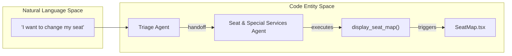
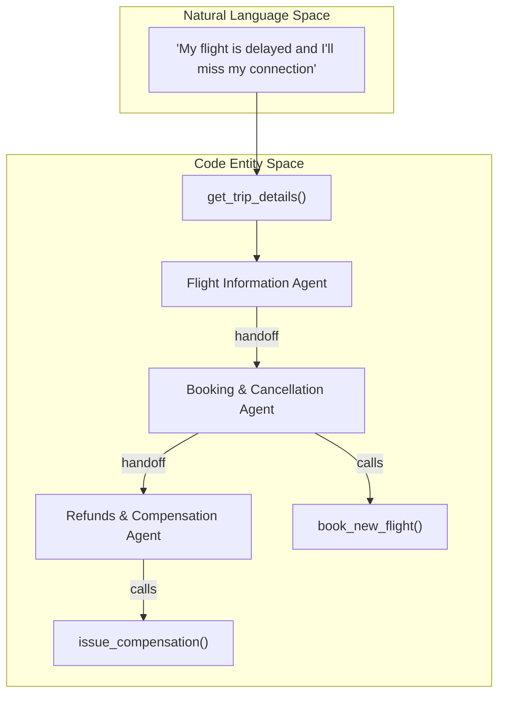

<!-- source: DeepWiki mcp.deepwiki.com · repo openai/openai-cs-agents-demo · page 6 Demo Scenarios · fetched 2026-10-26 -->

# Demo Scenarios

Relevant source files

The following files were used as context for generating this wiki page:

- [README.md](README.md)
- [python-backend/airline/demo_data.py](python-backend/airline/demo_data.py)

This document provides a high-level walkthrough of customer service interactions using the OpenAI Agents SDK demo system. It introduces the two primary mock itineraries used to hydrate the agent's context and demonstrates agent routing, tool execution, and guardrail enforcement.

For technical details about the agent system architecture, see [Agent System](#3). For frontend implementation details, see [Frontend Application](#4).

## Mock Itineraries (Demo Data)

The system uses two predefined scenarios in `MOCK_ITINERARIES` to provide a realistic context for the agents. These are defined in [python-backend/airline/demo_data.py:7-80]().

| Scenario Key | Passenger | Confirmation | Flight(s) | Status |
| :--- | :--- | :--- | :--- | :--- |
| `on_time` | Taylor Lee | `LL0EZ6` | FLT-123 | On time, operating as scheduled. |
| `disrupted` | Morgan Lee | `IR-D204` | PA441, NY802 | PA441 delayed 5h; connection NY802 missed. |

The `apply_itinerary_defaults` function [python-backend/airline/demo_data.py:83-100]() hydrates the `AirlineAgentContext` [python-backend/airline/context.py:11-23]() with this data based on the user's flight or confirmation number.

Sources: [python-backend/airline/demo_data.py:7-100](), [python-backend/airline/context.py:11-23]()

---

## Scenario 1: Seat Change Request Flow

This flow uses the `on_time` scenario. It demonstrates the transition from a general inquiry to a specialized task involving an interactive UI component.

1.  **Triage**: The `Triage Agent` identifies the seat change intent and hands off to the `Seat & Special Services Agent`.
2.  **Tool Execution**: The agent calls `display_seat_map`, which sends a tool call to the frontend.
3.  **Interactive UI**: The frontend renders the `SeatMap` component [ui/components/SeatMap.tsx:10-155]().
4.  **Update**: Once a seat is selected, `update_seat` is called to commit the change to the context.

For a detailed step-by-step walkthrough, see **[Seat Change Request Flow](#6.1)**.

### Seat Change Logic Bridge

Sources: [README.md:96-108](), [ui/components/SeatMap.tsx:10-155]()

---

## Scenario 2: Guardrail Enforcement

This scenario demonstrates how the system maintains safety and relevance. Guardrails are implemented in `guardrails.py` and evaluated before the main agent loop processes the input [python-backend/airline/guardrails.py:53-104]().

*   **Relevance Guardrail**: Prevents off-topic discussion (e.g., asking for a poem).
*   **Jailbreak Guardrail**: Prevents attempts to extract system instructions.

When a guardrail is triggered, it returns a `GuardrailFunctionOutput` with `tripwire_triggered=True` [python-backend/airline/guardrails.py:18-21](). The UI responds by highlighting the guardrail section in red.

For specific examples and UI screenshots, see **[Guardrail Enforcement Examples](#6.2)**.

Sources: [python-backend/airline/guardrails.py:18-104](), [README.md:135-146]()

---

## Scenario 3: Irregular Operations (IROP) Flow

This is the most complex scenario, utilizing the `disrupted` itinerary [python-backend/airline/demo_data.py:8-59](). It showcases a chain of specialized agents working together to resolve a missed connection.

1.  **Context Hydration**: `get_trip_details` pulls the "Paris to Austin" itinerary.
2.  **Analysis**: `Flight Information Agent` identifies the 5-hour delay on PA441 and the missed connection for NY802.
3.  **Rebooking**: `Booking & Cancellation Agent` uses `get_matching_flights` to find NY950 and `book_new_flight` to update the reservation.
4.  **Resolution**: `Refunds & Compensation Agent` issues vouchers for hotels and meals using `issue_compensation`.

For the full technical trace of this flow, see **[Irregular Operations (IROP) Flow](#6.3)**.

### IROP Multi-Agent Bridge

Sources: [README.md:148-165](), [python-backend/airline/demo_data.py:8-59]()

---

