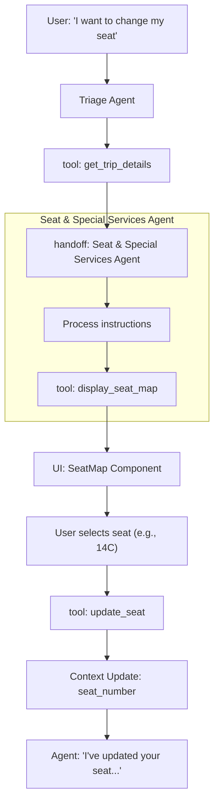
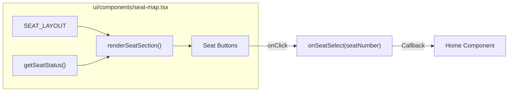

<!-- source: DeepWiki mcp.deepwiki.com · repo openai/openai-cs-agents-demo · page 6.1 Seat Change Request Flow · fetched 2026-10-26 -->

# Seat Change Request Flow

<details>
<summary>Relevant source files</summary>

The following files were used as context for generating this wiki page:

- [python-backend/airline/agents.py](python-backend/airline/agents.py)
- [python-backend/airline/tools.py](python-backend/airline/tools.py)
- [ui/components/runner-output.tsx](ui/components/runner-output.tsx)
- [ui/components/seat-map.tsx](ui/components/seat-map.tsx)

</details>


## Purpose and Scope

This document provides a detailed technical walkthrough of the seat change request flow in the Customer Service Agents Demo. It covers the complete end-to-end process using the `on_time` scenario (Flight FLT-123, confirmation LL0EZ6). The flow demonstrates the transition from the `Triage Agent` to the `Seat & Special Services Agent`, the invocation of the `display_seat_map` tool to trigger interactive UI, and the final commitment of data via the `update_seat` tool.

For information about the individual agent capabilities and routing logic, see [3.1. Agent Types and Capabilities](). For details about the UI components architecture, see [4.1. UI Components]().

## Flow Overview

The seat change request flow showcases the system's ability to intelligently route user intents through specialized agents while providing interactive tools for seat selection.



Sources: [python-backend/airline/agents.py:49-56](), [python-backend/airline/tools.py:44-50](), [python-backend/airline/tools.py:78-86]()

## Step-by-Step Technical Breakdown

### 1. Intent Recognition and Context Hydration
When the user requests a seat change, the `Triage Agent` first identifies the need for trip context. It calls `get_trip_details` [python-backend/airline/tools.py:48-50](). Since the user is in the `on_time` scenario, this tool hydrates the `AirlineAgentChatContext` with the default itinerary for FLT-123 [python-backend/airline/tools.py:57-58]().

The `Triage Agent` then performs a handoff to the `Seat & Special Services Agent` [python-backend/airline/agents.py:52]().

### 2. Specialist Agent Execution
The `Seat & Special Services Agent` receives the context, including the `confirmation_number` (LL0EZ6) and `flight_number` (FLT-123) [python-backend/airline/agents.py:31-34](). Following its instructions [python-backend/airline/agents.py:40-41](), it calls the `display_seat_map` tool.

### 3. Interactive Seat Map (Frontend)
The `display_seat_map` tool returns a specific signal that the frontend interprets to render the `SeatMap` component [ui/components/seat-map.tsx:29]().

**Data Structures used in `SeatMap`:**
*   **`SEAT_LAYOUT`**: Defines the grid for Business, Economy Plus, and Economy [ui/components/seat-map.tsx:12-19]().
*   **`OCCUPIED_SEATS`**: A hardcoded `Set` of seats that are rendered as disabled [ui/components/seat-map.tsx:21-25]().
*   **`EXIT_ROWS`**: Rows 4 and 16 are flagged for special styling [ui/components/seat-map.tsx:27]().



Sources: [ui/components/seat-map.tsx:12-28](), [ui/components/seat-map.tsx:30-34](), [ui/components/seat-map.tsx:66-70]()

### 4. Committing the Change
Once the user clicks a seat (e.g., "14C"), the selection is sent back to the agent. The agent then invokes the `update_seat` tool [python-backend/airline/tools.py:78-80]().

**Tool Implementation:**
```python
# python-backend/airline/tools.py:78-86
async def update_seat(
    context: RunContextWrapper[AirlineAgentChatContext], confirmation_number: str, new_seat: str
) -> str:
    apply_itinerary_defaults(context.context.state)
    context.context.state.confirmation_number = confirmation_number
    context.context.state.seat_number = new_seat
    return f"Updated seat to {new_seat} for confirmation number {confirmation_number}"
```

This updates the `AirlineAgentChatContext` state, which is then reflected in the **Agent Panel** under "Conversation Context" [ui/components/runner-output.tsx:103-109]().

## Observability in the Agent Panel

As this flow executes, the `RunnerOutput` component [ui/components/runner-output.tsx:16-18]() visualizes the backend events:

1.  **`handoff`**: Shows the transition from `triage` to `Seat and Special Services Agent` [ui/components/runner-output.tsx:91-92]().
2.  **`tool_call`**: Displays the call to `display_seat_map` with arguments [ui/components/runner-output.tsx:93-97]().
3.  **`context_update`**: Visualizes the change in `seat_number` within the state [ui/components/runner-output.tsx:103-109]().

| Event Type | Visual Indicator | Source |
| :--- | :--- | :--- |
| `handoff` | `ArrowRightLeft` icon | [ui/components/runner-output.tsx:27-28]() |
| `tool_call` | `Wrench` icon | [ui/components/runner-output.tsx:29-30]() |
| `context_update` | `RefreshCw` icon | [ui/components/runner-output.tsx:33-34]() |

Sources: [ui/components/runner-output.tsx:24-38](), [ui/components/runner-output.tsx:65-87]()

---

