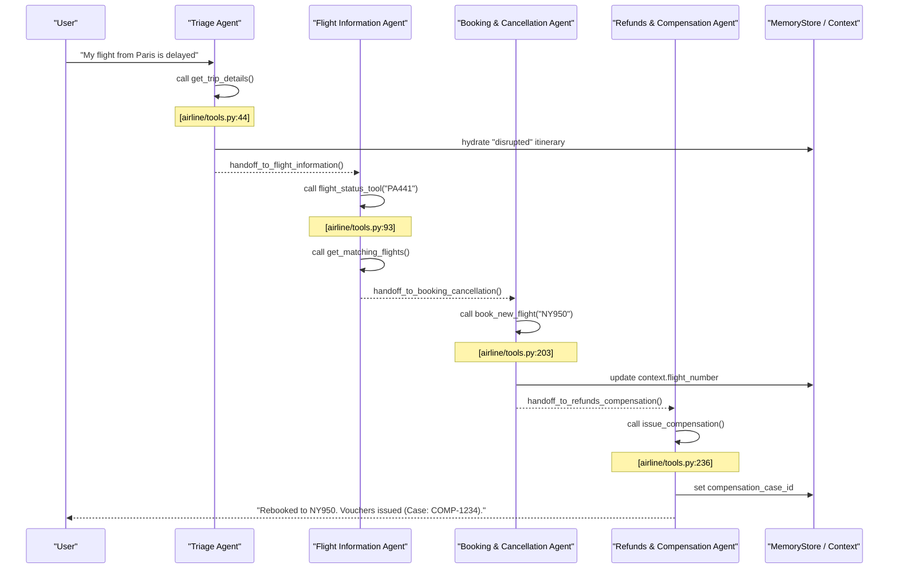
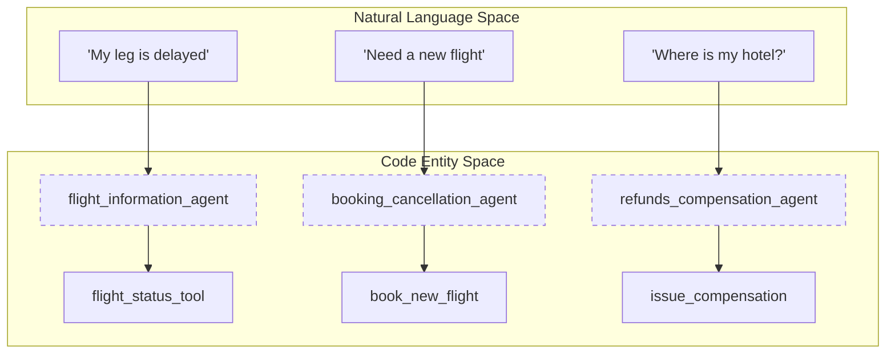

<!-- source: DeepWiki mcp.deepwiki.com · repo openai/openai-cs-agents-demo · page 6.3 Irregular Operations (IROP) Flow · fetched 2026-10-26 -->

# Irregular Operations (IROP) Flow

Relevant source files

The following files were used as context for generating this wiki page:

- [README.md](README.md)
- [python-backend/airline/agents.py](python-backend/airline/agents.py)
- [python-backend/airline/demo_data.py](python-backend/airline/demo_data.py)
- [python-backend/airline/tools.py](python-backend/airline/tools.py)

The Irregular Operations (IROP) flow demonstrates the multi-agent system's ability to handle complex, multi-step disruptions. This scenario involves a passenger traveling from Paris to Austin via New York where a significant delay on the first leg triggers a chain of events: identifying a missed connection, searching for alternates, rebooking, and issuing compensation vouchers.

## Scenario Overview
The system uses a pre-defined "disrupted" itinerary to simulate this complex state. 
- **Route**: Paris (CDG) → New York (JFK) → Austin (AUS) [python-backend/airline/demo_data.py:8-33]().
- **Primary Disruption**: Flight PA441 is delayed 5 hours, causing a missed connection for NY802 [python-backend/airline/demo_data.py:21-30]().
- **Resolution Path**: Rebook to NY950 and issue hotel/meal vouchers [python-backend/airline/demo_data.py:34-58]().

## Data Flow and Orchestration
The flow transitions through four specialized agents, each performing autonomous tool calls and handoffs based on the state hydrated in the `AirlineAgentChatContext`.

### 1. Context Hydration (Triage Agent)
The interaction begins with the **Triage Agent**. When a user mentions keywords like "Paris" or "delayed", the agent invokes `get_trip_details` [python-backend/airline/tools.py:44-54]().
- **Implementation**: `get_trip_details` scans the message for keywords ("paris", "new york", "austin") and calls `apply_itinerary_defaults` with the `scenario_key="disrupted"` [python-backend/airline/tools.py:55-58]().
- **Result**: The `AirlineAgentContext` is populated with the `MOCK_ITINERARIES["disrupted"]` data, including confirmation `IR-D204` [python-backend/airline/demo_data.py:11]().

### 2. Status Analysis (Flight Information Agent)
Triage hands off to the **Flight Information Agent**.
- **Tool Call**: The agent calls `flight_status_tool(flight_number="PA441")` [python-backend/airline/agents.py:70]().
- **Logic**: The tool identifies the 5-hour delay and explicitly returns a recommendation for reaccommodation because of the missed connection to NY802 [python-backend/airline/tools.py:120-121]().
- **Autonomous Handoff**: Per its instructions, the agent then calls `get_matching_flights` to find alternates (NY950, NY982) and hands off to the **Booking & Cancellation Agent** [python-backend/airline/agents.py:71-72]().

### 3. Rebooking (Booking & Cancellation Agent)
The **Booking & Cancellation Agent** secures the new travel arrangements.
- **Tool Call**: It executes `book_new_flight(new_flight_number="NY950")` [python-backend/airline/agents.py:97]().
- **Logic**: This tool updates the context's `flight_number` and `itinerary` to reflect the new segment [python-backend/airline/tools.py:209-223]().
- **Transition**: After rebooking, the agent follows its instruction hierarchy to hand off to the **Refunds & Compensation Agent** since a disruption is active [python-backend/airline/agents.py:101]().

### 4. Compensation (Refunds & Compensation Agent)
The final stage handles "duty-of-care" requirements.
- **Policy Check**: The agent may call `faq_lookup_tool` to confirm compensation rules for delays over 3 hours [python-backend/airline/tools.py:26-31]().
- **Tool Call**: It executes `issue_compensation()` [python-backend/airline/agents.py:126]().
- **Logic**: The tool generates a random `case_id` (e.g., "COMP-XXXX") and retrieves voucher details (hotel, meal, ground) from the `MOCK_ITINERARIES["disrupted"]["vouchers"]` object [python-backend/airline/tools.py:241-255]().

## Technical Sequence Diagram

The following diagram illustrates the transition between Natural Language intent and the underlying Python functions and Agent classes.

### IROP Multi-Agent Sequence

**Sources**: [python-backend/airline/agents.py:59-130](), [python-backend/airline/tools.py:44-255](), [python-backend/airline/demo_data.py:7-59]()

## Implementation Detail: Context Hydration
The transition from a string "Paris" to a complex object is handled by `apply_itinerary_defaults`.

| Function | File:Line | Purpose |
| :--- | :--- | :--- |
| `get_trip_details` | [python-backend/airline/tools.py:44]() | Entry point for detecting the IROP scenario from user text. |
| `apply_itinerary_defaults` | [python-backend/airline/demo_data.py:83]() | Merges `MOCK_ITINERARIES` data into the `AirlineAgentContext`. |
| `active_itinerary` | [python-backend/airline/demo_data.py:116]() | Resolves which scenario is currently active for tool logic. |

### Mapping Natural Language to Code Entities
This diagram maps the user's conceptual requests to the specific Agent classes and Tool functions defined in the codebase.

**Sources**: [python-backend/airline/agents.py:77-113](), [python-backend/airline/tools.py:89-236]()

## UI Representation
During this flow, the `AgentPanel` in the Next.js frontend visualizes the transitions:
1. **Agent Badge**: Changes from "Triage" → "Flight Information" → "Booking and Cancellation" → "Refunds and Compensation".
2. **Context View**: The `itinerary` array in the context state is updated in real-time as `book_new_flight` modifies the segments [python-backend/airline/tools.py:220-223]().
3. **Runner Output**: Displays `ProgressUpdateEvent` messages such as "Checking status for PA441..." emitted via `context.context.stream()` [python-backend/airline/tools.py:97]().

**Sources**: [ui/components/agent-panel.tsx:1-100](), [python-backend/airline/tools.py:97]()

---

