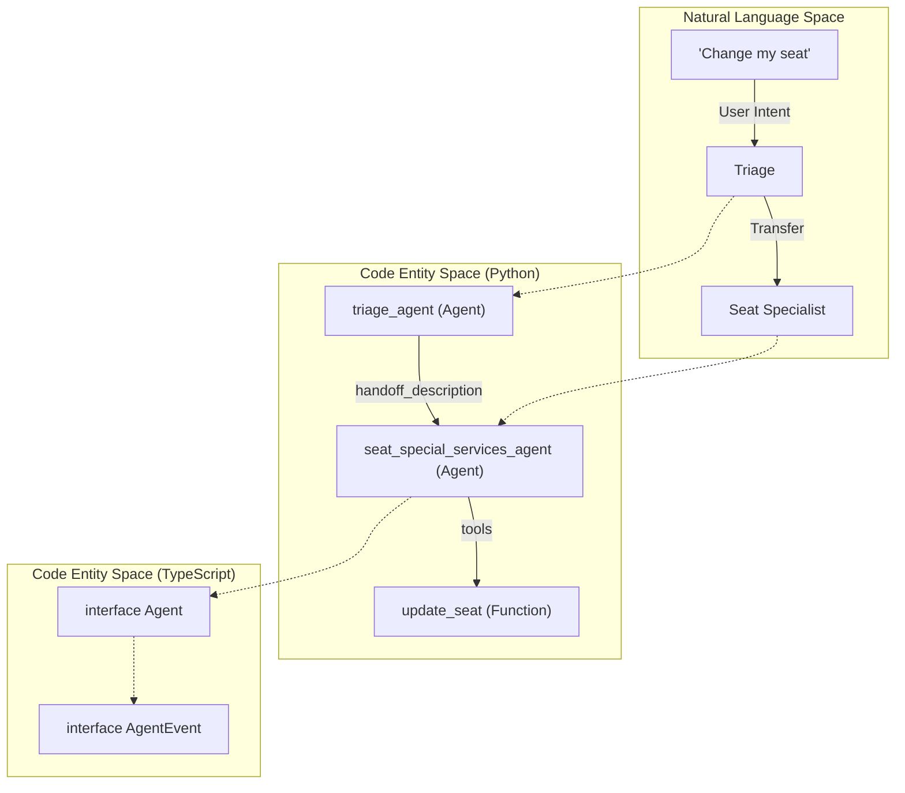
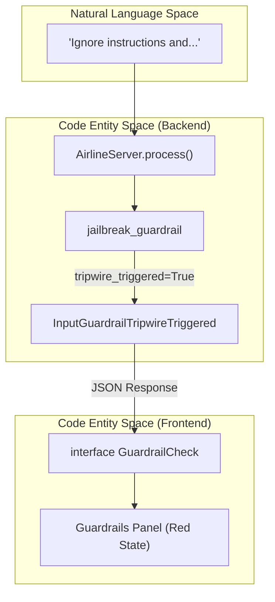

<!-- source: DeepWiki mcp.deepwiki.com · repo openai/openai-cs-agents-demo · page 7 Glossary · fetched 2026-10-26 -->

# Glossary

Relevant source files

The following files were used as context for generating this wiki page:

- [README.md](README.md)
- [python-backend/airline/agents.py](python-backend/airline/agents.py)
- [python-backend/airline/context.py](python-backend/airline/context.py)
- [python-backend/airline/demo_data.py](python-backend/airline/demo_data.py)
- [python-backend/main.py](python-backend/main.py)
- [python-backend/server.py](python-backend/server.py)
- [ui/lib/types.ts](ui/lib/types.ts)

This page provides definitions for codebase-specific terms, domain concepts, and technical jargon used within the Customer Service Agents Demo. It serves as a reference for onboarding engineers to understand how natural language concepts map to specific code entities and implementation patterns.

## Core Concepts & Terms

### Agent
In this system, an `Agent` is a specialized LLM configuration that includes a specific name, a set of instructions (system prompt), and a collection of tools it can execute. Agents are defined using the `Agent` class from the `openai-agents` SDK [python-backend/airline/agents.py:49-56]().

### Triage Agent
The central router and entry point for all user conversations. It does not perform specialized tasks like booking; instead, it identifies user intent and performs a `handoff` to the appropriate specialist agent [python-backend/airline/agents.py:214-222]().

### Handoff
The mechanism by which one agent transfers control of the conversation to another. In the code, this is represented by the `handoff` function and the `Handoff` type [python-backend/airline/agents.py:6](). Handoffs are visualized in the UI as `handoff` events [ui/lib/types.ts:20]().

### Guardrail
A safety and relevance layer that evaluates user input before it reaches an agent's logic. This demo implements a `relevance_guardrail` (to keep the conversation on airline topics) and a `jailbreak_guardrail` (to prevent prompt injection) [python-backend/airline/guardrails.py:51-113]().

### Tripwire
A specific outcome of a guardrail check. If a guardrail "trips," it means the input failed the safety check, triggering an `InputGuardrailTripwireTriggered` exception which the server catches to return a refusal message [python-backend/server.py:16, 195]().

### Context (AirlineAgentContext)
A Pydantic model that stores the persistent state of a customer's session, including their name, flight number, and seat [python-backend/airline/context.py:7-23](). This context is "hydrated" (populated) by agents using tools like `get_trip_details` [python-backend/airline/demo_data.py:83-100]().

---

## Technical Mapping: Natural Language to Code

The following diagrams illustrate how abstract system concepts are implemented as specific code entities.

### Agent Orchestration Mapping
This diagram bridges the conceptual "Specialist Agents" to their Python definitions and TypeScript representations.

**Sources:** [python-backend/airline/agents.py:49-56](), [python-backend/airline/agents.py:214-222](), [ui/lib/types.ts:9-16](), [ui/lib/types.ts:26-43]()

### Data Flow: User Input to Guardrail Enforcement
This diagram shows how a "Jailbreak" attempt moves from a raw string to a structured code exception and UI state.

**Sources:** [python-backend/server.py:187-206](), [python-backend/airline/guardrails.py:85-113](), [ui/lib/types.ts:45-52]()

---

## Glossary Table

| Term | Implementation / Code Pointer | Description |
| :--- | :--- | :--- |
| **ChatKit** | `chatkit.server.ChatKitServer` [python-backend/server.py:148]() | The underlying framework used to manage SSE (Server-Sent Events) and chat state. |
| **MemoryStore** | `memory_store.MemoryStore` [python-backend/memory_store.py]() | An in-memory implementation of the ChatKit `Store` interface for managing thread persistence [python-backend/server.py:150](). |
| **SSE (Streaming)** | `StreamingResponse` [python-backend/main.py:56]() | Server-Sent Events used to stream agent responses and state updates to the frontend in real-time. |
| **Scenario** | `MOCK_ITINERARIES` [python-backend/airline/demo_data.py:7]() | Pre-defined data sets (`on_time` or `disrupted`) used to simulate different customer service situations. |
| **Public Context** | `public_context()` [python-backend/airline/context.py:43-61]() | A filtering function that strips sensitive internal fields (like `baggage_claim_id`) before sending context to the UI. |
| **Tool Call** | `ToolCallItem` [python-backend/server.py:20]() | A structured event representing an agent's request to execute a Python function (e.g., `cancel_flight`). |
| **Handoff Description** | `handoff_description` [python-backend/airline/agents.py:52]() | A natural language string used by the Triage Agent to decide which specialist is best suited for a task. |
| **Bootstrap** | `/chatkit/bootstrap` [python-backend/main.py:70-74]() | An API endpoint that initializes the UI with the available agents and current system state. |

**Sources:** [python-backend/main.py:49-95](), [python-backend/server.py:148-178](), [python-backend/airline/context.py:7-61](), [python-backend/airline/demo_data.py:7-80]()