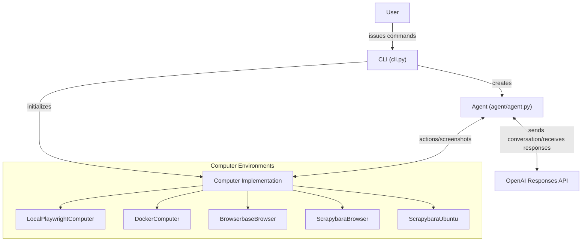
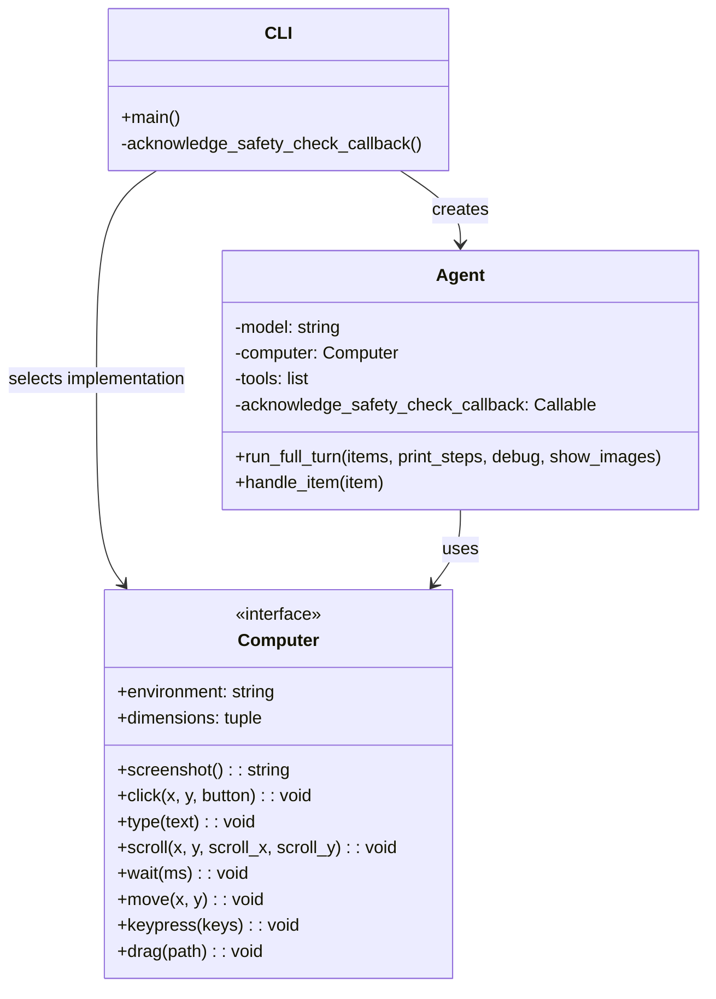
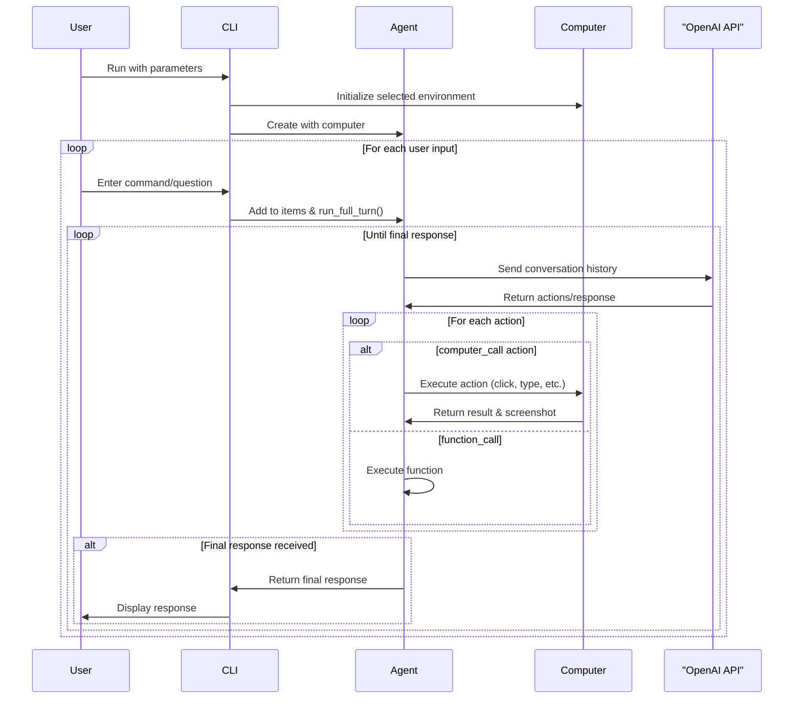
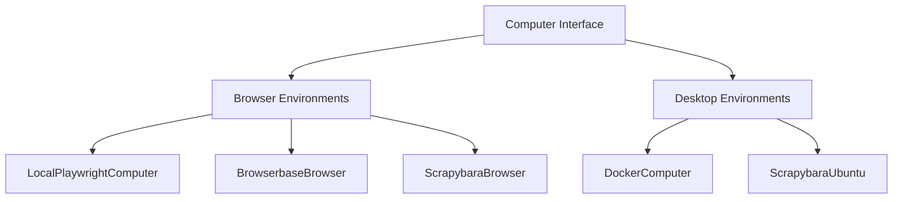

<!-- source: DeepWiki mcp.deepwiki.com · repo openai/openai-cua-sample-app · page 1 Overview · fetched 2026-10-26 -->

# Overview

Relevant source files

The following files were used as context for generating this wiki page:

- [README.md](README.md)

This document provides an introduction to the OpenAI Computer Using Agent (CUA) Sample App, a reference implementation that demonstrates how to build agents capable of using computer interfaces through the OpenAI API. The sample app includes a flexible architecture that supports multiple computer environments and provides a foundation for developing your own CUA applications.

## What is a Computer Using Agent?

A Computer Using Agent (CUA) is an AI agent that can interact with computer interfaces by performing actions like clicking, typing, and scrolling based on visual information from screenshots. The agent uses the OpenAI model to:

1. Understand what's visible on the screen
2. Decide what actions to take
3. Execute those actions through a defined computer interface

Sources: [README.md:34-38]()

## System Architecture

The sample app is built around a modular architecture with clean separation of concerns, making it extensible and adaptable to different environments.

Sources: [cli.py:3-9](), [cli.py:58-66](), [README.md:40-47]()

## Core Components

The system consists of three main components:

1. **Command Line Interface (CLI)**: The primary entry point for the application that initializes the selected computer environment and creates an agent to interact with it.

2. **Agent**: Manages the interaction between the user, OpenAI model, and computer environment. It processes user input, obtains actions from the model, and executes them on the computer.

3. **Computer**: An abstraction that defines a consistent interface for interacting with different computing environments, with implementations for various platforms (browsers, desktop environments, etc.).

Sources: [cli.py:18-100](), [README.md:40-47]()

## Execution Flow

The typical execution flow in the CUA sample app follows this pattern:

Sources: [cli.py:81-97](), [README.md:34-38]()

## Computer Environments

The sample app provides several computer environment implementations:

| Environment | Type | Description | Implementation |
|-------------|------|-------------|----------------|
| LocalPlaywrightComputer | Browser | Uses Playwright to control a local browser | `computers/local_playwright_computer.py` |
| DockerComputer | Linux | Controls a Docker container with VNC | `computers/docker_computer.py` |
| BrowserbaseBrowser | Browser | Uses Browserbase remote browser service | `computers/browserbase_browser.py` |
| ScrapybaraBrowser | Browser | Uses Scrapybara remote browser service | `computers/scrapybara_browser.py` |
| ScrapybaraUbuntu | Linux | Uses Scrapybara remote Ubuntu desktop | `computers/scrapybara_ubuntu.py` |

Sources: [cli.py:3-9](), [cli.py:58-66](), [README.md:92-98]()

## Actions Supported by Computer Environments

All computer environments support a standard set of actions that allow the agent to interact with the interface:

| Action | Description | Example |
|--------|-------------|---------|
| `click(x, y, button)` | Click at specific coordinates | `click(24, 150)` |
| `double_click(x, y)` | Double-click at specific coordinates | `double_click(24, 150)` |
| `scroll(x, y, scroll_x, scroll_y)` | Scroll at specific coordinates | `scroll(24, 150, 0, -100)` |
| `type(text)` | Type the specified text | `type("Hello, World!")` |
| `wait(ms)` | Wait for specified milliseconds | `wait(2000)` |
| `move(x, y)` | Move cursor to coordinates | `move(24, 150)` |
| `keypress(keys)` | Press specified keys | `keypress(["CTRL", "C"])` |
| `drag(path)` | Drag along a path | `drag([[24, 150], [100, 200]])` |

Sources: [README.md:79-88]()

## Getting Started

To get started with the CUA sample app, you'll typically:

1. **Select a computer environment**: Choose from local browser, Docker container, or cloud-based options
2. **Initialize the environment**: Set up the selected environment with necessary parameters
3. **Create an agent**: Create an agent instance that will interact with the environment
4. **Start the interaction loop**: Begin accepting user input and passing it to the agent

The CLI provides a convenient way to start the application with different configurations using command-line arguments.

Sources: [README.md:8-22](), [cli.py:18-100]()

## Related Pages

- For detailed information about the system architecture, see [Architecture Overview](#1.1)
- For more about core concepts, see [Core Concepts](#1.2)
- For details about the CLI, see [Command Line Interface](#2)
- For in-depth explanation of the Computer abstraction, see [Computer Abstraction](#3)
- For information about the Agent system, see [Agent System](#4)

---

