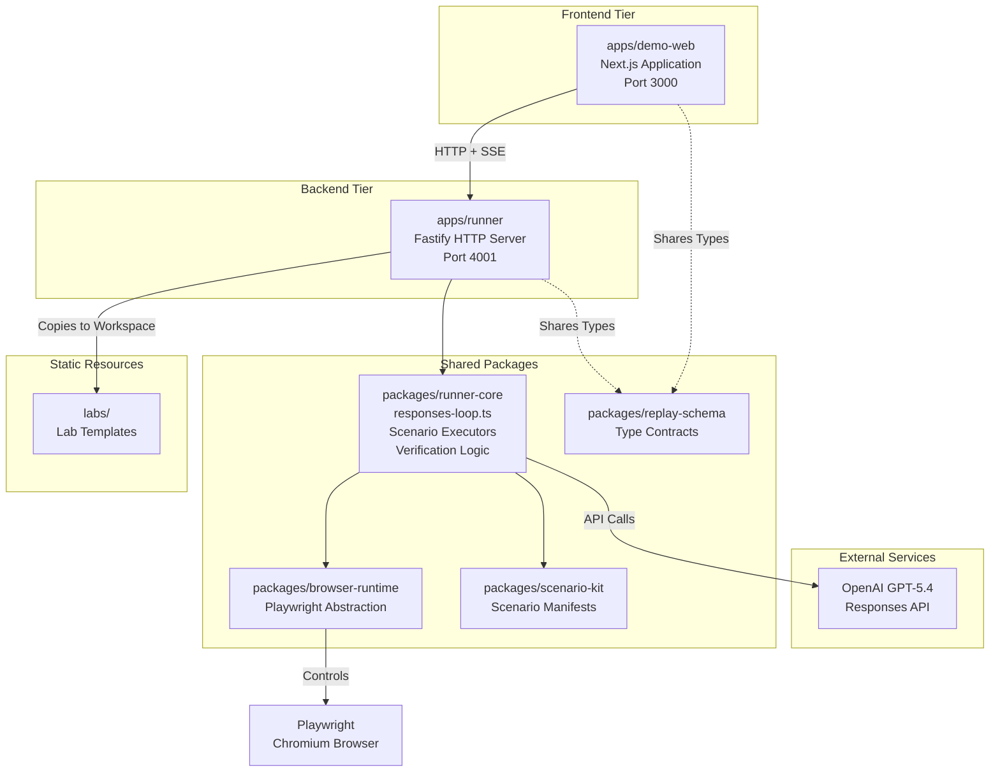
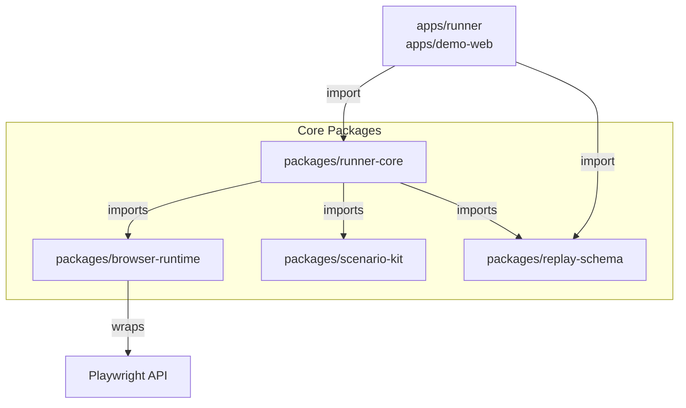
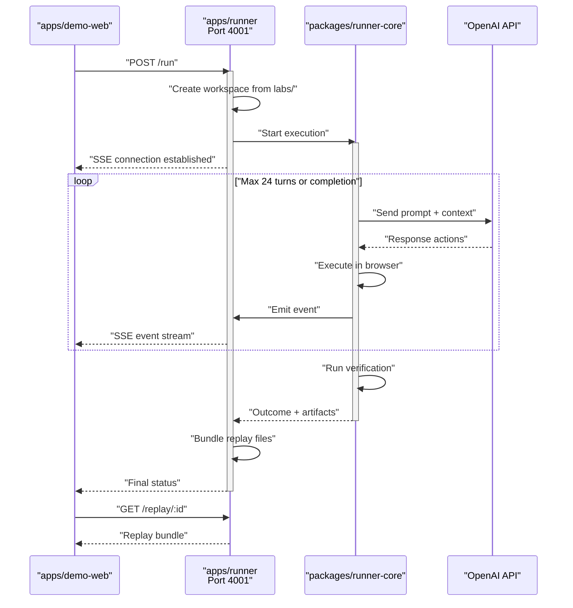
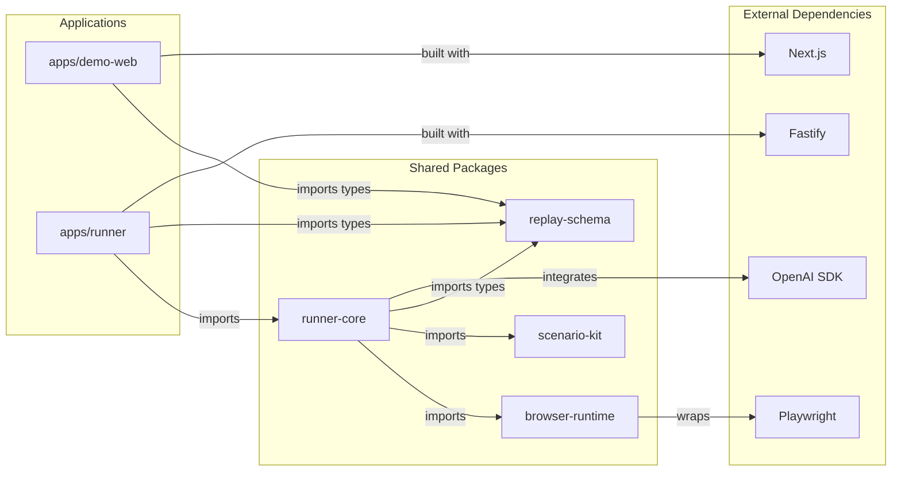
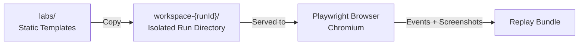

<!-- source: DeepWiki mcp.deepwiki.com · repo openai/openai-cua-sample-app · page 1.1 Architecture Overview · fetched 2026-10-26 -->

# Architecture Overview

Relevant source files

The following files were used as context for generating this wiki page:

- [README.md](README.md)

## Purpose and Scope

This document provides a high-level view of the openai-cua-sample-app system architecture, focusing on the structural organization of applications and packages, their dependencies, and communication patterns. For conceptual definitions of scenarios, workspaces, and execution modes, see [Core Concepts](#1.2). For detailed information about the Responses API integration, see [Responses API Integration](#5).

The architecture follows a three-tier design:
1. **Frontend**: Next.js operator console for initiating runs and viewing results
2. **Backend**: Fastify service managing execution orchestration and workspace isolation
3. **Shared Packages**: Reusable business logic for scenario execution, browser control, and type contracts

## System Architecture

**Sources**: [README.md:1-123]()

The most critical component in this architecture is `packages/runner-core`, which contains [packages/runner-core/src/responses-loop.ts](), the canonical integration point for the OpenAI Responses API.

## Applications

The monorepo contains two main applications that run as separate Node.js processes:

| Application | Technology | Default Port | Primary Responsibility |
|------------|------------|--------------|------------------------|
| `apps/demo-web` | Next.js 15 | 3000 | Operator console UI for initiating runs and viewing replay bundles |
| `apps/runner` | Fastify 5 | 4001 | HTTP/SSE server, workspace management, browser session orchestration |

### apps/demo-web

The operator console is a Next.js application that provides the user interface for:
- Selecting scenarios and configuring execution parameters
- Starting new runs via HTTP POST requests
- Receiving real-time updates via Server-Sent Events (SSE)
- Displaying replay bundles (screenshots, events, verification results)

The application reads configuration from `apps/demo-web/.env.local` and communicates with the runner service via the `RUNNER_BASE_URL` environment variable (default: `http://127.0.0.1:4001`).

**Sources**: [README.md:5](), [README.md:108-109](), [README.md:136-139]()

### apps/runner

The runner service is a Fastify application responsible for:
- Serving HTTP endpoints for run creation and status queries
- Streaming real-time events via SSE during execution
- Creating isolated workspaces by copying lab templates from `labs/`
- Managing Playwright browser sessions
- Delegating execution to `packages/runner-core`
- Bundling replay artifacts for operator review

The service reads configuration from the repository root `.env` file and exposes endpoints on `HOST:PORT` (default: `127.0.0.1:4001`).

**Sources**: [README.md:6](), [README.md:110-111](), [README.md:127-134]()

## Core Packages

The shared packages provide reusable functionality across both applications:

**Sources**: [README.md:7](), [README.md:112-121]()

### packages/runner-core

The orchestration hub containing:
- **responses-loop.ts**: The canonical Responses API integration point
- Scenario executors for `kanban`, `paint`, and `booking` scenarios
- Verification logic for drag-and-drop state, canvas state, and form completion
- Event capture and replay bundle generation

This package has the most dependencies, integrating browser control, scenario definitions, and OpenAI API interactions.

**Sources**: [README.md:13](), [README.md:118-119]()

### packages/browser-runtime

A Playwright abstraction layer providing:
- Browser session lifecycle management
- Page navigation and interaction primitives
- Screenshot capture
- Event recording for replay bundles

This package wraps Playwright to provide a stable interface for browser automation regardless of execution mode.

**Sources**: [README.md:116-117]()

### packages/scenario-kit

Contains scenario manifest definitions that specify:
- Scenario identifiers and display names
- Lab template paths
- Default prompts and task descriptions
- Verification requirements

The manifests provide a declarative interface for defining new scenarios without modifying core execution logic.

**Sources**: [README.md:114-115]()

### packages/replay-schema

A pure contract layer defining shared TypeScript types for:
- HTTP request and response payloads
- SSE event structures
- Replay bundle formats
- Error codes and messages

Both `apps/demo-web` and `apps/runner` import this package to ensure type consistency across the HTTP/SSE boundary.

**Sources**: [README.md:112-113]()

## Communication Architecture

The system uses two communication patterns between the frontend and backend:

**Sources**: [README.md:5-6](), [README.md:139]()

### HTTP Endpoints

The runner service exposes RESTful endpoints for:
- **POST /run**: Initiate a new scenario execution with configuration
- **GET /runs/:id**: Query run status and metadata
- **GET /replay/:id**: Retrieve bundled replay artifacts

### Server-Sent Events (SSE)

Real-time execution updates stream from runner to console via SSE, delivering:
- Turn-by-turn progress indicators
- Screenshot captures
- Model actions and responses
- Verification results
- Error notifications

The default maximum of 24 response turns prevents infinite loops while allowing sufficient iterations for complex multi-step scenarios.

**Sources**: [README.md:6](), [README.md:139]()

## Package Dependency Graph

**Sources**: [README.md:7](), [README.md:108-121]()

This dependency structure ensures:
- **Separation of concerns**: Frontend and backend share only type contracts
- **Modularity**: Core packages can be tested and developed independently
- **Type safety**: `replay-schema` enforces consistent data structures across HTTP boundaries
- **Testability**: Execution logic in `runner-core` is decoupled from HTTP serving

## Execution Modes

The system supports two execution modes that share the same infrastructure but differ in how the model controls the browser:

| Mode | Environment Variable | Computer Tool | Description |
|------|---------------------|---------------|-------------|
| `native` | `CUA_RESPONSES_MODE=native` | Yes | Model emits raw computer actions (clicks, drags, typing) |
| `code` | `CUA_RESPONSES_MODE=code` | No | Model scripts browser via `exec_js` Playwright REPL |

Both modes:
- Use identical scenario manifests from `packages/scenario-kit`
- Execute through the same `responses-loop.ts` integration point
- Generate compatible replay bundles
- Support all three official scenarios

The mode selection affects only how `packages/runner-core` interprets model responses, not the overall architecture.

**Sources**: [README.md:92-96](), [README.md:14]()

## Workspace Isolation

Each run executes in an isolated workspace created by copying lab templates:

**Sources**: [README.md:120-121](), [README.md:15]()

This isolation ensures:
- **Deterministic starting conditions**: Each run begins from a known state
- **No cross-contamination**: Runs cannot interfere with each other
- **Clean verification**: Expected outcomes match lab template structure
- **Reproducibility**: Failed runs can be debugged using identical starting conditions

Workspaces are managed by `apps/runner` and populated from the `labs/` directory containing HTML, CSS, JavaScript, and asset files for each scenario.

---

