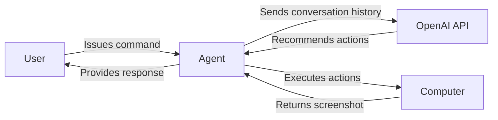
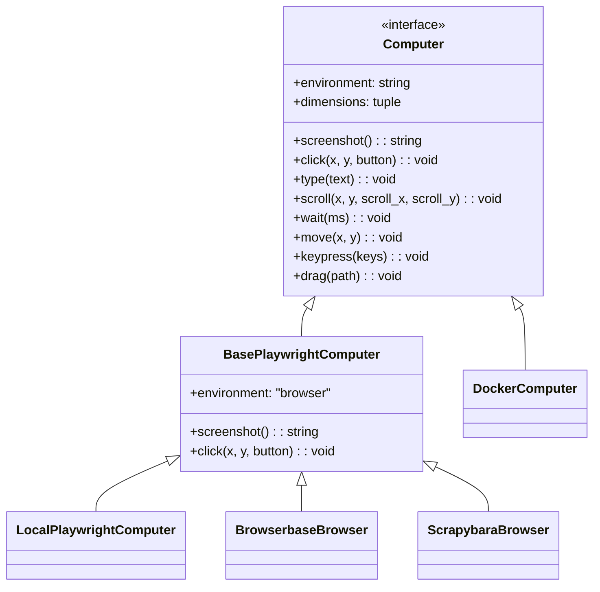
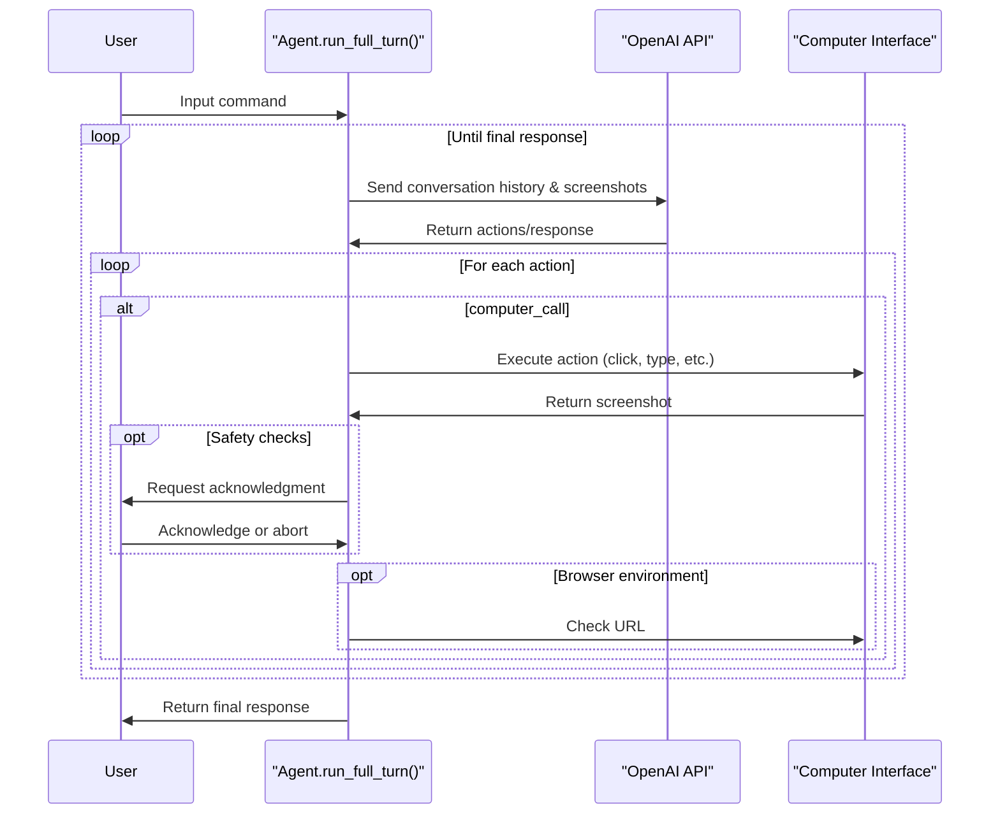
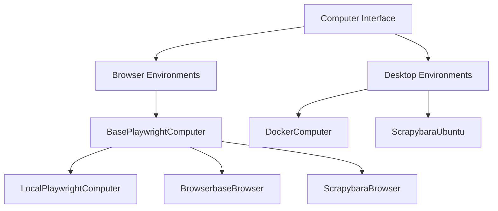
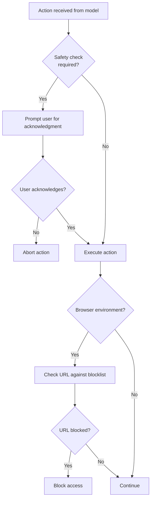

<!-- source: DeepWiki mcp.deepwiki.com · repo openai/openai-cua-sample-app · page 1.2 Core Concepts · fetched 2026-10-26 -->

# Core Concepts

Relevant source files

The following files were used as context for generating this wiki page:

- [README.md](README.md)

This document explains the key concepts underlying Computer Using Agents (CUAs) in the OpenAI CUA sample application. It covers the fundamental abstractions, interaction models, and environments that enable agents to control computer interfaces. For a higher-level overview of the system architecture, see [Architecture Overview](#1.1).

## What is a Computer Using Agent?

A Computer Using Agent (CUA) is an AI agent that can interact with computer interfaces by viewing screenshots and performing actions such as clicking, typing, scrolling, and other typical user interactions. It perceives the computer environment through screenshots and takes actions based on those visual inputs to accomplish tasks.

Sources: [README.md:34-38](), [simple_cua_loop.py:56-95]()

## Core Abstractions

The CUA sample app is built around two fundamental abstractions that provide a clean separation of concerns:

| Abstraction | Purpose | Implementation |
|-------------|---------|----------------|
| `Computer` | Interface for executing actions on different environments | `computers/computer.py` |
| `Agent` | Manages interaction between user, model, and computer | `agent/agent.py` |

### Computer Abstraction

The `Computer` interface provides a unified way to interact with various computing environments (local browsers, remote browsers, Docker containers, etc.). This abstraction handles the execution of actions like clicking, typing, and scrolling, while isolating the rest of the system from the specifics of the environment.

Sources: [README.md:40-47](), [README.md:76-89]()

### Agent Abstraction

The `Agent` class is responsible for managing the interaction loop between the user, the OpenAI model, and the computer environment. It handles:

1. Processing user input
2. Sending conversation history to the OpenAI API
3. Executing model-recommended actions
4. Performing safety checks
5. Returning responses to the user

Sources: [README.md:40-47](), [simple_cua_loop.py:13-53]()

## CUA Interaction Loop

The core interaction loop in a CUA system follows a well-defined sequence of steps that enable the agent to process user commands and interact with computing environments.

Sources: [simple_cua_loop.py:56-95](), [README.md:34-38]()

### Item Handling

Within the interaction loop, the agent must handle different types of items returned by the model:

1. **Messages**: Text responses from the model to the user
2. **Computer Calls**: Actions to be performed on the computer environment
3. **Function Calls**: Specialized functions that can be called directly

Each computer call results in:
1. Executing the action on the environment
2. Taking a screenshot
3. Processing any pending safety checks
4. Providing the screenshot back to the model

Sources: [simple_cua_loop.py:13-53]()

## Computer Environments

The CUA sample app supports multiple computer environments through the `Computer` interface abstraction. These environments fall into two main categories:

### Browser Environments

Browser environments provide access to web browsers. These are implemented using the `BasePlaywrightComputer` class, which uses Playwright for browser automation. Options include:

- `LocalPlaywrightComputer`: Uses a local browser window
- `BrowserbaseBrowser`: Uses a remote browser via Browserbase
- `ScrapybaraBrowser`: Uses a remote browser via Scrapybara

### Desktop Environments

Desktop environments provide access to complete operating system environments:

- `DockerComputer`: Uses a Docker container running Linux
- `ScrapybaraUbuntu`: Uses a remote Ubuntu desktop environment via Scrapybara

Sources: [README.md:90-98]()

## CUA Actions

Computer Using Agents interact with environments through a standard set of actions:

| Action | Example | Description |
|--------|---------|-------------|
| `click(x, y, button)` | `click(24, 150)` | Click at the specified coordinates |
| `double_click(x, y)` | `double_click(24, 150)` | Double-click at coordinates |
| `scroll(x, y, scroll_x, scroll_y)` | `scroll(24, 150, 0, -100)` | Scroll at position |
| `type(text)` | `type("Hello, World!")` | Type the specified text |
| `wait(ms)` | `wait(2000)` | Wait for milliseconds |
| `move(x, y)` | `move(24, 150)` | Move cursor to coordinates |
| `keypress(keys)` | `keypress(["CTRL", "C"])` | Press keyboard keys |
| `drag(path)` | `drag([[24, 150], [100, 200]])` | Drag from point to point |

Sources: [README.md:76-89]()

## Safety Mechanisms

The CUA sample app implements several safety mechanisms to prevent potentially harmful actions:

1. **Safety Checks**: Before executing certain actions, the agent may require explicit user acknowledgment.

2. **URL Blocking**: For browser environments, there's a mechanism to block access to certain websites.

3. **Docker DNS Restrictions**: When using the Docker environment, DNS settings can be used to restrict accessible websites.

The safety check process allows users to review potentially risky actions before they're executed, providing a critical layer of oversight.

Sources: [simple_cua_loop.py:5-10](), [simple_cua_loop.py:27-32](), [simple_cua_loop.py:45-49](), [README.md:150-154]()

## Function Calling Enhancement

In addition to standard computer actions, the `Agent` class supports function calling. This allows for:

1. Providing custom tools to the agent
2. Extending the computer interface with additional capabilities
3. Implementing higher-level functions not directly provided by the computer interface

When a function is both defined in `tools` and as a method on the `Computer` instance, the agent will route calls to the computer implementation. This is particularly useful for browser-specific functions like `back()` or `goto(url)` that may be difficult to perform through standard CUA actions.

Sources: [README.md:144-148]()

---

