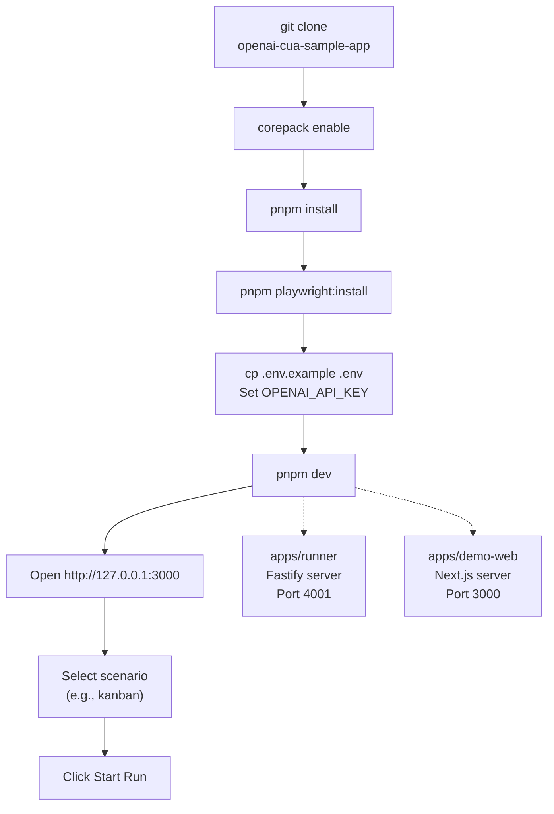
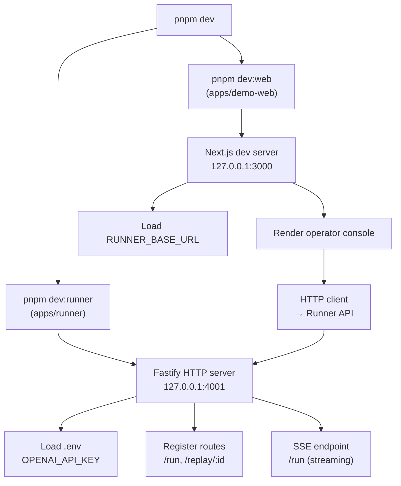

<!-- source: DeepWiki mcp.deepwiki.com · repo openai/openai-cua-sample-app · page 2 Getting Started · fetched 2026-10-26 -->

# Getting Started

<details>
<summary>Relevant source files</summary>

The following files were used as context for generating this wiki page:

- [.env.example](.env.example)
- [README.md](README.md)

</details>


This page provides a quick-start guide for setting up and running the openai-cua-sample-app for the first time. It covers the essential steps from cloning the repository to executing your first scenario with the Responses API. For detailed information on system prerequisites and installation troubleshooting, see [Prerequisites and Installation](#2.1). For a comprehensive list of development commands, see [Development Commands](#2.2). For a step-by-step walkthrough of scenario execution, see [Running Your First Scenario](#2.3).

## Setup Overview

The getting started process involves three main phases: installing dependencies, configuring your OpenAI API credentials, and starting the two-service architecture. The system consists of a Next.js frontend (`apps/demo-web`) running on port 3000 and a Fastify backend (`apps/runner`) running on port 4001.

**Setup Flow Diagram**



Sources: [README.md:18-64]()

## Prerequisites Summary

The following are required before installation:

| Component | Version | Purpose |
|-----------|---------|---------|
| Node.js | 22.20.0 | JavaScript runtime |
| pnpm | 10.26.0 | Package manager |
| Playwright Chromium | Latest | Browser automation |

Sources: [README.md:18-22]()

## Installation

Clone the repository and install dependencies:

```bash
git clone <repo-url>
cd openai-cua-sample-app
corepack enable
pnpm install
```

The `corepack enable` command ensures the correct version of pnpm is used. The `pnpm install` command installs all dependencies for both applications (`apps/demo-web` and `apps/runner`) and all shared packages.

Sources: [README.md:26-32]()

### Install Playwright Browser

Install the Chromium browser required by the `packages/browser-runtime` abstraction:

```bash
pnpm playwright:install
```

On Linux systems, additional OS-level dependencies are required:

```bash
pnpm playwright:install:with-deps
```

This command installs system libraries needed by Chromium. If Playwright later reports missing libraries, rerun this command.

Sources: [README.md:44-56]()

## Configuration

Copy the example environment file and configure your OpenAI API key:

```bash
cp .env.example .env
```

Edit `.env` and set the required variable:

```bash
OPENAI_API_KEY=your_key_here
```

The runner service (`apps/runner`) reads from the repository root `.env` file. The web application uses built-in defaults and optionally reads from `apps/demo-web/.env.local` for Next.js-specific overrides.

**Key Configuration Variables**

| Variable | Service | Default | Purpose |
|----------|---------|---------|---------|
| `OPENAI_API_KEY` | Runner | (required) | API authentication |
| `HOST` | Runner | `127.0.0.1` | Runner bind address |
| `PORT` | Runner | `4001` | Runner port |
| `CUA_DEFAULT_MODEL` | Runner | `gpt-5.4` | Model selection |
| `RUNNER_BASE_URL` | Web | `http://127.0.0.1:4001` | Runner endpoint |

For a complete list of configuration options, see [Environment Variables](#7.1).

Sources: [README.md:31-41](), [.env.example:1-11](), [README.md:125-141]()

## Starting the System

Start both services with a single command:

```bash
pnpm dev
```

This command launches both `apps/runner` and `apps/demo-web` simultaneously using the monorepo workspace configuration. The runner service starts first on port 4001, followed by the web interface on port 3000.

**Service Startup Architecture**



Sources: [README.md:58-62](), [README.md:66-73]()

### Separate Service Mode

For independent logs and debugging, run services separately:

```bash
# Terminal 1
pnpm dev:runner

# Terminal 2
RUNNER_BASE_URL=http://127.0.0.1:4001 pnpm dev:web
```

The `RUNNER_BASE_URL` environment variable configures the web application to connect to the runner service. This is useful when running services on different hosts or troubleshooting network issues.

Sources: [README.md:68-73]()

## Running Your First Scenario

Once both services are running, open the operator console at [http://127.0.0.1:3000](http://127.0.0.1:3000).

**First Run Workflow**

```mermaid
sequenceDiagram
    participant User
    participant DemoWeb["apps/demo-web<br/>(Port 3000)"]
    participant Runner["apps/runner<br/>(Port 4001)"]
    participant Core["packages/runner-core<br/>responses-loop.ts"]
    participant Playwright["Playwright<br/>Chromium"]
    
    User->>DemoWeb: "Navigate to http://127.0.0.1:3000"
    DemoWeb->>User: "Display scenario selection"
    User->>DemoWeb: "Select scenario (e.g., kanban)"
    User->>DemoWeb: "Keep Headless selected"
    User->>DemoWeb: "Click Start Run"
    
    DemoWeb->>Runner: "POST /run<br/>{scenarioId, config}"
    activate Runner
    
    Runner->>Runner: "Create workspace from labs/"
    Runner->>Playwright: "Launch browser session"
    Runner->>Core: "Start responses-loop.ts"
    
    loop "Up to 24 turns"
        Core->>Core: "Call Responses API"
        Core->>Playwright: "Execute actions"
        Core->>Runner: "Emit event"
        Runner->>DemoWeb: "SSE stream update"
    end
    
    Core->>Core: "Run verification"
    Core->>Runner: "Return outcome"
    deactivate Runner
    
    Runner->>DemoWeb: "Final status"
    DemoWeb->>User: "Display results"
```

The console displays three pre-configured scenarios:
- `kanban-reprioritize-sprint`: Drag-and-drop task prioritization
- `paint-draw-poster`: Canvas drawing and verification  
- `booking-complete-reservation`: Multi-step form completion

Select any scenario, keep the `Headless` checkbox selected (recommended for first run), and click **Start Run**. The system will:

1. Create an isolated workspace from `labs/` templates
2. Launch a Chromium browser session via `packages/browser-runtime`
3. Execute the scenario through `packages/runner-core/src/responses-loop.ts`
4. Stream live updates via Server-Sent Events (SSE)
5. Verify the outcome using scenario-specific verification logic
6. Generate a replay bundle with screenshots and events

For a detailed walkthrough with screenshots and troubleshooting, see [Running Your First Scenario](#2.3).

Sources: [README.md:64](), [README.md:98-104]()

## Verifying the Installation

A successful run displays:
- Live screenshot updates in the operator console
- Event stream showing model actions
- Final status indicating success or failure
- Replay bundle available for review

If the run completes successfully, the system is properly configured. The replay bundle contains:
- Screenshots at each turn
- Full event history
- Verification results
- Metadata about the run configuration

For more information on replay artifacts, see [Replay Bundles](#8.1).

**Common First-Run Issues**

| Issue | Likely Cause | Solution |
|-------|--------------|----------|
| Runner unreachable | Service not started | Verify `pnpm dev` output shows both services |
| API authentication error | Missing/invalid `OPENAI_API_KEY` | Check `.env` file configuration |
| Playwright missing | Browser not installed | Run `pnpm playwright:install` |
| Port conflict | Port 3000 or 4001 in use | Stop conflicting services or change `PORT`/`HOST` |

Sources: [README.md:64](), [README.md:150-157]()

## Next Steps

After completing your first run:

- **Explore execution modes**: Try switching between `native` and `code` mode by setting `CUA_RESPONSES_MODE` in `.env`. See [Native Mode](#5.2) and [Code Mode](#5.3).
- **Try other scenarios**: Execute `paint-draw-poster` or `booking-complete-reservation` to see different verification mechanisms. See [Official Scenarios](#6.2).
- **Review development commands**: Learn about linting, type checking, and testing. See [Development Commands](#2.2).
- **Understand the architecture**: Dive into how `responses-loop.ts` integrates with the Responses API. See [runner-core and responses-loop](#4.1).
- **Examine replay bundles**: Review captured screenshots and events from completed runs. See [Replay Bundles](#8.1).

Sources: [README.md:91-96](), [README.md:106-123]()

---

