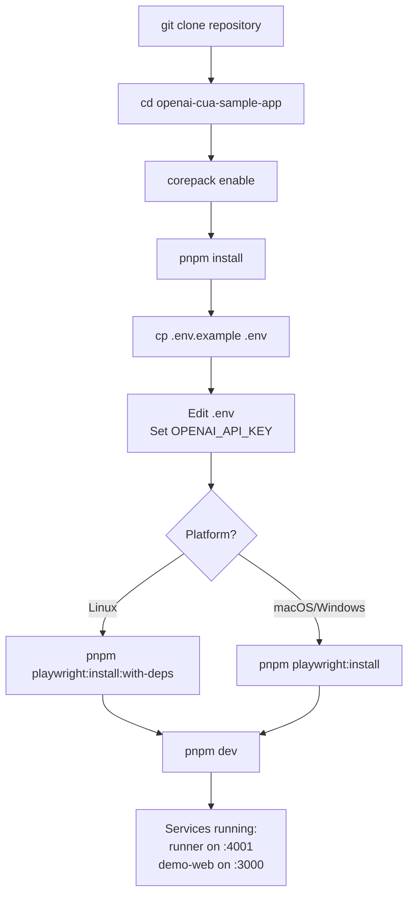
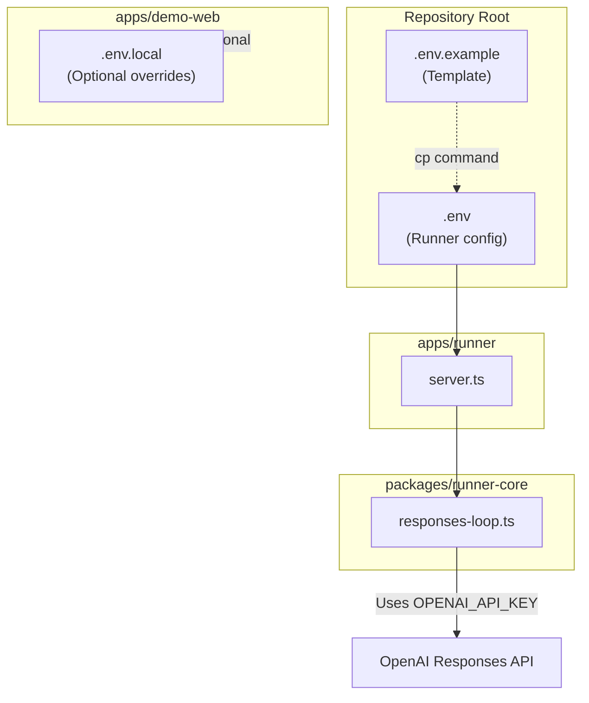
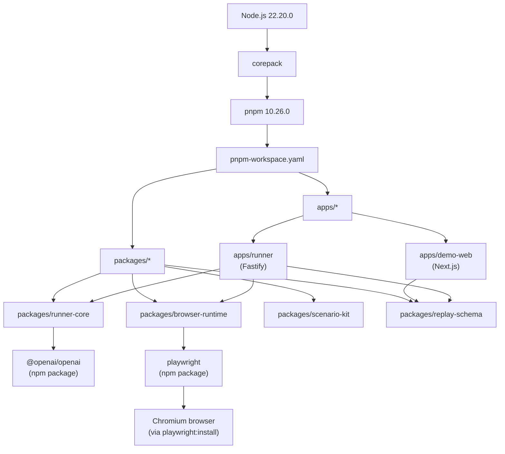

<!-- source: DeepWiki mcp.deepwiki.com · repo openai/openai-cua-sample-app · page 2.1 Prerequisites and Installation · fetched 2026-10-26 -->

# Prerequisites and Installation

<details>
<summary>Relevant source files</summary>

The following files were used as context for generating this wiki page:

- [README.md](README.md)

</details>


This page documents the required dependencies and installation steps necessary to set up a local development environment for the openai-cua-sample-app repository. It covers system prerequisites, dependency installation, environment configuration, and initial verification. For information about available development commands after installation, see [Development Commands](#2.2). For a walkthrough of running your first scenario, see [Running Your First Scenario](#2.3).

## System Requirements

The openai-cua-sample-app requires specific versions of Node.js and pnpm, along with Playwright's Chromium browser. The following table lists all required dependencies:

| Dependency | Required Version | Purpose |
|------------|------------------|---------|
| Node.js | `22.20.0` | JavaScript runtime for executing TypeScript applications |
| pnpm | `10.26.0` | Package manager for monorepo workspace management |
| Playwright Chromium | Latest stable | Browser automation engine for executing scenarios |
| Git | Any recent version | Version control for cloning the repository |

The repository uses `corepack` to manage the pnpm version, ensuring consistent package manager behavior across development environments. The specific Node.js version is enforced to maintain compatibility with dependencies and the OpenAI API client.

**Sources:** [README.md:18-23]()

## Installation Workflow

The installation process follows a deterministic sequence that prepares the monorepo structure, installs dependencies, configures environment variables, and provisions the Playwright browser.



**Installation Sequence**

Sources: [README.md:24-64]()

### Step 1: Repository Cloning

```bash
git clone <repo-url>
cd openai-cua-sample-app
```

Clone the repository and navigate into the root directory. All subsequent commands assume execution from this root directory, which contains the `package.json`, `pnpm-workspace.yaml`, and `.env.example` files.

### Step 2: Package Manager Initialization

```bash
corepack enable
pnpm install
```

The `corepack enable` command activates Node.js's built-in package manager version management, ensuring that the exact version of pnpm specified in [package.json]() is used. The `pnpm install` command then installs all workspace dependencies, including packages for `apps/demo-web`, `apps/runner`, and all shared packages under `packages/*`.

If `pnpm install` prints an `Ignored build scripts` warning for optional dependencies like `sharp` or `esbuild`, these warnings can be safely ignored for local development. The repository builds and runs successfully without approving optional build scripts.

Sources: [README.md:26-42]()

### Step 3: Environment Configuration

```bash
cp .env.example .env
```

Copy the example environment file to create a `.env` file in the repository root. This file is read automatically by `apps/runner` when started through the provided development scripts. Edit `.env` to set the required `OPENAI_API_KEY` variable:

```bash
OPENAI_API_KEY=your_key_here
```

The runner service requires this API key to communicate with the OpenAI Responses API at [packages/runner-core/src/responses-loop.ts](). Without a valid API key, scenario execution will fail with authentication errors.

Sources: [README.md:31-40]()

### Step 4: Playwright Browser Installation

```bash
pnpm playwright:install
```

This command downloads and installs the Chromium browser binary required by Playwright. The `playwright:install` script is defined in the root [package.json]() and delegates to Playwright's installation command.

**Linux-specific requirements:**

On Linux systems, Playwright requires additional OS-level dependencies (shared libraries for graphics, fonts, and media codecs). Install these dependencies using:

```bash
pnpm playwright:install:with-deps
```

This command installs both the Chromium browser and all necessary system libraries. If Playwright later reports missing system libraries during scenario execution, rerun this command and follow any OS package prompts it displays.

Sources: [README.md:44-56]()

## Configuration File Structure

The repository uses multiple environment files to separate concerns between the runner service and the web console. The following diagram illustrates the configuration file locations and which services read them:



**Configuration File Hierarchy**

The runner service (`apps/runner`) reads the root `.env` file automatically. The web application (`apps/demo-web`) uses Next.js built-in defaults but can be overridden by creating `apps/demo-web/.env.local` for local development customization. The `.env.local` file supports overriding `NEXT_PUBLIC_*` variables that control client-side behavior like model selection and maximum response turns.

Sources: [README.md:34-40](), [README.md:125-141]()

## Environment Variable Reference

The following table lists all environment variables recognized by the runner and web applications:

### Runner Environment Variables

| Variable | Default | Required | Description |
|----------|---------|----------|-------------|
| `OPENAI_API_KEY` | None | Yes | API key for OpenAI Responses API authentication |
| `HOST` | `127.0.0.1` | No | Network interface for runner HTTP server |
| `PORT` | `4001` | No | TCP port for runner HTTP server |
| `CUA_DEFAULT_MODEL` | `gpt-5.4` | No | Default model for scenario execution |
| `CUA_RESPONSES_MODE` | `auto` | No | Responses API mode: `auto`, `fallback`, or `live` |

### Web Application Environment Variables

| Variable | Default | Required | Description |
|----------|---------|----------|-------------|
| `RUNNER_BASE_URL` | `http://127.0.0.1:4001` | No | HTTP endpoint for runner service |
| `NEXT_PUBLIC_CUA_DEFAULT_MODEL` | `gpt-5.4` | No | Default model displayed in UI |
| `NEXT_PUBLIC_CUA_DEFAULT_MAX_RESPONSE_TURNS` | `24` | No | Default maximum turns per scenario run |

Only `OPENAI_API_KEY` is required for basic operation. All other variables have sensible defaults for local development.

Sources: [README.md:125-141]()

## Dependency Graph

The installation process establishes dependencies between multiple components. Understanding this graph helps diagnose installation issues:



**Dependency Resolution Flow**

The monorepo uses pnpm workspaces defined in [pnpm-workspace.yaml]() to link local packages without publishing them to npm. The `apps/runner` depends on `packages/runner-core` and `packages/browser-runtime`, which in turn depend on external npm packages like `@openai/openai` and `playwright`. The Playwright Chromium binary is installed separately through the `playwright:install` script and is not managed by pnpm.

Sources: [README.md:106-123]()

## Installation Verification

After completing the installation steps, verify the setup by starting both services:

```bash
pnpm dev
```

This command starts both `apps/runner` (on port 4001) and `apps/demo-web` (on port 3000) concurrently. Successful startup produces log output similar to:

```
[runner] Server listening at http://127.0.0.1:4001
[demo-web] ▲ Next.js ready on http://127.0.0.1:3000
```

Navigate to `http://127.0.0.1:3000` in a web browser to access the operator console. The console should display the scenario selection interface. If the runner is unreachable, the console displays connection error messages.

For detailed information about running scenarios through the operator console, see [Running Your First Scenario](#2.3).

Sources: [README.md:58-64]()

## Platform-Specific Considerations

### Linux Systems

Linux installations require additional Playwright system dependencies. The `pnpm playwright:install:with-deps` command installs these automatically, but manual installation may be required on some distributions. If Playwright reports errors like `libgobject-2.0.so.0: cannot open shared object file`, install the missing libraries using your distribution's package manager.

### macOS and Windows

macOS and Windows systems typically require only the `pnpm playwright:install` command. Playwright automatically downloads the appropriate Chromium binary for the platform.

### Docker and CI Environments

The installation process is compatible with Docker and CI environments. For containerized deployments, use a Node.js 22.20.0 base image and install Playwright dependencies explicitly using `pnpm playwright:install:with-deps`. The repository does not include a Dockerfile in the current release branch.

Sources: [README.md:50-56]()

## Common Installation Issues

The following table lists common installation problems and their solutions:

| Issue | Symptom | Solution |
|-------|---------|----------|
| Wrong Node.js version | `pnpm install` fails with version error | Install Node.js 22.20.0 using nvm or system package manager |
| Missing corepack | `corepack: command not found` | Run `corepack enable` after installing Node.js |
| Playwright libraries missing | Browser launch fails with library errors | Run `pnpm playwright:install:with-deps` on Linux |
| Missing API key | Scenario execution fails with 401 | Set `OPENAI_API_KEY` in `.env` file |
| Port conflicts | Runner or web app fails to start | Change `PORT` in `.env` or `RUNNER_BASE_URL` in `apps/demo-web/.env.local` |

Sources: [README.md:42-56]()

## Next Steps

With prerequisites installed and environment configured, proceed to [Development Commands](#2.2) to learn about available pnpm scripts for development, testing, and building. To execute your first scenario, see [Running Your First Scenario](#2.3).

Sources: [README.md:1-158]()

---

