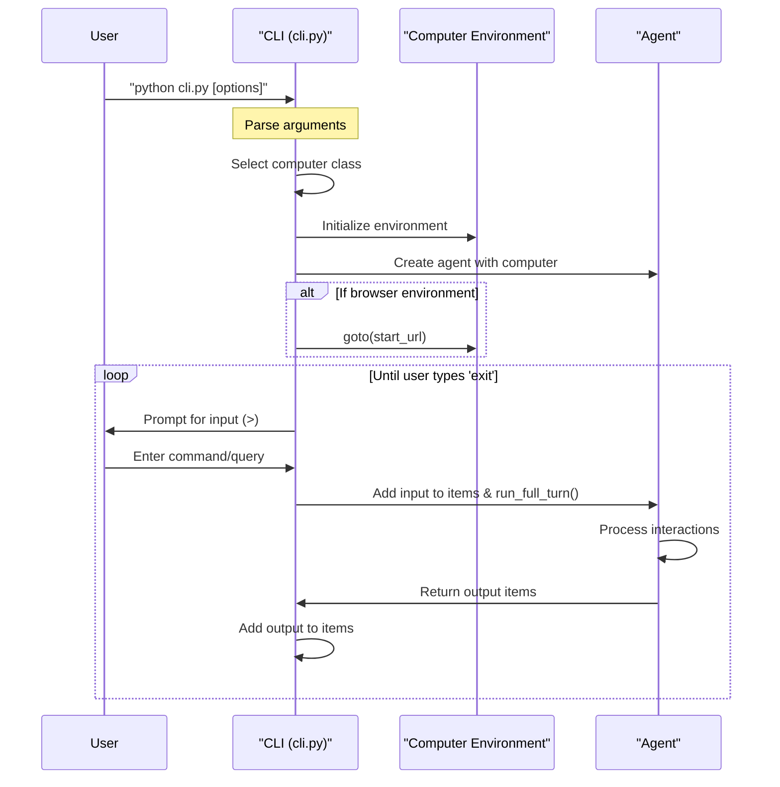
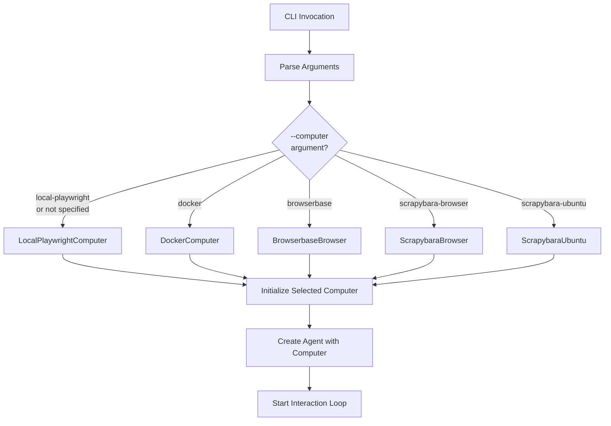
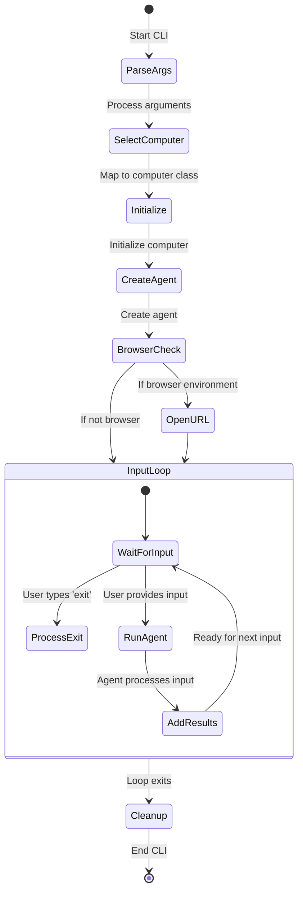

<!-- source: DeepWiki mcp.deepwiki.com · repo openai/openai-cua-sample-app · page 2.2 Development Commands · fetched 2026-10-26 -->

# CLI Usage Examples

<details>
<summary>Relevant source files</summary>

The following files were used as context for generating this wiki page:

- [README.md](README.md)

</details>


This page provides concrete examples of how to use the Command Line Interface (CLI) for the OpenAI Computer Using Agent (CUA) sample application. It demonstrates various invocation patterns and parameter combinations for different computer environments. For detailed information about all supported CLI arguments, see [CLI Arguments](#2.1).

## Basic CLI Invocation

The CLI is the primary entry point for running the CUA sample application. The basic invocation pattern is simple and uses the default local-playwright environment.

```bash
python cli.py
```

This command starts the CUA with a local browser window using Playwright. The CLI will open a browser window, navigate to the default URL (https://bing.com), and prompt you for input with a `>` character.

To exit the CLI at any time, type `exit` at the prompt or press `Ctrl+C`.

Sources: [cli.py:18-101](), [README.md:49-57]()

## CLI Invocation Flow

The following diagram illustrates the basic flow when invoking the CLI:



Sources: [cli.py:18-101]()

## Environment Selection Examples

The CUA sample application supports multiple computer environments through the `--computer` parameter. Here are examples for each supported environment:

### Local Playwright (Default)

```bash
python cli.py --computer local-playwright
```

This runs the agent with a local browser window using Playwright. It's the default option if `--computer` is not specified.

**First-time setup note**: If you haven't used Playwright before, you may be prompted to install browser dependencies. Follow the instructions provided in the command line to complete the setup.

### Docker Environment

```bash
python cli.py --computer docker
```

This connects the agent to a running Docker container environment. Before running this command, ensure you've built and started the Docker container:

```bash
docker build -t cua-sample-app .
docker run --rm -it --name cua-sample-app -p 5900:5900 --dns=1.1.1.3 -e DISPLAY=:99 cua-sample-app
```

### Browserbase Environment

```bash
python cli.py --computer browserbase
```

This connects to a remote browser via Browserbase. This requires setting up a Browserbase account and adding your API key to the `.env` file.

### Scrapybara Environments

For Scrapybara's browser environment:

```bash
python cli.py --computer scrapybara-browser
```

For Scrapybara's Ubuntu desktop environment:

```bash
python cli.py --computer scrapybara-ubuntu
```

Both require setting up a Scrapybara account and adding your API key to the `.env` file.

Sources: [cli.py:22-33](), [cli.py:58-64](), [README.md:91-98]()

## Computer Environment Selection



Sources: [cli.py:58-72]()

## Common Parameter Combinations

### Starting with a Specific URL

For browser-based environments, you can specify a starting URL:

```bash
python cli.py --start-url google.com
```

Note that the CLI automatically adds `https://` if the URL doesn't start with `http` or `https`.

### Enabling Debug Mode

To see detailed output during execution:

```bash
python cli.py --debug
```

This enables debug mode, which provides more detailed information about the agent's execution flow, including model requests and responses.

### Showing Images During Execution

To display screenshots during execution:

```bash
python cli.py --show
```

This is useful for observing what the agent is seeing and how it's interacting with the computer environment.

### Providing Initial Input

Instead of waiting for user input at the prompt, you can provide an initial command:

```bash
python cli.py --input "Search for the weather in San Francisco"
```

This is particularly useful for automation scripts or when you want to start with a specific task.

Sources: [cli.py:34-55](), [cli.py:76-97]()

## Combined Parameter Examples

You can combine multiple parameters for more complex usage scenarios:

### Example 1: Browser with Debug and Images

```bash
python cli.py --computer local-playwright --debug --show --start-url github.com
```

This starts the agent with a local browser pointed at GitHub, with both debug output and screenshots enabled.

### Example 2: Docker with Initial Input

```bash
python cli.py --computer docker --input "Open a text editor and write a hello world program"
```

This connects to a Docker environment and immediately instructs the agent to open a text editor and write a hello world program.

### Example 3: Remote Browser with Custom URL

```bash
python cli.py --computer browserbase --start-url docs.python.org --show
```

This connects to a Browserbase remote browser, navigates to the Python documentation, and shows screenshots during execution.

Sources: [cli.py:18-101](), [README.md:49-57]()

## CLI Runtime Flow



Sources: [cli.py:66-97]()

## Troubleshooting Common Issues

### First-time Playwright Setup

When running with `local-playwright` for the first time, you may see a message about missing browser executables. Follow the suggested command to install the necessary dependencies:

```bash
# Example of dependency installation command
playwright install
```

### Docker Container Conflicts

If you receive an error like:

```
docker: Error response from daemon: Conflict. The container name "/cua-sample-app" is already in use...
```

You'll need to remove the existing container:

```bash
docker rm -f cua-sample-app
```

### Environment Variables for Hosted Environments

For Browserbase or Scrapybara environments, ensure you've added your API key to the `.env` file:

```
# Example .env file
BROWSERBASE_API_KEY=your_api_key_here
SCRAPYBARA_API_KEY=your_api_key_here
```

Without these API keys, the remote environments will fail to initialize.

Sources: [README.md:24-26](), [README.md:126-137](), [README.md:139-143]()

---

