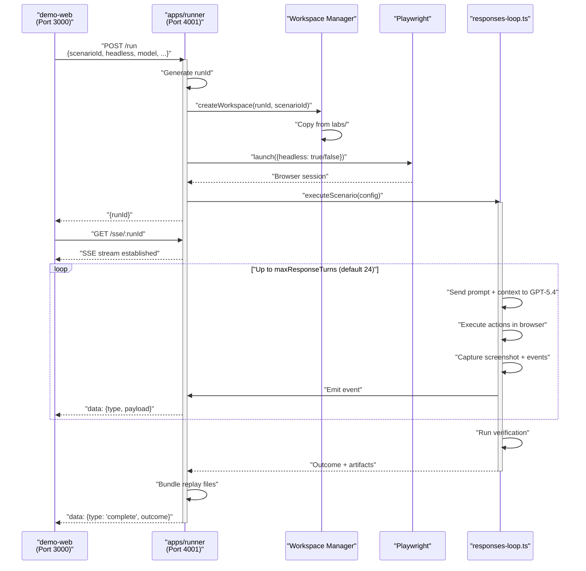
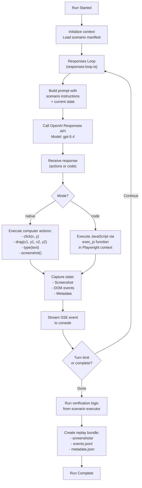
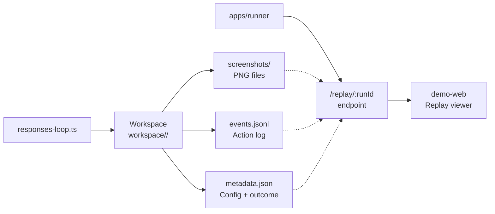

<!-- source: DeepWiki mcp.deepwiki.com · repo openai/openai-cua-sample-app · page 2.3 Running Your First Scenario · fetched 2026-10-26 -->

# Running Your First Scenario

<details>
<summary>Relevant source files</summary>

The following files were used as context for generating this wiki page:

- [README.md](README.md)

</details>


This page provides a step-by-step walkthrough for executing your first scenario using the operator console. It assumes you have completed the installation steps from [Prerequisites and Installation](#2.1) and are familiar with the development commands from [Development Commands](#2.2). For details on how the operator console UI is implemented, see [Operator Console (demo-web)](#3.1). For information about the underlying execution flow, see [Execution Flow](#5.1).

## Starting the Services

After completing installation, start both the runner service and the operator console together:

```bash
pnpm dev
```

This command launches two services in parallel:

| Service | Location | Default Port | Purpose |
|---------|----------|-------------|---------|
| Runner | `apps/runner` | 4001 | Fastify server that manages workspaces, browser sessions, and execution orchestration |
| Operator Console | `apps/demo-web` | 3000 | Next.js web application providing the UI for initiating runs and reviewing results |

The services are now accessible at:
- Operator Console: `http://127.0.0.1:3000`
- Runner API: `http://127.0.0.1:4001`

Verify the runner is healthy by checking its status endpoint:

```bash
curl http://127.0.0.1:4001/health
```

The runner reads configuration from `.env` at the repository root, including `OPENAI_API_KEY`, `CUA_DEFAULT_MODEL`, and `CUA_RESPONSES_MODE`. The console reads from `apps/demo-web/.env.local` if present, otherwise uses built-in defaults for `NEXT_PUBLIC_*` variables.

**Sources:** [README.md:58-73]()

---

## Accessing the Operator Console

Open `http://127.0.0.1:3000` in your browser. The console displays the scenario selection interface, which includes:

- **Scenario dropdown**: Lists all available scenarios from `packages/scenario-kit`
- **Configuration panel**: Allows customization of execution parameters
- **Run history**: Shows previous runs and their outcomes

The console communicates with the runner service via two channels:
1. HTTP requests for initiating runs and fetching replay data
2. Server-Sent Events (SSE) for real-time streaming of execution updates

The base URL for runner communication is configured via `RUNNER_BASE_URL` (defaults to `http://127.0.0.1:4001`).

**Sources:** [README.md:64-65](), [README.md:137]()

---

## Configuring a Run

### Selecting a Scenario

The dropdown presents three official scenarios:

| Scenario ID | Display Name | Verification Type |
|-------------|--------------|-------------------|
| `kanban-reprioritize-sprint` | Kanban Sprint Reprioritization | Drag-and-drop state |
| `paint-draw-poster` | Paint Poster Drawing | Canvas state |
| `booking-complete-reservation` | Booking Reservation Completion | Form completion |

Each scenario has a manifest in `packages/scenario-kit` that defines its lab template path, prompt, and verification logic.

### Configuration Options

The configuration panel exposes several parameters:

| Parameter | Default | Purpose |
|-----------|---------|---------|
| **Headless Mode** | `true` | Controls whether the browser window is visible during execution |
| **Model** | `gpt-5.4` | Specifies which OpenAI model to use |
| **Max Response Turns** | `24` | Limits the number of response loop iterations |
| **Execution Mode** | `native` | Selects between `native` (computer tool API) and `code` (Playwright REPL) |

For your first run, keep **Headless Mode** selected. Headless execution is faster and more reliable for automated verification. To observe browser actions in real-time, disable headless mode in subsequent runs.

**Sources:** [README.md:64](), [README.md:91-96](), [README.md:138-139]()

---

## Starting the Run

Click the **Start Run** button. The console sends a `POST /run` request to the runner service with the selected configuration:

```typescript
// Request payload structure from replay-schema
{
  scenarioId: string;
  headless: boolean;
  model: string;
  maxResponseTurns: number;
  mode: "native" | "code";
}
```

The runner immediately responds with a run ID and begins execution:

1. **Workspace Creation**: The runner copies the scenario's lab template from `labs/` to a temporary workspace directory
2. **Browser Launch**: A Playwright Chromium session is initialized, either headless or headful
3. **Responses Loop Initialization**: The runner starts the execution loop in `packages/runner-core/src/responses-loop.ts`

The console establishes an SSE connection to `GET /sse/:runId` to receive real-time updates.

**Diagram: Run Initiation Sequence**



**Sources:** [README.md:6](), [README.md:13]()

---

## Observing Execution

### Real-Time Updates

As the scenario executes, the console displays streaming updates via SSE events:

| Event Type | Payload | Purpose |
|------------|---------|---------|
| `turn:start` | `{turnNumber}` | Indicates a new response loop iteration |
| `action` | `{type, ...params}` | Shows individual actions (click, type, screenshot, etc.) |
| `screenshot` | `{imageData, timestamp}` | Provides current browser state |
| `turn:complete` | `{turnNumber}` | Marks end of iteration |
| `run:complete` | `{outcome, verification}` | Final result with success/failure |

The console renders these events in real-time, showing:
- A timeline of actions taken by the model
- Live screenshots of the browser state
- Progress through the maximum turn count

### Execution Flow

The runner orchestrates execution through `packages/runner-core/src/responses-loop.ts`, which implements the core Responses API integration:

**Diagram: Responses Loop Execution Flow**



**Sources:** [README.md:13](), [README.md:91-96]()

---

## Viewing Results

### Completion States

When execution completes, the console displays one of three outcomes:

| Outcome | Description | Next Steps |
|---------|-------------|------------|
| **Success** | Verification passed | Review replay bundle to understand model behavior |
| **Failure** | Verification failed or error occurred | Examine error messages and screenshots to diagnose issue |
| **Timeout** | Maximum turns reached without completion | Increase `maxResponseTurns` or adjust scenario complexity |

### Replay Bundle

Every run generates a replay bundle in the runner's workspace directory, containing:

```
workspace/<runId>/
├── screenshots/
│   ├── turn-001-screenshot-001.png
│   ├── turn-001-screenshot-002.png
│   └── ...
├── events.jsonl
└── metadata.json
```

The console provides download and inspection capabilities for these artifacts:

- **Screenshots**: Chronological view of browser state at each screenshot action
- **Events**: Detailed log of all actions, API calls, and browser interactions in JSONL format
- **Metadata**: Run configuration, timing information, and verification results

Access the replay bundle via:
- Console UI: Click on a completed run to view its details
- Direct API: `GET /replay/:runId` returns a downloadable archive
- File system: Navigate to the runner's workspace directory

**Diagram: Result Data Flow**



**Sources:** [README.md:5-6]()

---

## Troubleshooting First Runs

### Common Issues

| Issue | Cause | Solution |
|-------|-------|----------|
| "Missing OPENAI_API_KEY" | Environment variable not set | Verify `.env` contains valid API key |
| "Playwright not installed" | Browser binary missing | Run `pnpm playwright:install` |
| Connection refused (port 4001) | Runner not started | Ensure `pnpm dev` or `pnpm dev:runner` is running |
| Timeout after 24 turns | Scenario too complex for defaults | Increase `maxResponseTurns` in console UI |

### Verifying Setup

Before starting a run, confirm:

1. **API Key**: `echo $OPENAI_API_KEY` or check `.env` file
2. **Runner Health**: `curl http://127.0.0.1:4001/health` returns success
3. **Playwright**: Browser binary installed at correct path (shown in runner startup logs)
4. **Workspace Permissions**: Runner can write to temporary directory

### Inspecting Logs

The runner emits detailed logs during execution:

```bash
# View runner logs separately
pnpm dev:runner
```

Logs include:
- Workspace creation paths
- Browser launch details
- Responses API request/response summaries
- Verification step results

For more information on the execution flow and debugging strategies, see [Execution Flow](#5.1) and [Development Workflow](#8.3).

**Sources:** [README.md:24-65](), [README.md:66-83]()

---

