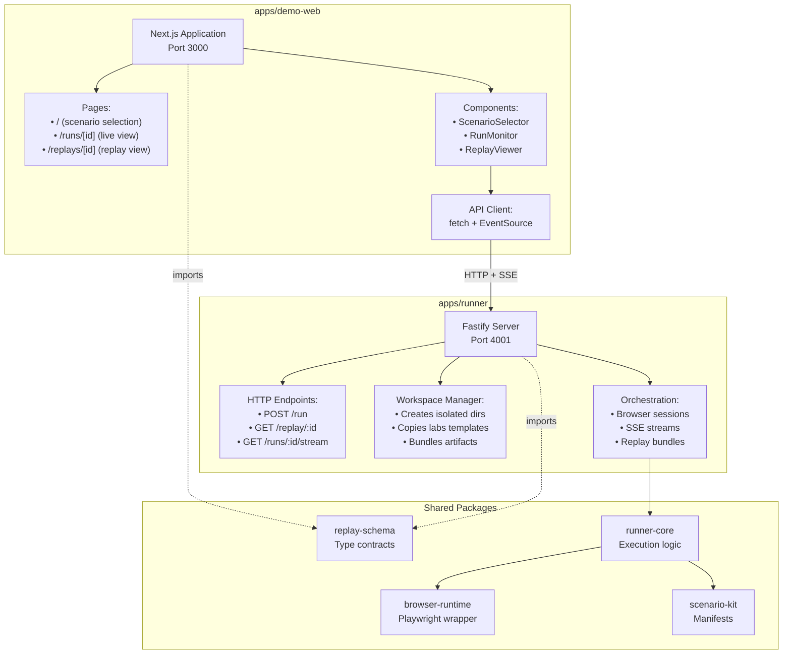
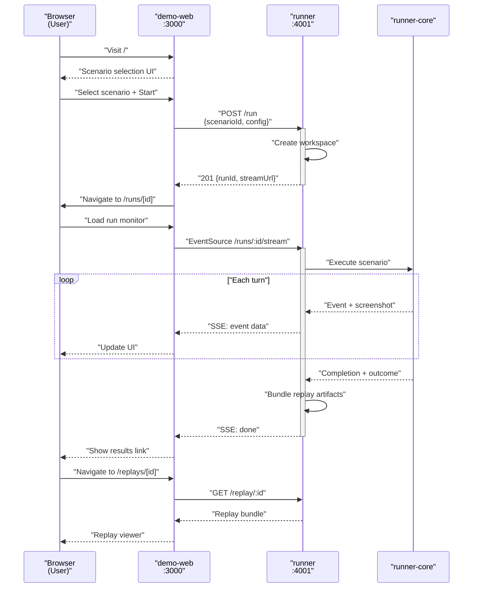
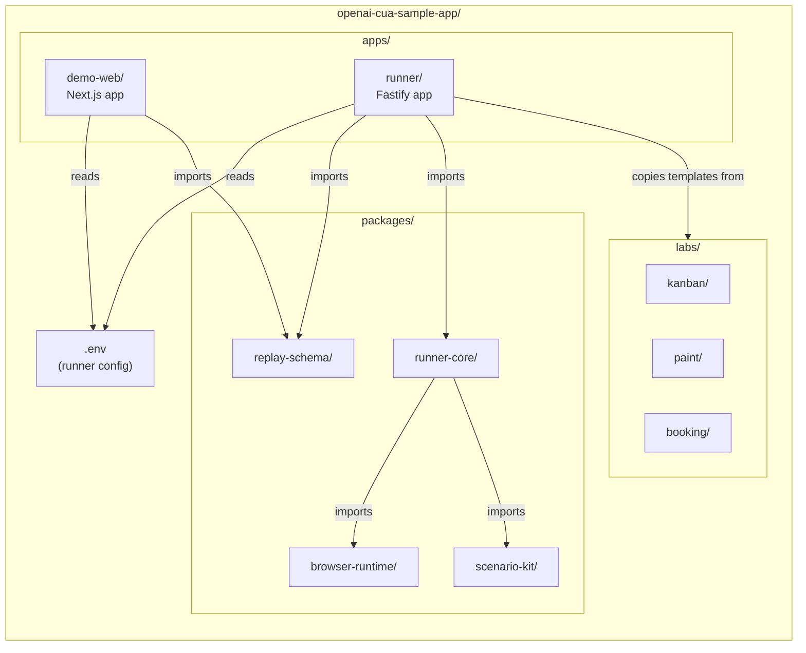
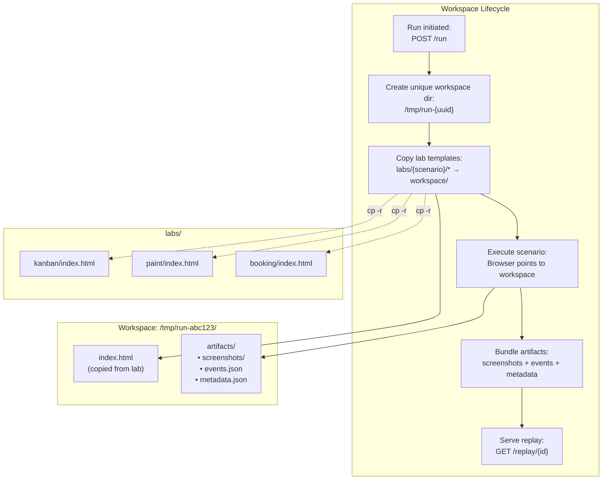
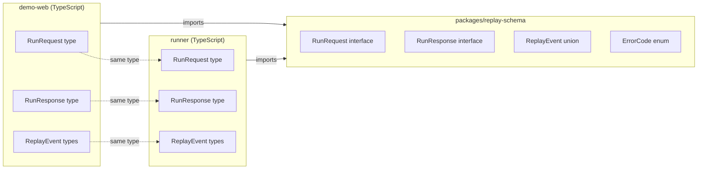

<!-- source: DeepWiki mcp.deepwiki.com · repo openai/openai-cua-sample-app · page 3 Applications · fetched 2026-10-26 -->

# Applications

<details>
<summary>Relevant source files</summary>

The following files were used as context for generating this wiki page:

- [README.md](README.md)

</details>


This document describes the two main applications in the openai-cua-sample-app monorepo: the operator console (`apps/demo-web`) and the runner service (`apps/runner`). These applications work together to provide a complete system for executing browser-focused computer-use scenarios using GPT-5.4.

For detailed information about the shared packages these applications depend on, see [Core Packages](#4). For information about how scenarios are executed within the runner, see [Scenarios](#6).

## System Architecture

The repository implements a client-server architecture with two distinct applications that communicate over HTTP and Server-Sent Events (SSE).

### Application Overview



**Sources:** [README.md:5-7](), [README.md:108-121]()

The system separates presentation concerns (`demo-web`) from execution concerns (`runner`), enabling:
- Independent development and deployment of each service
- Clear responsibility boundaries
- Type-safe communication via `replay-schema` contracts
- Flexible hosting configurations (same machine or distributed)

### Communication Patterns

The applications communicate using three distinct patterns:

| Pattern | Direction | Purpose | Endpoint |
|---------|-----------|---------|----------|
| HTTP POST | Web → Runner | Initiate scenario execution | `POST /run` |
| SSE Stream | Runner → Web | Real-time execution updates | `GET /runs/:id/stream` |
| HTTP GET | Web → Runner | Retrieve replay artifacts | `GET /replay/:id` |



**Sources:** [README.md:5-7](), Diagram 5 from architecture overview

## Application Services

### Service Ports and URLs

Both applications run on localhost by default with fixed ports:

| Service | Default URL | Environment Variable |
|---------|-------------|---------------------|
| `demo-web` | `http://127.0.0.1:3000` | `RUNNER_BASE_URL` (to configure runner location) |
| `runner` | `http://127.0.0.1:4001` | `HOST` and `PORT` |

**Sources:** [README.md:130-131](), [README.md:137](), [README.md:64]()

### Monorepo Structure



**Sources:** [README.md:106-123]()

The monorepo uses pnpm workspaces to manage dependencies between applications and packages. Both applications import the `replay-schema` package for type-safe communication contracts.

## Development Modes

The system supports three development modes:

### Full System Mode

```bash
pnpm dev
```

Starts both `demo-web` (port 3000) and `runner` (port 4001) simultaneously. This is the standard development mode.

**Sources:** [README.md:60-62]()

### Independent Services Mode

```bash
# Terminal 1: Start runner only
pnpm dev:runner

# Terminal 2: Start web only with runner URL
RUNNER_BASE_URL=http://127.0.0.1:4001 pnpm dev:web
```

Runs services in separate terminals for independent log viewing. The `RUNNER_BASE_URL` environment variable configures the web application to connect to a specific runner instance.

**Sources:** [README.md:66-73]()

### Configuration Matrix

The following environment variables control inter-service communication:

| Variable | Location | Purpose | Default |
|----------|----------|---------|---------|
| `HOST` | Runner `.env` | Runner bind address | `127.0.0.1` |
| `PORT` | Runner `.env` | Runner listen port | `4001` |
| `RUNNER_BASE_URL` | Web `.env.local` or env | Runner API endpoint | `http://127.0.0.1:4001` |

**Sources:** [README.md:130-131](), [README.md:137]()

This configuration enables flexible deployment scenarios:
- Local development: both services on localhost
- Distributed development: runner on separate host/container
- Production: services behind reverse proxy or load balancer

## Workspace Management

The runner creates isolated workspace directories for each execution:



**Sources:** [README.md:6](), [README.md:121]()

Each run receives:
- A unique workspace directory for isolated execution
- A copy of the appropriate lab template from `labs/{scenario}/`
- Write access for saving artifacts and screenshots
- Automatic cleanup after replay bundle creation

## Type Safety Boundary

The `replay-schema` package enforces type consistency across the HTTP boundary:



**Sources:** [README.md:112-113](), [README.md:7]()

Both applications import from `@cua/replay-schema`, ensuring:
- Request/response contracts match exactly
- Enum values are consistent
- Event types are validated at compile time
- Refactoring safety across the HTTP boundary

For details on specific schema types, see [replay-schema](#4.4).

## Next Steps

- For detailed documentation of the operator console UI, see [Operator Console (demo-web)](#3.1)
- For detailed documentation of the runner service API and orchestration, see [Runner Service](#3.2)
- For information about the execution logic within the runner, see [runner-core and responses-loop](#4.1)

---

