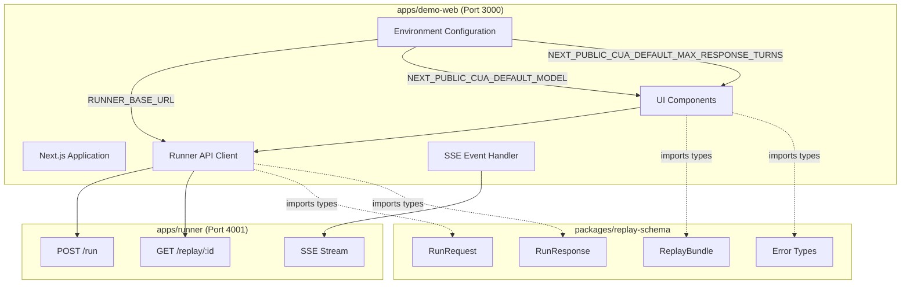
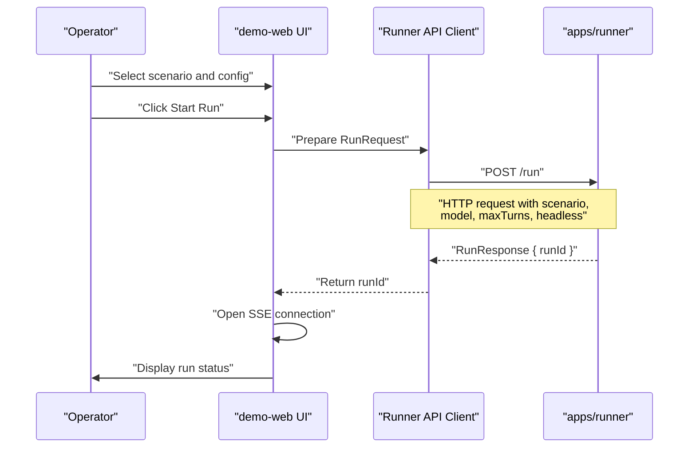
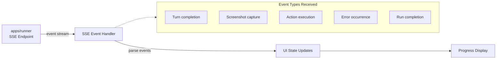
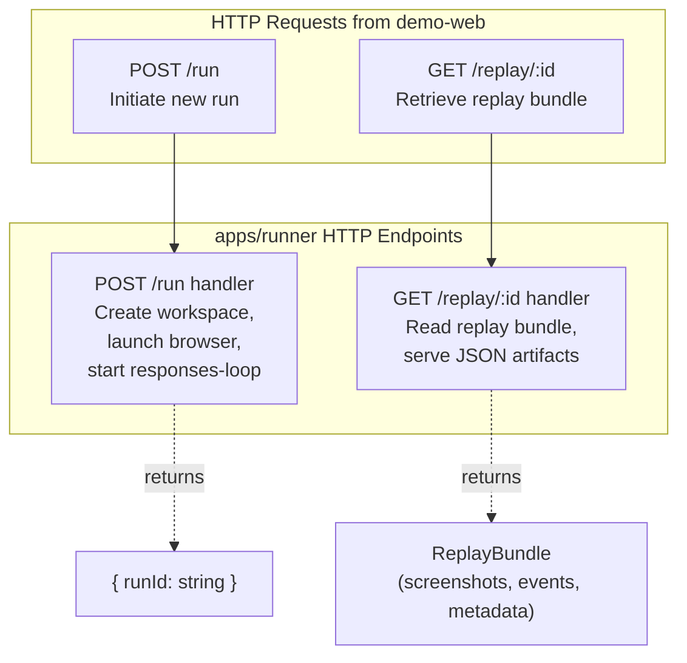
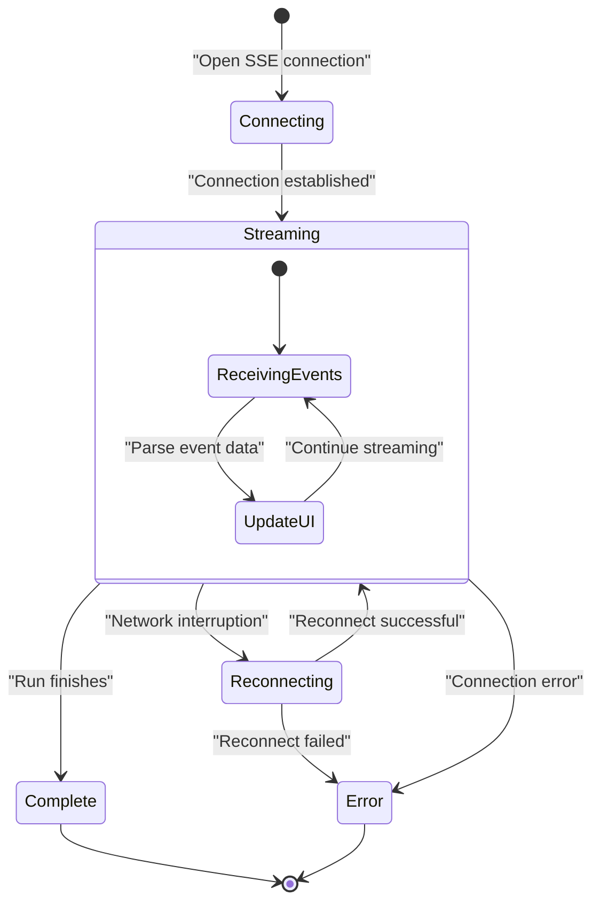
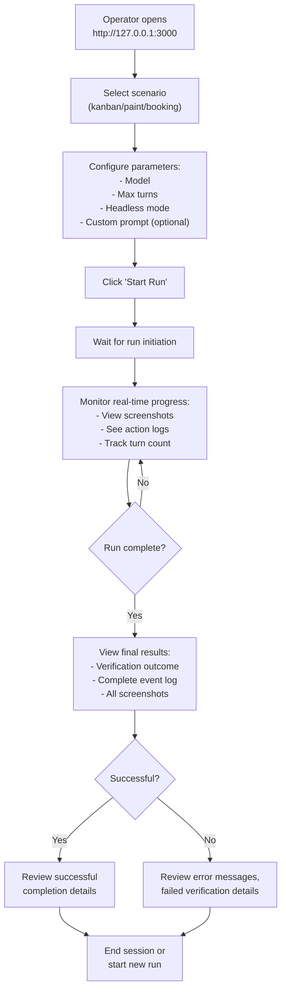

<!-- source: DeepWiki mcp.deepwiki.com · repo openai/openai-cua-sample-app · page 3.1 Operator Console (demo-web) · fetched 2026-10-26 -->

# Operator Console (demo-web)

<details>
<summary>Relevant source files</summary>

The following files were used as context for generating this wiki page:

- [.env.example](.env.example)
- [README.md](README.md)

</details>


## Purpose and Scope

The Operator Console is a Next.js web application located in `apps/demo-web` that provides the user interface for interacting with the CUA sample app. It enables operators to select scenarios, configure execution parameters, initiate runs, monitor progress in real-time via Server-Sent Events, and review replay artifacts including screenshots and event logs.

This page documents the operator console's architecture, features, and integration points. For details about the backend service that executes runs, see [Runner Service](#3.2). For information about the SSE streaming protocol, see [Server-Sent Events (SSE)](#8.2). For replay bundle structure, see [Replay Bundles](#8.1).

**Sources:** [README.md:5-5](), [README.md:108-109]()

## Architecture Overview

The operator console is a Next.js application running on port 3000 by default. It communicates with the runner service through HTTP requests and receives real-time updates via SSE connections. The application shares type contracts with the runner through the `replay-schema` package to ensure type safety across the HTTP boundary.

### Application Structure



**Diagram: Operator Console Architecture and Dependencies**

The console imports shared type definitions from `replay-schema` to maintain contract compatibility with the runner service. Configuration is managed through environment variables with the `NEXT_PUBLIC_` prefix for client-side access.

**Sources:** [README.md:5-7](), [README.md:112-113](), [README.md:136-139]()

## Core Features

### Scenario Selection and Configuration

The operator console provides a UI for selecting from the three official scenarios and configuring execution parameters:

| Feature | Description | Configuration |
|---------|-------------|---------------|
| Scenario Selection | Choose from `kanban`, `paint`, or `booking` scenarios | Loaded from `scenario-kit` manifests |
| Model Selection | Specify the GPT model to use | Default: `NEXT_PUBLIC_CUA_DEFAULT_MODEL` |
| Max Response Turns | Configure iteration limit | Default: `NEXT_PUBLIC_CUA_DEFAULT_MAX_RESPONSE_TURNS` (24) |
| Headless Mode | Toggle browser visibility | Boolean toggle (default: true) |
| Custom Prompt | Override scenario system prompt | Optional text input |

**Sources:** [README.md:64-64](), [README.md:98-103](), [README.md:136-139]()

### Run Initiation Workflow



**Diagram: Run Initiation Flow**

The console sends a `POST /run` request with scenario configuration and immediately establishes an SSE connection to receive real-time updates. The run proceeds asynchronously on the runner service.

**Sources:** [README.md:64-64]()

### Real-Time Progress Monitoring

The console receives Server-Sent Events from the runner service to provide live updates during run execution:



**Diagram: Real-Time Event Streaming Architecture**

The SSE handler processes incoming events and updates the UI state, displaying screenshots, action logs, and completion status as the run progresses.

**Sources:** [README.md:5-5](), [README.md:6-6]()

### Replay Artifact Viewing

After a run completes (successfully or with failure), the console retrieves and displays the replay bundle:

| Artifact Type | Description | Display Format |
|---------------|-------------|----------------|
| Screenshots | Captured at each turn | Image gallery with timestamps |
| Event Log | Chronological action and response log | Scrollable text with syntax highlighting |
| Metadata | Run configuration and outcome | Key-value display |
| Verification Results | Success/failure with details | Status indicator and message |
| Error Information | Stack traces and error codes | Formatted error display |

The console fetches replay bundles via `GET /replay/:id` and presents them in a user-friendly format, enabling operators to understand what occurred during execution even when the runner is offline or a run has failed.

**Sources:** [README.md:5-5](), [README.md:16-16]()

## Communication Patterns

### HTTP Request-Response



**Diagram: HTTP Communication Patterns**

The console uses standard HTTP request-response patterns for run initiation and artifact retrieval. Run initiation returns immediately with a `runId`, while the actual execution proceeds asynchronously.

**Sources:** [README.md:6-6](), [README.md:111-111]()

### Server-Sent Events (SSE)

The console establishes a long-lived SSE connection to receive real-time updates throughout the run lifecycle:



**Diagram: SSE Connection Lifecycle**

The SSE connection remains open for the duration of the run, providing continuous updates. The console handles connection errors gracefully and displays appropriate status messages.

**Sources:** [README.md:6-6](), [README.md:111-111]()

## Configuration

### Environment Variables

The operator console is configured through environment variables. For client-side access in Next.js, variables must be prefixed with `NEXT_PUBLIC_`.

| Variable | Type | Default | Purpose |
|----------|------|---------|---------|
| `RUNNER_BASE_URL` | string | `http://127.0.0.1:4001` | Base URL for runner service API |
| `NEXT_PUBLIC_CUA_DEFAULT_MODEL` | string | `gpt-5.4` | Default model selection in UI |
| `NEXT_PUBLIC_CUA_DEFAULT_MAX_RESPONSE_TURNS` | number | `24` | Default maximum response turns |

**Configuration Location:** `apps/demo-web/.env.local`

The console reads configuration from `.env.local` following Next.js conventions. The `RUNNER_BASE_URL` enables flexible deployment configurations, allowing the runner service to be hosted separately from the web application.

**Sources:** [README.md:40-40](), [README.md:136-139](), [.env.example:8-11]()

### Development Configuration

When running the services separately for development:

```bash
# Terminal 1: Start runner on default port 4001
pnpm dev:runner

# Terminal 2: Start web with explicit runner URL
RUNNER_BASE_URL=http://127.0.0.1:4001 pnpm dev:web
```

The `RUNNER_BASE_URL` environment variable overrides the default runner location, enabling independent service development.

**Sources:** [README.md:68-73]()

## User Workflow

### Typical Operator Interaction Flow



**Diagram: Operator Workflow Through the Console**

The console is designed to provide clear visibility into run status and outcomes, supporting iterative development and debugging even when runs fail or the runner service experiences issues.

**Sources:** [README.md:16-16](), [README.md:64-64]()

### Error Handling and Offline Scenarios

The operator console is designed to remain functional and informative even when the runner service is unavailable:

| Scenario | Console Behavior | User Experience |
|----------|------------------|-----------------|
| Runner offline at startup | Display connection error | Clear message indicating runner unavailable |
| Runner crashes during run | SSE connection breaks | Show last known state, indicate disconnection |
| Run fails with error | Receive error event via SSE | Display error code, message, and stack trace |
| Replay bundle corrupted | `GET /replay/:id` fails | Show error message, allow retry |
| Network interruption | SSE reconnection attempts | Show reconnecting status, resume on success |

The console's resilience ensures operators can diagnose issues effectively, fulfilling the design goal stated in the README: "how to build an operator-facing console that is understandable even when the runner is offline or a run fails."

**Sources:** [README.md:16-16]()

---

