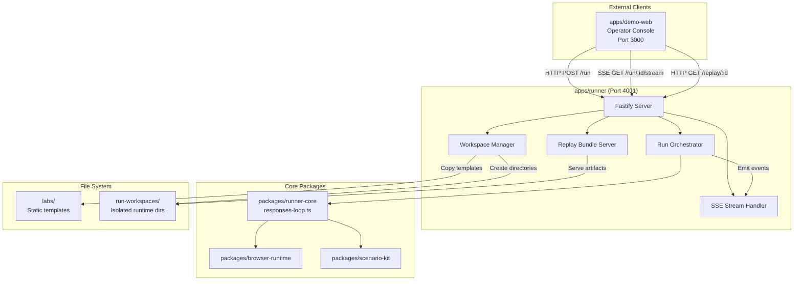
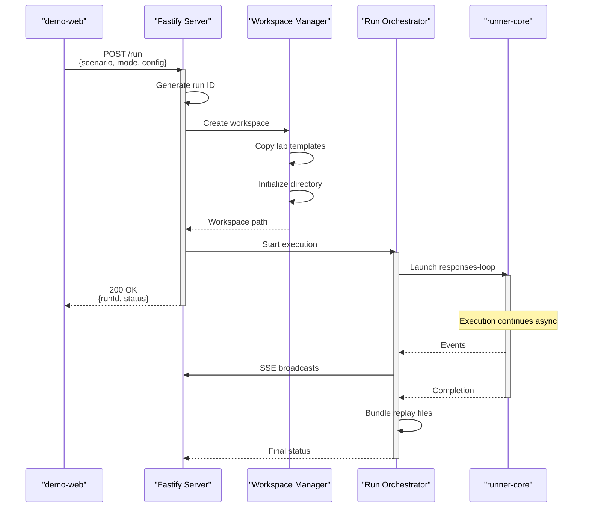
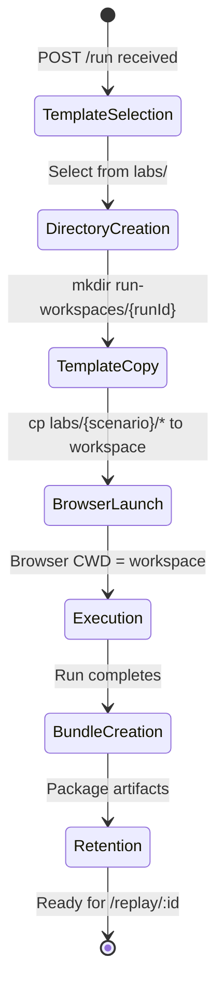
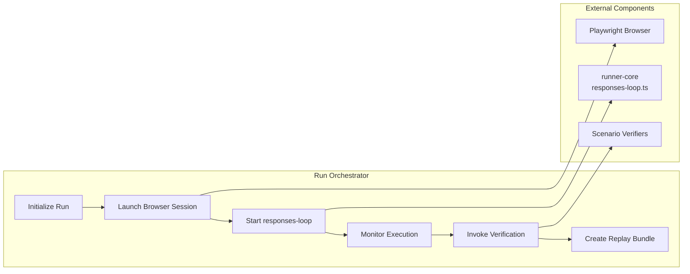
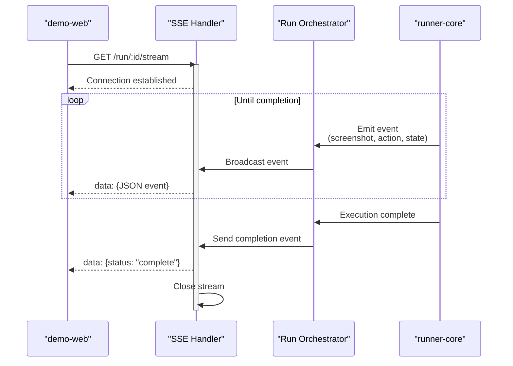
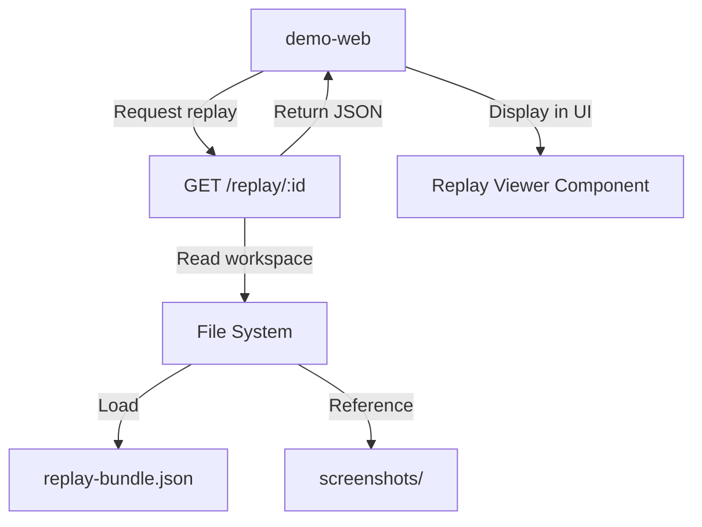
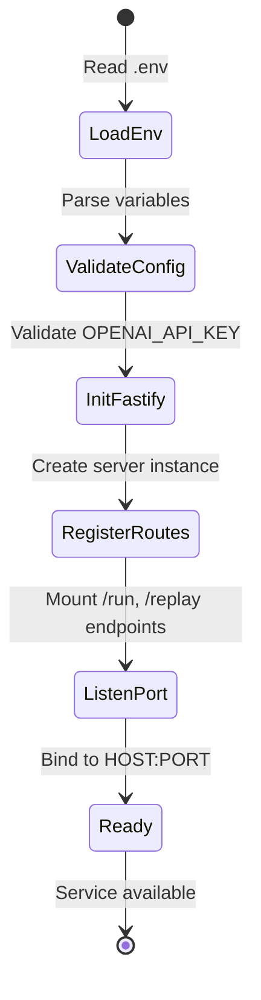

<!-- source: DeepWiki mcp.deepwiki.com · repo openai/openai-cua-sample-app · page 3.2 Runner Service · fetched 2026-10-26 -->

# Runner Service

<details>
<summary>Relevant source files</summary>

The following files were used as context for generating this wiki page:

- [.env.example](.env.example)
- [README.md](README.md)

</details>


## Purpose and Scope

The Runner Service is a Fastify-based HTTP backend located in [apps/runner]() that orchestrates scenario execution workflows. It serves as the integration layer between the operator console and the core execution engine, managing isolated workspaces, browser session lifecycles, and real-time event streaming.

This page documents the service's architecture, HTTP API surface, workspace management, and deployment configuration. For the execution logic that runs within the runner service, see [runner-core and responses-loop](#4.1). For the frontend that communicates with this service, see [Operator Console (demo-web)](#3.1).

**Sources:** [README.md:1-158]()

---

## Service Architecture

The runner service acts as a stateful HTTP server that coordinates between the operator console, execution packages, and browser automation infrastructure.

### Component Overview



**Sources:** [README.md:6](), [README.md:108-124]()

---

## HTTP API Surface

The runner service exposes three primary endpoint categories: run initiation, event streaming, and replay artifact retrieval.

### Endpoint Catalog

| Method | Path | Purpose | Response Type |
|--------|------|---------|---------------|
| `POST` | `/run` | Start a new scenario execution | JSON (run metadata) |
| `GET` | `/run/:id/stream` | Subscribe to real-time run events | Server-Sent Events |
| `GET` | `/replay/:id` | Retrieve replay bundle for completed run | JSON (replay artifacts) |
| `GET` | `/health` | Service health check | JSON (status) |

### Run Initiation Flow



**Sources:** [README.md:6](), Diagram 5 from context (Data Flow and Communication Patterns)

---

## Workspace Management

The runner service creates isolated filesystem workspaces for each execution. Each workspace contains a copy of the appropriate lab template and serves as the browser's working directory.

### Workspace Lifecycle



### Directory Structure

Each run workspace follows this structure:

```
run-workspaces/
└── {runId}/
    ├── index.html          # Copied from labs/{scenario}/
    ├── styles.css          # Lab static assets
    ├── script.js           # Lab JavaScript
    ├── screenshots/        # Created during execution
    │   ├── 0001.png
    │   ├── 0002.png
    │   └── ...
    └── replay-bundle.json  # Created after verification
```

**Sources:** [README.md:121](), [README.md:15](), Diagram 1 from context (System Overview)

---

## Execution Orchestration

The runner service coordinates scenario execution by integrating with `runner-core` and managing browser session lifecycles.

### Orchestration Responsibilities



The orchestrator:
1. Allocates a unique run identifier
2. Creates an isolated workspace from lab templates
3. Launches a Playwright browser session pointing to the workspace
4. Invokes the `responses-loop` from `runner-core` with scenario configuration
5. Monitors execution progress and captures events
6. Triggers scenario-specific verification after completion
7. Packages screenshots, events, and verification results into a replay bundle

**Sources:** [README.md:6](), [README.md:118-119](), Diagram 2 from context (Run Execution Lifecycle)

---

## Server-Sent Events (SSE)

Real-time run updates stream to the operator console via Server-Sent Events. Each connected client receives a continuous stream of structured events during execution.

### Event Stream Protocol



### Event Types

The SSE stream emits these event categories:

| Event Type | Payload | Frequency |
|------------|---------|-----------|
| `screenshot` | Base64-encoded PNG, timestamp | After each model turn |
| `action` | Computer action or exec_js call | Per response turn |
| `state` | Browser DOM state snapshot | Periodic |
| `turn` | Turn number, cumulative actions | Per response cycle |
| `completion` | Final status, verification outcome | Once at end |
| `error` | Error code, message, stack trace | On failure |

Clients maintain open connections throughout run execution. The server closes the stream after emitting the final `completion` or `error` event.

**Sources:** [README.md:6](), [README.md:111](), Diagram 5 from context (Data Flow and Communication Patterns)

---

## Replay Bundle Serving

After execution completes, the runner service packages all run artifacts into a replay bundle accessible via HTTP.

### Bundle Structure

The replay bundle aggregates:

- **Screenshots**: PNG captures after each model turn
- **Events**: Timestamped log of all computer actions or exec_js calls
- **Metadata**: Scenario ID, execution mode, model configuration
- **Verification**: Pass/fail status and verification-specific data
- **Timing**: Turn durations, total execution time

### Retrieval Flow



The replay endpoint serves a JSON response conforming to the `replay-schema` package contracts. Screenshot paths are either inlined as base64 or served as relative URLs depending on configuration.

**Sources:** [README.md:6](), [README.md:112-113](), [README.md:5]()

---

## Configuration

The runner service reads configuration from environment variables defined in the repository root `.env` file.

### Environment Variables

| Variable | Default | Purpose |
|----------|---------|---------|
| `OPENAI_API_KEY` | *(required)* | OpenAI API authentication |
| `HOST` | `127.0.0.1` | Bind address for Fastify server |
| `PORT` | `4001` | HTTP listen port |
| `CUA_DEFAULT_MODEL` | `gpt-5.4` | Default model for responses-loop |
| `CUA_RESPONSES_MODE` | `auto` | Execution mode: `auto`, `fallback`, or `live` |

### Startup Sequence



The runner automatically loads `.env` when started via `pnpm dev:runner` or `pnpm dev`. For manual execution, ensure environment variables are exported before starting the process.

**Sources:** [README.md:34-38](), [README.md:40](), [README.md:127-134](), [.env.example:1-12]()

---

## Deployment Considerations

### Development Mode

Start the runner independently:

```bash
pnpm dev:runner
```

This launches the Fastify server on the configured `HOST` and `PORT`, typically `127.0.0.1:4001`.

### Production Readiness

The runner service includes these production-oriented features:

- **Health checks**: `/health` endpoint for load balancer probes
- **Graceful shutdown**: Pending runs complete before process exit
- **Structured logging**: JSON logs for aggregation pipelines
- **Error boundaries**: Unhandled exceptions don't crash the server

### Resource Requirements

Each concurrent run consumes:
- One Playwright browser instance (100-300MB RAM)
- One isolated workspace directory (10-50MB disk)
- One SSE connection (minimal network overhead)

Disk usage grows linearly with retained replay bundles. Implement cleanup policies for production deployments.

**Sources:** [README.md:68-73](), [README.md:6]()

---

## Integration Points

### Upstream: Operator Console

The runner service serves requests from [demo-web](#3.1) running on port 3000. The console configures the runner's base URL via `RUNNER_BASE_URL`.

### Downstream: runner-core

The service delegates execution logic to [runner-core](#4.1), specifically invoking `responses-loop.ts` for Responses API integration. The runner owns workspace and browser lifecycle, while runner-core owns model interaction and verification.

### Shared Contracts: replay-schema

Both the runner service and demo-web import types from [replay-schema](#4.4) to ensure HTTP request/response compatibility. This package defines the canonical structure for run configurations, event payloads, and replay bundles.

**Sources:** [README.md:5-7](), [README.md:112-119](), Diagram 4 from context (Package Dependency Architecture)

---

