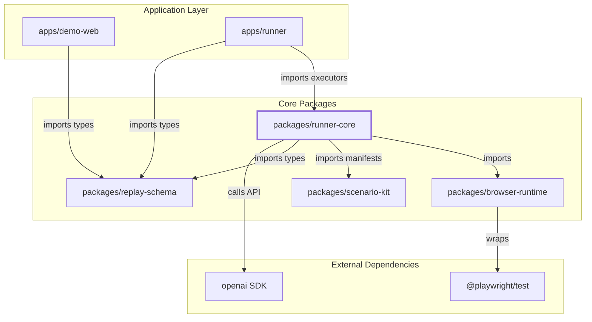
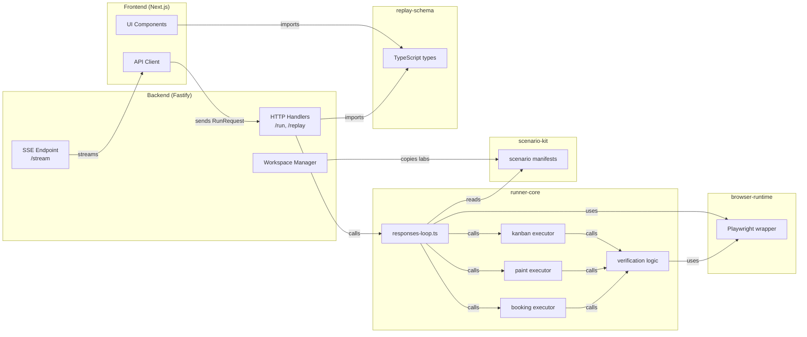

<!-- source: DeepWiki mcp.deepwiki.com · repo openai/openai-cua-sample-app · page 4 Core Packages · fetched 2026-10-26 -->

# Core Packages

Relevant source files

The following files were used as context for generating this wiki page:

- [README.md](README.md)

This document provides an overview of the four shared packages that comprise the business logic and infrastructure layer of the openai-cua-sample-app. These packages enable code reuse between the web console and runner service, enforce contract boundaries, and provide modular abstractions for browser control, scenario execution, and API integration.

For detailed information about specific packages, see:
- [runner-core and responses-loop](#4.1) for the canonical Responses API integration and scenario execution
- [browser-runtime](#4.2) for the Playwright abstraction layer
- [scenario-kit](#4.3) for scenario manifest definitions
- [replay-schema](#4.4) for shared type contracts

For information about the applications that consume these packages, see [Applications](#3).

**Sources:** [README.md:1-158]()

---

## Package Overview

The monorepo contains four shared packages located in the `packages/` directory:

| Package | Location | Primary Responsibility |
|---------|----------|----------------------|
| `runner-core` | `packages/runner-core/` | Orchestrates scenario execution, contains `responses-loop.ts` (the canonical Responses API integration point), implements scenario executors and verification logic |
| `browser-runtime` | `packages/browser-runtime/` | Provides Playwright session abstraction and browser control primitives |
| `scenario-kit` | `packages/scenario-kit/` | Defines scenario manifests and prompt defaults for the three official scenarios |
| `replay-schema` | `packages/replay-schema/` | Exports shared TypeScript contracts for requests, responses, replay data structures, and error types |

All packages are written in TypeScript and managed as pnpm workspaces, enabling type-safe imports across application boundaries.

**Sources:** [README.md:106-124]()

---

## Package Dependency Architecture

**Package Dependency Rules:**

The dependency graph enforces a clean separation of concerns:

1. **`replay-schema`** has zero internal dependencies. It serves as a pure contract layer imported by both applications and other packages.
2. **`scenario-kit`** has zero dependencies on other internal packages. It provides static scenario definitions.
3. **`browser-runtime`** depends only on Playwright. It abstracts browser control without knowledge of scenarios or API integration.
4. **`runner-core`** imports all three other packages and orchestrates execution. It is the only package that integrates with the OpenAI API.
5. **`apps/demo-web`** imports only `replay-schema`, ensuring the frontend has no direct dependency on execution logic.
6. **`apps/runner`** imports both `runner-core` and `replay-schema`, acting as the HTTP/SSE serving layer.

**Sources:** [README.md:106-124]()

---

## Key Exports by Package

This section maps high-level package responsibilities to concrete code symbols, enabling readers to locate specific functionality in the codebase.

### replay-schema Package

Located in `packages/replay-schema/`, this package exports TypeScript types and interfaces used across HTTP boundaries.

**Primary Exports:**
- Request/response contracts for the `/run` endpoint
- `ReplayBundle` type representing captured artifacts (screenshots, events, metadata)
- Error type definitions for structured error handling
- Event stream schemas for Server-Sent Events (SSE)

This package contains no runtime logic—only type definitions. Both `apps/demo-web` and `apps/runner` import these contracts to maintain type safety across the network boundary.

### scenario-kit Package

Located in `packages/scenario-kit/`, this package exports scenario manifest objects.

**Primary Exports:**
- Scenario manifest definitions for `kanban-reprioritize-sprint`, `paint-draw-poster`, and `booking-complete-reservation`
- Default prompt templates used by the operator console
- Scenario metadata (display names, descriptions, verification types)

The manifests are plain JavaScript objects that describe scenario configuration, including which lab template to use, what verification logic to apply, and what instructions to provide to the model.

### browser-runtime Package

Located in `packages/browser-runtime/`, this package wraps Playwright with a simplified API surface.

**Primary Exports:**
- Browser session lifecycle management (launch, teardown)
- Screenshot capture utilities
- Navigation and page state inspection primitives
- Headless/headful browser mode configuration

The `browser-runtime` package provides a stable abstraction over Playwright, allowing the rest of the system to avoid direct Playwright API coupling.

### runner-core Package

Located in `packages/runner-core/`, this is the most complex package, containing the core execution logic.

**Primary Exports:**
- `responses-loop.ts`: The canonical integration point for the Responses API (see [responses-loop](#4.1))
- Scenario executor implementations for each official scenario
- Verification functions that check drag-and-drop state, canvas state, and form completion
- Turn-by-turn orchestration logic that coordinates browser actions with model responses

The `packages/runner-core/src/responses-loop.ts` file is explicitly called out in the README as the single canonical place where Responses API integration occurs.

**Sources:** [README.md:1-158]()

---

## Package Integration Points

**Integration Flow:**

1. **Frontend → Backend:** `apps/demo-web` imports types from `replay-schema` and sends HTTP requests to `apps/runner` endpoints
2. **Backend → Core:** `apps/runner` HTTP handlers invoke functions from `runner-core`, passing in configuration and workspace paths
3. **Core → Runtime:** `runner-core` executors call `browser-runtime` functions to control the browser
4. **Core → Scenarios:** `runner-core` reads manifests from `scenario-kit` to determine execution parameters
5. **Backend → Frontend:** `apps/runner` streams events back to `apps/demo-web` via SSE, using event types defined in `replay-schema`

The `replay-schema` package acts as a shared vocabulary between frontend and backend, while `runner-core` acts as the orchestration hub that integrates all other packages.

**Sources:** [README.md:1-158]()

---

## Execution Mode Support

Both `native` and `code` execution modes are implemented entirely within `packages/runner-core/`. The mode selection (controlled by the `CUA_RESPONSES_MODE` environment variable) affects how `responses-loop.ts` constructs the Responses API request.

**Mode Implementation:**

- **Native Mode:** The `responses-loop.ts` file constructs Responses API requests that expose the computer tool directly. The model emits raw computer actions (clicks, drags, typing) which are then translated into Playwright commands by `runner-core`.

- **Code Mode:** The `responses-loop.ts` file constructs Responses API requests that expose an `exec_js` function. The model writes Playwright JavaScript code, which `runner-core` executes directly in the browser context.

Both modes use the same:
- Scenario manifests from `scenario-kit`
- Browser control primitives from `browser-runtime`
- Verification logic in `runner-core`
- Replay bundle structure from `replay-schema`

This design ensures that execution mode is an implementation detail of the orchestration layer, not a system-wide architectural constraint.

**Sources:** [README.md:91-97]()

---

## Workspace and Lab Integration

The `packages/runner-core/` execution logic relies on isolated workspaces created by `apps/runner`. Each workspace is populated by copying static HTML/CSS/JavaScript files from the `labs/` directory.

**Lab Template Mapping:**

| Scenario | Lab Template | Package Usage |
|----------|-------------|---------------|
| `kanban-reprioritize-sprint` | `labs/kanban/` | Manifest in `scenario-kit`, executor in `runner-core` |
| `paint-draw-poster` | `labs/paint/` | Manifest in `scenario-kit`, executor in `runner-core` |
| `booking-complete-reservation` | `labs/booking/` | Manifest in `scenario-kit`, executor in `runner-core` |

The scenario manifest in `scenario-kit` specifies which lab template to use. The `apps/runner` workspace manager copies the lab files into a run-specific directory. The `runner-core` executor then launches a browser pointed at that workspace using `browser-runtime`.

**Sources:** [README.md:98-124]()

---

## Package Modularity Benefits

The four-package architecture provides several advantages:

1. **Type Safety Across Boundaries:** `replay-schema` ensures that HTTP requests, SSE events, and replay bundles maintain type consistency between frontend and backend.

2. **Testability:** Each package can be tested independently. `browser-runtime` can be tested against Playwright without requiring OpenAI API calls. `runner-core` can be tested with mocked browser sessions.

3. **Clear Ownership:** The `packages/runner-core/src/responses-loop.ts` file is the single canonical integration point for the Responses API, making it easy to audit and modify API usage.

4. **Extensibility:** New scenarios can be added by creating manifests in `scenario-kit` and executors in `runner-core`, without modifying `browser-runtime` or `replay-schema`.

5. **Deployment Flexibility:** The clean separation allows `apps/demo-web` to be deployed independently of `apps/runner`, as long as both agree on the `replay-schema` contracts.

For detailed documentation of each package's implementation, see the child pages [runner-core](#4.1), [browser-runtime](#4.2), [scenario-kit](#4.3), and [replay-schema](#4.4).

**Sources:** [README.md:1-158]()

---

