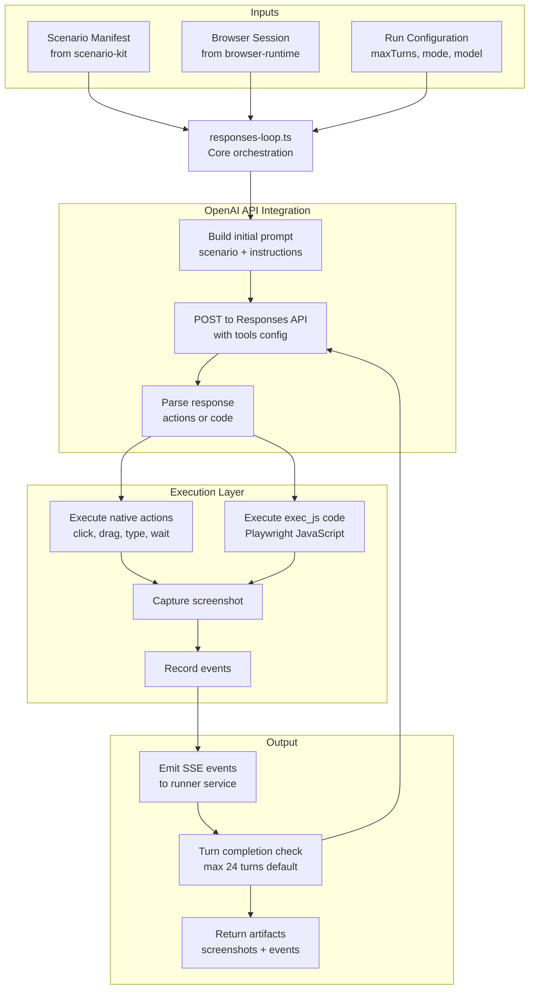
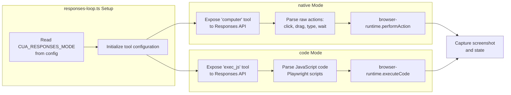
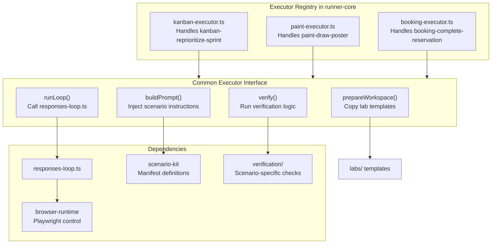
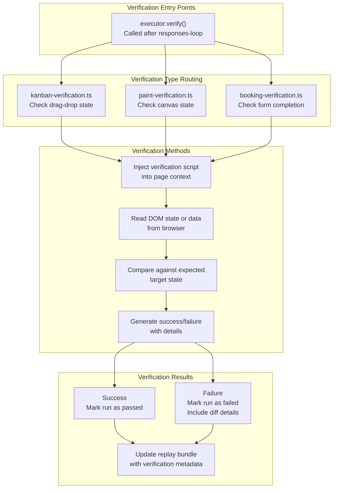
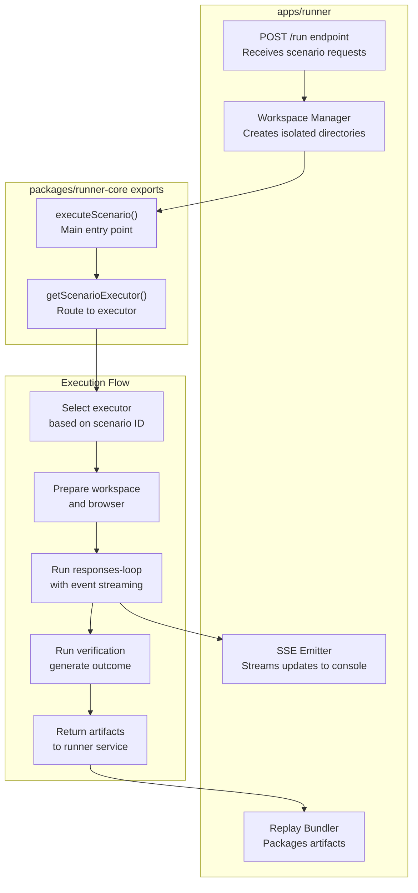

<!-- source: DeepWiki mcp.deepwiki.com · repo openai/openai-cua-sample-app · page 4.1 runner-core and responses-loop · fetched 2026-10-26 -->

# runner-core and responses-loop

Relevant source files

The following files were used as context for generating this wiki page:

- [README.md](README.md)

## Purpose and Scope

The `runner-core` package contains the canonical integration with OpenAI's Responses API through `responses-loop.ts`, along with scenario execution orchestration and verification logic. This page documents the package structure, the responses loop implementation, scenario executors, and verification mechanisms. For details on the Responses API execution flow, see [Execution Flow](#5.1). For scenario definitions and manifests, see [Scenario System](#6.1).

**Sources:** [README.md:13](), [README.md:118-119]()

---

## Package Structure

The `runner-core` package is organized into several key areas:

| Directory/File | Purpose |
|---|---|
| `src/responses-loop.ts` | Core Responses API integration loop |
| `src/executors/` | Scenario-specific execution logic for kanban, paint, and booking |
| `src/verification/` | Verification functions for different scenario types |
| `src/index.ts` | Package exports for consumption by `apps/runner` |

The package serves as the orchestration hub, importing from:
- `browser-runtime` for Playwright session control
- `scenario-kit` for scenario manifests and prompts
- `replay-schema` for type contracts

It exports execution functions that the runner service calls to initiate and manage scenario runs.

**Sources:** [README.md:118-119]()

---

## Responses Loop Architecture

#### Diagram: responses-loop.ts Integration Points

The responses loop implements the core turn-based interaction pattern:

1. **Initialization**: Receives scenario manifest, browser session, and configuration
2. **Prompt Construction**: Builds initial system and user prompts from scenario instructions
3. **API Request**: Sends prompt to GPT-5.4 Responses API with tool configuration (native computer tool or exec_js)
4. **Response Processing**: Parses model response to extract actions or code
5. **Execution**: Executes actions in browser via `browser-runtime`
6. **State Capture**: Takes screenshot and records execution events
7. **Streaming**: Emits events to runner service for SSE transmission
8. **Iteration**: Repeats until completion signal, max turns (default 24), or error

**Sources:** [README.md:13](), [README.md:91-96]()

---

## Execution Modes

The responses loop supports two execution modes through the `CUA_RESPONSES_MODE` environment variable:

#### Diagram: Mode-Specific Execution Paths

### Native Mode
- Exposes the Responses API `computer` tool directly
- Model emits coordinates for clicks, drag operations, text for typing, and wait durations
- Closest representation of the raw computer tool capabilities
- Actions executed through `browser-runtime` coordinate-based methods

### Code Mode
- Exposes an `exec_js` function as a tool
- Model generates Playwright JavaScript code
- Provides a browser REPL harness
- Code executed through `browser-runtime.executeCode` with full Playwright API access

Both modes share the same verification pipeline and replay artifact generation.

**Sources:** [README.md:91-96]()

---

## Scenario Executors

#### Diagram: Scenario Executor Architecture

Each scenario has a dedicated executor that implements a common interface:

| Method | Responsibility |
|---|---|
| `prepareWorkspace()` | Copies lab templates from `labs/` into isolated workspace |
| `buildPrompt()` | Constructs scenario-specific instructions from manifest |
| `runLoop()` | Invokes `responses-loop.ts` with scenario context |
| `verify()` | Executes scenario-specific verification after completion |

### Example: Kanban Executor Flow

1. Copies `labs/kanban/` HTML and assets to workspace
2. Builds prompt including target board state from operator input
3. Calls responses loop with browser pointed at workspace URL
4. After completion, verifies drag-and-drop state matches target configuration

**Sources:** [README.md:100-102](), [README.md:118-119]()

---

## Verification Logic

The verification subsystem validates scenario outcomes against expected criteria:

#### Diagram: Verification Pipeline

### Verification Types

| Scenario | Verification Method | Success Criteria |
|---|---|---|
| `kanban-reprioritize-sprint` | Parse DOM to extract card positions in columns | Card order matches operator-specified target state |
| `paint-draw-poster` | Execute canvas pixel comparison or state serialization | Saved canvas state matches expected drawing criteria |
| `booking-complete-reservation` | Read form submission data from page | Form fields populated correctly and submission confirmed |

### Verification Process

1. **State Extraction**: Inject JavaScript into page to read current state (DOM structure, canvas data, form values)
2. **Target Comparison**: Compare extracted state against expected target defined in scenario manifest or operator input
3. **Outcome Generation**: Produce structured success/failure result with details
4. **Metadata Capture**: Include verification details in replay bundle for operator review

**Sources:** [README.md:100-102]()

---

## Integration with Runner Service

#### Diagram: runner-core Export Interface

The runner service consumes `runner-core` through a clean API:

### Entry Point
`executeScenario(scenarioId, config, eventCallback)` is the primary export that:
- Accepts scenario ID (e.g., `"kanban"`, `"paint"`, `"booking"`)
- Receives configuration including model, max turns, execution mode
- Takes event callback for real-time SSE streaming
- Returns promise resolving to execution outcome and artifacts

### Event Streaming
The responses loop emits events during execution:
- `turn_start`: New API request initiated
- `action_executed`: Browser action completed
- `screenshot_captured`: New screenshot available
- `turn_complete`: Turn finished, next iteration beginning
- `run_complete`: All turns finished or early completion
- `error`: Execution error occurred

These events flow through the callback to the runner service's SSE endpoint, enabling real-time console updates.

### Artifact Return
After execution, `runner-core` returns:
- Array of screenshots (base64-encoded or file paths)
- Event log with timestamps and action details
- Verification outcome (success/failure with details)
- Metadata (turn count, execution mode, model used)

The runner service bundles these artifacts for replay via `GET /replay/:runId`.

**Sources:** [README.md:6](), [README.md:118-119]()

---

## Configuration and Tunables

The responses loop respects several configuration parameters:

| Parameter | Source | Default | Description |
|---|---|---|---|
| `maxResponseTurns` | Run config | `24` | Maximum API request turns before termination |
| `model` | Run config | `"gpt-5.4"` | OpenAI model identifier |
| `mode` | `CUA_RESPONSES_MODE` | `"auto"` | Execution mode: `native` or `code` |
| `headless` | Run config | `true` | Browser visibility during execution |

### Turn Limit Rationale
The default 24-turn limit prevents infinite loops while allowing sufficient iterations for complex scenarios like multi-step form completion. The limit can be adjusted per-run through the operator console.

### Mode Selection
- `native`: Direct computer tool exposure
- `code`: Playwright REPL exposure via `exec_js`

Both modes execute against the same scenario manifests and produce equivalent replay artifacts.

**Sources:** [README.md:91-96](), [README.md:139]()

---

## Error Handling

The responses loop handles several error categories:

| Error Type | Handling Strategy | Outcome |
|---|---|---|
| API errors | Capture error response, terminate loop | Run marked failed with API error details |
| Browser errors | Catch Playwright exceptions, log context | Run marked failed with browser error details |
| Verification failures | Normal execution completion, verification reports failure | Run marked failed with verification diff |
| Timeout errors | Max turns exceeded without completion | Run marked failed with timeout indicator |
| Safety acknowledgements | Return stable error code | Run failed with `unsupported_safety_acknowledgement` |

All errors are captured in the replay bundle with full context for debugging.

**Sources:** [README.md:145-147]()

---

