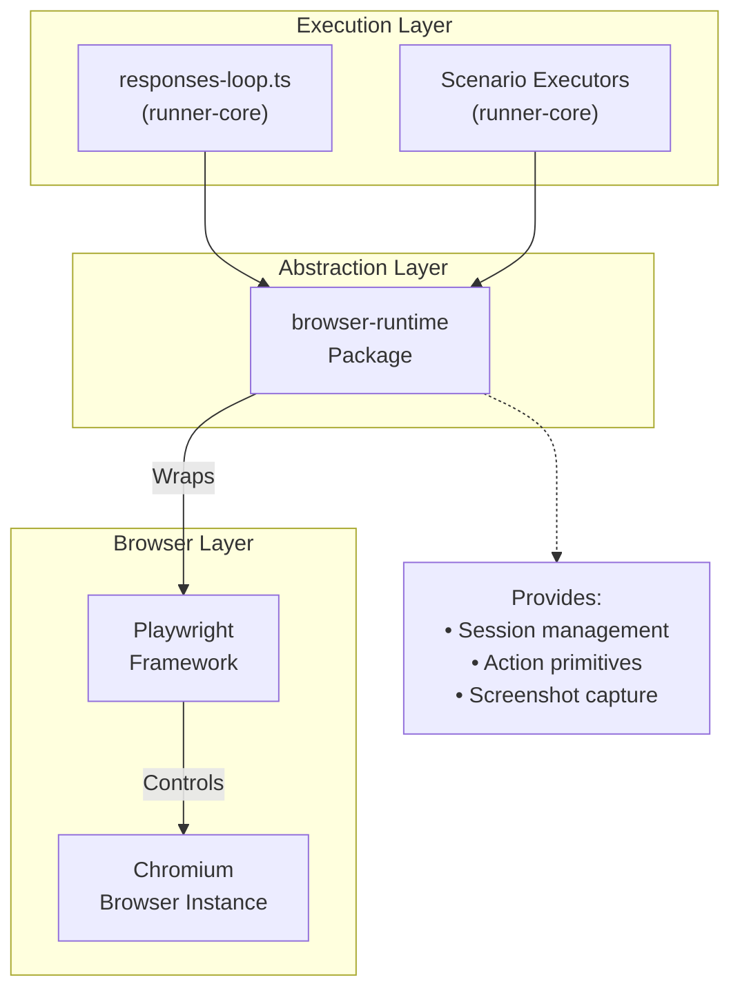
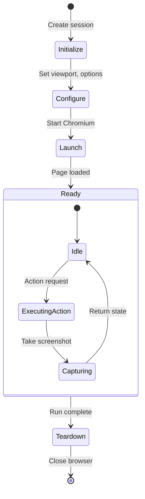
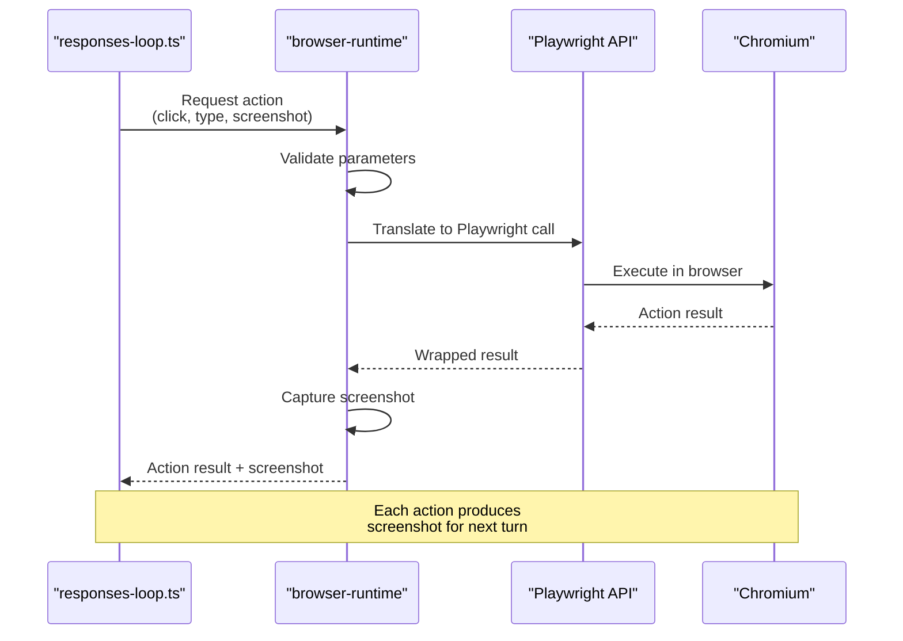
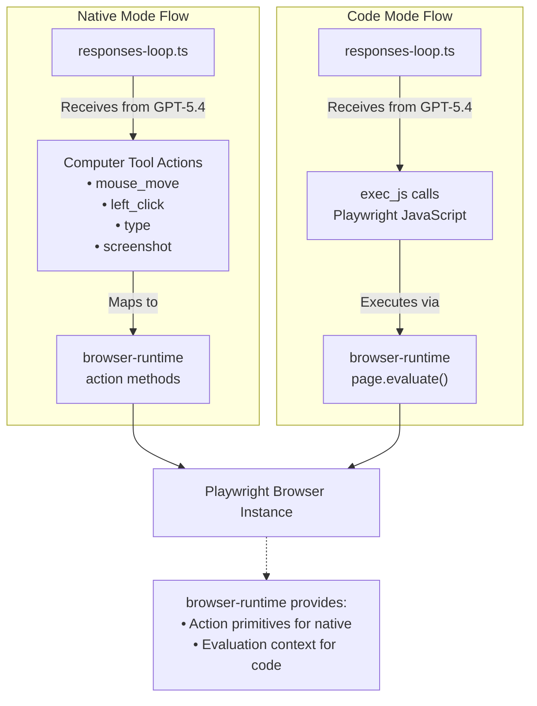
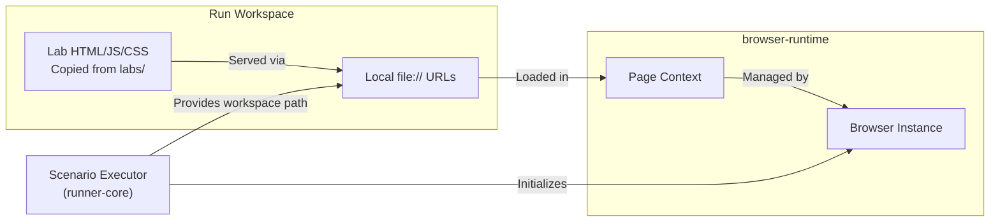
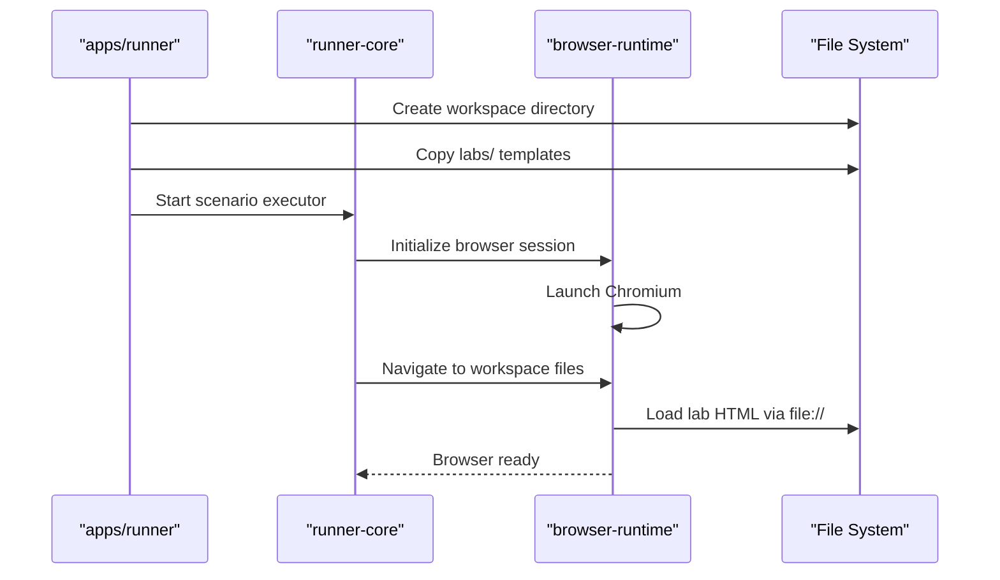
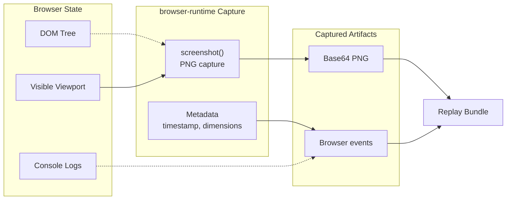

<!-- source: DeepWiki mcp.deepwiki.com · repo openai/openai-cua-sample-app · page 4.2 browser-runtime · fetched 2026-10-26 -->

# browser-runtime

<details>
<summary>Relevant source files</summary>

The following files were used as context for generating this wiki page:

- [README.md](README.md)

</details>


## Overview

The `browser-runtime` package provides a Playwright abstraction layer that enables browser control capabilities for the openai-cua-sample-app. It serves as the interface between the execution orchestration in `runner-core` and the underlying Playwright browser automation framework.

**Key Responsibilities:**
- Abstract Playwright browser and page lifecycle management
- Provide consistent browser session interfaces for scenario execution
- Expose browser control primitives (clicks, navigation, screenshots)
- Support both headless and headful browser modes
- Handle browser configuration and session isolation

Sources: [README.md:116-117]()
</thinking>

## Package Role in System Architecture

The `browser-runtime` package sits at a critical layer in the system architecture, mediating between high-level execution logic and low-level browser automation:



Sources: [README.md:6-7](), [README.md:116-119]()

## Browser Session Management

The `browser-runtime` package manages the complete lifecycle of browser sessions, from initialization through cleanup. Each scenario execution receives an isolated browser context to ensure clean, reproducible runs.

**Browser Session Lifecycle Diagram:**


**Key Configuration Options:**

| Option | Purpose | Values |
|--------|---------|--------|
| Headless Mode | Browser visibility | `true` (default), `false` |
| Viewport Size | Browser dimensions | Default matches computer tool expectations |
| Chromium Path | Browser binary location | Set by Playwright installation |
| Context Isolation | Per-run isolation | Always enabled for scenario runs |

Sources: [README.md:22](), [README.md:44-57](), [README.md:64]()

## Browser Action Primitives

The `browser-runtime` package exposes browser control primitives that support both execution modes. These primitives form the foundation for scenario execution:

**Core Action Categories:**

| Category | Actions | Used By |
|----------|---------|---------|
| Navigation | Page load, URL navigation | Both modes |
| Input | Clicks, typing, key presses | Native mode primary |
| State Capture | Screenshots, DOM snapshots | Both modes |
| Evaluation | JavaScript execution in page context | Code mode primary |

**Action Execution Flow:**


The abstraction ensures consistent behavior regardless of whether actions originate from native computer tool calls or code mode JavaScript execution.

Sources: [README.md:93-94]()

## Integration with Execution Modes

The `browser-runtime` package supports both native and code execution modes through a unified interface. The mode selection determines how browser actions are invoked:

**Execution Mode Comparison:**


**Native Mode Action Mapping:**

| Computer Tool Action | browser-runtime Method | Playwright Call |
|---------------------|------------------------|-----------------|
| `mouse_move(x, y)` | Mouse position tracking | `page.mouse.move(x, y)` |
| `left_click(x, y)` | Click at coordinates | `page.mouse.click(x, y)` |
| `type(text)` | Text input | `page.keyboard.type(text)` |
| `screenshot()` | Capture viewport | `page.screenshot()` |

**Code Mode Integration:**

In code mode, the `browser-runtime` exposes the Playwright `page` object context to JavaScript execution, allowing the model to script browser interactions directly through `page.click()`, `page.fill()`, `page.evaluate()`, and other Playwright APIs.

Sources: [README.md:91-96]()

## Workspace and Lab Integration

The `browser-runtime` package operates within isolated workspaces created for each scenario run. Each run receives a dedicated directory containing lab templates copied from the `labs/` directory:

**Workspace Browser Flow:**


**Workspace Initialization Sequence:**


The workspace isolation ensures:
- Clean state for each run
- No cross-run contamination
- Deterministic lab starting conditions
- Safe file system access boundaries

Sources: [README.md:106-121]()

## Screenshot and State Capture

The `browser-runtime` package captures browser state after each action, providing visual context for the next response turn:

**Screenshot Capture Process:**

| Stage | Operation | Output |
|-------|-----------|--------|
| Pre-action | Current viewport state | Baseline screenshot |
| Action execution | Browser interaction | DOM/UI changes |
| Post-action | Viewport capture | New state screenshot |
| Encoding | Base64 encoding | Embeddable image data |

**State Capture Architecture:**


Screenshots are taken at full viewport resolution and encoded as PNG images. Each screenshot is tagged with metadata including timestamp and viewport dimensions, enabling accurate replay reconstruction.

Sources: [README.md:5-6]()

## Usage Examples

### Basic Usage with CLI

To use a browser environment with the CUA Sample App CLI:

```bash
python cli.py --computer local-playwright --start-url https://example.com
```

This starts the CLI with the LocalPlaywrightComputer and navigates to the specified URL.

### Adding Browser-Specific Functions

You can provide browser-specific functions to the Agent by implementing them in your Computer subclass and specifying them as tools. This is useful for cases where screenshots might not capture UI elements like the browser's back button.

For example, to add a `goto` function:

```python
# Define the function schema
goto_function = {
    "type": "function",
    "function": {
        "name": "goto",
        "description": "Navigate to a URL",
        "parameters": {
            "type": "object",
            "properties": {
                "url": {
                    "type": "string",
                    "description": "The URL to navigate to"
                }
            },
            "required": ["url"]
        }
    }
}

# Create the agent with the function
agent = Agent(
    model="gpt-4o",
    computer=computer,
    tools=[goto_function]
)
```

Since `goto` is already implemented in `BasePlaywrightComputer`, the function call will be routed to the Computer's implementation.

Sources: [README.md:144-148]()

---

