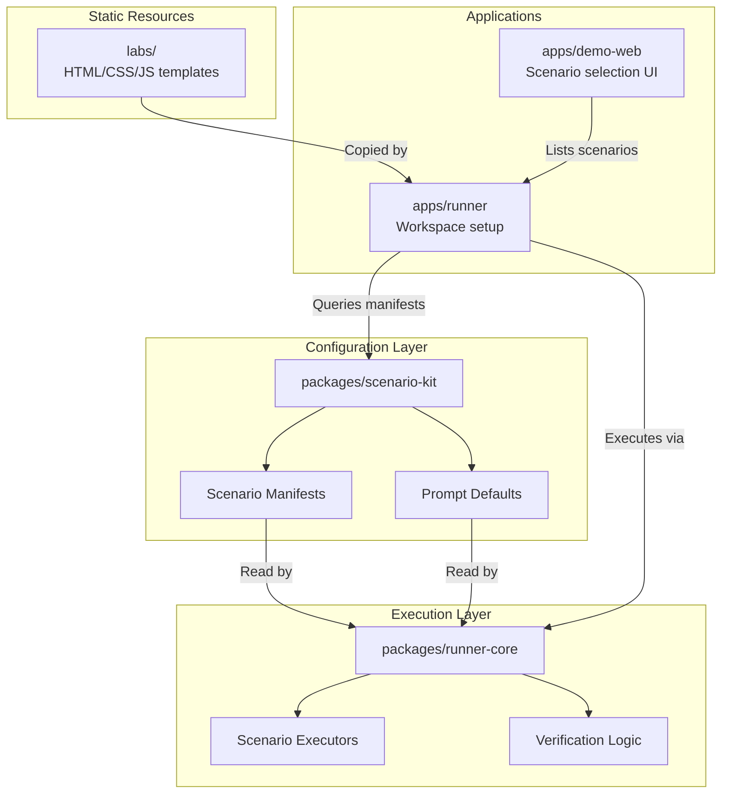
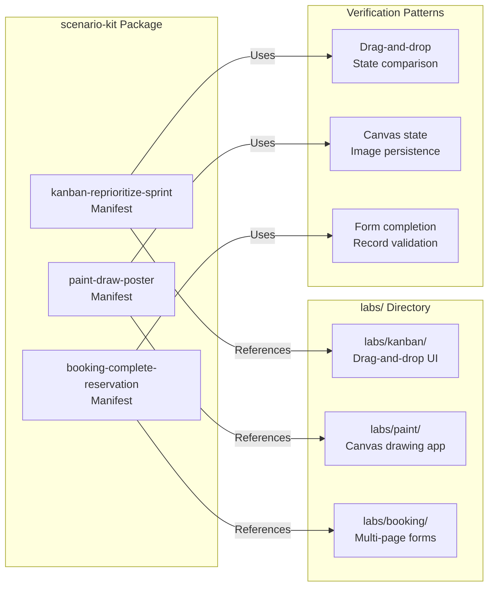
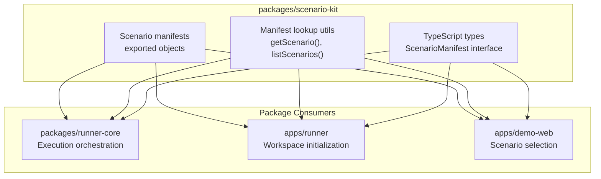
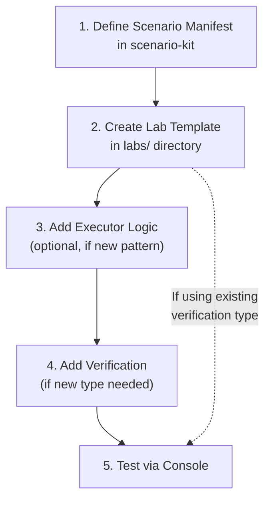

<!-- source: DeepWiki mcp.deepwiki.com · repo openai/openai-cua-sample-app · page 4.3 scenario-kit · fetched 2026-10-26 -->

# scenario-kit

Relevant source files

The following files were used as context for generating this wiki page:

- [README.md](README.md)

## Purpose and Scope

The `scenario-kit` package provides public scenario manifest definitions and prompt defaults for the openai-cua-sample-app. It serves as a declarative registry of available scenarios, defining what each scenario does, how it should be initialized, and what prompt templates to use. This package contains no execution logic; it only defines the static configuration that runner-core uses to orchestrate runs. For information about scenario execution and verification, see [Scenario System](#6.1). For details about the execution engine that consumes these manifests, see [runner-core and responses-loop](#4.1).

**Sources:** [README.md:1-158]()

---

## Package Role in Architecture

The `scenario-kit` package acts as a configuration layer between the static lab templates and the execution engine. It translates high-level scenario descriptions into concrete initialization parameters that runner-core can consume.

**Sources:** [README.md:106-124]()

---

## Scenario Manifest Structure

Each scenario manifest defines the essential metadata and configuration needed to execute that scenario. While the exact TypeScript interface resides in the package source, the manifest conceptually includes:

| Manifest Field | Purpose | Example |
|---------------|---------|---------|
| **Scenario ID** | Unique identifier for API and routing | `"kanban-reprioritize-sprint"` |
| **Short Name** | Human-readable alias | `"kanban"` |
| **Display Name** | UI-friendly title | `"Kanban Board Reprioritization"` |
| **Lab Template** | Directory in `labs/` to copy | `"kanban"` |
| **Entry Point** | Initial HTML file to load | `"index.html"` |
| **Prompt Template** | System/user message structure | Operator-customizable text |
| **Verification Type** | How to determine success | `"drag-and-drop"`, `"canvas"`, `"form"` |

The manifest serves as a contract between the operator console (which lists available scenarios), the runner (which sets up workspaces), and runner-core (which executes and verifies outcomes).

**Sources:** [README.md:99-104](), [README.md:106-124]()

---

## Official Scenario Definitions

The package defines three official scenarios that demonstrate different verification patterns and interaction paradigms:

### Kanban Reprioritize Sprint

- **Scenario ID:** `kanban-reprioritize-sprint`
- **Short Name:** `kanban`
- **Focus:** Stateful drag-and-drop verification against a target board state derived from the operator prompt
- **Lab Template:** Kanban board with draggable task cards
- **Verification:** Compares final card positions to expected state

### Paint Draw Poster

- **Scenario ID:** `paint-draw-poster`
- **Short Name:** `paint`
- **Focus:** Cursor control, drawing, and verifying saved canvas state
- **Lab Template:** Canvas-based drawing application
- **Verification:** Validates that canvas state was saved and matches drawing expectations

### Booking Complete Reservation

- **Scenario ID:** `booking-complete-reservation`
- **Short Name:** `booking`
- **Focus:** Multi-step browsing and form completion
- **Lab Template:** Multi-page booking flow with forms
- **Verification:** Checks local confirmation record against form data

**Sources:** [README.md:98-104]()

---

## Prompt Defaults and Templates

The `scenario-kit` package provides prompt templates that define the initial context given to GPT-5.4 when starting a run. These templates typically include:

- **System message:** Establishes the scenario context, available tools, and success criteria
- **User message template:** Incorporates operator-provided customization (e.g., "reprioritize tasks based on urgency")
- **Default parameters:** Max response turns, model name, execution mode preferences

The prompt templates are designed to be operator-customizable through the console UI while maintaining the core scenario instructions. When runner-core initiates a responses-loop, it combines:

1. The base prompt template from scenario-kit
2. Operator customizations from the run request
3. Dynamic context (browser state, screenshots, previous actions)

This separation allows scenario definitions to remain stable while operators adapt prompts to specific test cases.

**Sources:** [README.md:106-124](), [README.md:136-140]()

---

## Package Exports and Imports

The `scenario-kit` package exports its manifests and utilities for consumption by other packages in the monorepo:

**Typical import patterns:**

- `runner-core` imports manifests to match scenario IDs to execution and verification strategies
- `apps/runner` imports manifests to set up workspaces by copying the correct lab template
- `apps/demo-web` imports manifests to populate the scenario selection dropdown

The package maintains a stable interface so that adding new scenarios requires changes only to scenario-kit and runner-core (for new verification types), not to the applications.

**Sources:** [README.md:106-124]()

---

## Relationship to Execution and Verification

While `scenario-kit` defines *what* scenarios exist and their configuration, it does not implement execution or verification logic. The division of responsibilities is:

| Responsibility | Package | Details |
|---------------|---------|---------|
| **Manifest Definition** | `scenario-kit` | Static configuration, prompt templates, metadata |
| **Workspace Setup** | `apps/runner` | Copies lab templates based on manifest |
| **Execution** | `runner-core` | responses-loop, browser control, turn management |
| **Verification** | `runner-core` | Scenario-specific outcome validation |

This separation enables:

- **Declarative scenario additions:** New scenarios can be added by defining manifests without modifying execution code (unless new verification types are needed)
- **Execution mode flexibility:** The same manifest works for both `native` and `code` execution modes
- **Testability:** Manifests can be validated independently of runtime behavior

For details on how manifests are executed, see [runner-core and responses-loop](#4.1). For verification patterns, see [Verification Mechanisms](#6.3).

**Sources:** [README.md:92-97](), [README.md:106-124]()

---

## Adding Custom Scenarios

The package structure supports custom scenario definitions by following the established pattern:

**Steps to add a scenario:**

1. **Create manifest** in `scenario-kit` with unique ID, display name, and lab reference
2. **Add lab template** in `labs/<scenario-name>/` with HTML/CSS/JS assets
3. **Add executor** in `runner-core` if the scenario requires new initialization patterns
4. **Add verifier** in `runner-core` if the scenario requires a new verification type (drag-and-drop, canvas, form are already implemented)
5. **Test** by selecting the scenario in the operator console

Most simple scenarios can reuse existing verification types and require no changes to runner-core.

**Sources:** [README.md:7](), [README.md:106-124]()

---

## Integration with replay-schema

The `scenario-kit` manifests influence the structure of replay bundles through the `replay-schema` package, which defines shared contracts. When a run completes:

1. The manifest's scenario ID appears in replay metadata
2. The prompt template influences stored prompt data
3. Verification type determines what verification artifacts are captured

The scenario manifest serves as the source of truth for what constitutes a valid run of that scenario, ensuring consistency between initiation, execution, and replay.

For details on replay bundle structure, see [Replay Bundles](#8.1). For the shared type definitions, see [replay-schema](#4.4).

**Sources:** [README.md:106-124]()

---

