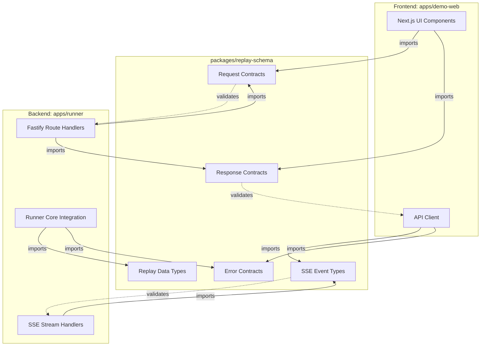
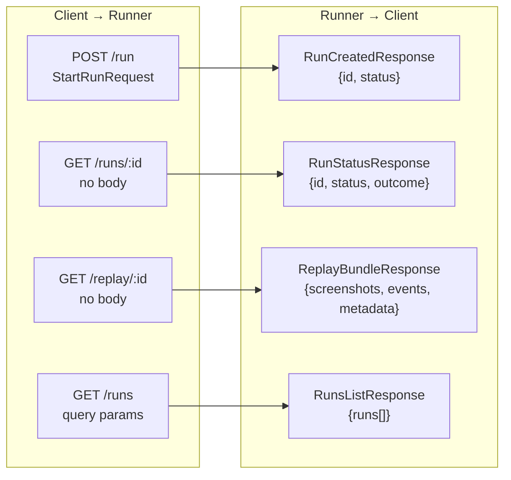
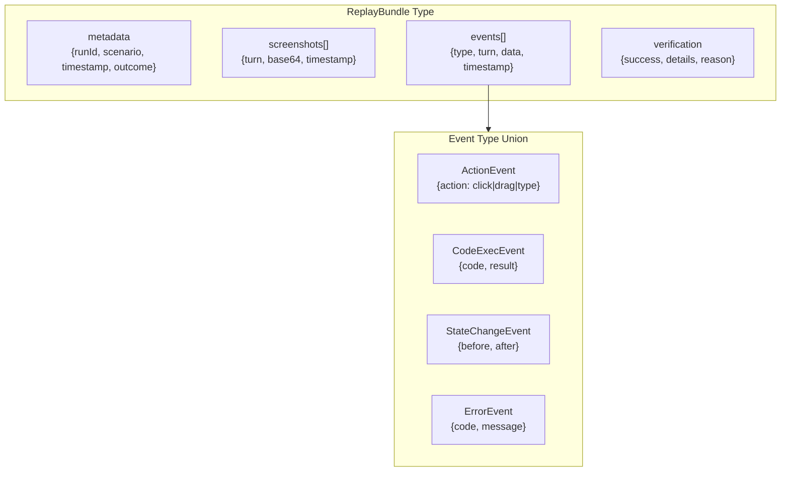
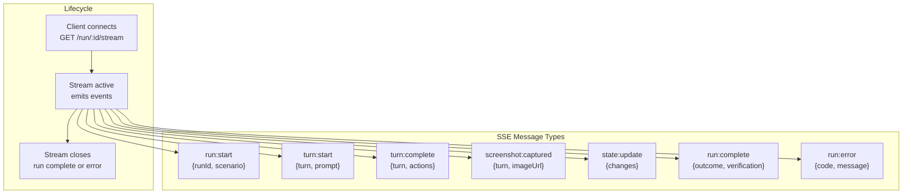
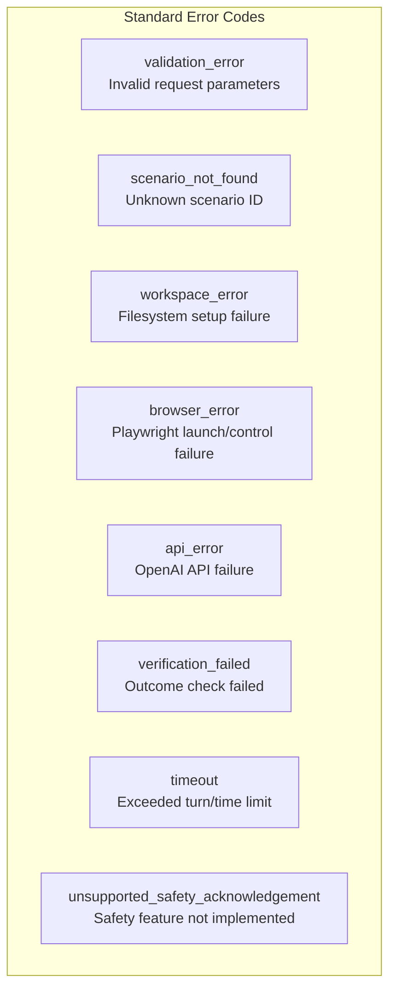
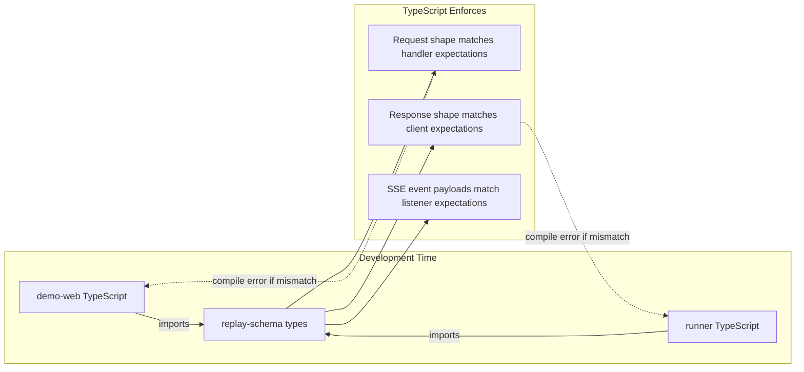
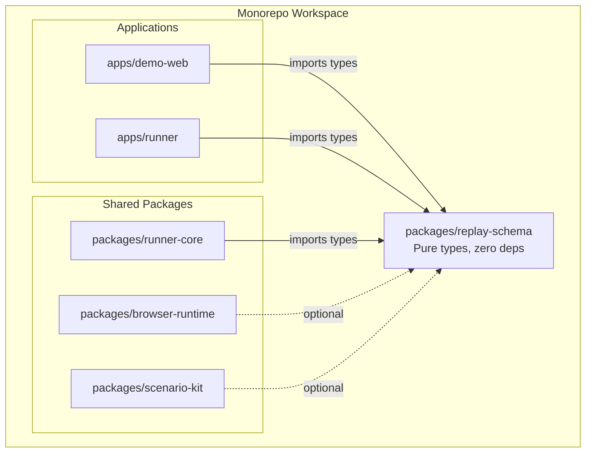

<!-- source: DeepWiki mcp.deepwiki.com · repo openai/openai-cua-sample-app · page 4.4 replay-schema · fetched 2026-10-26 -->

# replay-schema

<details>
<summary>Relevant source files</summary>

The following files were used as context for generating this wiki page:

- [README.md](README.md)

</details>


## Purpose and Scope

The `replay-schema` package defines shared TypeScript contracts for requests, responses, replay artifacts, and errors used across the `demo-web` operator console and `runner` service. This package serves as the single source of truth for API communication and ensures type safety across the HTTP and Server-Sent Events (SSE) boundaries.

For information about how these contracts are used in the operator console, see [Operator Console (demo-web)](#3.1). For details on how the runner service implements these contracts, see [Runner Service](#3.2). For the actual replay bundle creation and structure, see [Replay Bundles](#8.1).

**Sources:** [README.md:112-113]()

---

## Package Role in System Architecture



The `replay-schema` package acts as a contract layer ensuring both applications agree on data structures at compile time, preventing runtime type mismatches during HTTP and SSE communication.

**Sources:** [README.md:112-113](), high-level architecture diagrams

---

## Core Type Categories

The package organizes contracts into five primary categories:

| Category | Purpose | Used By |
|----------|---------|---------|
| **Request Contracts** | Define the shape of HTTP POST/GET request bodies and query parameters | `demo-web` (sends), `runner` (validates) |
| **Response Contracts** | Define the shape of HTTP response bodies for run status, results, and metadata | `runner` (sends), `demo-web` (consumes) |
| **Event Stream Types** | Define SSE message payloads for real-time run updates | `runner` (emits), `demo-web` (listens) |
| **Replay Data Types** | Define the structure of replay bundles including screenshots, events, and metadata | `runner-core` (generates), `runner` (serves), `demo-web` (displays) |
| **Error Contracts** | Define standardized error shapes and codes for failure scenarios | Both applications for consistent error handling |

**Sources:** [README.md:112-113](), system architecture overview

---

## Request/Response Contracts

### HTTP API Surface

The schema defines contracts for the runner's HTTP endpoints:



### StartRunRequest Structure

Typical fields in a start run request contract:

- `scenarioId`: string identifier (e.g., `"kanban"`, `"paint"`, `"booking"`)
- `executionMode`: `"native"` or `"code"` 
- `model`: optional model override (defaults from env var)
- `maxResponseTurns`: optional turn limit (defaults to 24)
- `headless`: boolean for browser visibility
- `customPrompt`: optional string for operator-provided instructions

### Response Status Types

Common status values defined in response contracts:

- `"pending"`: run queued but not started
- `"running"`: active execution in progress
- `"completed"`: finished successfully
- `"failed"`: terminated with error
- `"timeout"`: exceeded turn or time limit

**Sources:** [README.md:93-96](), [README.md:139]()

---

## Replay Data Structures

### Replay Bundle Schema



### Screenshot Data Contract

Screenshots captured during execution include:

- `turn`: integer index (0-23 typically)
- `imageData`: base64-encoded PNG string
- `timestamp`: ISO 8601 timestamp
- `width`: viewport width in pixels
- `height`: viewport height in pixels
- `metadata`: optional object with cursor position, active element

### Event Record Contract

Each event in the replay bundle contains:

- `eventId`: unique string identifier
- `turn`: which response turn generated this event
- `eventType`: discriminated union type
- `payload`: type-specific data object
- `timestamp`: ISO 8601 timestamp
- `duration`: optional milliseconds for timed actions

**Sources:** [README.md:5-7](), system overview diagrams

---

## Event Stream Schema

### Server-Sent Event Types



### SSE Message Format

All SSE messages follow a common envelope:

- `type`: discriminated event type string
- `timestamp`: ISO 8601 timestamp
- `runId`: string identifier for correlation
- `data`: type-specific payload object

The `demo-web` console establishes an SSE connection immediately after creating a run via `POST /run`, then processes these messages to update the UI in real-time as execution progresses.

**Sources:** [README.md:5-6](), [README.md:111](), SSE documentation in system diagrams

---

## Error Contracts

### Error Code Taxonomy



### Error Response Structure

Error contracts define a consistent shape:

- `code`: string error code from taxonomy above
- `message`: human-readable description
- `details`: optional object with additional context
- `runId`: optional string if error relates to specific run
- `turn`: optional integer if error occurred during specific turn
- `timestamp`: ISO 8601 timestamp

The `unsupported_safety_acknowledgement` code is explicitly mentioned in the README as an unimplemented safety feature that causes runs to fail with a stable error code.

**Sources:** [README.md:147]()

---

## Type Safety Guarantees

### Compile-Time Validation



By centralizing all interface contracts in `replay-schema`, the codebase achieves:

1. **Zero runtime serialization errors** from type mismatches between `demo-web` and `runner`
2. **Refactoring safety** - changing a contract triggers compile errors at all usage sites
3. **API documentation** - contracts serve as machine-readable API documentation
4. **Shared enums** - status codes, error codes, and other enumerations defined once

The TypeScript compiler enforces that both applications conform to these contracts, catching integration issues at build time rather than runtime.

**Sources:** [README.md:112-113](), system architecture diagrams

---

## Usage Patterns

### In demo-web (Frontend)

The operator console imports types for API calls:

```typescript
// Typical import pattern in apps/demo-web
import type { 
  StartRunRequest, 
  RunStatusResponse, 
  SSEMessage 
} from '@cua/replay-schema';

// Type-safe API client
async function startRun(req: StartRunRequest): Promise<RunStatusResponse> {
  // Implementation validates against schema
}
```

### In runner (Backend)

The runner service validates incoming requests:

```typescript
// Typical import pattern in apps/runner
import type { 
  StartRunRequest, 
  RunStatusResponse, 
  ReplayBundle 
} from '@cua/replay-schema';

// Type-safe route handler
fastify.post<{ Body: StartRunRequest }>('/run', async (request, reply) => {
  // Request body automatically typed
});
```

### In runner-core (Execution)

The core execution logic produces typed replay data:

```typescript
// Typical import pattern in packages/runner-core
import type { 
  ReplayBundle, 
  EventRecord, 
  VerificationResult 
} from '@cua/replay-schema';

// Type-safe replay bundle construction
function buildReplayBundle(...): ReplayBundle {
  // Return typed bundle
}
```

**Sources:** [README.md:112-113](), package dependency architecture diagrams

---

## Integration with Monorepo

The `replay-schema` package is designed for zero runtime dependencies - it exports only TypeScript types and interfaces. This makes it lightweight and safe to import from any package in the monorepo without creating circular dependencies or adding bundle weight.



Because `replay-schema` contains only type definitions with no runtime code, it can be freely imported by any package without concerns about circular dependencies or increasing bundle size. TypeScript's type erasure means these imports have zero cost in production builds.

**Sources:** [README.md:107-123](), package architecture diagrams

---

