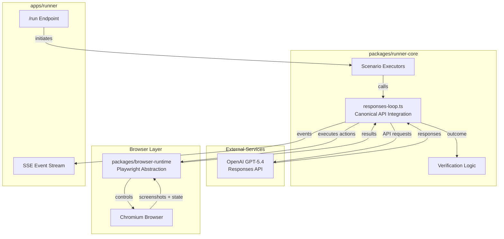
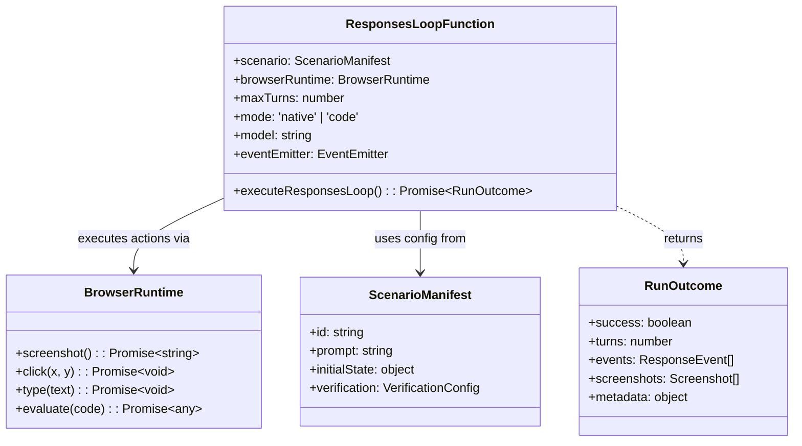
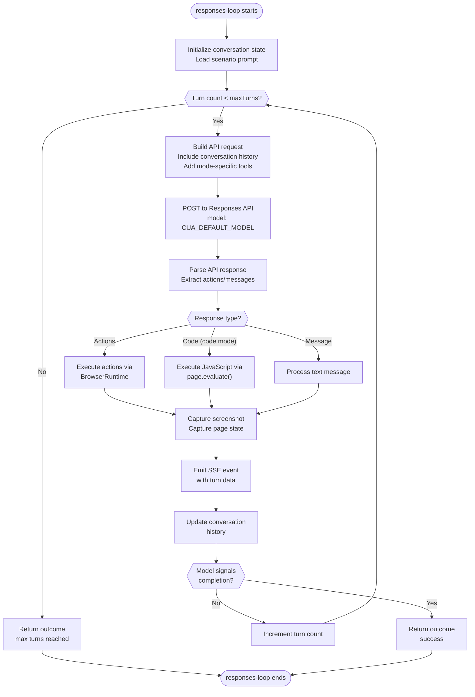
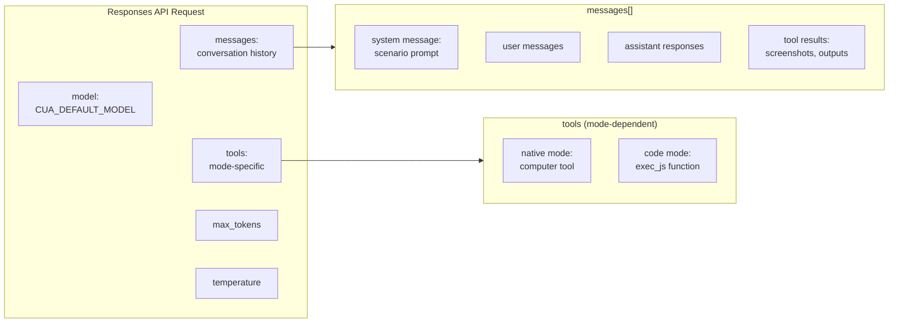
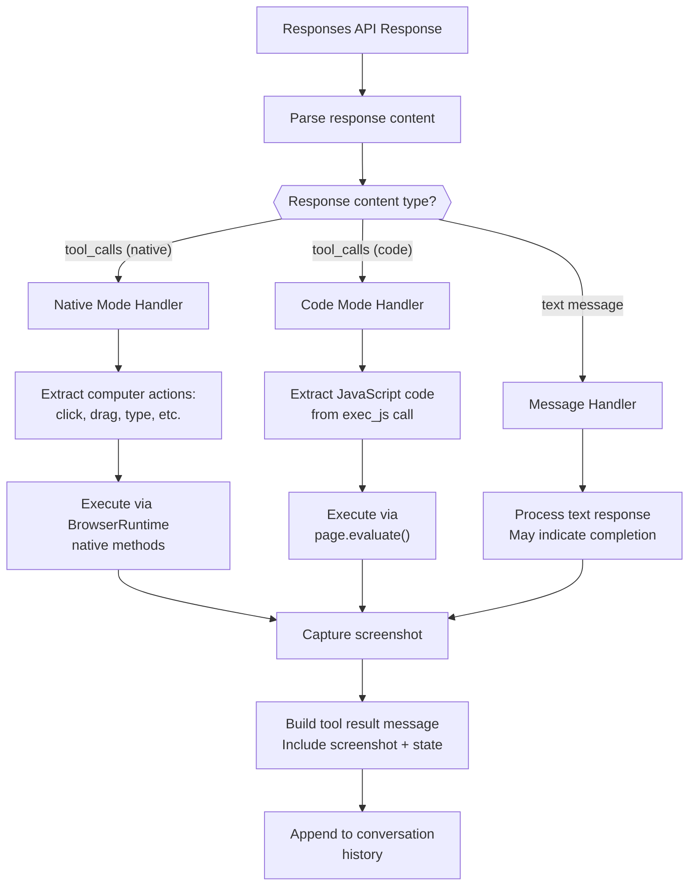
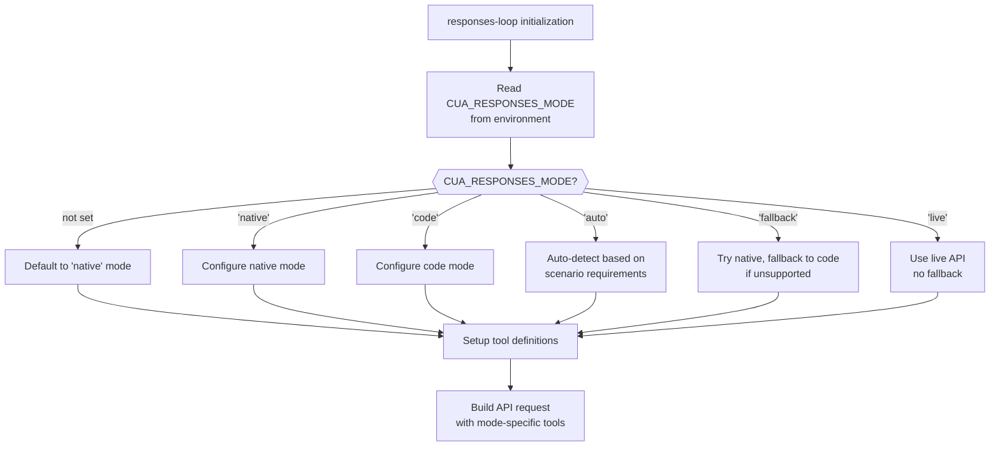
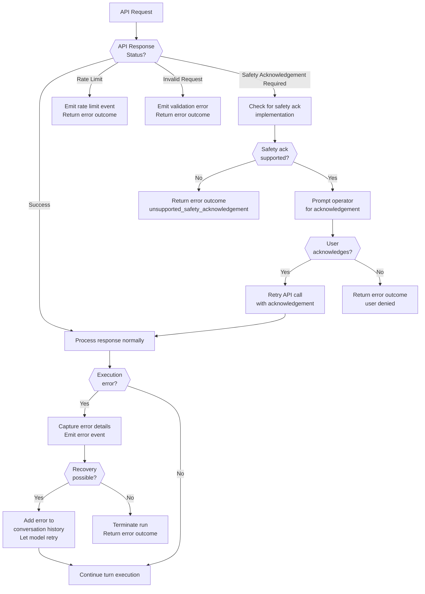

<!-- source: DeepWiki mcp.deepwiki.com · repo openai/openai-cua-sample-app · page 5 Responses API Integration · fetched 2026-10-26 -->

# Responses API Integration

Relevant source files

The following files were used as context for generating this wiki page:

- [README.md](README.md)

## Purpose and Scope

This section documents how the openai-cua-sample-app integrates with OpenAI's GPT-5.4 Responses API for browser automation. The integration is centralized in a single canonical location: `packages/runner-core/src/responses-loop.ts`. This design makes it easy to understand how the system communicates with the model, processes responses, and executes actions in the browser.

The Responses API integration supports two execution modes (native and code), handles turn-based execution with configurable limits, and manages error handling and safety checks. This page focuses on the integration mechanics; for execution flow details see [Execution Flow (5.1)](#5.1), for mode-specific behavior see [Native Mode (5.2)](#5.2) and [Code Mode (5.3)](#5.3).

Sources: [README.md:13-14](), [README.md:91-96]()

## Integration Architecture

The Responses API integration sits at the heart of the runner-core package, coordinating between the OpenAI model, browser runtime, and scenario execution logic.

### Responses API Integration in System Context

Sources: [README.md:13-14](), [README.md:118-119]()

The `responses-loop.ts` file is the only place in the codebase that makes direct API calls to the Responses API. This centralization makes it straightforward to understand the integration, modify API parameters, or add instrumentation.

## responses-loop.ts: The Canonical Integration Point

The `responses-loop.ts` file contains the complete implementation of the Responses API integration loop. It manages the conversation state, constructs API requests, processes responses, executes actions, and emits events for the SSE stream.

### Key Components in responses-loop.ts

Sources: [README.md:13-14](), [README.md:118-119]()

The responses loop is invoked by scenario executors and runs until either:
- The model indicates completion
- The maximum turn count is reached (default 24)
- An error occurs that cannot be recovered

## Turn-Based Execution Model

The Responses API integration implements a turn-based execution model where each "turn" consists of sending a prompt to the model and processing its response. The loop continues until completion or the maximum turn count is reached.

### Turn Execution Flow

Sources: [README.md:139]()

### Turn Count Configuration

| Configuration | Location | Default |
|---------------|----------|---------|
| Backend default | `packages/runner-core` | 24 |
| Frontend default | `NEXT_PUBLIC_CUA_DEFAULT_MAX_RESPONSE_TURNS` | 24 |
| Runtime override | Request body `maxResponseTurns` | Uses default |

The 24-turn default provides sufficient iterations for complex scenarios while preventing infinite loops.

Sources: [README.md:139]()

## Request Structure

Each API request to the Responses API includes the conversation history, scenario context, and mode-specific tool definitions.

### API Request Components

Sources: [README.md:132-133]()

### Message Array Structure

The messages array maintains the complete conversation history:

1. **System message**: Contains the scenario prompt from the scenario manifest
2. **User messages**: Initial task description and context
3. **Assistant responses**: Model's actions, code, or messages from previous turns
4. **Tool results**: Screenshots, execution outputs, and state information from browser actions

This structure allows the model to maintain context across multiple turns and make informed decisions based on previous actions and their results.

Sources: [README.md:91-96]()

## Response Processing

The Responses API returns different response types depending on the execution mode. The responses-loop processes these and routes them to the appropriate handlers.

### Response Type Handling

Sources: [README.md:91-96]()

### Tool Call Response Format

In native mode, tool calls specify actions like:
- `click`: Click at coordinates (x, y)
- `drag`: Drag along a path of coordinates
- `type`: Type text into the active element
- `screenshot`: Capture current page state
- `wait`: Wait for specified milliseconds

In code mode, tool calls specify:
- `exec_js`: Execute Playwright JavaScript code in the browser context

Each response is processed, executed, and the result (including screenshot) is added back to the conversation history for the next turn.

Sources: [README.md:91-96]()

## Mode Configuration and Selection

The execution mode determines how the model controls the browser. The mode is configured via the `CUA_RESPONSES_MODE` environment variable and affects which tools are exposed to the model.

### Mode Selection Flow

Sources: [README.md:133]()

### Mode Configuration Table

| Mode | Tool Exposed | Behavior | Use Case |
|------|--------------|----------|----------|
| `native` | computer tool | Model emits raw actions (click, drag, type) | Closest sample of computer tool |
| `code` | exec_js function | Model writes Playwright JavaScript | Clearest sample of browser REPL |
| `auto` | Selected automatically | System chooses based on scenario | Convenience |
| `fallback` | Tries native first | Falls back to code if native unsupported | Development |
| `live` | Based on API | Uses actual API capabilities | Production |

Sources: [README.md:91-96](), [README.md:133]()

The mode selection affects:
- Which tools are included in the API request
- How responses are processed and executed
- Which BrowserRuntime methods are invoked
- How verification is performed

For detailed information on how each mode works, see [Native Mode (5.2)](#5.2) and [Code Mode (5.3)](#5.3).

## Error Handling and Safety

The Responses API integration implements error handling for API failures, safety acknowledgements, and execution errors.

### Error Handling Flow

Sources: [README.md:146-148]()

### Safety Acknowledgement Handling

The system currently does not implement safety acknowledgement callbacks. When the API requests a safety acknowledgement:

1. The responses-loop detects the `unsupported_safety_acknowledgement` error code
2. It emits an error event to the SSE stream
3. It returns a failed outcome with error details
4. The run terminates with a clear error message

This behavior is documented as a known limitation in the README.

Sources: [README.md:146-148]()

### Common Error Scenarios

| Error Type | Cause | Handling |
|------------|-------|----------|
| Rate limit exceeded | Too many API requests | Emit event, return error outcome |
| Invalid request | Malformed API request | Emit event, return error outcome |
| Safety acknowledgement required | API requires safety check | Fail with `unsupported_safety_acknowledgement` |
| Browser execution error | Playwright action fails | Add to history, let model retry if possible |
| Network timeout | API unreachable | Emit event, return error outcome |

The error handling ensures that operators receive clear feedback through the SSE stream and can review error details in the replay bundle.

Sources: [README.md:146-148]()

## Conclusion

The Agent system serves as the intelligent intermediary between the user, the OpenAI model, and the computer environment. It manages the conversation flow, processes different types of actions, implements safety mechanisms, and adapts to different computing environments. Through its modular design, it can be extended to support new environments and features while maintaining a consistent interface for user interaction.

For more details on how the Agent processes specific item types, see [Item Handling](#4.2). For information on the safety mechanisms, see [Safety Mechanisms](#4.3).

---

