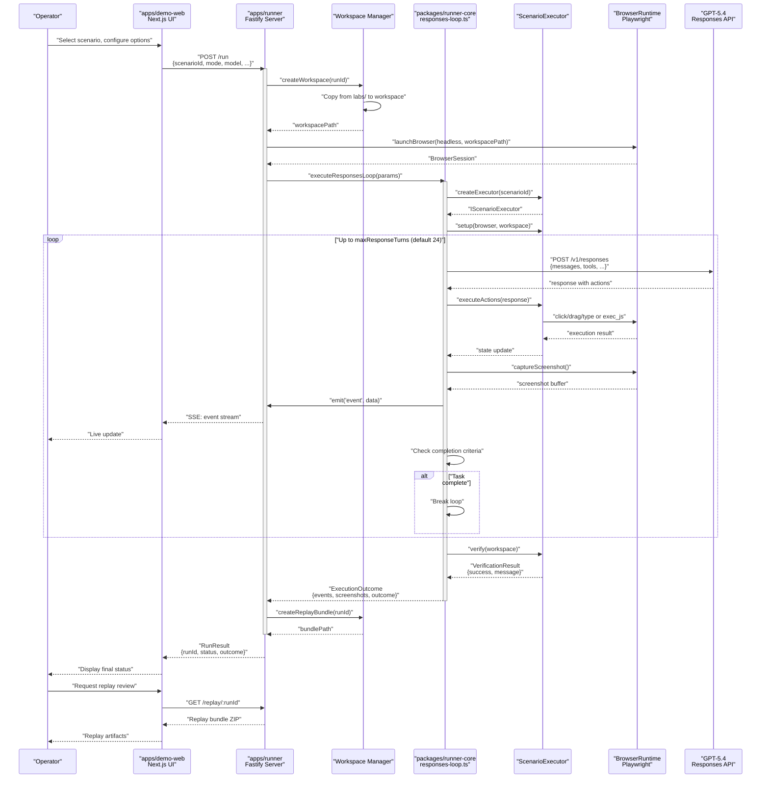
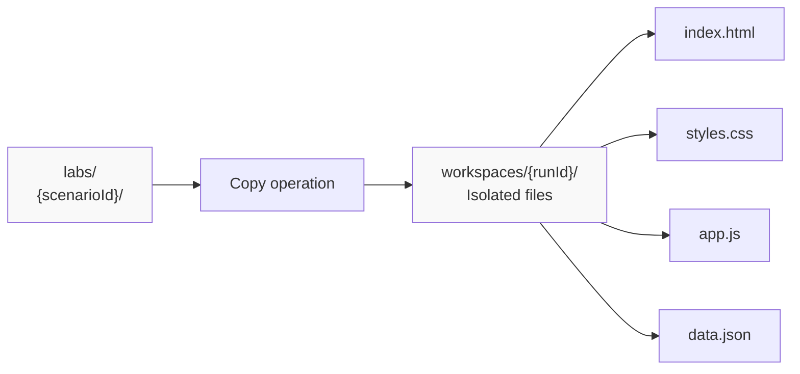
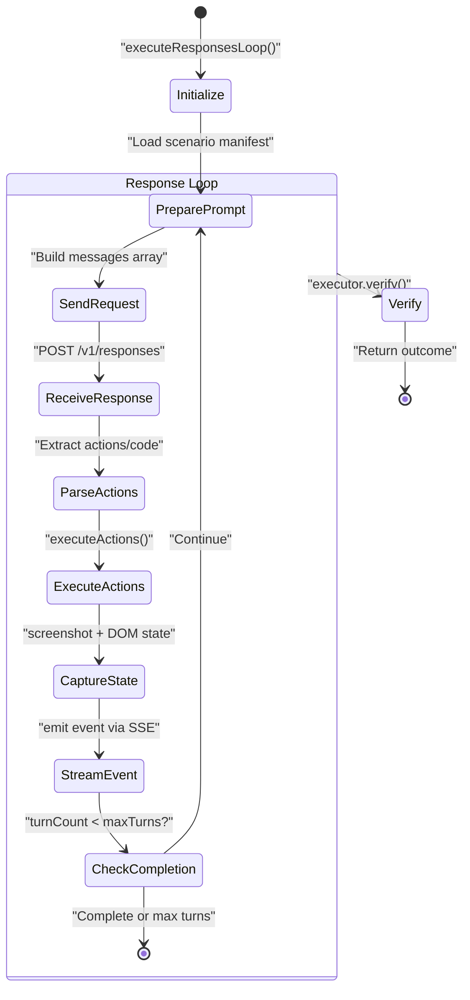
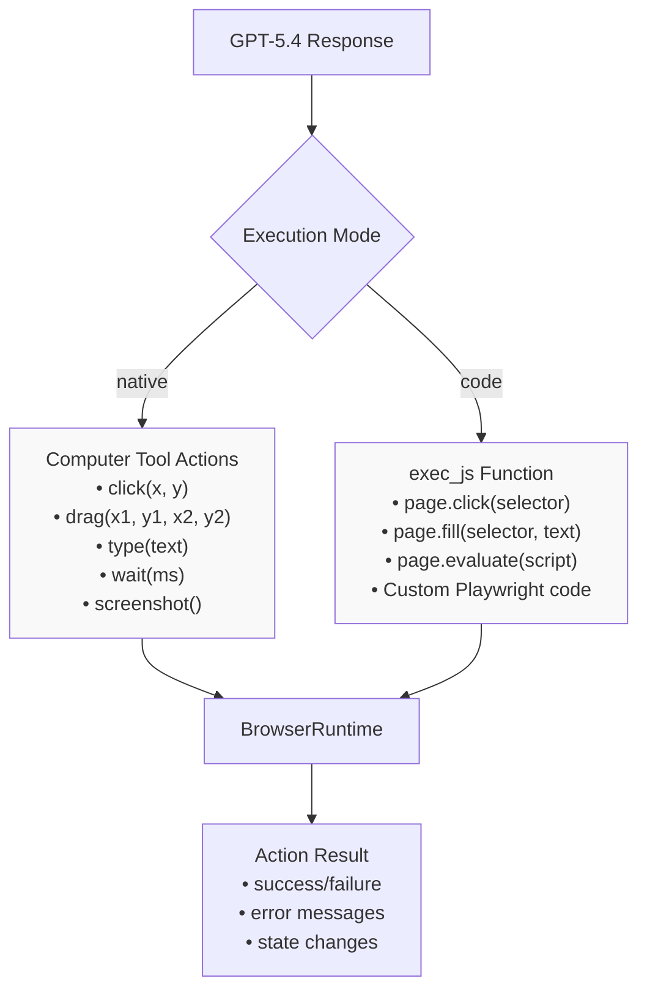
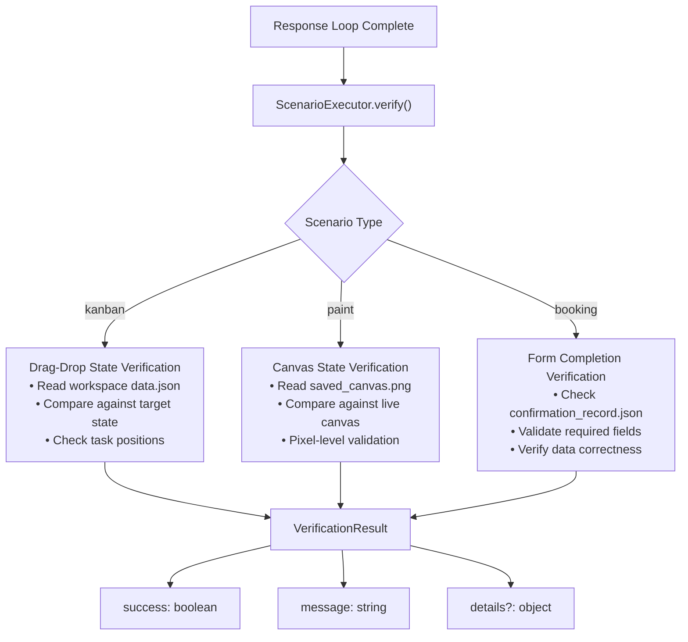
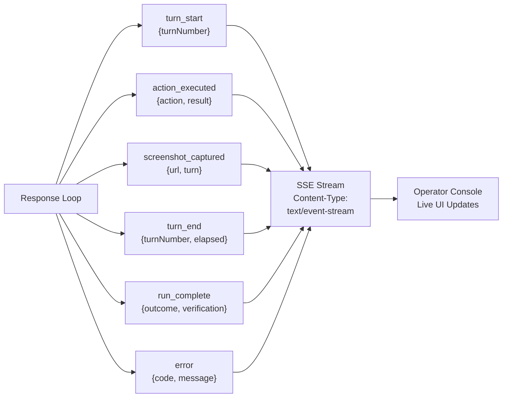
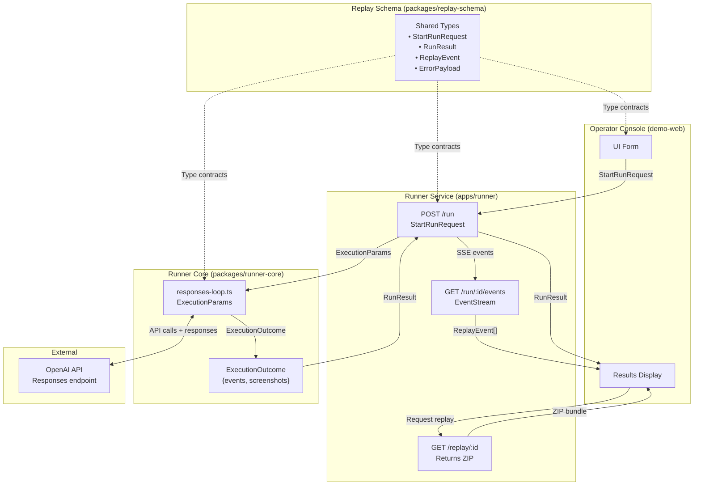

<!-- source: DeepWiki mcp.deepwiki.com · repo openai/openai-cua-sample-app · page 5.1 Execution Flow · fetched 2026-10-26 -->

# Execution Flow

<details>
<summary>Relevant source files</summary>

The following files were used as context for generating this wiki page:

- [README.md](README.md)

</details>


## Purpose and Scope

This document describes the complete execution flow from scenario initiation through model interaction to verification and artifact bundling. It covers the orchestration logic that applies to both Native and Code execution modes.

For details on how the model controls the browser in Native mode, see [Native Mode](#5.2). For details on Code mode's Playwright JavaScript REPL, see [Code Mode](#5.3). For information on how scenarios are defined and verified, see [Scenario System](#6.1).

---

## Overview

The execution flow begins when an operator selects a scenario in the console and submits a run request. The runner service creates an isolated workspace, launches a Playwright browser session, and enters the response loop where GPT-5.4 iteratively controls the browser until the task completes or the turn limit is reached. After execution, the system runs scenario-specific verification and bundles all artifacts for replay.

**Key Components**

| Component | Location | Role |
|-----------|----------|------|
| Operator Console | `apps/demo-web` | UI for initiating runs and viewing results |
| Runner Service | `apps/runner` | HTTP/SSE server, workspace management |
| Response Loop | `packages/runner-core/src/responses-loop.ts` | Canonical Responses API integration point |
| Scenario Executors | `packages/runner-core/src/scenarios/` | Scenario-specific execution and verification |
| Browser Runtime | `packages/browser-runtime` | Playwright session abstraction |

Sources: [README.md:1-158]()

---

## Complete Execution Sequence

The following diagram shows the end-to-end flow with actual code entities and API endpoints:

### Execution Flow with Code Entities



Sources: [README.md:5-7](), [README.md:13]()

---

## Phase Breakdown

### Phase 1: Run Initiation

The execution flow begins when the operator submits a run request from the console UI.

**Request Contract**

The console sends a `POST /run` request with the following structure:

| Field | Type | Description |
|-------|------|-------------|
| `scenarioId` | `string` | One of: `kanban`, `paint`, `booking` |
| `mode` | `string` | Execution mode: `native` or `code` |
| `model` | `string` | Model name (default: `gpt-5.4`) |
| `maxResponseTurns` | `number` | Turn limit (default: `24`) |
| `headless` | `boolean` | Browser visibility |
| `operatorPrompt` | `string` | Optional task-specific instructions |

The runner service receives this request and assigns a unique `runId` (UUID) for tracking.

Sources: [README.md:138-139]()

---

### Phase 2: Workspace Initialization

Before browser launch, the runner creates an isolated workspace by copying lab templates.



**Workspace Structure**

Each workspace is a complete copy of the scenario's lab template, ensuring:
- Isolation: concurrent runs do not interfere
- Determinism: each run starts from identical state
- Mutability: verification can inspect modified files

The workspace path becomes the base URL for browser navigation: `file://${workspacePath}/index.html`

Sources: [README.md:120-121]()

---

### Phase 3: Browser Session Launch

The `BrowserRuntime` from `packages/browser-runtime` launches a Playwright Chromium session.

**Launch Parameters**

| Parameter | Source | Purpose |
|-----------|--------|---------|
| `headless` | Request body | Operator visibility preference |
| `workspacePath` | Workspace manager | File system base for navigation |
| `viewport` | Fixed (1024x768) | Consistent screenshot dimensions |
| `slowMo` | Optional | Debugging delay between actions |

The browser session persists for the entire response loop and is closed only after verification completes.

Sources: [README.md:116-117]()

---

### Phase 4: Response Loop Execution

The core orchestration occurs in `responses-loop.ts`, which implements an iterative conversation with the GPT-5.4 Responses API.

### Response Loop State Machine



**Turn Structure**

Each turn consists of:

1. **Prompt Construction**: Scenario instructions + conversation history + current browser state
2. **API Call**: `POST /v1/responses` with tools configuration (Native or Code mode)
3. **Action Execution**: Model's chosen actions applied to the browser
4. **State Capture**: Screenshot + event metadata
5. **Event Emission**: SSE stream to console for live updates

**Conversation History**

The response loop maintains a `messages` array that grows with each turn:
- Initial system prompt from scenario manifest
- User message with task description
- Assistant responses with actions taken
- User messages with execution results and screenshots

Sources: [README.md:13](), [README.md:92-96]()

---

### Phase 5: Action Execution

Depending on the execution mode (`CUA_RESPONSES_MODE`), actions are executed differently:



The `ScenarioExecutor` interface defines the `executeActions()` method that translates model responses into browser operations. Implementation details differ by mode but the interface remains consistent.

Sources: [README.md:92-96]()

---

### Phase 6: Turn Limit and Completion

The response loop enforces a configurable turn limit to prevent infinite loops.

**Completion Criteria**

The loop terminates when:
- **Explicit Completion**: Model indicates task is complete (mode-specific signal)
- **Turn Limit**: `turnCount >= maxResponseTurns` (default: `24`)
- **Error Condition**: Unrecoverable browser or API error

**Turn Limit Configuration**

| Location | Variable | Default |
|----------|----------|---------|
| Console UI | `NEXT_PUBLIC_CUA_DEFAULT_MAX_RESPONSE_TURNS` | `24` |
| Runner Service | Passed via request | Operator override |

The 24-turn default provides sufficient iterations for complex multi-step scenarios while preventing runaway execution costs.

Sources: [README.md:138-139]()

---

### Phase 7: Verification

After the response loop completes, the scenario executor runs verification logic.



**Verification Interface**

Each scenario executor implements:

```typescript
interface VerificationResult {
  success: boolean;
  message: string;
  details?: Record<string, unknown>;
}
```

Verification logic reads from the mutable workspace to check that the model's actions achieved the intended outcome.

Sources: [README.md:100-104](), [README.md:118-119]()

---

### Phase 8: Artifact Bundling

The runner creates a replay bundle containing all execution artifacts.

**Replay Bundle Contents**

| Artifact | Format | Purpose |
|----------|--------|---------|
| `screenshots/` | PNG files | Visual timeline of execution |
| `events.json` | JSON array | Action-by-action event log |
| `metadata.json` | JSON object | Run configuration and outcome |
| `verification.json` | JSON object | Verification result details |
| `workspace/` | Copied files | Final workspace state |

The bundle is served via `GET /replay/:runId` as a ZIP archive. The console can download and inspect artifacts for debugging or demonstration purposes.

Sources: [README.md:5](), [README.md:112-113]()

---

## Event Streaming

Throughout execution, the runner emits Server-Sent Events (SSE) to provide real-time updates to the console.

### SSE Event Types



The console maintains an active SSE connection during execution, updating the UI in real-time as each event arrives. This provides live visibility into long-running scenarios without polling.

Sources: [README.md:6](), [README.md:111]()

---

## Error Handling

The execution flow includes multiple error handling layers:

**Error Categories**

| Category | Location | Behavior |
|----------|----------|----------|
| API Errors | `responses-loop.ts` | Retry with exponential backoff |
| Browser Errors | `BrowserRuntime` | Capture and report, attempt recovery |
| Verification Errors | `ScenarioExecutor` | Mark as failed, include diagnostic details |
| Safety Acknowledgements | API response | Fail with `unsupported_safety_acknowledgement` |

**Safety Acknowledgement Limitation**

The current implementation does not support pending computer-use safety acknowledgements. When the API requests one, the run fails immediately with a stable error code. This is documented as a known limitation.

Sources: [README.md:146-148]()

---

## Data Flow Summary

The following diagram shows how data flows through the system with actual schema types:

### Data Flow with Schema Types



Sources: [README.md:112-113](), [README.md:5-7]()

---

## Key Execution Parameters

The following table summarizes configuration that affects execution flow:

| Parameter | Location | Default | Impact |
|-----------|----------|---------|--------|
| `OPENAI_API_KEY` | `.env` | Required | API authentication |
| `CUA_DEFAULT_MODEL` | `.env` | `gpt-5.4` | Model selection |
| `CUA_RESPONSES_MODE` | `.env` | `auto` | Native vs Code execution |
| `NEXT_PUBLIC_CUA_DEFAULT_MAX_RESPONSE_TURNS` | `.env.local` | `24` | Turn limit |
| `headless` | Request body | `true` | Browser visibility |
| `operatorPrompt` | Request body | Scenario default | Task instructions |

All parameters are optional except `OPENAI_API_KEY`. The system uses sensible defaults for typical development and demonstration workflows.

Sources: [README.md:128-141]()

---

