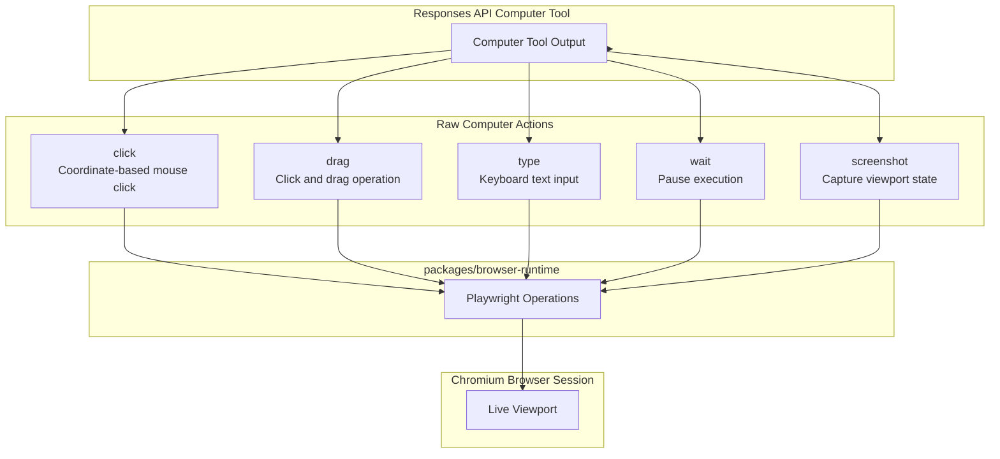
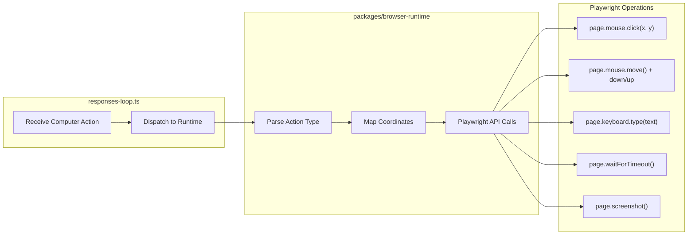

<!-- source: DeepWiki mcp.deepwiki.com · repo openai/openai-cua-sample-app · page 5.2 Native Mode · fetched 2026-10-26 -->

# Native Mode

<details>
<summary>Relevant source files</summary>

The following files were used as context for generating this wiki page:

- [README.md](README.md)

</details>


## Purpose and Scope

This document describes native mode execution, where the GPT-5.4 model controls the browser through raw computer actions emitted by the Responses API computer tool. Native mode provides the most direct demonstration of OpenAI's computer-use capabilities, exposing clicks, drags, typing, waits, and screenshots as primitive operations against the live browser session.

For information about the alternative execution approach where the model scripts the browser using Playwright JavaScript, see [Code Mode](#5.3). For the overall execution flow shared by both modes, see [Execution Flow](#5.1).

Sources: [README.md:91-96]()

---

## Native Mode Overview

Native mode configures the system to use the Responses API's computer tool directly, without any intermediate scripting layer. In this mode, the model receives screenshots of the browser viewport and emits low-level computer actions such as mouse clicks at specific coordinates, drag operations, keyboard input, and wait commands.

The mode is selected via the `CUA_RESPONSES_MODE` environment variable and represents the canonical integration pattern for the computer tool. As stated in the README: "native is the closest sample of the computer tool itself."

Sources: [README.md:91-96]()

---

## Configuration

### Environment Variable

Native mode is enabled through the runner's environment configuration:

| Variable | Values | Description |
|----------|--------|-------------|
| `CUA_RESPONSES_MODE` | `auto`, `fallback`, `live` | Controls Responses API mode configuration |

The runner reads this value from the repository root `.env` file at startup. The specific mapping between these values and native mode behavior is determined by the runner-core implementation.

Sources: [README.md:133]()

### Mode Selection Logic

The execution mode determination occurs in `responses-loop.ts`, the canonical Responses API integration point. This file orchestrates the interaction between the model and browser runtime, translating mode configuration into the appropriate tool exposure.

Sources: [README.md:13](), [README.md:119]()

---

## Computer Actions in Native Mode

### Action Types



**Computer Action Translation Flow**

Sources: [README.md:93]()

### Action Characteristics

Each action type in native mode operates at the primitive computer-use level:

- **click**: Accepts pixel coordinates relative to the viewport origin. The browser-runtime translates these to Playwright click operations at the specified location.

- **drag**: Defines start and end coordinates for click-and-drag operations, enabling interactions like repositioning elements or drawing on canvas surfaces.

- **type**: Emits keyboard input character sequences. The browser-runtime handles text insertion at the currently focused element.

- **wait**: Introduces delays between actions, allowing the browser to complete rendering or asynchronous operations before the next action.

- **screenshot**: Captures the current viewport state as an image, which becomes part of the context for the next model turn.

Sources: [README.md:93]()

---

## Native Mode Execution Flow

### Turn-Based Interaction

```mermaid
sequenceDiagram
    participant Loop as responses-loop.ts
    participant API as OpenAI Responses API
    participant Runtime as browser-runtime
    participant Browser as Chromium Session
    
    Note over Loop: Native mode configured
    
    loop Max 24 turns
        Loop->>Browser: Capture screenshot
        Browser-->>Loop: Viewport image
        
        Loop->>API: Send screenshot + context
        Note over API: Model analyzes viewport<br/>Plans computer actions
        API-->>Loop: Computer tool output<br/>(click/drag/type/wait)
        
        Loop->>Runtime: Translate action
        Note over Runtime: Convert to Playwright calls
        Runtime->>Browser: Execute at coordinates
        Browser-->>Runtime: State change
        Runtime-->>Loop: Action complete
        
        Loop->>Loop: Emit SSE event
        Note over Loop: Screenshot + action logged
    end
```

**Native Mode Turn Cycle**

Sources: [README.md:13](), [README.md:93](), [README.md:139]()

### Coordinate-Based Interaction Model

Native mode fundamentally differs from code mode in how it addresses browser elements. Instead of using DOM selectors or JavaScript evaluation, native mode operates purely through:

1. **Visual analysis**: The model receives screenshots showing the current viewport state
2. **Coordinate targeting**: Actions specify pixel locations rather than semantic element references
3. **State observation**: Subsequent screenshots confirm whether actions achieved their intended effect

This approach mirrors how a human operator would interact with an application using only mouse and keyboard input, without access to the underlying DOM structure or JavaScript environment.

Sources: [README.md:93-96]()

---

## Integration with Runner Core

### Responses Loop Implementation

The `responses-loop.ts` file in `packages/runner-core/src/` serves as the integration point for both execution modes. In native mode, this module:

1. Configures the Responses API client to expose the computer tool
2. Manages the screenshot capture and submission cycle
3. Receives computer tool output from the API
4. Dispatches actions to the browser-runtime for execution
5. Captures post-action state for the next turn

The loop continues until either the scenario reaches completion criteria, the maximum turn count (default 24) is reached, or an error condition occurs.

Sources: [README.md:13](), [README.md:119](), [README.md:139]()

### Browser Runtime Translation



**Action Translation to Playwright Layer**

The browser-runtime package provides the abstraction layer that translates native mode computer actions into concrete Playwright operations. This separation ensures that the responses loop remains agnostic to the specific browser automation framework, while the runtime handles implementation details like coordinate system normalization and browser-specific quirks.

Sources: [README.md:116-117](), [README.md:119]()

---

## Native Mode with Official Scenarios

### Scenario Compatibility

All three official scenarios support native mode execution:

| Scenario | Native Mode Interaction Pattern |
|----------|--------------------------------|
| `kanban-reprioritize-sprint` | Click-and-drag operations to reposition task cards across board columns |
| `paint-draw-poster` | Cursor movements and click-drag sequences to draw on canvas surface |
| `booking-complete-reservation` | Click coordinates for form fields and buttons, type actions for text input |

Each scenario uses the same verification pipeline regardless of execution mode. The scenario executor does not need to differentiate between actions performed via native computer tool vs. code mode scripting.

Sources: [README.md:99-102](), [README.md:96]()

### Verification Independence

Native mode actions ultimately produce the same browser state changes as code mode operations. The verification mechanisms described in [Verification Mechanisms](#6.3) evaluate final states (drag-and-drop positions, canvas pixel data, form completion records) without regard to how those states were achieved.

This mode-agnostic verification design allows scenarios to be tested and validated under both execution modes, ensuring the runner-core implementation handles both approaches correctly.

Sources: [README.md:96]()

---

## Event Streaming and Replay

### Native Mode Events

During native mode execution, the runner emits Server-Sent Events (SSE) containing:

- The computer action type and parameters (coordinates, text, duration)
- Pre-action and post-action screenshots showing viewport state before and after execution
- Timing information for each action
- Error conditions if action execution fails

These events populate the replay bundle, enabling the operator console to reconstruct the exact sequence of model decisions and browser responses.

Sources: [README.md:6](), [README.md:111]()

### Replay Bundle Structure

The replay artifacts captured during native mode runs include:

- **Screenshots**: Timestamped viewport captures at each turn
- **Actions**: Structured records of each computer action with coordinates and parameters
- **Metadata**: Scenario configuration, model selection, turn count
- **Verification results**: Final outcome determination based on scenario-specific criteria

The replay-schema package defines the contracts for these artifacts, ensuring consistent structure across both execution modes.

Sources: [README.md:112-113]()

---

## Limitations and Considerations

### Coordinate Precision

Native mode relies on pixel-perfect coordinate specification. Viewport size changes, DPI scaling, or dynamic layout shifts can affect action targeting accuracy. The browser-runtime attempts to normalize coordinate systems, but scenarios should design UIs with stable layouts and predictable element positions.

### Visual Context Dependency

Unlike code mode where the model can query DOM state or evaluate JavaScript expressions, native mode operates purely on visual information. Complex UI states that are not visually distinct may be challenging for the model to differentiate.

### Action Primitives

Native mode exposes only the core computer actions supported by the Responses API computer tool. Operations that would require multiple coordinated primitives (e.g., text selection via shift+arrow keys, multi-key shortcuts) must be decomposed into individual click, type, and key press actions.

Sources: [README.md:93-96]()

---

## Debugging Native Mode

### Common Issues

When native mode runs fail or produce unexpected results:

1. **Coordinate misalignment**: Review screenshots in the replay bundle to verify click targets align with intended UI elements
2. **Timing issues**: Verify that wait actions provide sufficient delays for asynchronous UI updates
3. **Viewport assumptions**: Confirm the browser viewport size matches scenario expectations

### Headful Mode

For debugging native mode behavior, the operator console supports headful browser execution:

```bash
# Start with headful browser visible
pnpm dev
# In console UI: uncheck "Headless" before starting run
```

Headful mode allows direct observation of how computer actions translate to browser interactions, making it easier to diagnose coordinate or timing issues.

Sources: [README.md:64]()

---

