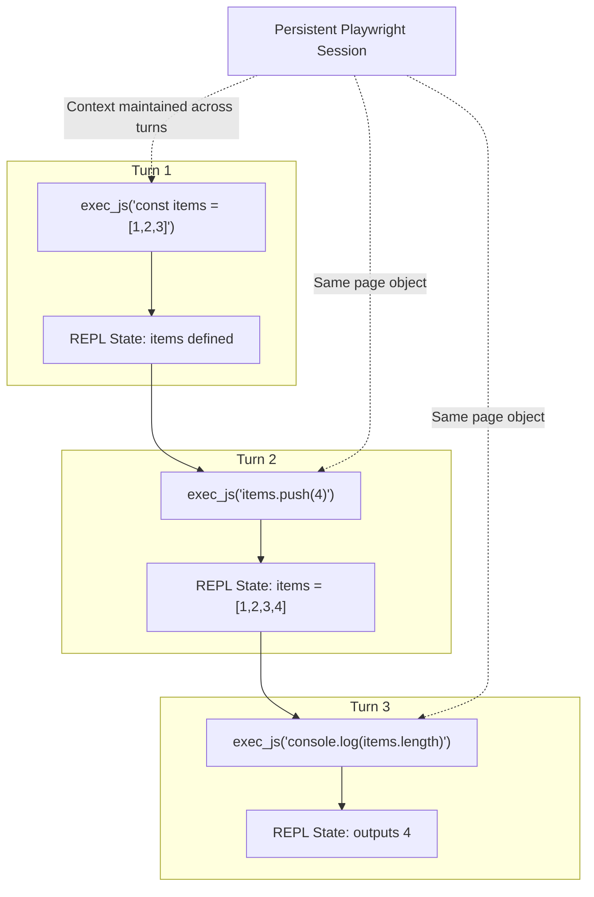
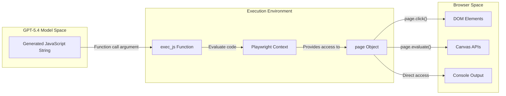
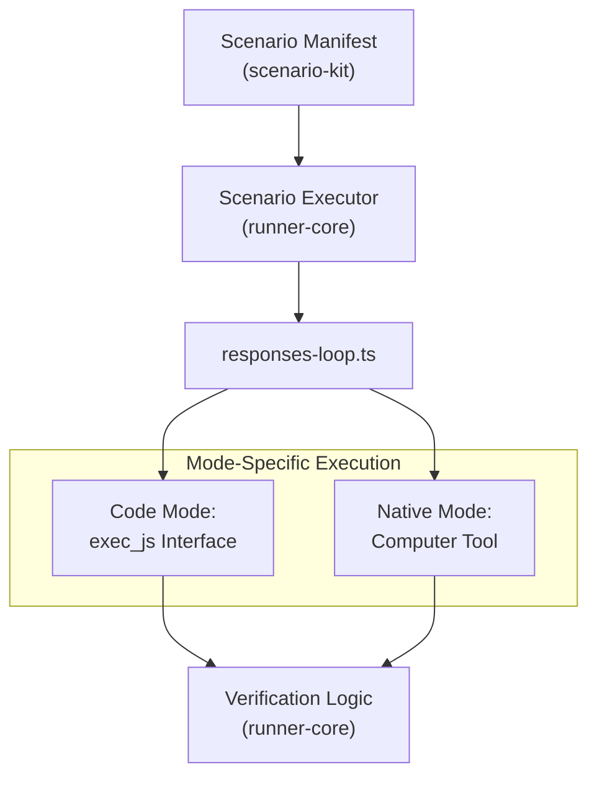
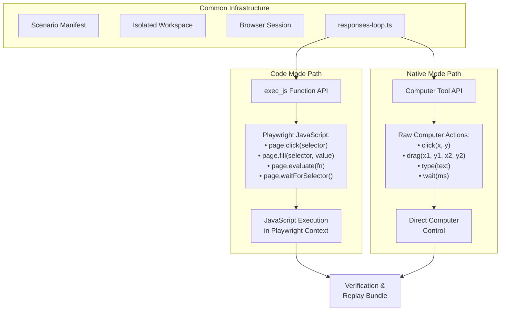

<!-- source: DeepWiki mcp.deepwiki.com · repo openai/openai-cua-sample-app · page 5.3 Code Mode · fetched 2026-10-26 -->

# Code Mode

<details>
<summary>Relevant source files</summary>

The following files were used as context for generating this wiki page:

- [README.md](README.md)

</details>


## Purpose and Scope

This page documents code mode, one of two execution modes available in the openai-cua-sample-app for browser automation with GPT-5.4. Code mode exposes a persistent Playwright JavaScript REPL through the `exec_js` function, allowing the model to script browser interactions rather than emit raw computer actions.

For information about the alternative execution approach using raw computer actions, see [Native Mode](#5.2). For the overall execution flow common to both modes, see [Execution Flow](#5.1).

**Sources:** [README.md:91-96]()

---

## Overview

Code mode transforms the browser automation interface from a low-level computer tool into a high-level scripting environment. Instead of the model issuing discrete click coordinates, drag operations, and keystrokes, it generates Playwright JavaScript code that executes in the browser context.

### Key Characteristics

| Aspect | Description |
|--------|-------------|
| **API Interface** | `exec_js` function exposed to GPT-5.4 |
| **Control Paradigm** | Script-based browser automation |
| **Persistence** | REPL maintains state across function calls |
| **Code Target** | Playwright API (page.click, page.fill, page.evaluate, etc.) |
| **Use Case** | Clearest sample of a browser REPL harness |

The mode choice is orthogonal to scenario selection—all official scenarios (`kanban`, `paint`, `booking`) execute successfully in either mode using identical scenario manifests and verification pipelines.

**Sources:** [README.md:91-96](), Diagram 3 from system architecture overview

---

## Configuration

### Environment Variable

Code mode activation is controlled through the `CUA_RESPONSES_MODE` environment variable in the runner service's `.env` file:

```bash
CUA_RESPONSES_MODE=auto|fallback|live
```

| Value | Behavior |
|-------|----------|
| `auto` | System automatically selects mode based on model capabilities |
| `fallback` | Falls back to code mode if native computer tool unavailable |
| `live` | Explicitly uses the Responses API's current recommendation |

**Sources:** [README.md:133]()

### Runtime Mode Selection

The actual mode determination happens in the responses loop orchestration logic within `packages/runner-core`. The system constructs the appropriate function call interface based on the resolved mode.

**Sources:** Inferred from [README.md:13]() and package architecture

---

## Execution Flow

```mermaid
sequenceDiagram
    participant GPT as "GPT-5.4 Responses API"
    participant Loop as "responses-loop.ts"
    participant ExecJS as "exec_js Handler"
    participant Runtime as "browser-runtime"
    participant PW as "Playwright Session"
    participant Browser as "Chromium Browser"
    
    Loop->>GPT: "Send prompt + exec_js function definition"
    GPT-->>Loop: "Response with JavaScript code"
    Loop->>ExecJS: "Extract code from function call"
    ExecJS->>Runtime: "Execute JavaScript in context"
    Runtime->>PW: "page.evaluate() or page.click()"
    PW->>Browser: "Browser automation action"
    Browser-->>PW: "Action result"
    PW-->>Runtime: "Execution outcome"
    Runtime-->>ExecJS: "Return value or error"
    ExecJS-->>Loop: "Function call result"
    Loop->>Loop: "Capture screenshot + events"
    Loop->>GPT: "Next turn with updated context"
```

**Diagram: Code Mode Execution Sequence**

**Sources:** [README.md:13](), Diagram 2 and Diagram 5 from system architecture overview

### Turn-by-Turn Process

1. **Prompt Construction**: `responses-loop.ts` sends scenario context and task description to GPT-5.4
2. **Function Exposure**: The `exec_js` function definition is included in the tools array
3. **Model Response**: GPT-5.4 returns JavaScript code wrapped in an `exec_js` function call
4. **Code Extraction**: The responses loop extracts the JavaScript string from the function parameters
5. **Execution**: Code runs in the Playwright context with access to the `page` object
6. **State Capture**: Screenshot and events recorded regardless of execution success/failure
7. **Iteration**: Process repeats up to `NEXT_PUBLIC_CUA_DEFAULT_MAX_RESPONSE_TURNS` (default 24)

**Sources:** [README.md:139](), Diagram 2 from system architecture overview

---

## The exec_js Function

### Function Signature

The `exec_js` function serves as the primary interface between GPT-5.4 and the browser runtime. While the exact implementation resides in `packages/runner-core`, the function conceptually accepts a JavaScript code string and executes it in the Playwright session context.

### Persistent REPL Characteristics



**Diagram: REPL Persistence Across Turns**

The REPL maintains state between function calls within a single run. Variables, functions, and DOM modifications persist until the run completes or the browser session terminates.

**Sources:** [README.md:94](), Diagram 3 from system architecture overview

---

## Playwright JavaScript Access

### Available APIs

Code mode exposes the full Playwright JavaScript API to the model. The `page` object provides the primary interface:

| Category | Example Methods |
|----------|----------------|
| **Navigation** | `page.goto()`, `page.goBack()`, `page.reload()` |
| **Selectors** | `page.click()`, `page.fill()`, `page.locator()` |
| **Evaluation** | `page.evaluate()`, `page.evaluateHandle()` |
| **Waiting** | `page.waitForSelector()`, `page.waitForTimeout()` |
| **Screenshots** | `page.screenshot()` (captured automatically by system) |
| **DOM Manipulation** | Via `page.evaluate()` with arbitrary JavaScript |

### Code Execution Context



**Diagram: Code Execution Context and Scope**

**Sources:** [README.md:94](), packages structure from architecture overview

### Example JavaScript Patterns

The model typically generates code patterns like:

- **Direct element interaction**: `await page.click('button[data-testid="submit"]')`
- **Form filling**: `await page.fill('input[name="email"]', 'test@example.com')`
- **DOM inspection**: `const text = await page.textContent('.result')`
- **Custom evaluation**: `await page.evaluate(() => document.querySelector('canvas').toDataURL())`
- **Waiting strategies**: `await page.waitForSelector('.loading', {state: 'hidden'})`

**Sources:** Inferred from [README.md:94]() and Playwright documentation patterns

---

## Integration with Scenario System

### Scenario Executor Compatibility

Both code mode and native mode share the same scenario executor infrastructure located in `packages/runner-core`. The executor's responsibility is to:

1. Load the scenario manifest from `packages/scenario-kit`
2. Initialize the workspace from `labs/` templates
3. Launch the browser session via `packages/browser-runtime`
4. Invoke the responses loop in the appropriate mode
5. Run scenario-specific verification logic



**Diagram: Scenario System Integration Points**

**Sources:** [README.md:13](), [README.md:118-119](), Diagram 6 from system architecture overview

### Verification Agnosticism

Verification mechanisms operate identically regardless of execution mode:

| Scenario | Verification Type | Code Mode Compatible |
|----------|------------------|---------------------|
| `kanban-reprioritize-sprint` | Drag-and-drop state comparison | ✓ Yes |
| `paint-draw-poster` | Canvas state extraction and verification | ✓ Yes |
| `booking-complete-reservation` | Form completion record validation | ✓ Yes |

The verification logic inspects final browser state and artifacts, not the execution path that produced them.

**Sources:** [README.md:99-103](), section 6.3 reference

---

## Comparison with Native Mode

### Architectural Differences



**Diagram: Mode Comparison Architecture**

**Sources:** [README.md:91-96](), Diagram 3 from system architecture overview

### When to Use Code Mode

| Use Case | Code Mode Advantage |
|----------|-------------------|
| **Development/Debugging** | JavaScript errors provide clearer feedback than coordinate-based failures |
| **Rapid Prototyping** | Faster to test scenario logic with direct Playwright API |
| **DOM Complexity** | Selectors more resilient than pixel coordinates for dynamic layouts |
| **Learning/Demonstration** | Code output shows exactly what the model "thinks" about the task |
| **Fallback Mode** | Provides functionality when native computer tool unavailable |

### When to Use Native Mode

| Use Case | Native Mode Advantage |
|----------|---------------------|
| **Computer Tool Fidelity** | Closest sample of the actual Responses API computer capabilities |
| **Cross-Application Tasks** | Not limited to browser (though this repo is browser-focused) |
| **Vision-First Workflows** | Model reasons directly from screenshots without DOM knowledge |
| **Production Samples** | Demonstrates the recommended computer-use API surface |

**Sources:** [README.md:91-96]()

---

## Replay Bundle Generation

Code mode generates identical replay bundle artifacts to native mode:

- **Screenshots**: Captured after each turn
- **Events**: Function call parameters and results logged
- **Metadata**: Execution timing, model responses, verification outcomes
- **Workspace State**: Final browser state and any modified files

The replay system, defined in `packages/replay-schema`, maintains mode-agnostic contracts for artifact serialization.

**Sources:** [README.md:112-113](), section 8.1 reference

---

## Error Handling

### JavaScript Execution Errors

When `exec_js` code throws an exception:

1. The error is caught by the Playwright context
2. Error details are returned to `responses-loop.ts`
3. The error information is included in the next prompt to GPT-5.4
4. The model can attempt recovery or alternative approaches
5. Screenshot captured regardless of success/failure

### Timeout Handling

The browser runtime enforces execution timeouts to prevent infinite loops or hung operations. Timeouts result in error responses that the model can reason about in subsequent turns.

**Sources:** Inferred from [README.md:13]() and Playwright runtime patterns

---

## Implementation Location

The code mode implementation spans multiple packages:

| Component | Package | Key Files |
|-----------|---------|-----------|
| **Responses Loop** | `packages/runner-core` | `responses-loop.ts` |
| **exec_js Handler** | `packages/runner-core` | Scenario executors |
| **Browser Runtime** | `packages/browser-runtime` | Playwright session abstraction |
| **Mode Configuration** | `apps/runner` | Environment variable handling |
| **Type Contracts** | `packages/replay-schema` | Shared request/response types |

**Sources:** [README.md:106-124](), Diagram 4 from system architecture overview

---

## Limitations

- **Browser-Focused Only**: This repository intentionally limits code mode to browser automation via Playwright. File system operations, shell commands, or other computer-use capabilities are out of scope.
- **No Safety Acknowledgements**: Pending computer-use safety acknowledgements are not implemented. Runs fail with `unsupported_safety_acknowledgement` when the API requests one.
- **Execution Isolation**: Code runs in the Playwright context, not in the Node.js process. Direct Node.js API access is unavailable.
- **Turn Limits**: Maximum of 24 response turns by default (configurable via `NEXT_PUBLIC_CUA_DEFAULT_MAX_RESPONSE_TURNS`).

**Sources:** [README.md:143-148](), [README.md:139]()

---

## Development Workflow

### Testing Code Mode Locally

```bash
# Ensure code mode is active (or use auto)
echo "CUA_RESPONSES_MODE=auto" >> .env

# Start services
pnpm dev

# Navigate to http://127.0.0.1:3000
# Select any scenario
# Run and observe JavaScript execution in logs
```

### Inspecting exec_js Calls

The runner service logs each `exec_js` function call and its result. Review `apps/runner` console output during execution to see:

- Generated JavaScript code
- Execution timing
- Return values or error messages
- Screenshot capture events

**Sources:** [README.md:58-73]()

---

## Summary

Code mode provides a high-level browser scripting interface for GPT-5.4 through the `exec_js` function and Playwright JavaScript API. It shares all infrastructure with native mode—scenarios, workspaces, verification, and replay bundles—while offering a different control paradigm. The mode is particularly valuable for development, debugging, and situations where direct Playwright API access clarifies the automation logic.

For information about configuring execution mode selection, see [Environment Variables](#7.1). For details on the shared verification pipeline, see [Verification Mechanisms](#6.3).

**Sources:** [README.md:91-96](), entire system architecture overview

---

