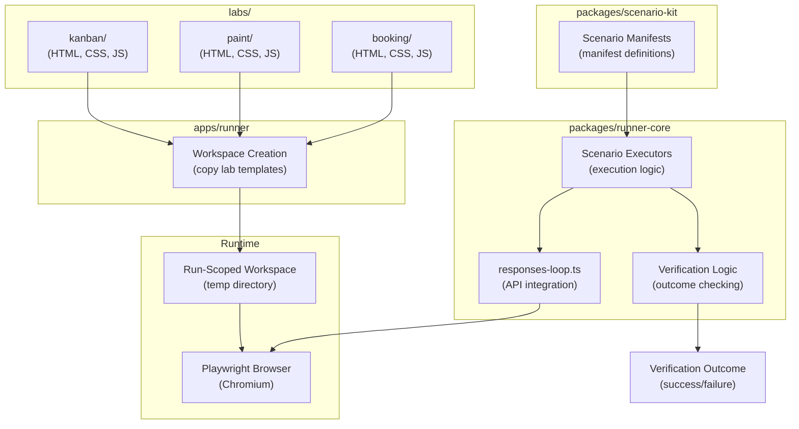
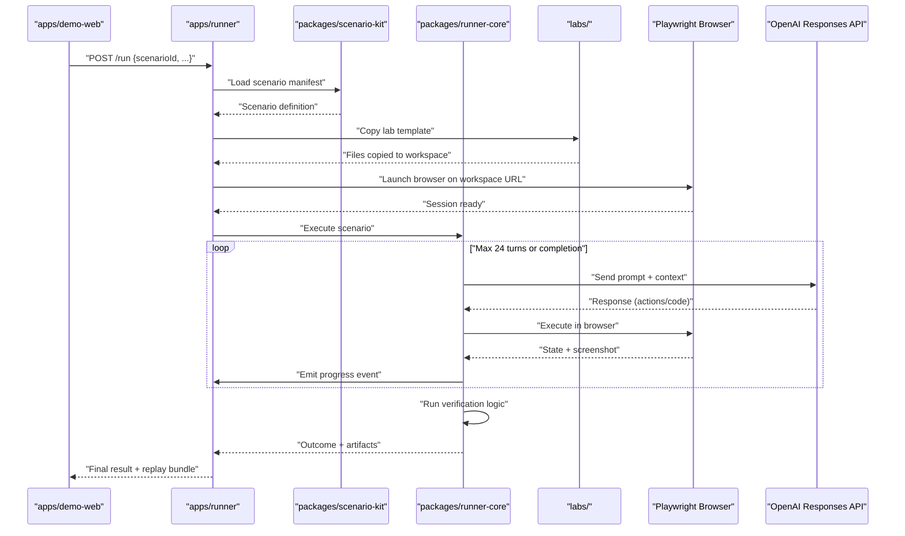
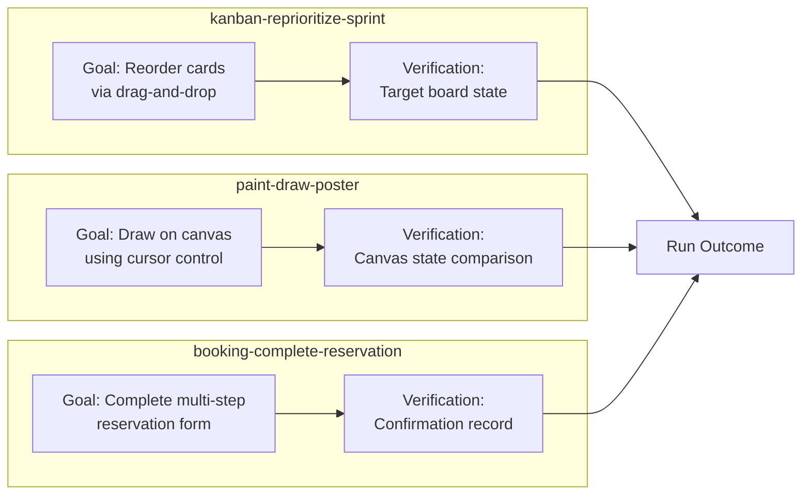
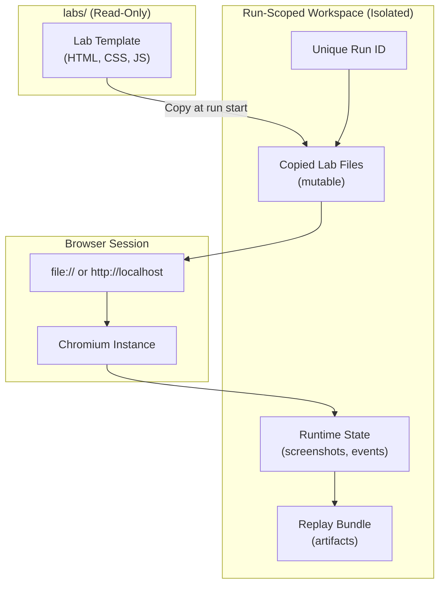

<!-- source: DeepWiki mcp.deepwiki.com · repo openai/openai-cua-sample-app · page 6 Scenarios · fetched 2026-10-26 -->

# Scenarios

Relevant source files

The following files were used as context for generating this wiki page:

- [README.md](README.md)

This document describes the scenario system in the openai-cua-sample-app repository. A scenario is a structured, executable demonstration that combines a browser-based lab environment with a goal-oriented task for the GPT-5.4 model to accomplish. The scenario system provides the framework for defining, executing, and verifying these demonstrations.

For implementation details about how scenarios are structured and executed, see [Scenario System](#6.1). For information about the three official scenarios included in this repository, see [Official Scenarios](#6.2). For details on how scenario outcomes are verified, see [Verification Mechanisms](#6.3).

**Sources:** [README.md:1-158]()

## What is a Scenario

A scenario represents a complete, self-contained demonstration workflow. Each scenario consists of:

1. **Scenario Manifest**: A structured definition that includes the scenario ID, display name, description, prompt template, and configuration parameters
2. **Lab Template**: Static HTML, CSS, and JavaScript files that provide the starting browser environment
3. **Executor**: Code that orchestrates the browser session and integrates with the Responses API
4. **Verifier**: Code that determines whether the model successfully completed the scenario's goal

Scenarios are designed to be deterministic and verifiable. They use local lab templates rather than live web applications to ensure consistent starting conditions across runs.

**Sources:** [README.md:13-16](), [README.md:98-103](), [README.md:107-123]()

## Scenario Components Architecture

**Scenario Component Locations**

This diagram shows where each scenario component lives in the codebase and how they relate during a run. The `packages/scenario-kit` package provides scenario manifest definitions, while the `labs/` directory contains static lab templates. The `packages/runner-core` package contains both the execution logic and verification logic. During a run, the `apps/runner` service copies lab templates into an isolated workspace and launches a browser session against that workspace.

**Sources:** [README.md:107-123]()

## Scenario Properties

Each scenario in the system shares a common set of properties and characteristics:

| Property | Description | Example Values |
|----------|-------------|----------------|
| **Scenario ID** | Short identifier used in code and URLs | `kanban`, `paint`, `booking` |
| **Display Name** | Human-readable name shown in operator console | `kanban-reprioritize-sprint` |
| **Lab Template** | Directory in `labs/` containing starting HTML/CSS/JS | `labs/kanban/` |
| **Verification Type** | Method used to determine success | Drag-and-drop state, canvas state, form completion |
| **Execution Mode Support** | Whether scenario works in native and/or code mode | Both modes supported |
| **Workspace Isolation** | Each run gets its own copy of the lab template | Yes (always) |
| **Max Response Turns** | Default maximum iterations with the model | 24 (configurable) |

**Sources:** [README.md:98-103](), [README.md:139]()

## Scenario Execution Flow

**Scenario Execution Sequence**

This sequence diagram shows the complete flow of a scenario execution from initiation to completion. The process begins when the operator console sends a run request to the runner service. The runner loads the scenario manifest from `packages/scenario-kit`, copies the lab template from `labs/` into an isolated workspace, and launches a browser session. The `packages/runner-core` package then orchestrates the interaction with the OpenAI Responses API, executing actions in the browser and capturing state. After completion or reaching the maximum turn count, verification logic determines the outcome.

**Sources:** [README.md:13](), [README.md:107-123]()

## Official Scenario Types

The repository includes three official scenarios that demonstrate different aspects of browser automation and verification:

**Official Scenario Taxonomy**

Each official scenario demonstrates a distinct interaction pattern and verification mechanism. The `kanban-reprioritize-sprint` scenario teaches stateful drag-and-drop operations where the model must reorder cards to match a target state derived from the operator's prompt. The `paint-draw-poster` scenario demonstrates precise cursor control and drawing actions, with verification comparing the saved canvas state against the live canvas. The `booking-complete-reservation` scenario showcases multi-step form navigation and completion, with verification checking a local confirmation record.

**Sources:** [README.md:98-103]()

## Scenario Configuration

Scenarios can be configured through multiple mechanisms:

**Execution Mode Configuration**

Scenarios support both `native` and `code` execution modes, controlled by the `CUA_RESPONSES_MODE` environment variable:

- **native**: The model emits raw computer actions (clicks, drags, typing) directly
- **code**: The model scripts the browser using Playwright JavaScript via `exec_js`

Both modes use identical scenario manifests and lab templates, demonstrating that the scenario system is execution-mode agnostic.

**Turn Limit Configuration**

The maximum number of response turns can be configured via `NEXT_PUBLIC_CUA_DEFAULT_MAX_RESPONSE_TURNS` (default: 24). This prevents infinite loops while allowing sufficient iterations for complex multi-step scenarios.

**Sources:** [README.md:91-96](), [README.md:133-139]()

## Scenario Workspace Isolation

**Workspace Isolation Model**

Each scenario run operates in a completely isolated workspace. At the start of a run, the runner service copies the relevant lab template from the `labs/` directory into a temporary, run-scoped workspace identified by a unique run ID. The browser session serves these copied files, ensuring that modifications during the run do not affect other concurrent runs or the original lab templates. All runtime state, including screenshots and events, is captured within this isolated workspace and bundled into the final replay artifacts.

**Sources:** [README.md:6](), [README.md:15](), [README.md:120-121]()

## Scenario Extension Points

The scenario system is designed for extensibility:

| Extension Point | Location | Purpose |
|-----------------|----------|---------|
| **New Scenario Manifest** | `packages/scenario-kit` | Define new scenario metadata and prompts |
| **New Lab Template** | `labs/` | Create new browser environments |
| **New Executor** | `packages/runner-core` | Add execution logic for new scenario types |
| **New Verifier** | `packages/runner-core` | Implement custom verification logic |

Adding a new scenario requires creating entries in all four extension points and ensuring they are properly wired together through the scenario manifest.

**Sources:** [README.md:7](), [README.md:107-123]()

## Related Documentation

For detailed information about specific aspects of the scenario system:

- **Scenario System**: See [Scenario System](#6.1) for implementation details about manifests, executors, and the scenario lifecycle
- **Official Scenarios**: See [Official Scenarios](#6.2) for in-depth documentation of kanban, paint, and booking scenarios
- **Verification Mechanisms**: See [Verification Mechanisms](#6.3) for details on how scenario outcomes are determined
- **Responses API Integration**: See [Responses API Integration](#5) for information about how scenarios interact with GPT-5.4
- **Execution Modes**: See [Native Mode](#5.2) and [Code Mode](#5.3) for execution mode details

**Sources:** [README.md:1-158]()

---

