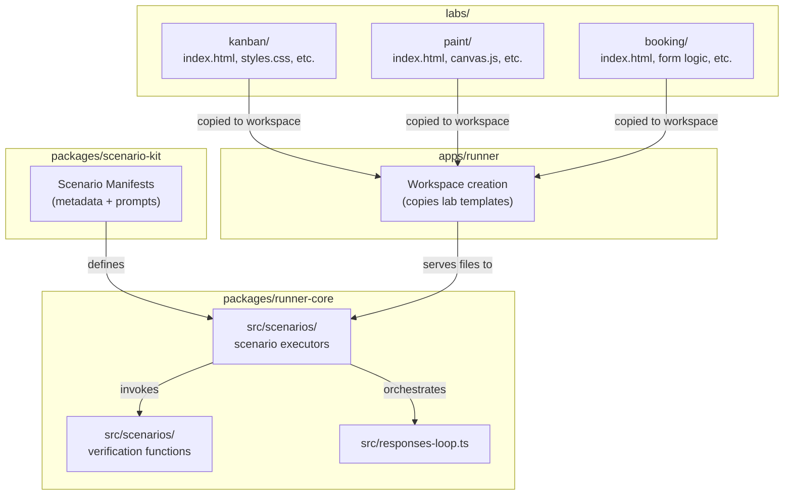
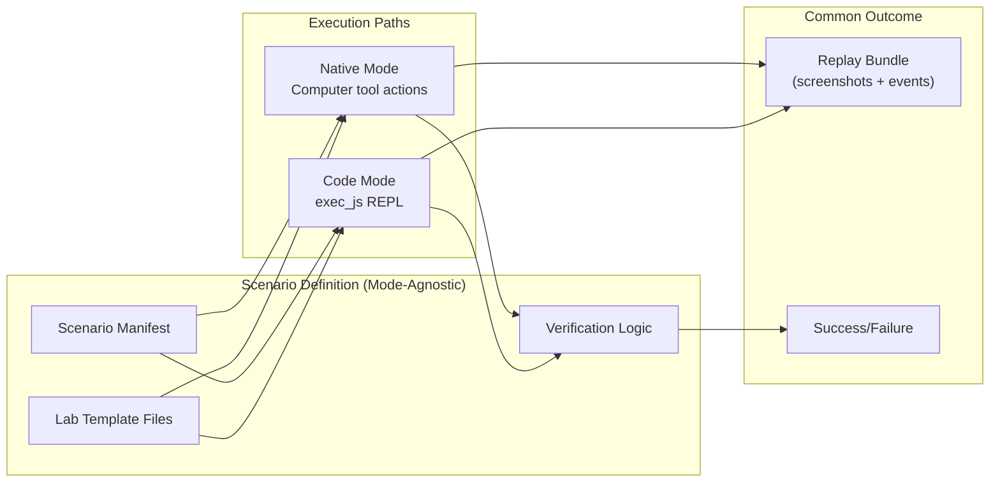
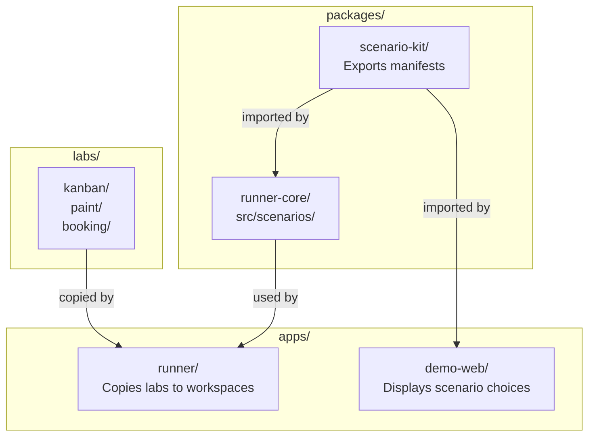

<!-- source: DeepWiki mcp.deepwiki.com · repo openai/openai-cua-sample-app · page 6.1 Scenario System · fetched 2026-10-26 -->

# Scenario System

<details>
<summary>Relevant source files</summary>

The following files were used as context for generating this wiki page:

- [README.md](README.md)

</details>


## Purpose and Scope

This document explains the scenario system architecture in the openai-cua-sample-app, including scenario manifests, executors, and the complete lifecycle of a scenario run. Scenarios are the fundamental unit of work in this application - each scenario represents a discrete browser automation task that GPT-5.4 attempts to complete.

For details about the three official scenarios (kanban, paint, booking), see [Official Scenarios](#6.2). For in-depth coverage of verification logic, see [Verification Mechanisms](#6.3). For information about the `scenario-kit` package implementation, see [scenario-kit](#4.3).

---

## Scenario Fundamentals

A **scenario** in this system is a self-contained browser automation task with four essential components:

| Component | Purpose | Location |
|-----------|---------|----------|
| **Manifest** | Declares scenario metadata, prompts, and configuration | `packages/scenario-kit` |
| **Lab Template** | Provides static HTML/CSS/JS files as starting state | `labs/` directory |
| **Executor** | Orchestrates the responses loop for the scenario | `packages/runner-core/src/scenarios/` |
| **Verifier** | Determines success or failure after execution | `packages/runner-core/src/scenarios/` |

Each scenario is identified by a unique `scenarioId` (e.g., `"kanban-reprioritize-sprint"`) and an optional short `slug` (e.g., `"kanban"`). Both identifiers can be used interchangeably throughout the system.

**Sources:** [README.md:98-104]()

---

## Scenario Components Architecture

The following diagram shows how scenario components are organized across the codebase and how they relate to each other:

**Diagram: Scenario Component Distribution**



**Sources:** [README.md:106-124]()

---

## Scenario Lifecycle

A scenario run progresses through distinct phases from selection to verification. The lifecycle is orchestrated by the runner service and executed by `runner-core`.

**Diagram: Scenario Run Lifecycle**

```mermaid
stateDiagram-v2
    [*] --> Selection: Operator chooses scenario
    
    Selection --> WorkspaceInit: Runner receives POST /run
    
    state WorkspaceInit {
        [*] --> CreateDir: Create unique run directory
        CreateDir --> CopyTemplates: Copy from labs/{scenarioId}
        CopyTemplates --> [*]: Workspace ready
    }
    
    WorkspaceInit --> BrowserSetup: Start Playwright session
    
    BrowserSetup --> Execution
    
    state Execution {
        [*] --> LoadManifest: Read scenario-kit manifest
        LoadManifest --> InvokeExecutor: Call scenario executor
        InvokeExecutor --> ResponsesLoop: Start responses-loop.ts
        
        state ResponsesLoop {
            [*] --> SendPrompt
            SendPrompt --> ReceiveResponse: GPT-5.4 responds
            ReceiveResponse --> ExecuteAction: Apply actions/code
            ExecuteAction --> CaptureState: Screenshot + events
            CaptureState --> CheckTurns: Check turn limit
            CheckTurns --> SendPrompt: Continue
            CheckTurns --> [*]: Max turns or completion
        }
        
        ResponsesLoop --> [*]: Execution complete
    }
    
    Execution --> Verification: Invoke scenario verifier
    
    state Verification {
        [*] --> InspectDOM: Read browser state
        InspectDOM --> CompareExpected: Apply scenario rules
        CompareExpected --> SetOutcome: success or failure
        SetOutcome --> [*]
    }
    
    Verification --> BundleCreation: Create replay bundle
    BundleCreation --> [*]: Run complete
```



**Sources:** [README.md:13-16]()

---

## Scenario Manifest Structure

Scenario manifests are defined in `packages/scenario-kit` and provide the declarative configuration for each scenario. While the specific TypeScript types are defined in that package (see [scenario-kit](#4.3)), manifests typically include:

| Manifest Field | Description |
|----------------|-------------|
| `scenarioId` | Full unique identifier (e.g., `"kanban-reprioritize-sprint"`) |
| `slug` | Short alias (e.g., `"kanban"`) |
| `name` | Human-readable name |
| `description` | Purpose and behavior summary |
| `systemPrompt` | Instructions given to GPT-5.4 |
| `userPromptTemplate` | Template for operator input (may include placeholders) |
| `maxTurns` | Maximum response turns allowed (default 24) |
| `verificationType` | Type of verification to perform |

The manifest is loaded by the scenario executor at runtime to configure the responses loop and verification logic.

**Sources:** [README.md:98-104](), [README.md:132-139]()

---

## Execution Modes and Scenario Independence

Both execution modes (`native` and `code`) use identical scenario manifests and lab templates. The mode determines how GPT-5.4 controls the browser, but not the scenario structure itself:

**Diagram: Mode-Agnostic Scenario System**



The `CUA_RESPONSES_MODE` environment variable controls which execution path is used, but the scenario system remains unchanged.

**Sources:** [README.md:91-96]()

---

## Directory Organization

The scenario system spans multiple directories in the monorepo:

**Diagram: Scenario File Locations**



The separation ensures that:
- Scenario definitions (`scenario-kit`) are pure data structures with no execution logic
- Execution logic (`runner-core`) is isolated from the HTTP layer
- Lab templates (`labs/`) remain static and reusable across multiple runs
- The operator console (`demo-web`) can display scenario metadata without importing execution code

**Sources:** [README.md:106-124]()

---

## Workspace Isolation

Each scenario run creates an isolated workspace to prevent cross-contamination between runs:

| Isolation Aspect | Implementation |
|------------------|----------------|
| **File System** | Unique directory per run under `apps/runner/.workspaces/` |
| **Browser Session** | Fresh Playwright context for each run |
| **Template Files** | Copied from `labs/{scenarioId}/` to workspace directory |
| **Port Allocation** | Local HTTP server serves workspace files |

The runner service (`apps/runner`) handles workspace creation and cleanup. Lab templates are copied, not symlinked, so modifications during a run do not affect the source templates or other concurrent runs.

**Sources:** [README.md:5-7]()

---

## Scenario Executor Contract

Scenario executors in `packages/runner-core/src/scenarios/` follow a consistent pattern:

1. **Accept inputs**: scenario manifest, operator prompt variables, browser session, workspace URL
2. **Invoke responses-loop**: pass scenario configuration to `responses-loop.ts`
3. **Stream events**: emit progress updates via SSE
4. **Run verification**: call scenario-specific verification function
5. **Return outcome**: success/failure status with verification details

Each executor is a TypeScript function that bridges the generic responses loop with scenario-specific requirements. The executor does not directly make API calls to GPT-5.4; that responsibility belongs to `responses-loop.ts` (see [runner-core and responses-loop](#4.1)).

**Sources:** [README.md:13](), [README.md:119]()

---

## Verification Phase

After the responses loop completes (either by reaching `maxTurns` or by model-initiated completion), the scenario verifier runs:

**Diagram: Verification Flow**

```mermaid
sequenceDiagram
    participant Executor as "Scenario Executor"
    participant Loop as "responses-loop.ts"
    participant Browser as "Playwright Session"
    participant Verifier as "Scenario Verifier"
    
    Executor->>Loop: Start responses loop
    Loop->>Loop: Execute up to maxTurns
    Loop-->>Executor: Loop complete
    
    Executor->>Browser: Pause for state stabilization
    Executor->>Verifier: Invoke verification
    
    Verifier->>Browser: page.evaluate() to inspect DOM
    Browser-->>Verifier: Return DOM state
    
    Verifier->>Verifier: Apply scenario rules
    Verifier-->>Executor: Return {success, details}
    
    Executor->>Executor: Set run outcome
```

Verification is synchronous and deterministic. It inspects the final browser state (DOM, canvas data, localStorage, etc.) and compares it against expected outcomes defined by the scenario rules.

**Sources:** [README.md:100-102]()

---

## Adding New Scenarios

To add a new scenario to the system, you must provide all four components:

1. **Create lab template** in `labs/{new-scenario-id}/` with `index.html` and supporting assets
2. **Define manifest** in `packages/scenario-kit` with scenario metadata and prompts
3. **Implement executor** in `packages/runner-core/src/scenarios/{new-scenario-id}.ts`
4. **Implement verifier** in the same executor file or a shared verification module

The scenario becomes available automatically once the manifest is exported from `scenario-kit`. No changes to `apps/runner` or `apps/demo-web` are required for the scenario to appear in the operator console.

**Sources:** [README.md:7]()

---

## Official Scenarios Overview

The repository includes three official scenarios that demonstrate different verification patterns:

| Scenario ID | Slug | Verification Type | Key Challenge |
|-------------|------|-------------------|---------------|
| `kanban-reprioritize-sprint` | `kanban` | Drag-and-drop state comparison | Stateful reordering of DOM elements |
| `paint-draw-poster` | `paint` | Canvas pixel data inspection | Drawing accuracy and tool usage |
| `booking-complete-reservation` | `booking` | Form submission record validation | Multi-step navigation and data entry |

Each scenario showcases a different aspect of browser automation and verification. Detailed documentation for each scenario is available in [Official Scenarios](#6.2).

**Sources:** [README.md:98-104]()

---

