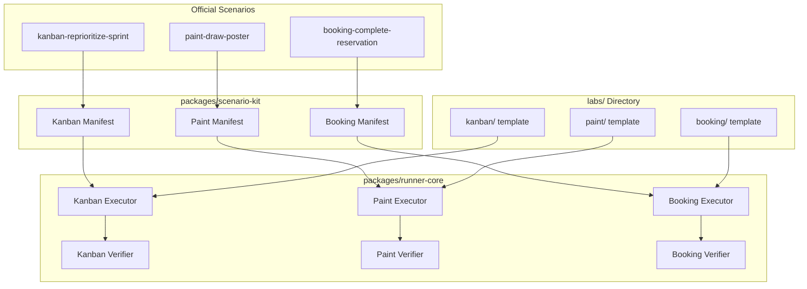
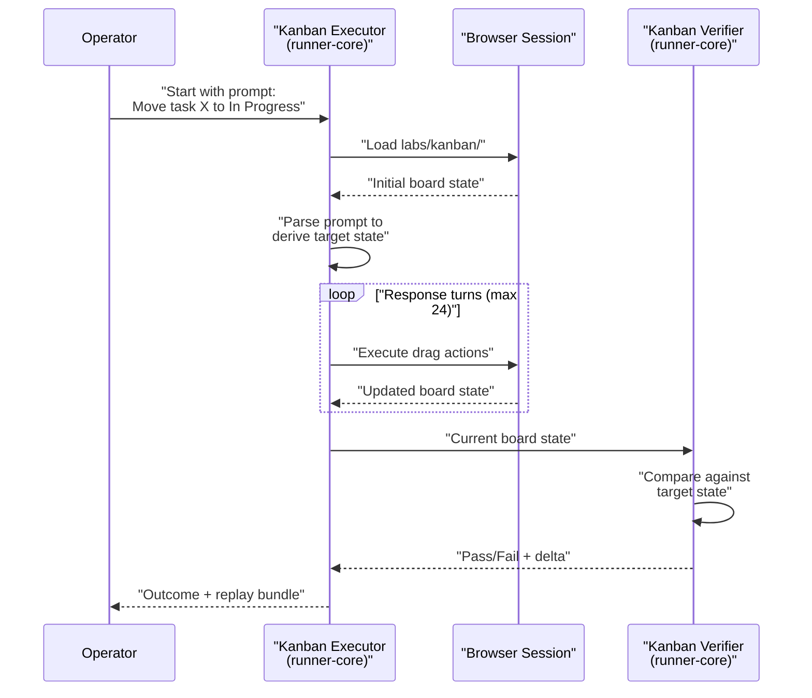
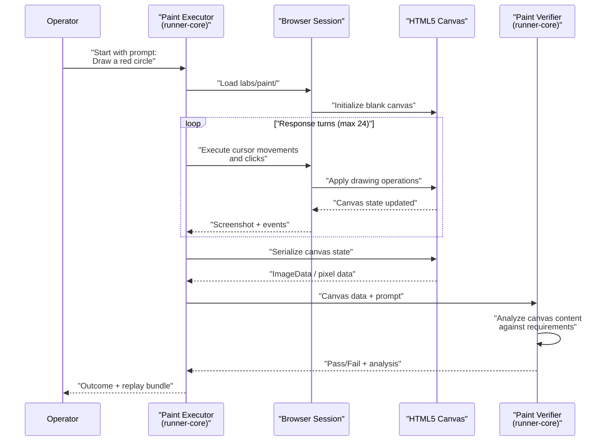
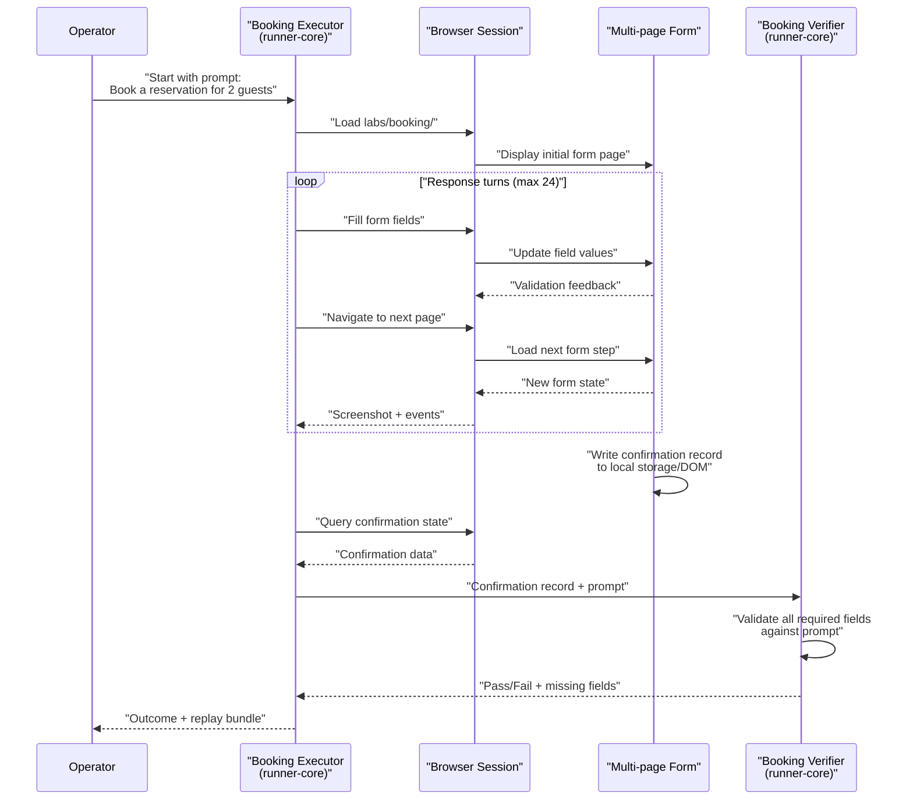
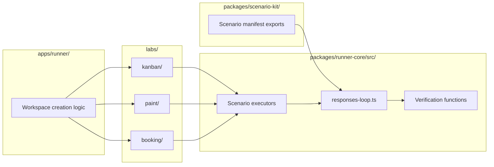

<!-- source: DeepWiki mcp.deepwiki.com · repo openai/openai-cua-sample-app · page 6.2 Official Scenarios · fetched 2026-10-26 -->

# Official Scenarios

Relevant source files

The following files were used as context for generating this wiki page:

- [README.md](README.md)

## Purpose and Scope

This document describes the three official scenarios shipped with the openai-cua-sample-app repository: `kanban-reprioritize-sprint`, `paint-draw-poster`, and `booking-complete-reservation`. Each scenario demonstrates a distinct browser interaction pattern and verification approach, serving as reference implementations for integrating GPT-5.4's browser control capabilities.

For information about the scenario system architecture and how scenarios are defined and executed, see [Scenario System](#6.1). For details on verification mechanisms and how different verification types work, see [Verification Mechanisms](#6.3).

## Scenario Overview

The repository includes three official scenarios, each designed to demonstrate specific browser automation capabilities and verification patterns. All scenarios support both `native` and `code` execution modes and use isolated workspaces populated from the `labs/` directory.

### Scenario Summary Table

| Scenario ID | Short Name | Interaction Pattern | Verification Type | Primary Teaching Goal |
|-------------|------------|---------------------|-------------------|----------------------|
| `kanban-reprioritize-sprint` | `kanban` | Drag-and-drop UI manipulation | Stateful board state comparison | Demonstrating complex drag-and-drop operations |
| `paint-draw-poster` | `paint` | Canvas drawing and cursor control | Canvas state inspection | Teaching precise cursor control for creative tasks |
| `booking-complete-reservation` | `booking` | Multi-step form navigation | Form completion verification | Showing multi-page browsing and data entry |

**Sources:** [README.md:98-104]()

## Scenario Architecture

The following diagram shows how official scenarios map to their code components across the repository structure.

**Sources:** [README.md:106-124]()

## kanban-reprioritize-sprint

### Purpose

The `kanban-reprioritize-sprint` scenario demonstrates stateful drag-and-drop verification. The model receives a natural language prompt describing desired task prioritization and must manipulate a kanban board to match the target state.

### Key Characteristics

- **Scenario ID:** `kanban-reprioritize-sprint`
- **Short name:** `kanban`
- **Interaction type:** Drag-and-drop operations on HTML elements
- **Verification approach:** Compare final board state against target state derived from operator prompt
- **Complexity:** Medium (requires understanding relative positioning and stateful board structure)

### Lab Template

The kanban lab template resides in `labs/kanban/` and contains:
- An HTML-based kanban board with multiple columns (e.g., "Backlog", "In Progress", "Done")
- Draggable task cards with identifiable attributes
- JavaScript handlers for drag-and-drop events
- Local state tracking of card positions

### Execution Flow

### Verification Logic

The kanban verifier performs stateful verification by:
1. Extracting the target board configuration from the operator prompt
2. Querying the final browser DOM to determine actual card positions
3. Comparing each card's column assignment against the expected state
4. Reporting success only if all cards match the target configuration

**Sources:** [README.md:100]()

## paint-draw-poster

### Purpose

The `paint-draw-poster` scenario demonstrates cursor control and canvas manipulation. The model must interpret a drawing task and produce a visual result on an HTML canvas that matches the request.

### Key Characteristics

- **Scenario ID:** `paint-draw-poster`
- **Short name:** `paint`
- **Interaction type:** Precise cursor movements and drawing operations
- **Verification approach:** Canvas state inspection and comparison
- **Complexity:** High (requires fine-grained coordinate control and understanding visual requirements)

### Lab Template

The paint lab template resides in `labs/paint/` and contains:
- An HTML5 `<canvas>` element
- Drawing tools (e.g., brushes, colors, shapes)
- JavaScript canvas API wrappers
- Canvas state serialization functions for verification

### Execution Flow

### Verification Logic

The paint verifier performs canvas state verification by:
1. Extracting the saved canvas data from the browser session
2. Analyzing pixel data or canvas API state
3. Comparing the visual output against expectations derived from the prompt
4. Validating that drawing operations were performed correctly

**Sources:** [README.md:101]()

## booking-complete-reservation

### Purpose

The `booking-complete-reservation` scenario demonstrates multi-step form navigation and completion. The model must browse through a multi-page booking flow, fill in required fields, and complete a reservation.

### Key Characteristics

- **Scenario ID:** `booking-complete-reservation`
- **Short name:** `booking`
- **Interaction type:** Form field interaction and multi-page navigation
- **Verification approach:** Form completion verification against local confirmation record
- **Complexity:** Medium (requires understanding multi-step workflows and form validation)

### Lab Template

The booking lab template resides in `labs/booking/` and contains:
- A multi-page HTML form workflow (e.g., search → select → details → confirm)
- Form inputs with validation rules
- Navigation controls between form pages
- Local storage or DOM-based confirmation tracking

### Execution Flow

### Verification Logic

The booking verifier performs form completion verification by:
1. Extracting the confirmation record from the browser (local storage, DOM element, or API response)
2. Parsing the operator prompt to determine required reservation details
3. Comparing the submitted form data against the requirements
4. Reporting success only if all required fields were completed correctly and the reservation was confirmed

**Sources:** [README.md:102]()

## Scenario Component Mapping

The following diagram maps scenario components to their specific file locations in the repository structure.

**Sources:** [README.md:106-124]()

## Scenario Execution Modes

All three official scenarios support both execution modes defined in the system. The choice of mode is controlled by the `CUA_RESPONSES_MODE` environment variable and can be selected per-run in the operator console.

### Mode Comparison for Official Scenarios

| Aspect | Native Mode | Code Mode |
|--------|-------------|-----------|
| **Kanban drag-and-drop** | Model emits `click`, `drag`, and `drop` actions with pixel coordinates | Model scripts `page.dragAndDrop()` or equivalent Playwright methods |
| **Paint canvas drawing** | Model emits precise `mouse_move` and `click` sequences for drawing strokes | Model scripts `page.evaluate()` with canvas API calls |
| **Booking form completion** | Model emits `click` on inputs and `type` for text entry | Model scripts `page.fill()` and `page.click()` for form navigation |
| **Verification** | Same verification logic applies to both modes | Same verification logic applies to both modes |

**Sources:** [README.md:91-97]()

## Common Scenario Properties

All official scenarios share the following characteristics:

1. **Isolated Workspaces:** Each run creates an isolated workspace in `apps/runner/.workspaces/<runId>/` populated by copying the relevant lab template
2. **Default Turn Limit:** 24 response turns maximum, configurable via `NEXT_PUBLIC_CUA_DEFAULT_MAX_RESPONSE_TURNS`
3. **Replay Bundle Generation:** All scenarios produce replay bundles containing screenshots, events, metadata, and outcome status
4. **Deterministic Labs:** Lab templates are static HTML/JavaScript files designed for reproducible verification
5. **Prompt-Driven:** Operator prompts guide the model's behavior and are used to derive verification targets

**Sources:** [README.md:1-158]()

## Adding Custom Scenarios

While this document covers the official scenarios, the system supports custom scenario development. New scenarios require:

- A manifest definition in `packages/scenario-kit`
- An executor implementation in `packages/runner-core`
- A lab template in `labs/`
- Custom verification logic in `packages/runner-core`

For details on the scenario system architecture and how to extend it, see [Scenario System](#6.1).

---

