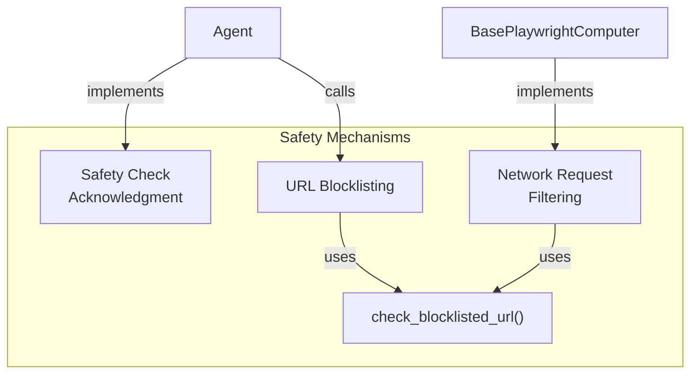
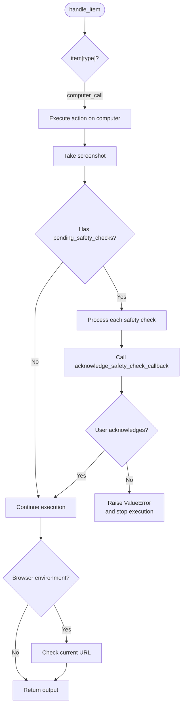
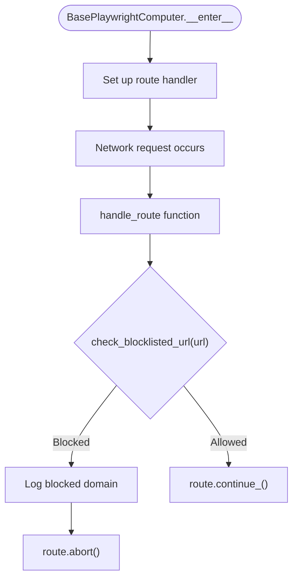
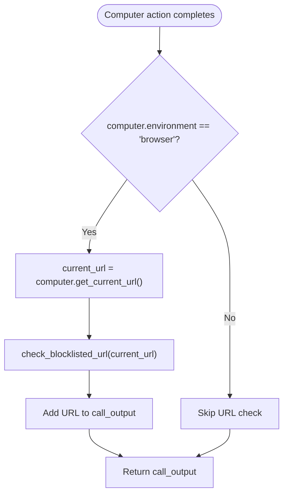
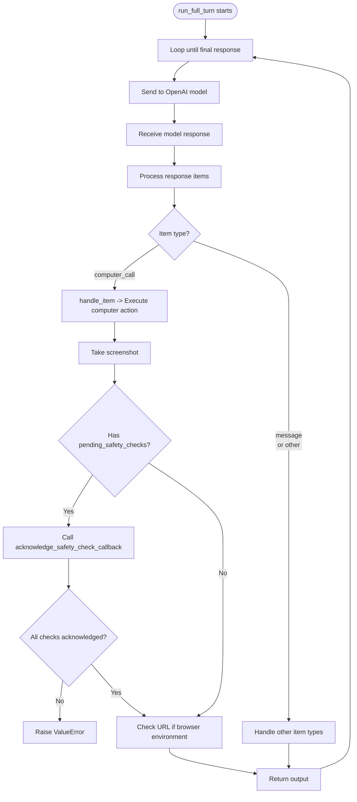
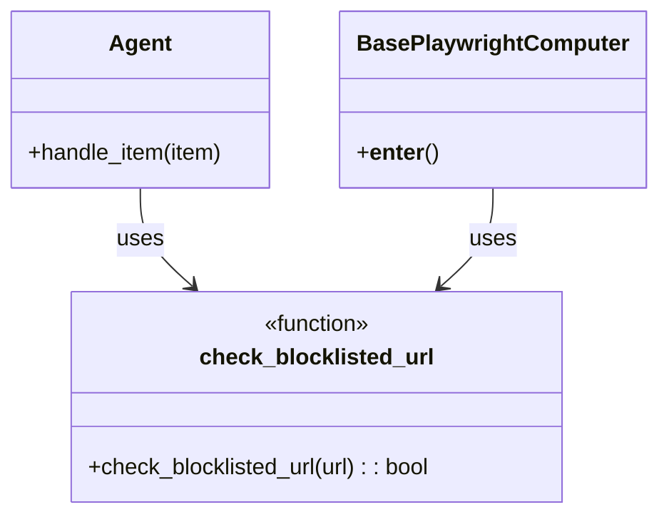

<!-- source: DeepWiki mcp.deepwiki.com · repo openai/openai-cua-sample-app · page 6.3 Verification Mechanisms · fetched 2026-10-26 -->

# Safety Mechanisms

<details>
<summary>Relevant source files</summary>

The following files were used as context for generating this wiki page:

- [README.md](README.md)

</details>


## Purpose and Scope

This document details the safety mechanisms implemented in the OpenAI Computer Using Agent (CUA) sample application. These mechanisms protect users by preventing harmful actions and restricting access to potentially dangerous resources. For information about the general agent execution flow, see [Agent Execution Flow](#4.1).

## Safety Mechanisms Overview

The CUA sample application implements multiple layers of safety protection:

1. **Safety Check Acknowledgment System**: Requires explicit user confirmation before proceeding with potentially risky actions
2. **URL Blocklisting**: Prevents navigation to and interaction with potentially malicious websites
3. **Network Request Filtering**: Blocks requests to restricted domains at the browser level

### Safety Mechanism Architecture



Sources: [agent/agent.py:1-9](), [computers/base_playwright.py:61-71]()

## Safety Check Acknowledgment System

The Agent class implements a safety check mechanism that requires explicit user acknowledgment before proceeding with potentially risky actions.

### Implementation Details

```mermaid
classDiagram
    class Agent {
        -model: string
        -computer: Computer
        -tools: list
        -acknowledge_safety_check_callback: Callable
        +run_full_turn(items, print_steps, debug, show_images)
        +handle_item(item)
    }
    
    Agent --> "acknowledge_safety_check_callback": uses
```

The Agent constructor accepts a callback function that handles safety check acknowledgments:

```python
def __init__(
    self,
    model="computer-use-preview",
    computer: Computer = None,
    tools: list[dict] = [],
    acknowledge_safety_check_callback: Callable = lambda: False,
):
    # ...
    self.acknowledge_safety_check_callback = acknowledge_safety_check_callback
```

The default callback returns `False`, which means all safety checks will fail unless a proper callback is provided.

Sources: [agent/agent.py:20-33]()

### Safety Check Flow

When the agent processes a computer call, it checks for pending safety checks:



The relevant code for safety check processing:

```python
# if user doesn't ack all safety checks exit with error
pending_checks = item.get("pending_safety_checks", [])
for check in pending_checks:
    message = check["message"]
    if not self.acknowledge_safety_check_callback(message):
        raise ValueError(
            f"Safety check failed: {message}. Cannot continue with unacknowledged safety checks."
        )
```

Sources: [agent/agent.py:86-92]()

## URL Blocklisting

The application implements URL blocklisting at two different levels:

### 1. Network Request Filtering (Browser Environments)

In browser-based computer environments, network requests are intercepted and filtered before they're processed:



The route handler is set up in the `__enter__` method of BasePlaywrightComputer:

```python
def __enter__(self):
    # Start Playwright and call the subclass hook for getting browser/page
    self._playwright = sync_playwright().start()
    self._browser, self._page = self._get_browser_and_page()

    # Set up network interception to flag URLs matching domains in BLOCKED_DOMAINS
    def handle_route(route, request):
        url = request.url
        if check_blocklisted_url(url):
            print(f"Flagging blocked domain: {url}")
            route.abort()
        else:
            route.continue_()

    self._page.route("**/*", handle_route)
    return self
```

Sources: [computers/base_playwright.py:56-73]()

### 2. Post-Action URL Checking

After every computer action in browser environments, the agent checks the current URL:



The relevant code:

```python
# additional URL safety checks for browser environments
if self.computer.environment == "browser":
    current_url = self.computer.get_current_url()
    check_blocklisted_url(current_url)
    call_output["output"]["current_url"] = current_url
```

Sources: [agent/agent.py:105-108]()

## Integration in Agent Execution Flow

Safety mechanisms are integrated throughout the agent's execution flow:



Sources: [agent/agent.py:113-141](), [agent/agent.py:71-111]()

## Environment-Specific Safety Measures

Different safety measures apply depending on the computer environment:

| Environment | Safety Mechanisms Applied |
|-------------|---------------------------|
| Browser     | • Safety check acknowledgment<br>• Network request filtering<br>• URL blocklisting after actions |
| Desktop     | • Safety check acknowledgment only |

Sources: [agent/agent.py:105-108](), [computers/base_playwright.py:61-71]()

## URL Blocklisting Implementation

The `check_blocklisted_url` function from the utils module is used by both safety mechanisms:



This function checks if a URL contains any of the blocklisted domains and raises an error or returns true if it does.

Sources: [agent/agent.py:1-9](), [computers/base_playwright.py:5]()

## Summary

The safety mechanisms in the CUA sample application work together to:

1. Prevent execution of potentially risky actions without explicit user acknowledgment
2. Block navigation to restricted or malicious websites
3. Prevent network requests to blocklisted domains
4. Apply appropriate safety measures based on the environment (browser vs. desktop)

These mechanisms provide a multi-layered safety approach when using AI agents to interact with computer environments.

---

