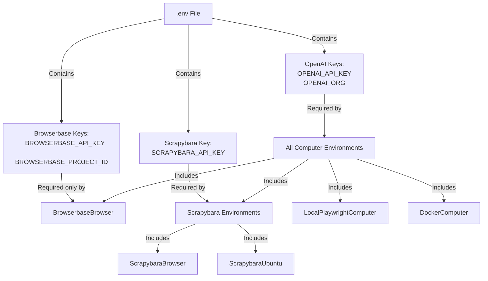
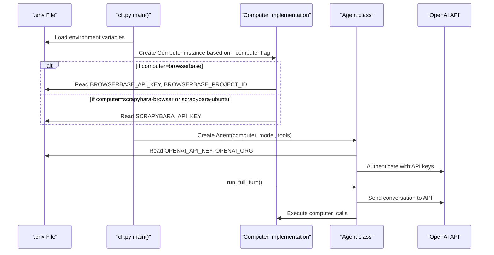

<!-- source: DeepWiki mcp.deepwiki.com · repo openai/openai-cua-sample-app · page 7.1 Environment Variables · fetched 2026-10-26 -->

# Environment Variables

<details>
<summary>Relevant source files</summary>

The following files were used as context for generating this wiki page:

- [.env.example](.env.example)
- [README.md](README.md)

</details>


This document covers the environment variables required for configuring the OpenAI CUA Sample App. For information about Docker configuration, see [Docker Setup](#6.2).

## Overview

The OpenAI CUA Sample App uses environment variables to store API keys for OpenAI and third-party services that provide remote computer environments. These environment variables are loaded from a `.env` file placed in the root directory of the project.

## Required Environment Variables

The following environment variables are required for basic functionality:

| Variable | Description | Required For |
|----------|-------------|-------------|
| `OPENAI_API_KEY` | Your OpenAI API key for accessing the Responses API | All environments |
| `OPENAI_ORG` | Your OpenAI organization ID | All environments |

Sources: [.env.example:3-4](), [README.md:36-38]()

## Optional Environment Variables

Depending on which computer environment you choose, you'll need additional environment variables:

| Variable | Description | Required For |
|----------|-------------|-------------|
| `BROWSERBASE_API_KEY` | API key for Browserbase service | Browserbase environment |
| `BROWSERBASE_PROJECT_ID` | Project ID for Browserbase | Browserbase environment |
| `SCRAPYBARA_API_KEY` | API key for Scrapybara service | Scrapybara environments (browser and Ubuntu) |

Sources: [.env.example:6-9](), [README.md:96-98]()

## Environment Variables by Computer Environment

### Environment Variable Requirements Diagram



Sources: [README.md:92-98]()

## Setting Up Environment Variables

To set up environment variables for the CUA Sample App:

1. Create a copy of the `.env.example` file and name it `.env`:
   ```bash
   cp .env.example .env
   ```

2. Edit the `.env` file and replace the placeholder values with your actual API keys:
   ```
   OPENAI_API_KEY="your-openai-api-key"
   OPENAI_ORG="your-openai-org-id"
   
   # Only needed if using Browserbase
   BROWSERBASE_API_KEY="your-browserbase-api-key"
   BROWSERBASE_PROJECT_ID="your-browserbase-project-id"
   
   # Only needed if using Scrapybara
   SCRAPYBARA_API_KEY="your-scrapybara-api-key"
   ```

3. The application will automatically load these environment variables when you run it.

Sources: [.env.example:1-9]()

## Environment Variables Flow in Application

### Environment Variable Usage Flow



Sources: [README.md:41-48]()

## Obtaining API Keys

### OpenAI API Keys
1. Create an account at [OpenAI Platform](https://platform.openai.com/)
2. Navigate to the API section and create a new API key
3. Copy your API key and organization ID to your `.env` file

### Browserbase API Keys
1. Create an account at [Browserbase](https://www.browserbase.com/)
2. Obtain your API key and project ID from the dashboard
3. Add these credentials to your `.env` file

### Scrapybara API Keys
1. Create an account at [Scrapybara](https://scrapybara.com/dashboard)
2. Obtain your API key from the dashboard
3. Add the API key to your `.env` file

Sources: [README.md:142-143]()

## Security Considerations

When working with environment variables containing API keys:

- Never commit your `.env` file to version control (it's included in `.gitignore` by default)
- Protect your API keys, especially your OpenAI API key, as they can incur charges to your account
- In production environments, consider using system environment variables instead of a `.env` file
- Review the permissions granted to each API key to ensure they only have the access required

## Troubleshooting

If you encounter issues related to environment variables:

1. Verify that your `.env` file exists in the root directory of the project
2. Check that the API keys in your `.env` file are correct and not expired
3. Ensure you've installed the python-dotenv package (included in requirements.txt)
4. For hosted environments, verify that your account is active and has sufficient credits/permissions
5. If using Docker, environment variables may need to be passed differently (see [Docker Setup](#6.2))

Sources: [README.md:112-137]()

---

