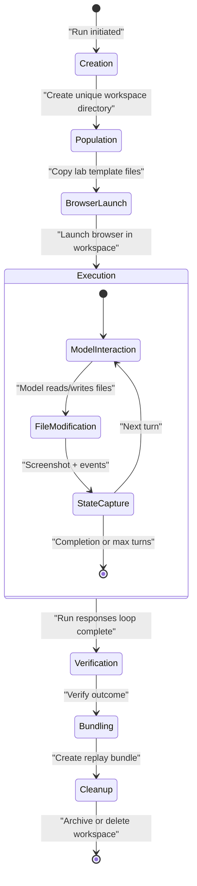
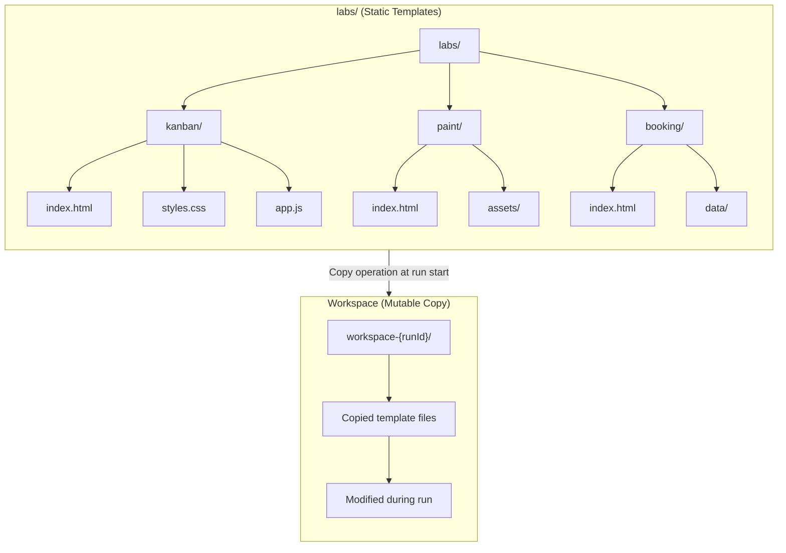
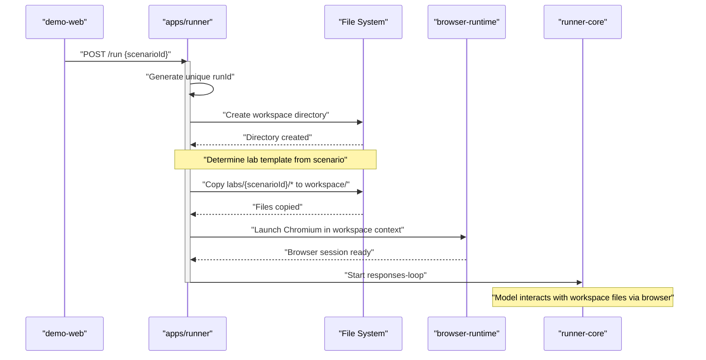
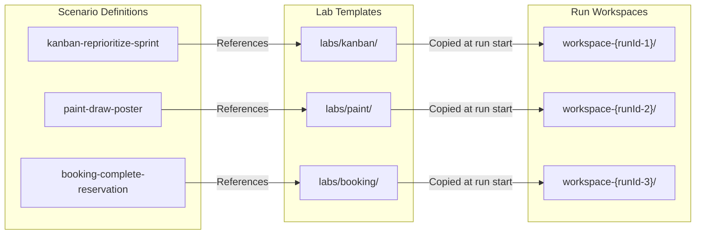
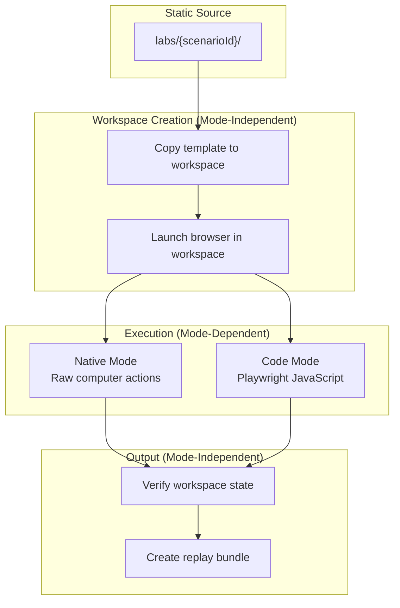

<!-- source: DeepWiki mcp.deepwiki.com · repo openai/openai-cua-sample-app · page 7.2 Workspaces and Lab Templates · fetched 2026-10-26 -->

# Workspaces and Lab Templates

Relevant source files

The following files were used as context for generating this wiki page:

- [README.md](README.md)

This page explains how the runner service creates isolated, run-scoped workspaces from static lab templates. Each run operates in its own workspace directory that is populated by copying files from the `labs/` directory at the start of execution.

For information about the runner service that manages these workspaces, see [Runner Service](#3.2). For details about how scenarios define which lab template to use, see [Scenario System](#6.1).

---

## Overview

Every run execution requires an isolated workspace to prevent interference between concurrent runs and to ensure deterministic starting conditions. The runner achieves this by:

1. Creating a unique workspace directory for each run
2. Copying the appropriate lab template into that workspace
3. Launching the browser session pointed at the workspace
4. Allowing the model to interact with and modify workspace contents
5. Preserving the final workspace state as part of the replay bundle

This design ensures that each scenario starts with a known-good state and can safely modify files without affecting other runs or the original templates.

**Sources:** [README.md:6](), [README.md:15](), [README.md:120-121]()

---

## Workspace Lifecycle

**Workspace Lifecycle Phases**

| Phase | Description | Responsible Component |
|-------|-------------|----------------------|
| **Creation** | Generate unique workspace identifier and directory path | `apps/runner` |
| **Population** | Copy static lab template files into workspace | `apps/runner` |
| **Browser Launch** | Initialize Playwright session with workspace as root | `packages/browser-runtime` |
| **Execution** | Model interacts with browser, may modify workspace files | `packages/runner-core` |
| **Verification** | Check workspace state against expected outcomes | `packages/runner-core` |
| **Bundling** | Package workspace artifacts into replay bundle | `apps/runner` |
| **Cleanup** | Archive or delete workspace directory | `apps/runner` |

**Sources:** [README.md:6](), [README.md:111]()

---

## Lab Templates Structure

Lab templates are static directory structures stored in the `labs/` directory at the repository root. Each template contains the HTML, CSS, JavaScript, and asset files needed to run a specific scenario.

**Template Directory Characteristics**

- **Immutable**: Templates in `labs/` are never modified by runs
- **Versioned**: Templates are checked into source control
- **Self-contained**: Each template includes all resources needed for its scenario
- **Browser-ready**: Templates contain valid HTML entry points
- **Deterministic**: Starting state is identical for every run of the same scenario

**Sources:** [README.md:120-121]()

---

## Workspace Creation Process

The runner service orchestrates workspace creation as the first step of run execution. This process ensures isolation and repeatability across all scenarios and execution modes.

**Workspace Directory Naming**

The runner generates unique workspace identifiers to prevent collisions between concurrent runs. The workspace directory path typically follows a pattern that includes:

- Run ID (unique identifier)
- Timestamp (for ordering and cleanup)
- Scenario identifier (for debugging)

**File Copy Strategy**

The runner performs a full copy of the lab template directory tree:

- All files and subdirectories are copied recursively
- File permissions and timestamps are preserved
- Symbolic links (if any) are resolved to actual files

This ensures that each workspace is a complete, independent copy that can be modified without affecting the original template or other concurrent runs.

**Sources:** [README.md:6](), [README.md:15](), [README.md:120-121]()

---

## Scenario-Specific Templates

Each of the three official scenarios uses its own lab template that provides the specific environment needed for that scenario's task.

**Template Purposes by Scenario**

| Scenario | Lab Template | Template Purpose |
|----------|--------------|------------------|
| **kanban-reprioritize-sprint** | `labs/kanban/` | Provides a drag-and-drop task board interface with initial task layout |
| **paint-draw-poster** | `labs/paint/` | Provides a canvas drawing application with tools and state persistence |
| **booking-complete-reservation** | `labs/booking/` | Provides a multi-step booking form interface with validation |

**Sources:** [README.md:100-103](), [README.md:120-121]()

---

## Workspace Isolation Benefits

The workspace isolation model provides several critical advantages for the sample application:

**Concurrency Safety**

Multiple runs can execute simultaneously without file conflicts. Each workspace is completely independent, allowing parallel execution of the same scenario or different scenarios.

**Deterministic Starting Conditions**

Every run begins with an identical copy of the lab template. This ensures that verification logic can make assumptions about the initial state and that runs are reproducible.

**Safe Mutation**

The model can freely modify workspace files during execution without affecting:
- The original lab templates
- Other concurrent runs
- Future runs of the same scenario

**Artifact Preservation**

The final workspace state is preserved as part of the replay bundle, allowing post-run analysis of:
- Modified HTML/CSS/JavaScript files
- Generated images or data files
- Browser storage state

**Debugging Support**

When a run fails, the preserved workspace allows developers to inspect the exact file state that caused the failure, making it easier to reproduce and fix issues.

**Sources:** [README.md:6](), [README.md:15]()

---

## Execution Mode Independence

Both `native` and `code` execution modes operate against the same workspace structure. The workspace isolation model is independent of how the model controls the browser.

**Mode-Specific Workspace Interactions**

| Execution Mode | Workspace File Access | Browser Control Method |
|----------------|----------------------|------------------------|
| **native** | Indirect (via browser rendering of workspace files) | Computer tool API (clicks, drags, typing) |
| **code** | Direct (via Playwright file system APIs) and indirect (via browser) | Playwright JavaScript via `exec_js` |

In both modes, the browser session's root is pointed at the workspace directory, allowing the model to interact with workspace files through the browser interface.

**Sources:** [README.md:92-96]()

---

## Integration with Run Lifecycle

Workspace creation and management integrates with other run lifecycle components documented elsewhere in this wiki.

**Related Components**

- **Runner Service** [#3.2]() - HTTP endpoints that trigger workspace creation
- **Browser Runtime** [#4.2]() - Playwright session initialization in workspace context
- **Responses Loop** [#4.1]() - Execution that operates within the workspace
- **Verification** [#6.3]() - Checks workspace state against expected outcomes
- **Replay Bundles** [#8.1]() - Packages workspace artifacts for review

**Configuration Impact**

No environment variables directly control workspace behavior, but workspace paths are influenced by:

- Run ID generation (internal to runner)
- Scenario selection (determines which lab template to copy)
- File system permissions (OS-level configuration)

**Sources:** [README.md:6](), [README.md:110-123]()

---

