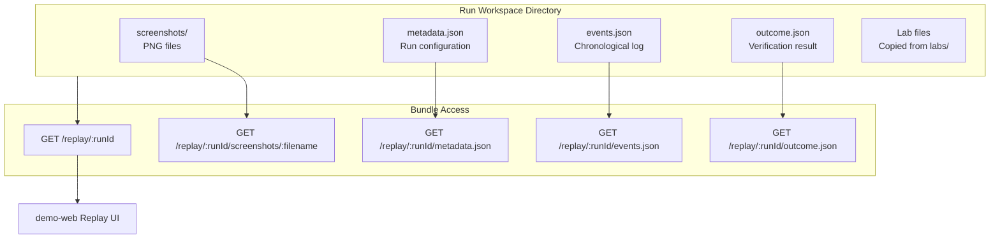
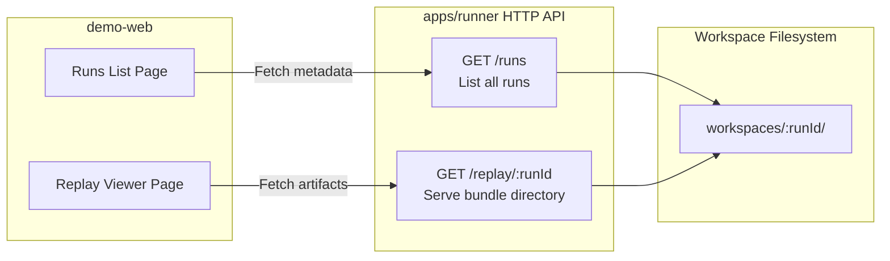
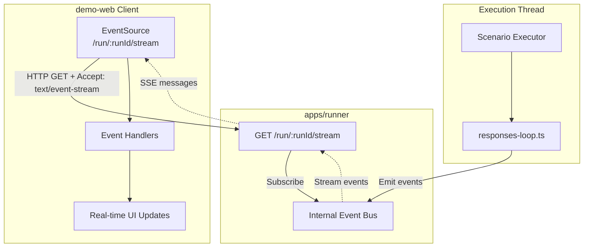
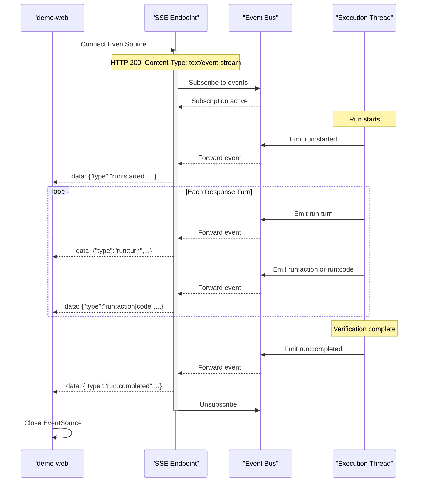
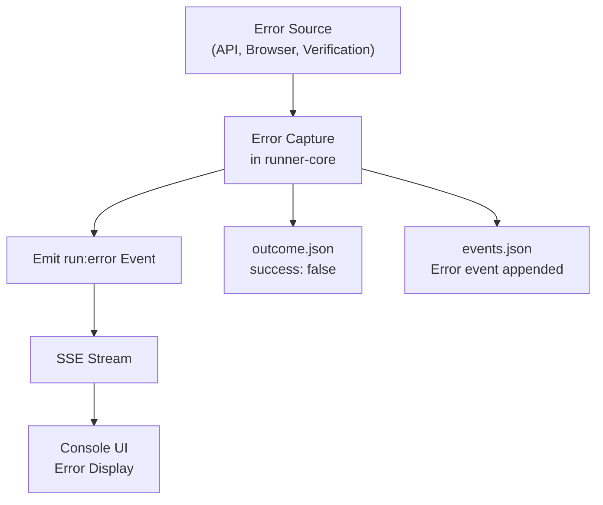
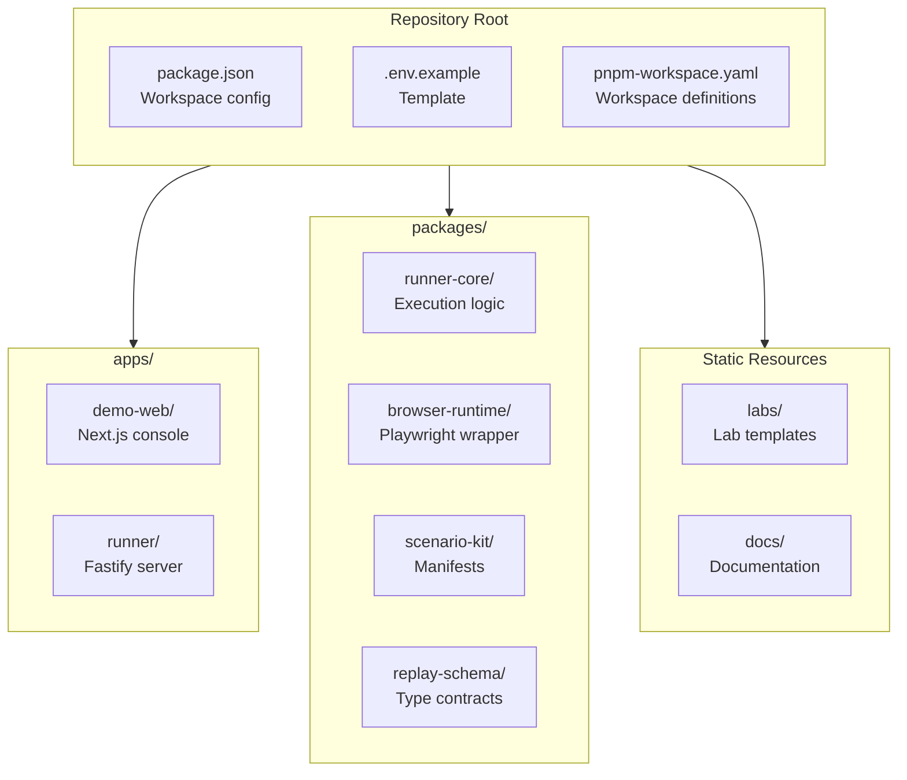
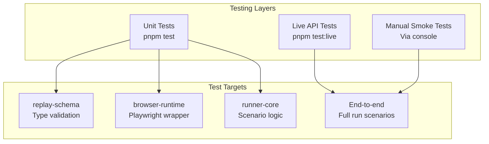
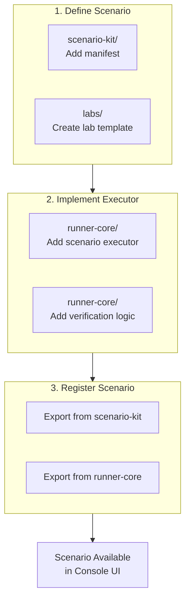
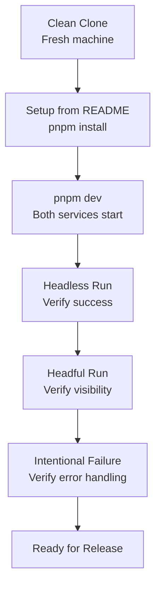

<!-- source: DeepWiki mcp.deepwiki.com · repo openai/openai-cua-sample-app · page 8 Advanced Topics · fetched 2026-10-26 -->

# Advanced Topics

<details>
<summary>Relevant source files</summary>

The following files were used as context for generating this wiki page:

- [README.md](README.md)

</details>


This page covers advanced features and development practices in the openai-cua-sample-app. For basic setup and running scenarios, see [Getting Started](#2). For understanding the core Responses API integration, see [responses-loop](#4.1). For scenario-specific verification logic, see [Verification Mechanisms](#6.3).

The following sections document the replay bundle system for reviewing run artifacts, the SSE streaming interface for real-time updates, and development patterns for extending the codebase.

## Replay Bundle System

Every run execution produces a replay bundle containing all artifacts needed to review what happened. The runner service creates these bundles automatically after scenario execution completes, regardless of success or failure.

### Bundle Structure



**Sources:** [README.md:5-7](), [README.md:106-123]()

### Artifact Capture Pipeline

The runner service captures artifacts at multiple stages during execution:

```mermaid
sequenceDiagram
    participant Exec as "Scenario Executor"
    participant Loop as "responses-loop.ts"
    participant Browser as "browser-runtime"
    participant FS as "Workspace Filesystem"
    participant Events as "Event Emitter"
    
    Exec->>Loop: Execute scenario
    activate Loop
    
    loop Each Response Turn
        Loop->>Browser: Execute action/code
        Browser-->>Loop: Page state
        Loop->>Browser: Take screenshot
        Browser-->>Loop: PNG buffer
        Loop->>FS: Save screenshot
        Note over FS: screenshots/turn-N.png
        Loop->>Events: Emit event with metadata
        Note over Events: Includes screenshot path
    end
    
    Loop->>Exec: Execution complete
    deactivate Loop
    Exec->>Exec: Run verification
    Exec->>FS: Write outcome.json
    Exec->>FS: Write events.json
    Exec->>FS: Write metadata.json
    Exec-->>Events: Emit final status
```

**Sources:** [README.md:111-112](), [README.md:118-119]()

### Metadata Schema

The `metadata.json` file captures run configuration and timing:

| Field | Type | Description |
|-------|------|-------------|
| `runId` | string | Unique identifier for the run |
| `scenarioId` | string | Scenario identifier (e.g., `kanban`, `paint`, `booking`) |
| `modelName` | string | GPT model used (default `gpt-5.4`) |
| `mode` | string | Execution mode: `native` or `code` |
| `headless` | boolean | Whether browser ran headless |
| `maxResponseTurns` | number | Maximum turns allowed (default 24) |
| `startTime` | string | ISO 8601 timestamp |
| `endTime` | string | ISO 8601 timestamp |
| `prompt` | string | User-provided scenario prompt |

**Sources:** [README.md:112-113]()

### Events Schema

The `events.json` file contains a chronological array of events. The schema is defined in the `replay-schema` package to ensure type safety between the runner and console.

Each event includes:

| Field | Type | Description |
|-------|------|-------------|
| `type` | string | Event type identifier |
| `timestamp` | string | ISO 8601 timestamp |
| `turnIndex` | number | Which response turn (0-indexed) |
| `screenshotPath` | string | Relative path to screenshot if captured |
| `payload` | object | Event-specific data |

Common event types:
- `run:started` - Execution began
- `run:turn` - Model response received
- `run:action` - Action executed (native mode)
- `run:code` - Code executed (code mode)
- `run:verification` - Verification completed
- `run:completed` - Execution finished
- `run:error` - Error occurred

**Sources:** [README.md:112-113]()

### Outcome Schema

The `outcome.json` file captures verification results:

| Field | Type | Description |
|-------|------|-------------|
| `success` | boolean | Whether verification passed |
| `reason` | string | Human-readable explanation |
| `details` | object | Scenario-specific verification data |
| `finalState` | object | Captured browser/application state |

The `details` object varies by scenario. For example, `kanban-reprioritize-sprint` includes the final board state with card positions, while `booking-complete-reservation` includes form field values.

**Sources:** [README.md:100-102]()

### Accessing Replay Bundles

The runner exposes replay bundles through HTTP endpoints. The console application uses these endpoints to render the replay UI.



**Sources:** [README.md:108-111]()

### Workspace Lifecycle

Workspaces are created at the start of each run and persist after completion for replay access:

1. **Creation**: The runner copies lab templates from `labs/` into a new workspace directory `workspaces/:runId/`
2. **Execution**: Browser sessions operate within the workspace context
3. **Capture**: Artifacts are written to the workspace during and after execution
4. **Persistence**: Workspaces remain available for replay until manually cleaned

The workspace isolation ensures that multiple runs can execute concurrently without interference.

**Sources:** [README.md:120-121]()

## Server-Sent Events (SSE)

The runner uses SSE to stream real-time updates to the console during run execution. This allows operators to monitor progress without polling.

### SSE Endpoint



**Sources:** [README.md:5-6](), [README.md:111]()

### Event Stream Lifecycle



**Sources:** [README.md:111]()

### Event Payload Types

The SSE stream sends JSON-encoded events. All events share a base structure:

```typescript
{
  type: string;
  timestamp: string;
  runId: string;
  payload: object; // Event-specific data
}
```

Key event payloads:

| Event Type | Payload Fields | Description |
|------------|----------------|-------------|
| `run:started` | `scenarioId`, `modelName`, `mode` | Execution began |
| `run:turn` | `turnIndex`, `responseId` | Model response received |
| `run:action` | `action`, `coordinates`, `text` | Native mode action executed |
| `run:code` | `code`, `result` | Code mode script executed |
| `run:screenshot` | `path`, `turnIndex` | Screenshot captured |
| `run:verification` | `success`, `reason` | Verification completed |
| `run:completed` | `success`, `duration` | Execution finished |
| `run:error` | `error`, `message`, `code` | Error occurred |

**Sources:** [README.md:112-113]()

### SSE Connection Management

The console manages SSE connections with reconnection logic:

1. **Initial Connection**: `EventSource` connects when run starts
2. **Keep-Alive**: Server sends periodic keep-alive comments to prevent timeout
3. **Automatic Reconnection**: Browser automatically reconnects on network failures
4. **Explicit Close**: Console closes connection when run completes or user navigates away

The runner tracks active SSE connections and cleans them up when clients disconnect or runs complete.

**Sources:** [README.md:5-6]()

### Error Propagation

Errors during execution are propagated through the SSE stream:



**Sources:** [README.md:16]()

## Development Workflow

### Repository Structure

The repository follows a monorepo pattern with clear separation of concerns:



**Sources:** [README.md:106-123]()

### Development Commands

The repository provides a comprehensive set of development commands through pnpm workspaces:

| Command | Purpose | Notes |
|---------|---------|-------|
| `pnpm dev` | Start both apps together | Combined logs |
| `pnpm dev:runner` | Start runner only | Port 4001 |
| `pnpm dev:web` | Start console only | Port 3000, requires `RUNNER_BASE_URL` |
| `pnpm lint` | Run ESLint | All workspaces |
| `pnpm typecheck` | Run TypeScript compiler | Check types without building |
| `pnpm test` | Run unit tests | All packages |
| `pnpm test:live` | Run live API tests | Requires `OPENAI_API_KEY` |
| `pnpm build` | Build all packages and apps | Production builds |
| `pnpm check` | Run lint + typecheck + test | Pre-commit verification |
| `pnpm playwright:install` | Install Chromium | Required once |
| `pnpm playwright:install:with-deps` | Install Chromium + OS deps | Linux systems |

**Sources:** [README.md:26-89]()

### Testing Strategy

The repository includes multiple testing layers:



**Sources:** [README.md:75-89]()

### Test Configuration

Live tests are opt-in and require API credentials:

```bash
# Run all unit tests (no API calls)
pnpm test

# Run live API tests (requires key)
OPENAI_API_KEY=your_key_here pnpm test:live
```

The test suite is designed to run in CI/CD environments. Unit tests execute without external dependencies, while live tests are gated behind secret availability checks.

**Sources:** [README.md:85-89]()

### Debugging Techniques

#### Browser Visibility

Toggle headless mode to observe browser interactions:

1. In the console UI, uncheck "Headless"
2. Start a run
3. Browser window appears showing real-time interactions

This is useful for understanding model behavior and debugging verification failures.

**Sources:** [README.md:64]()

#### Log Analysis

Both applications emit structured logs:

```bash
# Runner logs (execution details)
pnpm dev:runner

# Console logs (HTTP requests, SSE events)
pnpm dev:web

# Combined logs (interleaved)
pnpm dev
```

The runner logs include:
- API request/response details
- Browser action execution
- Verification logic results
- Error stack traces

**Sources:** [README.md:68-73]()

#### Replay Inspection

After a run completes, inspect the workspace directory directly:

```bash
# Navigate to workspace
cd workspaces/<runId>

# View metadata
cat metadata.json

# View events
cat events.json

# View outcome
cat outcome.json

# Review screenshots
ls screenshots/
```

This allows offline analysis of run artifacts without using the console UI.

**Sources:** [README.md:120-121]()

### Adding Custom Scenarios

To add a new scenario, implement these components:



**Steps:**

1. **Create Lab Template** in `labs/your-scenario/`
   - HTML, CSS, JavaScript files
   - Should be self-contained and deterministic

2. **Define Manifest** in `packages/scenario-kit/src/manifests/`
   - Scenario ID, name, description
   - Default prompt template
   - Mode compatibility

3. **Implement Executor** in `packages/runner-core/src/scenarios/`
   - Scenario-specific setup logic
   - Verification function
   - Export from package

4. **Update Console** to recognize the new scenario
   - Manifest is automatically picked up
   - UI reflects new scenario in dropdown

**Sources:** [README.md:98-104](), [README.md:106-123]()

### Execution Mode Switching

Both execution modes share the same infrastructure:

| Aspect | Native Mode | Code Mode |
|--------|-------------|-----------|
| API Integration | Direct computer tool | `exec_js` function |
| Lab Files | Same templates | Same templates |
| Verification | Same logic | Same logic |
| Replay Format | Same schema | Same schema |
| Configuration | `CUA_RESPONSES_MODE=native` | `CUA_RESPONSES_MODE=code` |

To experiment with both modes:

```bash
# Run in native mode (default)
pnpm dev

# Run in code mode
CUA_RESPONSES_MODE=code pnpm dev:runner
pnpm dev:web
```

**Sources:** [README.md:91-96]()

### Pre-Release Validation

Before releasing changes, verify the complete workflow:



**Sources:** [README.md:150-157]()

### Safety Considerations

When developing new scenarios or features:

- **Workspace Isolation**: Always operate within isolated workspaces, never against production systems
- **Local Labs Only**: Official scenarios use local lab templates for deterministic verification
- **No Authentication**: Do not point the browser at authenticated, financial, medical, or high-stakes environments
- **Browser-Focused**: File-editing and workspace-patching scenarios are out of scope for this release

**Sources:** [README.md:143-148]()

### Environment Variable Override Patterns

The console reads environment variables with Next.js conventions:

```bash
# Runner configuration (.env in repo root)
OPENAI_API_KEY=sk-...
CUA_DEFAULT_MODEL=gpt-5.4
CUA_RESPONSES_MODE=native

# Console configuration (apps/demo-web/.env.local)
RUNNER_BASE_URL=http://127.0.0.1:4001
NEXT_PUBLIC_CUA_DEFAULT_MODEL=gpt-5.4
NEXT_PUBLIC_CUA_DEFAULT_MAX_RESPONSE_TURNS=24
```

The `NEXT_PUBLIC_` prefix exposes variables to the browser. Variables without this prefix remain server-side only.

**Sources:** [README.md:34-40](), [README.md:126-141]()

---

