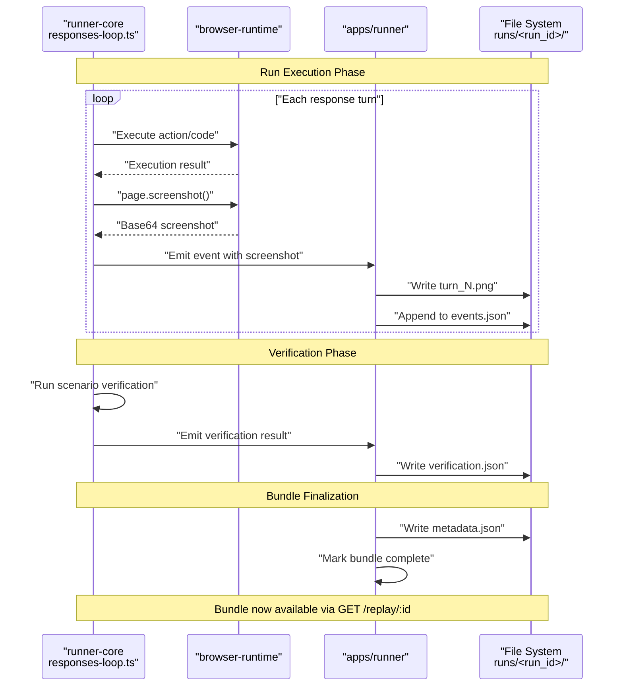
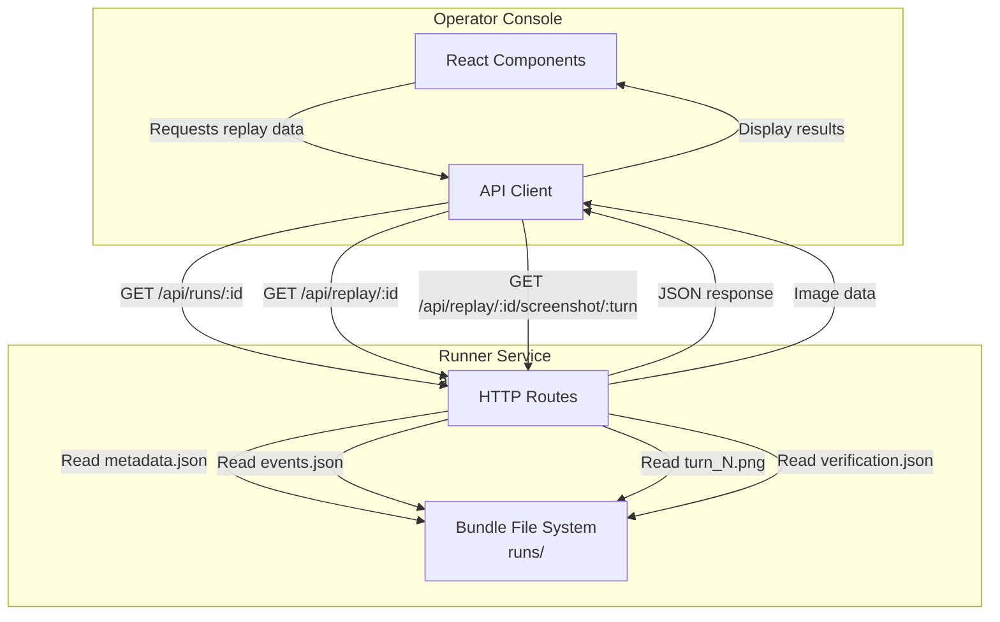
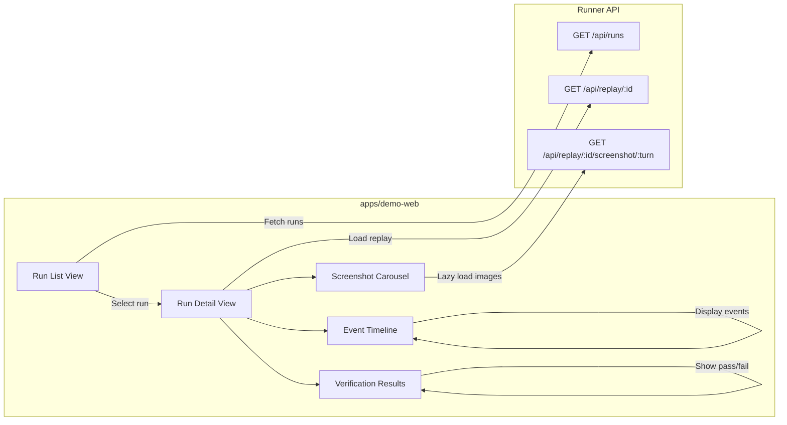

<!-- source: DeepWiki mcp.deepwiki.com · repo openai/openai-cua-sample-app · page 8.1 Replay Bundles · fetched 2026-10-26 -->

# Replay Bundles

<details>
<summary>Relevant source files</summary>

The following files were used as context for generating this wiki page:

- [README.md](README.md)

</details>


## Purpose and Scope

This document explains how replay bundles are captured, structured, and accessed in the openai-cua-sample-app. A replay bundle is a collection of artifacts generated during a run execution, including screenshots, events, metadata, and verification outcomes. These artifacts enable operators to review what happened during a run, debug failures, and understand model behavior.

For information about how runs are executed and events are streamed in real-time, see [Server-Sent Events (SSE)](#8.2). For information about scenario verification logic that produces verification metadata in bundles, see [Verification Mechanisms](#6.3).

---

## What is a Replay Bundle?

A replay bundle is a directory of artifacts created for each run, stored in the runner's workspace under `runs/<run_id>`. The bundle contains all data necessary to reconstruct what happened during execution without re-running the scenario.

**Key components:**

| Component | Description | File Format |
|-----------|-------------|-------------|
| Screenshots | Base64-encoded images captured after each model response turn | PNG (base64) |
| Events | JSON records of all actions, responses, and state changes | JSON |
| Metadata | Run configuration, timing, model information | JSON |
| Verification Results | Pass/fail status and verification-specific data | JSON |

Sources: [README.md:1-158]()

---

## Replay Bundle Structure

### Directory Layout

```
runs/
  └── <run_id>/
      ├── screenshots/
      │   ├── turn_0.png
      │   ├── turn_1.png
      │   └── ...
      ├── events.json
      ├── metadata.json
      └── verification.json
```

### Artifact Types

**Screenshot Files**

Screenshots are captured after each response turn and stored as individual PNG files. The naming convention follows `turn_<N>.png` where `N` is the zero-indexed turn number.

**Events Log**

The `events.json` file contains a chronological array of all events that occurred during the run:
- Model requests and responses
- Computer actions (native mode) or JavaScript execution (code mode)
- Browser state changes
- Error conditions

**Metadata Record**

The `metadata.json` file captures run configuration:
- Run ID and timestamp
- Scenario identifier
- Model name and execution mode
- Turn count limits
- Initial prompt

**Verification Results**

The `verification.json` file contains scenario-specific verification outcomes, including pass/fail status and any verification-specific data structures (e.g., final board state for kanban, canvas data for paint, form values for booking).

Sources: [README.md:1-158]()

---

## Artifact Capture Flow

The following diagram shows how artifacts are captured during run execution and assembled into a replay bundle.

**Diagram: Artifact Capture and Bundle Assembly**



Sources: [README.md:13](), [README.md:111-119]()

---

## Bundle Creation Process

### Workspace Initialization

When a run starts, the runner creates an isolated workspace directory:

1. Create `runs/<run_id>/` directory
2. Copy lab templates from `labs/` to workspace
3. Initialize empty artifacts: `events.json`, `screenshots/` directory

### Event Streaming and Capture

During execution, the runner-core package emits events that the runner service captures and persists:

- Each event includes metadata (timestamp, turn number, event type)
- Screenshots are emitted as base64-encoded data URLs
- Events are streamed to the operator console via SSE simultaneously with persistence

### Bundle Finalization

After execution completes (success, failure, or turn limit):

1. Final verification results are written to `verification.json`
2. Run metadata (total turns, final status, duration) is written to `metadata.json`
3. Bundle is marked as complete and ready for retrieval

Sources: [README.md:111](), [README.md:119]()

---

## Accessing Replay Bundles

The runner service exposes HTTP endpoints for retrieving replay bundles and their constituent artifacts.

**Diagram: Replay Bundle Access Pattern**



### Key Endpoints

| Endpoint | Method | Description | Returns |
|----------|--------|-------------|---------|
| `/api/runs/:id` | GET | Retrieve run status and metadata | JSON with run info |
| `/api/replay/:id` | GET | Retrieve complete replay bundle | JSON with all artifacts |
| `/api/replay/:id/screenshot/:turn` | GET | Retrieve specific screenshot | PNG image |
| `/api/replay/:id/events` | GET | Retrieve events log | JSON array |

### Response Schema

The complete replay bundle response includes:

```typescript
{
  runId: string;
  status: "success" | "failure" | "error";
  metadata: {
    scenarioId: string;
    model: string;
    mode: "native" | "code";
    startTime: string;
    endTime: string;
    turnCount: number;
  };
  events: Array<{
    type: string;
    turn: number;
    timestamp: string;
    data: object;
  }>;
  screenshots: Array<{
    turn: number;
    url: string; // Relative URL to screenshot endpoint
  }>;
  verification: {
    passed: boolean;
    details: object; // Scenario-specific
  };
}
```

Sources: [README.md:112-113]()

---

## Replay Bundle Use Cases

### Debugging Failed Runs

When a run fails, operators can review the replay bundle to understand:
- Which actions were attempted
- Where execution diverged from expected behavior
- What the browser state looked like at each turn
- Why verification failed

### Model Behavior Analysis

Replay bundles enable analysis of model decision-making:
- Sequence of actions chosen by the model
- Timing between actions
- Response to environmental changes
- Differences between native and code mode execution patterns

### Scenario Development

When developing new scenarios, replay bundles help:
- Validate verification logic against actual outcomes
- Identify edge cases in browser state
- Refine prompts based on observed model behavior
- Test scenario reproducibility

### Compliance and Auditing

For regulated environments, replay bundles provide:
- Complete audit trail of automated actions
- Timestamped record of system interactions
- Evidence for verification outcomes
- Reproducible execution history

Sources: [README.md:5](), [README.md:16]()

---

## Storage and Lifecycle

### Storage Location

Replay bundles are stored in the runner's working directory under `runs/`. Each run creates a new subdirectory identified by run ID.

### Bundle Retention

The current implementation does not automatically delete old replay bundles. Operators must manually manage disk space by removing old run directories.

**Typical bundle size:**
- 10-20 screenshots: ~500KB - 2MB
- Events log: ~50-200KB
- Metadata and verification: ~10-50KB
- **Total per run: ~600KB - 2.5MB**

For long-running deployments, consider implementing:
- Automatic cleanup of runs older than N days
- Compression of bundles not recently accessed
- External storage for historical bundles

### Concurrent Access

The runner service handles concurrent read access to replay bundles safely. Multiple operators can retrieve the same replay bundle simultaneously without conflicts.

Sources: [README.md:111]()

---

## Implementation Details

### Event Emission in runner-core

The runner-core package emits events through an event emitter pattern. The responses-loop implementation in [packages/runner-core/src/responses-loop.ts]() generates events for:
- Each model request sent
- Each model response received
- Each computer action or code execution
- Each screenshot capture
- Verification start and completion
- Error conditions

### Event Persistence in apps/runner

The runner service subscribes to events from runner-core and persists them to disk. The service maintains:
- Write streams for efficient event appending
- Screenshot file writers with proper naming
- Metadata accumulation for final bundle summary

### Schema Validation

The replay-schema package defines TypeScript interfaces for all bundle components, ensuring type safety across the HTTP boundary between demo-web and runner services.

Sources: [README.md:13](), [README.md:112-113](), [README.md:118-119]()

---

## Replay Bundle Format Evolution

The replay bundle format is versioned to support backward compatibility as the system evolves:

| Version | Changes | Compatibility |
|---------|---------|---------------|
| 1.0 | Initial format with screenshots, events, metadata, verification | Current |
| Future | Potential additions: network logs, console output, DOM snapshots | Planned |

When adding new fields to replay bundles, follow these guidelines:
1. Add fields as optional in the schema
2. Maintain backward compatibility for existing field structures
3. Document breaking changes in migration guides
4. Version the bundle format in `metadata.json`

Sources: [README.md:112-113]()

---

## Integration with Operator Console

The demo-web application consumes replay bundles to present run results to operators.

**Diagram: Console Replay Presentation**



The console provides:
- **Run list**: Summary of all runs with status indicators
- **Screenshot carousel**: Navigate through turn-by-turn screenshots
- **Event timeline**: Chronological view of actions and responses
- **Verification panel**: Pass/fail status with scenario-specific details

Sources: [README.md:5](), [README.md:108-109]()

---

## Best Practices

### For Operators

1. **Review failed runs immediately**: Replay bundles are most valuable when reviewed while context is fresh
2. **Compare successful and failed runs**: Identify patterns in model behavior
3. **Archive important runs**: Move bundles to external storage before they're cleaned up
4. **Use screenshots for documentation**: Capture evidence of correct behavior

### For Developers

1. **Emit granular events**: Capture enough detail to reconstruct execution without overwhelming the log
2. **Include timestamps**: Enable timing analysis and correlation with external logs
3. **Validate bundle completeness**: Ensure all expected artifacts are present before marking bundle complete
4. **Test bundle retrieval**: Verify all endpoints work correctly with various bundle states

Sources: [README.md:16]()

---

