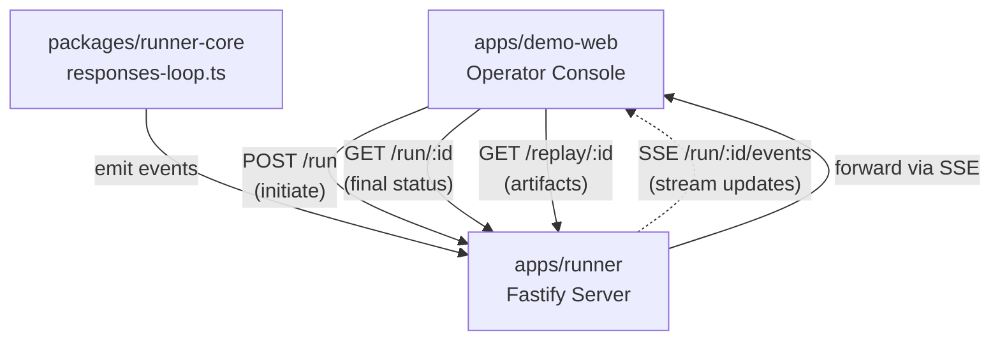
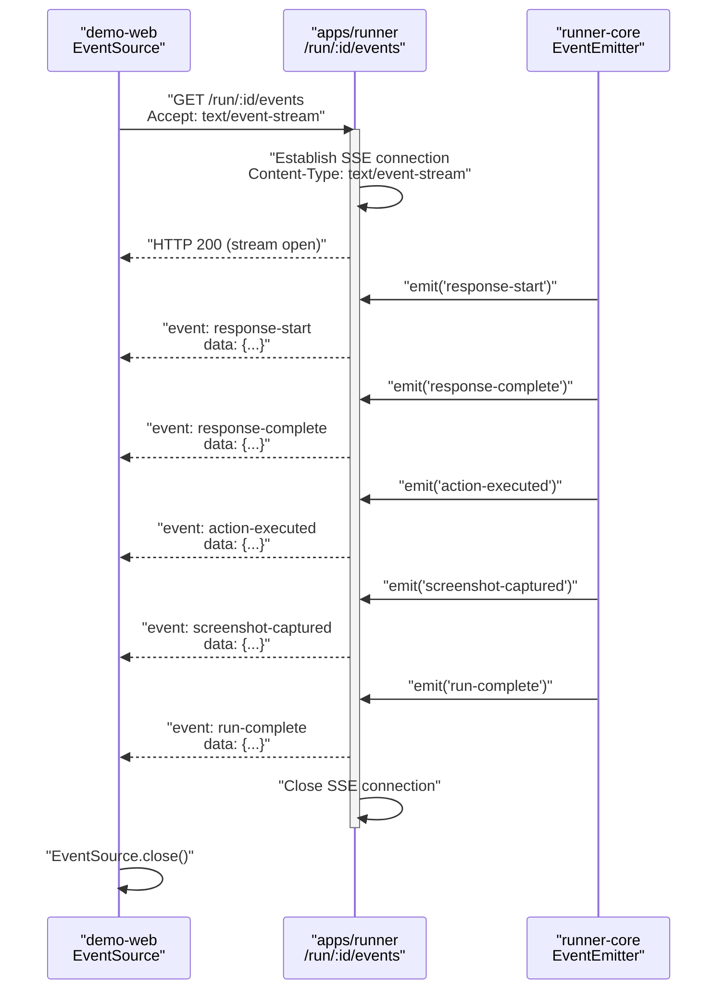
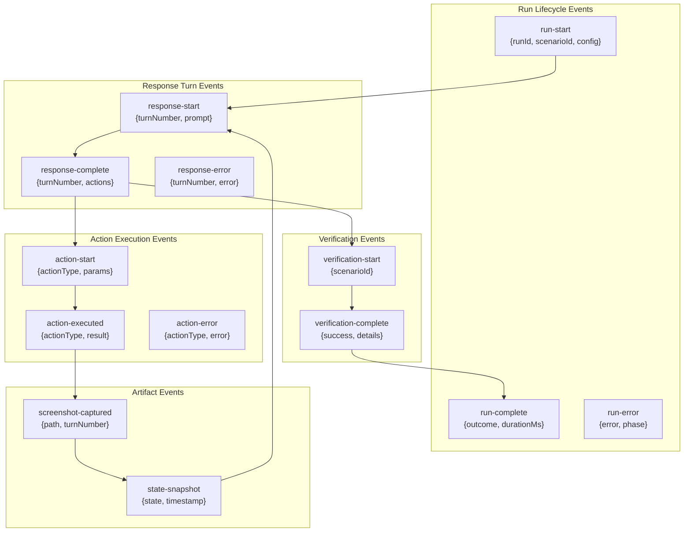
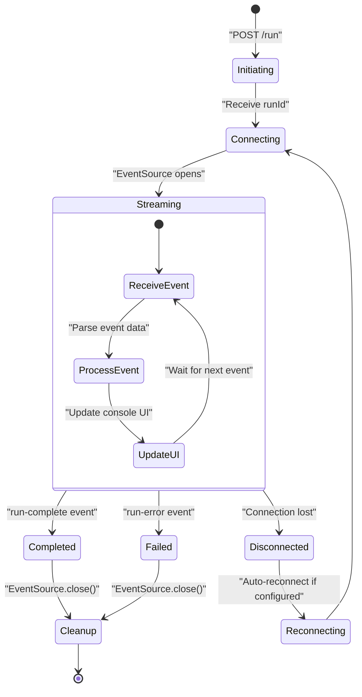
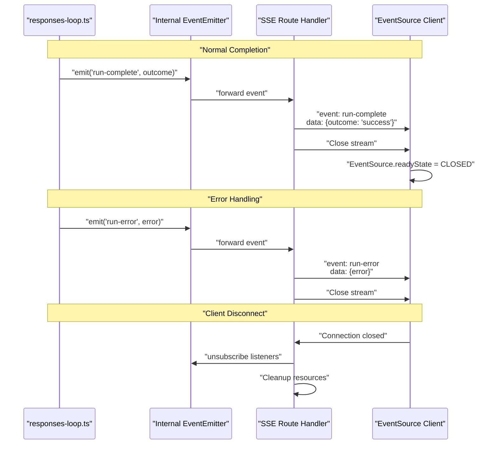
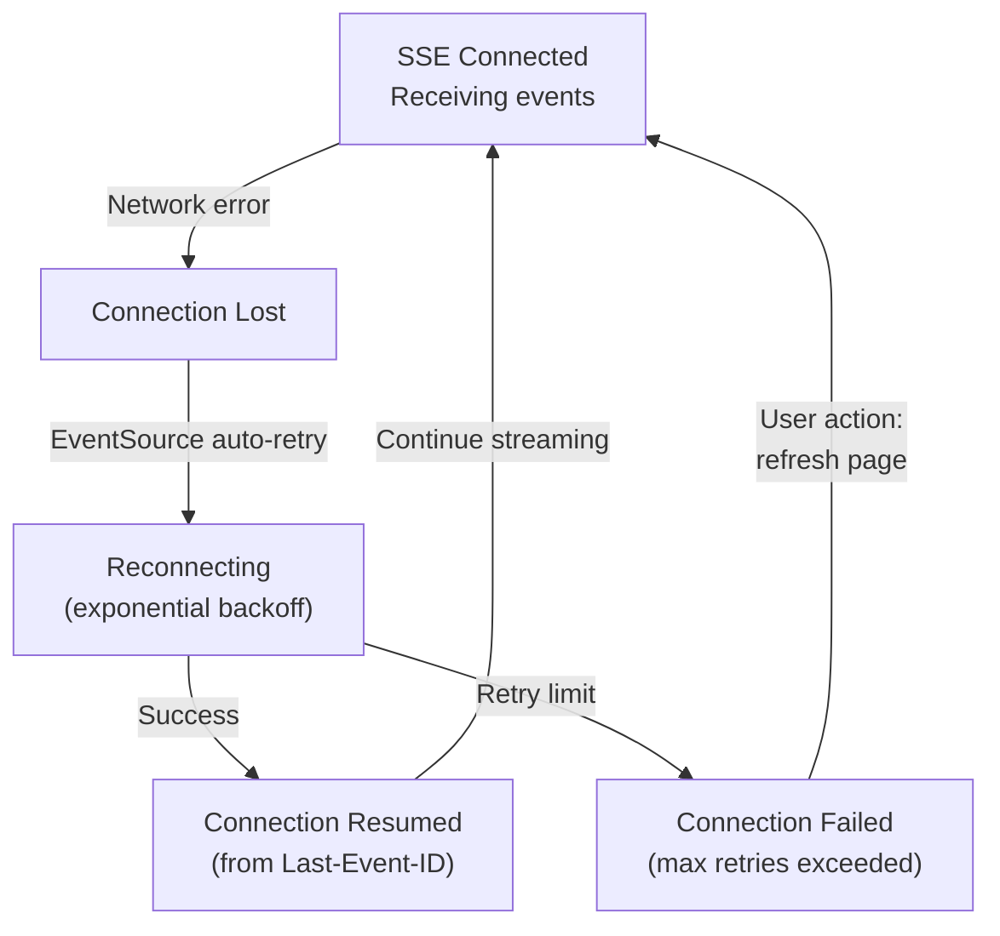
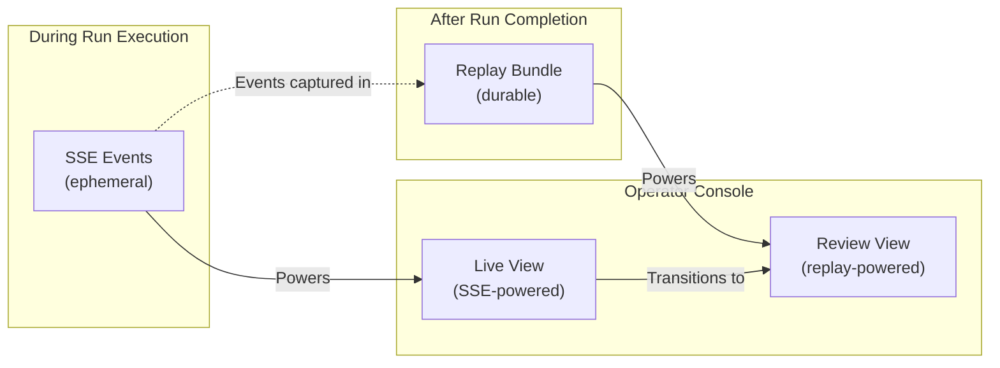

<!-- source: DeepWiki mcp.deepwiki.com · repo openai/openai-cua-sample-app · page 8.2 Server-Sent Events (SSE) · fetched 2026-10-26 -->

# Server-Sent Events (SSE)

<details>
<summary>Relevant source files</summary>

The following files were used as context for generating this wiki page:

- [README.md](README.md)

</details>


## Purpose and Scope

This document describes the Server-Sent Events (SSE) streaming interface that provides real-time updates from the runner service to the operator console during scenario execution. SSE enables the operator to observe live progress including response turns, browser actions, screenshot captures, and completion status without polling.

For information about the runner service architecture, see [Runner Service](#3.2). For details on replay artifacts captured during runs, see [Replay Bundles](#8.1). For the overall execution flow, see [Execution Flow](#5.1).

**Sources:** [README.md:1-158]()

---

## SSE Role in System Architecture

The SSE streaming interface bridges the `apps/runner` Fastify backend and the `apps/demo-web` Next.js frontend, enabling unidirectional server-to-client communication during long-running scenario executions. While the initial run is initiated via HTTP POST, subsequent updates stream through SSE to avoid polling overhead.

### System Communication Pattern



**Diagram: SSE Communication Pattern**

The runner exposes SSE endpoints that stream events emitted by `packages/runner-core` during execution. The console establishes an SSE connection immediately after initiating a run and maintains it until the run completes or fails.

**Sources:** [README.md:1-11](), high-level architecture diagrams

---

## SSE Endpoint Architecture

### Primary Streaming Endpoint

The runner service exposes an SSE endpoint at `/run/:id/events` where `:id` is the unique run identifier returned from the initial `POST /run` request. This endpoint streams events in the standard SSE format with `event:` and `data:` fields.



**Diagram: SSE Request-Response Lifecycle**

**Sources:** [README.md:6](), high-level sequence diagram (Diagram 5)

---

## Event Type Taxonomy

The SSE stream emits multiple event types corresponding to different phases of the execution lifecycle. Each event follows the `replay-schema` package contracts to ensure type consistency between the runner and console.

### Event Type Hierarchy



**Diagram: Event Type Flow During Execution**

**Sources:** [README.md:13](), packages structure

---

## Event Payload Structure

Each SSE event contains a JSON payload conforming to the `packages/replay-schema` contracts. The schema ensures type safety across the HTTP/SSE boundary.

### Standard Event Fields

| Field | Type | Description |
|-------|------|-------------|
| `type` | `string` | Event type identifier (matches SSE `event:` field) |
| `runId` | `string` | Unique run identifier |
| `timestamp` | `number` | Unix timestamp (milliseconds) when event occurred |
| `data` | `object` | Event-specific payload |

### Event-Specific Payloads

| Event Type | Key Payload Fields |
|------------|-------------------|
| `response-start` | `turnNumber`, `promptTokens`, `contextWindow` |
| `response-complete` | `turnNumber`, `actions[]`, `completionTokens` |
| `action-executed` | `actionType` (`click`/`drag`/`type`/`wait`), `coordinates`, `duration` |
| `screenshot-captured` | `relativePath`, `width`, `height`, `turnNumber` |
| `state-snapshot` | `pageState`, `cookies`, `localStorage` |
| `verification-complete` | `success`, `expectedState`, `actualState`, `diff` |
| `run-complete` | `outcome` (`success`/`failure`/`error`), `totalTurns`, `durationMs` |
| `run-error` | `errorCode`, `message`, `phase` |

**Sources:** [README.md:112-114](), replay-schema package reference

---

## Client-Side Consumption

The `apps/demo-web` operator console establishes SSE connections using the browser's native `EventSource` API. The connection is created immediately after receiving the run ID from the initial `POST /run` request.

### Connection Establishment Pattern



**Diagram: Client SSE Connection State Machine**

The console application creates an `EventSource` instance pointing to `/run/:id/events` and registers event listeners for each event type. The browser automatically handles connection management, reconnection, and buffering.

**Sources:** [README.md:5](), apps/demo-web structure

---

## Connection Lifecycle Management

### Runner-Side Connection Handling

The runner maintains active SSE connections for ongoing runs. When the `responses-loop.ts` execution completes or encounters an error, the runner closes the SSE stream gracefully by sending a final event and closing the HTTP response.



**Diagram: SSE Connection Lifecycle Scenarios**

**Sources:** [README.md:6](), [README.md:111](), runner-core reference

---

## Error Handling and Resilience

### Connection Errors

The SSE implementation handles several error scenarios:

| Error Scenario | Runner Behavior | Console Behavior |
|---------------|-----------------|------------------|
| Network interruption | Maintain event buffer, wait for reconnect | `EventSource` auto-reconnects with `Last-Event-ID` |
| Run execution error | Emit `run-error` event, close stream | Display error, close connection |
| Invalid run ID | Return HTTP 404 | Display "Run not found" |
| Runner shutdown | Close all active SSE streams | Detect disconnect, show offline state |
| Client disconnect | Clean up listeners, stop emitting | N/A |

### Reconnection Strategy

The browser's `EventSource` automatically reconnects with exponential backoff when the connection drops. The runner tracks the last emitted event ID and can resume from that point if the client sends the `Last-Event-ID` header.



**Diagram: SSE Reconnection Flow**

**Sources:** [README.md:16](), SSE standard behavior

---

## Event Ordering and Delivery Guarantees

### Ordering Guarantees

The SSE implementation provides strict ordering guarantees within a single run:

- Events are emitted in chronological order by `packages/runner-core`
- The runner forwards events to SSE clients in the order received
- Clients receive events in the order sent (TCP guarantees)
- Event IDs increment monotonically for resumption support

### Buffer Management

The runner maintains a bounded event buffer for each active SSE connection:

- New events are added to the buffer when emitted by `runner-core`
- Events are removed from the buffer after successful transmission
- If the buffer exceeds capacity (slow client), the connection is terminated
- Completed runs' events are not buffered; clients must request replay artifacts instead

**Sources:** [README.md:111](), Fastify SSE patterns

---

## Integration with Replay Bundles

SSE events provide real-time updates during execution, while replay bundles provide durable artifacts after completion. The relationship between the two:



**Diagram: SSE and Replay Relationship**

All events streamed via SSE are also captured in the replay bundle's `events.json` file. This allows the operator to review the exact sequence of events that occurred during execution, even after the SSE connection has closed.

**Sources:** [README.md:6](), [README.md:121](), replay-schema package

---

## Performance Considerations

### Event Frequency

During active execution, the system emits events at varying rates:

- **Response turns:** ~1 event per 5-30 seconds (depending on model latency)
- **Action execution:** ~1-10 events per response turn (depending on action count)
- **Screenshots:** 1 per response turn (after action execution)
- **State snapshots:** Configurable, typically 1 per response turn

With the default maximum of 24 response turns (configurable via `NEXT_PUBLIC_CUA_DEFAULT_MAX_RESPONSE_TURNS`), a typical run generates 100-500 events over 2-10 minutes.

### Network Efficiency

SSE is more efficient than polling for this use case:

- Single long-lived HTTP connection vs. repeated polling requests
- Server pushes events only when they occur vs. client polling at fixed intervals
- Smaller payload overhead (SSE format vs. HTTP headers on each poll)
- Browser handles buffering and reconnection automatically

**Sources:** [README.md:139](), execution flow patterns

---

## Configuration

### Runner Configuration

The runner's SSE behavior is controlled by the Fastify server configuration:

| Configuration | Environment Variable | Default | Description |
|--------------|---------------------|---------|-------------|
| SSE timeout | N/A (Fastify default) | No timeout | How long to keep idle SSE connections open |
| Event buffer size | N/A (internal) | 1000 events | Max events buffered per connection |
| Compression | N/A (Fastify config) | Enabled | Whether to compress SSE streams |

### Console Configuration

The console's SSE client behavior is controlled by the `EventSource` configuration in `apps/demo-web`:

| Configuration | Environment Variable | Default | Description |
|--------------|---------------------|---------|-------------|
| Runner base URL | `RUNNER_BASE_URL` | `http://127.0.0.1:4001` | Base URL for SSE endpoint construction |
| Auto-reconnect | N/A (browser default) | Enabled | Browser automatically reconnects |
| Retry interval | N/A (browser default) | Exponential backoff | Time between reconnection attempts |

**Sources:** [README.md:137](), [README.md:70-73]()

---

## Development and Debugging

### Observing SSE Traffic

During development, SSE traffic can be observed in multiple ways:

**Browser DevTools:**
- Open Network tab, filter by "EventStream" type
- View individual events in the Messages sub-tab
- Monitor connection status and timing

**Runner Logs:**
- The runner logs each SSE connection establishment and closure
- Event emission is logged at debug level
- Connection errors are logged at warn/error level

**Testing SSE Endpoints:**

```bash
# Initiate a run and capture the run ID
RUN_ID=$(curl -X POST http://127.0.0.1:4001/run \
  -H "Content-Type: application/json" \
  -d '{"scenarioId": "kanban", "config": {}}' \
  | jq -r '.runId')

# Connect to the SSE stream
curl -N http://127.0.0.1:4001/run/$RUN_ID/events
```

The `-N` flag disables buffering, allowing curl to display SSE events as they arrive.

**Sources:** [README.md:68-83](), development workflow patterns

---

## Future Extensions

The SSE architecture supports future enhancements:

- **Selective event subscriptions:** Clients specify which event types to receive
- **Event filtering:** Server-side filtering by turn number, action type, etc.
- **Multiplexed streams:** Multiple runs streamed over a single SSE connection
- **Compression:** Event payload compression for bandwidth optimization
- **Broadcast mode:** Multiple clients observing the same run

The current implementation provides a foundation for these extensions while keeping the initial system simple and maintainable.

**Sources:** System architecture, extensibility patterns

---

