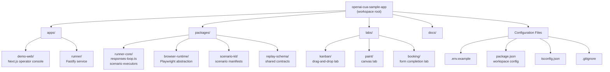
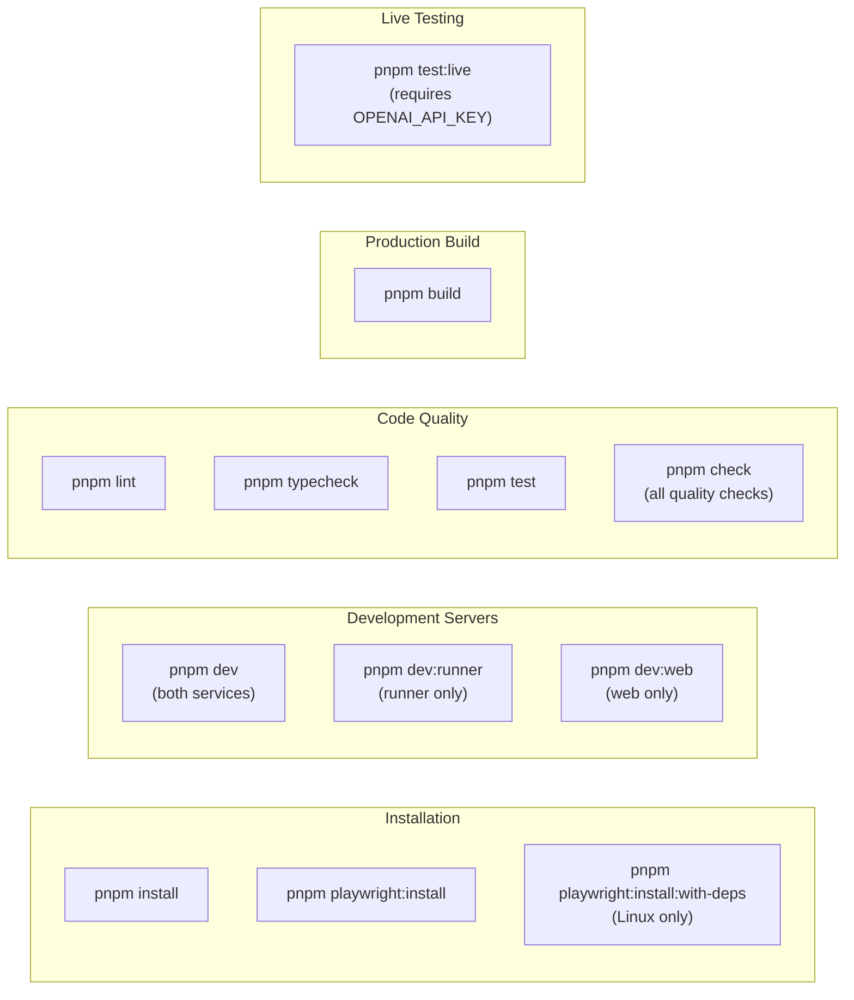
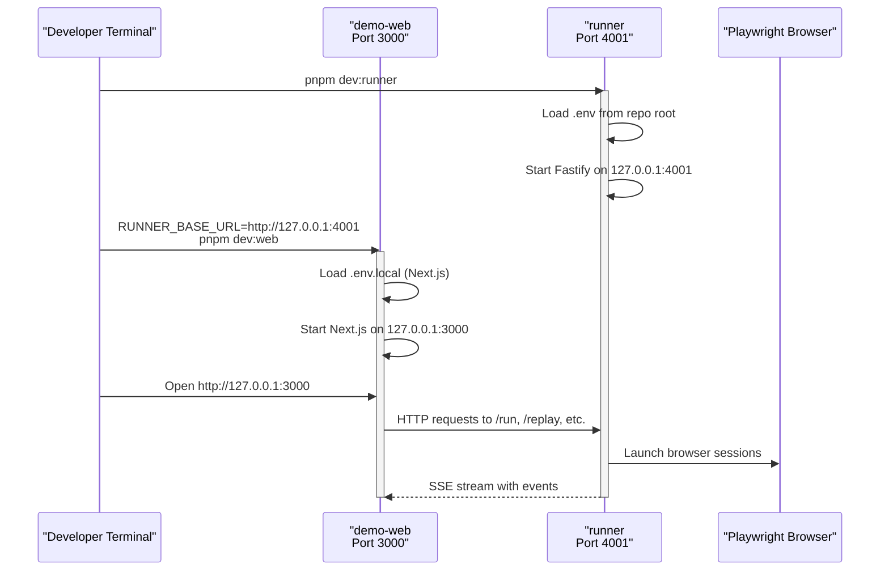
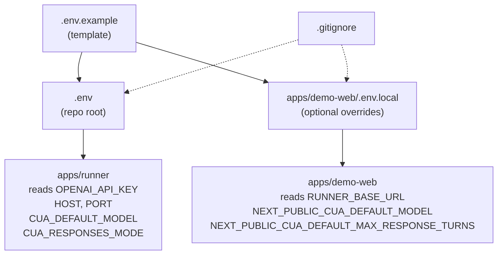
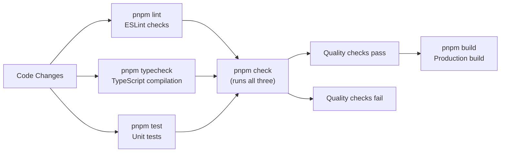
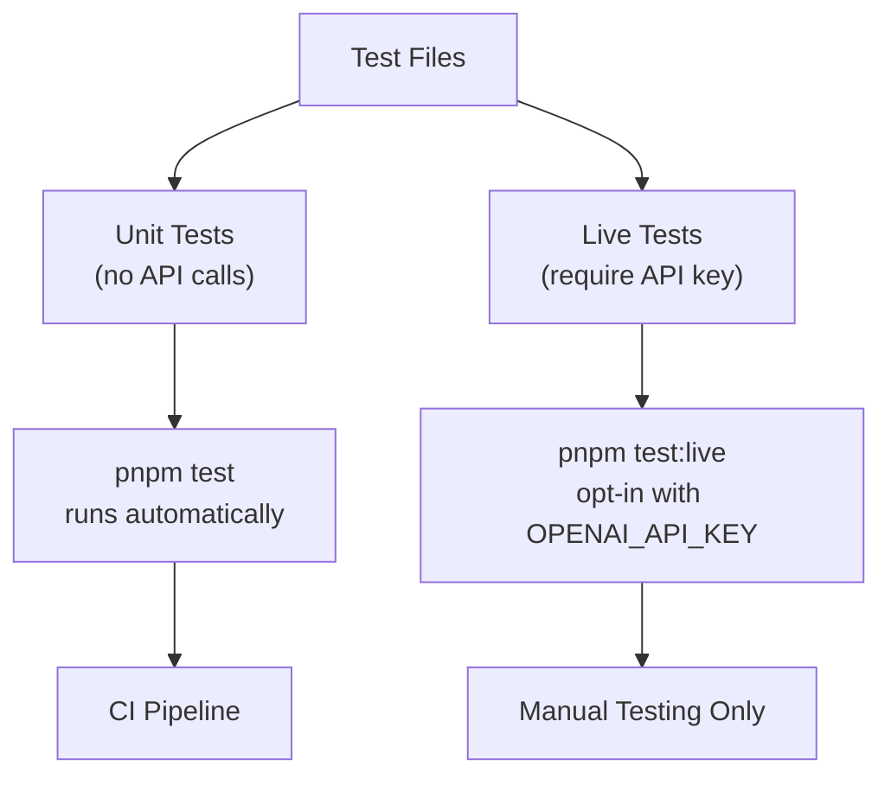
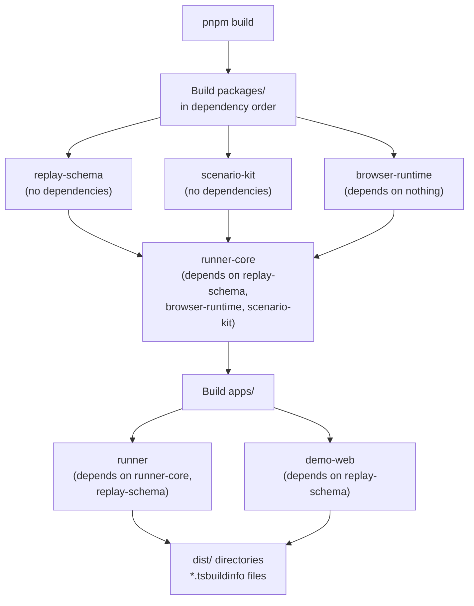
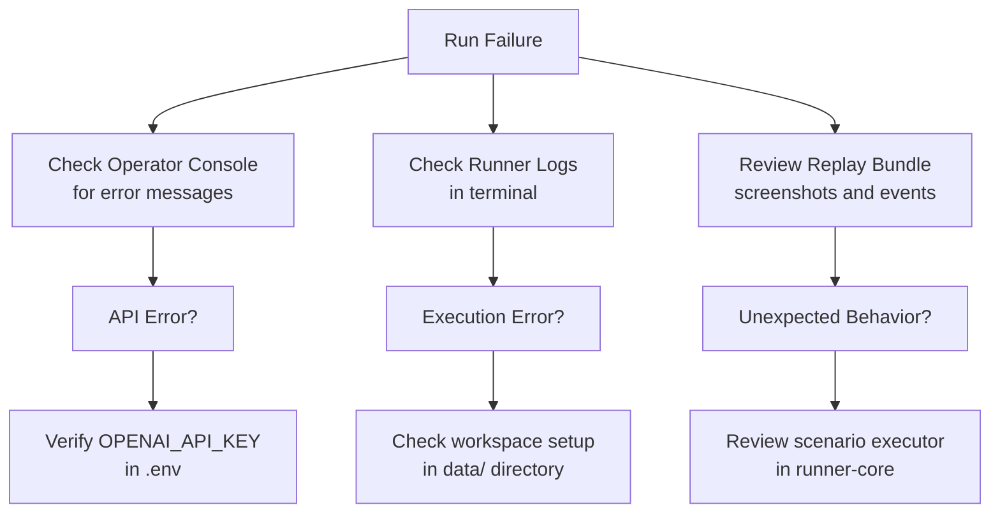
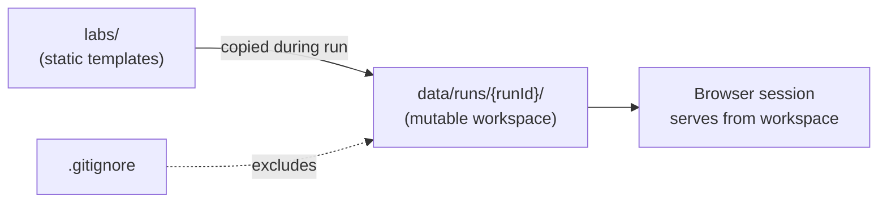
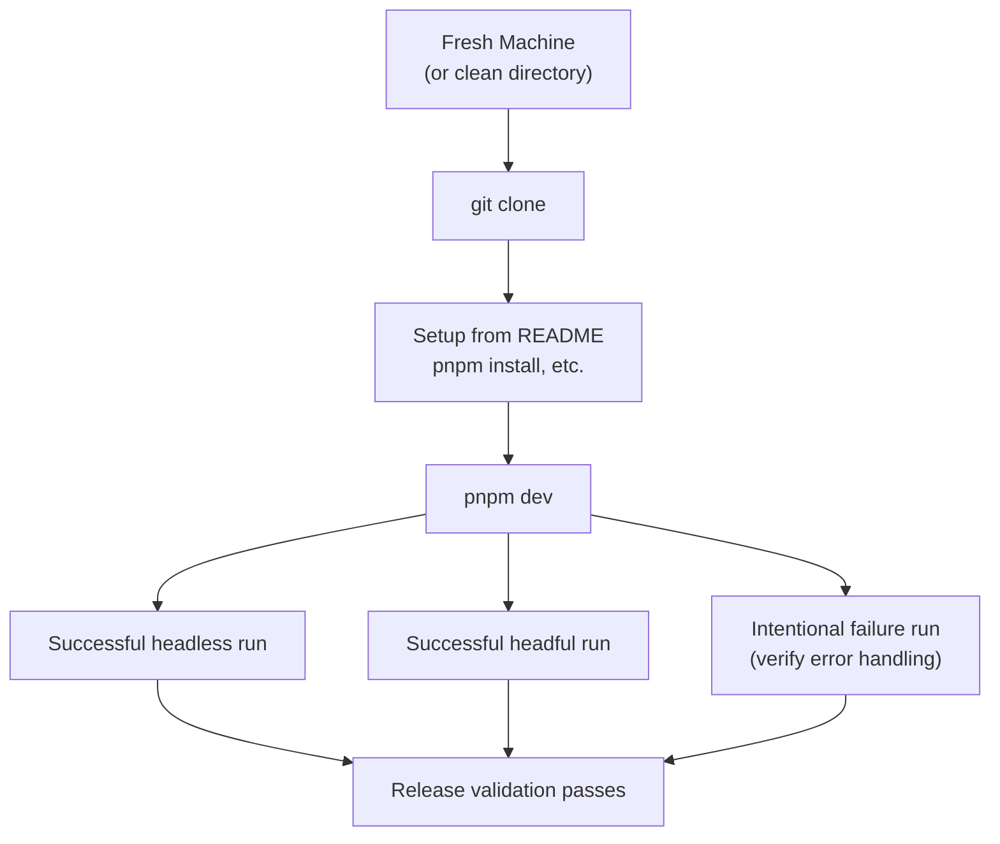

<!-- source: DeepWiki mcp.deepwiki.com · repo openai/openai-cua-sample-app · page 8.3 Development Workflow · fetched 2026-10-26 -->

# Development Workflow

<details>
<summary>Relevant source files</summary>

The following files were used as context for generating this wiki page:

- [.gitignore](.gitignore)
- [README.md](README.md)

</details>


This document covers typical development patterns, testing strategies, and repository organization for developers extending or contributing to the openai-cua-sample-app codebase. For information about configuration options, see [Configuration](#7). For details about specific packages, see [Core Packages](#4).

## Repository Structure

The repository follows a monorepo architecture using pnpm workspaces, with applications and shared packages organized into distinct directories.

### Directory Layout



**Sources:** [README.md:106-123]()

| Directory | Purpose | Key Files |
|-----------|---------|-----------|
| `apps/demo-web` | Operator console UI | Next.js pages, SSE client |
| `apps/runner` | HTTP/SSE server | Fastify routes, workspace management |
| `packages/runner-core` | Core orchestration | `responses-loop.ts`, scenario executors |
| `packages/browser-runtime` | Browser control | Playwright session wrapper |
| `packages/scenario-kit` | Scenario definitions | Manifest schemas |
| `packages/replay-schema` | Shared contracts | TypeScript types for HTTP/SSE |
| `labs` | Static lab templates | HTML/CSS/JS for scenarios |
| `docs` | Architecture documentation | Scenario descriptions |

**Sources:** [README.md:106-123]()

## Development Commands

The repository provides a set of pnpm workspace scripts for common development tasks. All commands are executed from the repository root.

### Core Development Commands



**Sources:** [README.md:26-89]()

### Command Reference

| Command | Description | Port(s) |
|---------|-------------|---------|
| `pnpm install` | Install all workspace dependencies | - |
| `pnpm playwright:install` | Install Playwright Chromium browser | - |
| `pnpm playwright:install:with-deps` | Install Playwright with OS dependencies (Linux) | - |
| `pnpm dev` | Start both runner and web services | 4001, 3000 |
| `pnpm dev:runner` | Start runner service only | 4001 |
| `pnpm dev:web` | Start web console only | 3000 |
| `pnpm lint` | Run ESLint across all packages | - |
| `pnpm typecheck` | Run TypeScript compiler checks | - |
| `pnpm test` | Run unit tests | - |
| `pnpm test:live` | Run live API integration tests | - |
| `pnpm build` | Build all packages and applications | - |
| `pnpm check` | Run lint, typecheck, and test together | - |

**Sources:** [README.md:26-89]()

## Development Modes

Developers can run services together or independently depending on their workflow needs.

### Running Both Services

The default development mode starts both the runner and web console simultaneously:

```bash
pnpm dev
```

This command runs both services with shared terminal output. The runner starts on `http://127.0.0.1:4001` and the web console on `http://127.0.0.1:3000`.

**Sources:** [README.md:58-64]()

### Running Services Independently

For independent logs and isolated debugging, run services separately:

```bash
# Terminal 1: Start runner
pnpm dev:runner

# Terminal 2: Start web console with explicit runner URL
RUNNER_BASE_URL=http://127.0.0.1:4001 pnpm dev:web
```

The `RUNNER_BASE_URL` environment variable configures the web console's API client to point to the runner service. This pattern enables flexible deployment configurations.

**Sources:** [README.md:66-73]()

### Service Communication Flow



**Sources:** [README.md:66-73]()

## Configuration Management

Development environment configuration is managed through environment files and workspace conventions.

### Environment File Hierarchy



**Sources:** [README.md:26-42](), [README.md:125-141](), [.gitignore:2]()

The runner reads `.env` from the repository root automatically. The web application uses Next.js conventions, reading from `apps/demo-web/.env.local` for local overrides. Both `.env` and `.env.local` are excluded from version control via `.gitignore`.

**Sources:** [README.md:40](), [.gitignore:2]()

## Code Quality Workflow

The repository enforces code quality through linting, type checking, and testing before commits.

### Quality Check Pipeline



**Sources:** [README.md:75-83]()

### Pre-Commit Workflow

The recommended workflow before committing code:

1. **Run quality checks**: `pnpm check` executes lint, typecheck, and test together
2. **Verify build**: `pnpm build` ensures production build succeeds
3. **Run affected scenarios**: Test relevant scenarios in the operator console
4. **Review changes**: Check modified files match intended scope

**Sources:** [README.md:75-83]()

## Testing Strategy

The repository distinguishes between fast unit tests and slower live API integration tests.

### Test Types

| Test Type | Command | Requirements | Purpose |
|-----------|---------|--------------|---------|
| Unit Tests | `pnpm test` | None | Fast, isolated tests without API calls |
| Live Tests | `pnpm test:live` | `OPENAI_API_KEY` | Integration tests against OpenAI API |

**Sources:** [README.md:80-89]()

### Live Testing Pattern

Live tests remain opt-in and secret-gated to prevent accidental API usage during development:

```bash
OPENAI_API_KEY=your_key_here pnpm test:live
```

This pattern ensures developers explicitly provide credentials when running tests that incur API costs.

**Sources:** [README.md:85-89]()

### Test Organization



**Sources:** [README.md:85-89]()

## Build Process

The build command compiles all TypeScript packages and applications for production deployment.

### Build Workflow



**Sources:** [README.md:81](), [.gitignore:7-10]()

Build artifacts are written to `dist/` directories within each package and application. TypeScript incremental build information is stored in `*.tsbuildinfo` files. Both are excluded from version control.

**Sources:** [.gitignore:7-10]()

## Common Development Patterns

### Adding a New Scenario

When adding a new scenario to the repository:

1. **Create lab template** in `labs/new-scenario/`
2. **Define manifest** in `packages/scenario-kit/src/`
3. **Implement executor** in `packages/runner-core/src/scenarios/`
4. **Add verification logic** in the executor
5. **Update scenario registry** to expose the new scenario
6. **Test in operator console** with both native and code modes

**Sources:** [README.md:106-123]()

### Debugging a Failed Run



**Sources:** [README.md:1-158]()

The operator console displays error messages even when runs fail. The runner emits detailed logs to the terminal where it was started. Replay bundles in the `data/` directory contain screenshots and events for post-mortem analysis.

**Sources:** [README.md:16]()

### Working with Workspaces

Runtime workspaces are created in the `data/` directory and are excluded from version control:



**Sources:** [README.md:121](), [.gitignore:9]()

Each run creates an isolated workspace by copying lab templates from `labs/` into `data/runs/{runId}/`. The browser session serves content from this workspace directory, allowing the model to interact with a mutable copy of the lab.

**Sources:** [README.md:121]()

## Release Validation Checklist

Before releasing changes, validate the complete workflow on a fresh machine:



**Sources:** [README.md:150-158]()

The validation checklist ensures:
- Clean clone succeeds on a fresh machine
- Setup completes using only README instructions
- `pnpm dev` starts both services successfully
- At least one headless run completes successfully
- At least one headful run completes successfully
- Intentional failures display clear error messages in the operator console

**Sources:** [README.md:150-158]()

## Ignored Files and Artifacts

The `.gitignore` configuration excludes development artifacts and sensitive data from version control:

| Pattern | Purpose |
|---------|---------|
| `__pycache__/` | Python bytecode (legacy) |
| `.env` | Sensitive credentials and local configuration |
| `.venv/`, `env/` | Python virtual environments (legacy) |
| `node_modules/` | Node.js dependencies |
| `.next/` | Next.js build cache |
| `dist/` | TypeScript build output |
| `coverage/` | Test coverage reports |
| `data/` | Runtime workspaces and replay bundles |
| `*.tsbuildinfo` | TypeScript incremental build information |

**Sources:** [.gitignore:1-11]()

The `data/` directory is particularly important to exclude, as it contains mutable run workspaces and replay bundles that can grow large and contain sensitive information from test runs.

**Sources:** [.gitignore:9]()