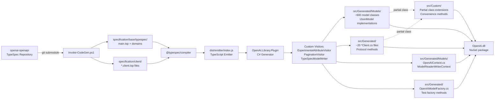

<!-- source: DeepWiki mcp.deepwiki.com · repo openai/openai-dotnet · page 1 Overview · fetched 2026-10-26 -->

# Overview

<details>
<summary>Relevant source files</summary>

The following files were used as context for generating this wiki page:

- [README.md](README.md)
- [api/OpenAI.net8.0.cs](api/OpenAI.net8.0.cs)
- [api/OpenAI.netstandard2.0.cs](api/OpenAI.netstandard2.0.cs)
- [examples/Assistants/Example01_RetrievalAugmentedGeneration.cs](examples/Assistants/Example01_RetrievalAugmentedGeneration.cs)
- [examples/Assistants/Example01_RetrievalAugmentedGenerationAsync.cs](examples/Assistants/Example01_RetrievalAugmentedGenerationAsync.cs)
- [examples/Assistants/Example05_AssistantsWithVision.cs](examples/Assistants/Example05_AssistantsWithVision.cs)
- [examples/Assistants/Example05_AssistantsWithVisionAsync.cs](examples/Assistants/Example05_AssistantsWithVisionAsync.cs)
- [examples/Chat/Example02_SimpleChatStreaming.cs](examples/Chat/Example02_SimpleChatStreaming.cs)
- [examples/Chat/Example02_SimpleChatStreamingAsync.cs](examples/Chat/Example02_SimpleChatStreamingAsync.cs)
- [examples/Chat/Example03_FunctionCalling.cs](examples/Chat/Example03_FunctionCalling.cs)
- [examples/Chat/Example06_StructuredOutputs.cs](examples/Chat/Example06_StructuredOutputs.cs)
- [examples/Chat/Example06_StructuredOutputsAsync.cs](examples/Chat/Example06_StructuredOutputsAsync.cs)
- [src/Generated/Models/OpenAIContext.cs](src/Generated/Models/OpenAIContext.cs)
- [src/Generated/OpenAIModelFactory.cs](src/Generated/OpenAIModelFactory.cs)
- [tests/Responses/ResponsesTests.cs](tests/Responses/ResponsesTests.cs)
- [tests/Telemetry/ChatTelemetryTests.cs](tests/Telemetry/ChatTelemetryTests.cs)
- [tspCodeModel.json](tspCodeModel.json)

</details>


## Purpose and Scope

The OpenAI .NET SDK is the official .NET client library for accessing the OpenAI REST API. It provides strongly-typed C# bindings for all OpenAI services including chat completions, embeddings, image generation, audio transcription, assistants, and more. The SDK is code-generated from OpenAI's TypeSpec specifications to ensure consistency with the REST API and rapid integration of new features.

This page provides a high-level overview of the SDK's architecture, capabilities, and design principles. For detailed information about specific features:
- Getting started guide: see [Getting Started](#2)
- Architecture deep-dive: see [Architecture and Design](#3)
- Individual client documentation: see [Client Libraries](#4)
- Advanced features: see [Advanced Features](#5) and [Tool Integration](#6)

**Sources:** [README.md:1-37](), [CHANGELOG.md:1-15](), [src/OpenAI.csproj:1-84]()

---

## Key Features

The OpenAI .NET SDK offers the following capabilities:

| Feature Area | Client | Status | Description |
|-------------|--------|--------|-------------|
| **Chat Completions** | `ChatClient` | Stable | Text generation, streaming, function calling, structured outputs, audio I/O |
| **Audio** | `AudioClient` | Stable | Speech generation (TTS), transcription, translation |
| **Embeddings** | `EmbeddingClient` | Stable | Text embeddings with multi-input support |
| **Images** | `ImageClient` | Stable | Image generation, editing, variations with DALL-E models |
| **Files** | `OpenAIFileClient` | Stable | File upload/download/deletion with purpose management |
| **Moderations** | `ModerationClient` | Stable | Text and image content moderation |
| **Models** | `OpenAIModelClient` | Stable | List and retrieve available model information |
| **Responses** | `ResponsesClient` | Experimental (OPENAI001) | Multi-turn reasoning, advanced tools (web search, file search, computer use, MCP) |
| **Assistants** | `AssistantClient` | Experimental (OPENAI001) | Persistent assistants with threads, runs, file search, code interpreter |
| **Vector Stores** | `VectorStoreClient` | Experimental (OPENAI001) | Vector store management for RAG scenarios with chunking strategies |
| **Batch Processing** | `BatchClient` | Experimental (OPENAI001) | Asynchronous batch job processing with rehydration support |
| **Fine-Tuning** | `FineTuningClient` | Experimental (OPENAI001) | Model fine-tuning with supervised and DPO methods |
| **Realtime** | `RealtimeClient` | Experimental (OPENAI002) | WebSocket-based real-time conversations with voice activity detection |
| **Videos** | `VideoClient` | Experimental (OPENAI001) | Video generation and content operations |
| **Evals** | `EvaluationClient` | Experimental (OPENAI001) | Evaluation operations for model testing |
| **Graders** | `GraderClient` | Experimental (OPENAI001) | Grading and scoring operations |
| **Containers** | `ContainerClient` | Experimental (OPENAI001) | Container resource management for code execution |
| **Conversations** | `ConversationClient` | Experimental (OPENAI001) | Real-time conversation management |

**Additional Features:**
- Synchronous and asynchronous API variants
- Streaming support with `CollectionResult<T>` and `AsyncCollectionResult<T>`
- OpenTelemetry integration for distributed tracing (ChatClient only)
- JSON Patch support for dynamic property access
- Dependency injection friendly (thread-safe singletons)
- Protocol methods for low-level REST access

**Sources:** [README.md:94-111](), [api/OpenAI.netstandard2.0.cs:1-41](), [CHANGELOG.md:13-93]()

---

## Architecture at a Glance

The SDK follows a layered architecture with clear separation between generated and custom code:

**SDK Architecture Layers**

```mermaid
graph TB
    subgraph UserCode["Application Layer"]
        App["User Application"]
    end
    
    subgraph PublicAPI["Client Layer (Public API)"]
        OAIClient["OpenAIClient"]
        ChatCli["ChatClient"]
        AudioCli["AudioClient"]
        EmbedCli["EmbeddingClient"]
        ResponsesCli["ResponsesClient"]
        AssistantCli["AssistantClient"]
        VectorStoreCli["VectorStoreClient"]
        BatchCli["BatchClient"]
        FileCli["OpenAIFileClient"]
        ModelCli["OpenAIModelClient"]
        ImageCli["ImageClient"]
        ModerationCli["ModerationClient"]
        RealtimeCli["RealtimeClient"]
        FineTuneCli["FineTuningClient"]
        Other["+ 4 more clients"]
    end
    
    subgraph Infrastructure["Infrastructure Layer"]
        Pipeline["ClientPipeline"]
        ApiKey["ApiKeyCredential"]
        Options["OpenAIClientOptions"]
        Telemetry["OpenTelemetrySource"]
    end
    
    subgraph CodeGen["Generated Code Layer"]
        GenModels["Generated Models<br/>src/Generated/Models/"]
        GenClients["Generated Clients<br/>src/Generated/*Client.cs"]
        Context["OpenAIContext.cs<br/>ModelReaderWriterContext"]
        Factory["OpenAIModelFactory.cs"]
    end
    
    subgraph Custom["Custom Code Layer"]
        CustomModels["Custom Extensions<br/>src/Custom/Models/"]
        CustomClients["Custom Clients<br/>src/Custom/*Client.cs"]
    end
    
    subgraph Source["Code Generation Sources"]
        TypeSpec["TypeSpec Specs<br/>specification/base/"]
        ClientTsp["Client Customizations<br/>specification/client/*.client.tsp"]
        Generator["@openai/plugin<br/>C# Generator"]
    end
    
    App --> OAIClient
    OAIClient -->|"GetChatClient(model)"| ChatCli
    OAIClient -->|"GetResponsesClient(model)"| ResponsesCli
    OAIClient -->|"GetAssistantClient()"| AssistantCli
    
    ChatCli --> Pipeline
    ResponsesCli --> Pipeline
    AssistantCli --> Pipeline
    
    Pipeline --> ApiKey
    Pipeline --> Options
    ChatCli --> Telemetry
    
    GenClients -.partial class.-> CustomClients
    GenModels -.partial class.-> CustomModels
    
    CustomClients --> Pipeline
    CustomModels --> Context
    GenModels --> Context
    
    TypeSpec --> Generator
    ClientTsp --> Generator
    Generator --> GenModels
    Generator --> GenClients
    Generator --> Context
    Generator --> Factory
```



**Key Architectural Principles:**

1. **Factory Pattern**: `OpenAIClient` serves as a central factory that provisions specialized clients with shared configuration
2. **Generated + Custom Code**: Core functionality is code-generated from TypeSpec, enhanced with partial classes for convenience APIs
3. **Protocol + Convenience Methods**: Each client offers both low-level protocol methods (`BinaryContent`/`RequestOptions`) and high-level convenience methods (strongly-typed models)
4. **Shared Infrastructure**: All clients share common `ClientPipeline`, authentication, and configuration
5. **Streaming First-Class**: Streaming responses are treated as first-class patterns with `CollectionResult<T>` and `AsyncCollectionResult<T>`

**Sources:** [README.md:122-142](), [src/OpenAI.csproj:1-84](), [api/OpenAI.netstandard2.0.cs:2-41]()

---

## Client Library Organization

The SDK is organized into scenario-specific namespaces, each containing a corresponding client class:

**Client Factory Pattern**

```mermaid
graph TB
    OAIClient["OpenAIClient<br/>Factory (api/OpenAI.*.cs)"]
    
    subgraph Stable["Stable Clients (No Attribute)"]
        Chat["ChatClient<br/>OpenAI.Chat"]
        Audio["AudioClient<br/>OpenAI.Audio"]
        Embed["EmbeddingClient<br/>OpenAI.Embeddings"]
        Image["ImageClient<br/>OpenAI.Images"]
        File["OpenAIFileClient<br/>OpenAI.Files"]
        Mod["ModerationClient<br/>OpenAI.Moderations"]
        Model["OpenAIModelClient<br/>OpenAI.Models"]
    end
    
    subgraph Exp001["Experimental [OPENAI001]"]
        Resp["ResponsesClient<br/>OpenAI.Responses"]
        Asst["AssistantClient<br/>OpenAI.Assistants"]
        VS["VectorStoreClient<br/>OpenAI.VectorStores"]
        Batch["BatchClient<br/>OpenAI.Batch"]
        FT["FineTuningClient<br/>OpenAI.FineTuning"]
        Eval["EvaluationClient<br/>OpenAI.Evals"]
        Grade["GraderClient<br/>OpenAI.Graders"]
        Cont["ContainerClient<br/>OpenAI.Containers"]
        Conv["ConversationClient<br/>OpenAI.Conversations"]
        Vid["VideoClient<br/>OpenAI.Videos"]
    end
    
    subgraph Exp002["Experimental [OPENAI002]"]
        RT["RealtimeClient<br/>OpenAI.Realtime"]
    end
    
    OAIClient -->|"GetChatClient(string model)"| Chat
    OAIClient -->|"GetAudioClient(string model)"| Audio
    OAIClient -->|"GetEmbeddingClient(string model)"| Embed
    OAIClient -->|"GetImageClient(string model)"| Image
    OAIClient -->|"GetOpenAIFileClient()"| File
    OAIClient -->|"GetModerationClient(string model)"| Mod
    OAIClient -->|"GetOpenAIModelClient()"| Model
    
    OAIClient -->|"GetResponsesClient(string model)"| Resp
    OAIClient -->|"GetAssistantClient()"| Asst
    OAIClient -->|"GetVectorStoreClient()"| VS
    OAIClient -->|"GetBatchClient()"| Batch
    OAIClient -->|"GetFineTuningClient()"| FT
    OAIClient -->|"GetEvaluationClient()"| Eval
    OAIClient -->|"GetGraderClient()"| Grade
    OAIClient -->|"GetContainerClient()"| Cont
    OAIClient -->|"GetConversationClient()"| Conv
    OAIClient -->|"GetVideoClient()"| Vid
    OAIClient -->|"GetRealtimeClient()"| RT
```



**Client Provisioning Pattern:**

The `OpenAIClient` class provides factory methods (`GetChatClient`, `GetAudioClient`, `GetEmbeddingClient`, etc.) that create specialized clients sharing the same `ClientPipeline`, `ApiKeyCredential`, and `OpenAIClientOptions`:

```csharp
// Single authentication, multiple clients
OpenAIClient client = new(apiKey: Environment.GetEnvironmentVariable("OPENAI_API_KEY"));

// All clients share the same HTTP pipeline and authentication
ChatClient chatClient = client.GetChatClient("gpt-4o");
EmbeddingClient embeddingClient = client.GetEmbeddingClient("text-embedding-3-small");
AssistantClient assistantClient = client.GetAssistantClient();
ResponsesClient responsesClient = client.GetResponsesClient("gpt-4o-mini");
```

**Sources:** [api/OpenAI.netstandard2.0.cs:2-30](), [api/OpenAI.net8.0.cs:2-43](), [README.md:122-142]()

---

## Code Generation Approach

The SDK uses a **TypeSpec-to-C# code generation pipeline** to maintain consistency with the OpenAI REST API:

**Code Generation Pipeline**



**Key Components:**

| Component | Purpose | Location |
|-----------|---------|----------|
| **TypeSpec Definitions** | OpenAPI-like specifications defining API contracts (20+ domain files) | `specification/base/typespec/` |
| **Client Customizations** | C#-specific annotations (`@@clientName`, `@@alternateType`, `@@projectedName`) | `specification/client/*.client.tsp` |
| **C# Generator Plugin** | TypeSpec emitter that generates C# code via Microsoft.TypeSpec.Generator | `codegen/generator/` (contains OpenAI.Library.Plugin) |
| **ExperimentalAttributeVisitor** | Applies `[Experimental("OPENAI001")]` or `[Experimental("OPENAI002")]` based on stability lists | `codegen/generator/src/visitors/ExperimentalAttributeVisitor.cs` |
| **PaginationVisitor** | Standardizes pagination with `*CollectionOptions` and `CollectionResult<T>` | `codegen/generator/src/visitors/PaginationVisitor.cs` |
| **TypeSpecModelWriter** | Outputs `tspCodeModel.json` for introspection and debugging | `codegen/generator/src/visitors/TypeSpecModelWriter.cs` |
| **Generated Models** | ~600 data classes implementing `IJsonModel<T>` and `IPersistableModel<T>` | `src/Generated/Models/` |
| **Generated Clients** | Protocol methods (BinaryContent/RequestOptions overloads) for each client | `src/Generated/*Client.cs` |
| **OpenAIContext** | Central `ModelReaderWriterContext` with `TryGetTypeBuilderCore` for all models | `src/Generated/Models/OpenAIContext.cs` |
| **OpenAIModelFactory** | Factory methods for creating model instances in tests | `src/Generated/OpenAIModelFactory.cs` |
| **Custom Code** | Partial class extensions adding convenience methods and custom logic | `src/Custom/` |

**Regeneration:** Code is regenerated via `Invoke-CodeGen.ps1`, which:
1. Clones/updates the `openai-openapi` submodule
2. Compiles TypeSpec definitions with `@typespec/compiler`
3. Runs the `@openai/plugin` emitter to generate C# code
4. Outputs to `src/Generated/` (overwriting existing files)
5. Committed to git (validated by `codegen-validation.yml` CI workflow)

**Sources:** [src/Generated/Models/OpenAIContext.cs:1-237](), [src/Generated/OpenAIModelFactory.cs:1-50](), [tspCodeModel.json:1-100](), [README.md:1-8]()

---

## API Stability Model

The SDK uses a **two-tier stability system** to balance innovation with backwards compatibility:

**API Stability Classification**

```mermaid
graph TB
    TypeOrMember["Type or Member"]
    
    StableLists["Hardcoded Stability Lists<br/>StableClasses.txt<br/>StableProperties.txt<br/>StableMethods.txt"]
    
    InStableList{In stable list?}
    
    NamespaceCheck{Check namespace}
    
    subgraph Stable["Stable (No Attribute)"]
        ChatNS["OpenAI.Chat namespace"]
        AudioNS["OpenAI.Audio namespace"]
        EmbedNS["OpenAI.Embeddings namespace"]
        ImagesNS["OpenAI.Images namespace"]
        FilesNS["OpenAI.Files namespace"]
        ModNS["OpenAI.Moderations namespace"]
        ModelsNS["OpenAI.Models namespace"]
    end
    
    subgraph Exp001["[Experimental OPENAI001]"]
        AssistNS["OpenAI.Assistants namespace"]
        BatchNS["OpenAI.Batch namespace"]
        ContNS["OpenAI.Containers namespace"]
        ConvNS["OpenAI.Conversations namespace"]
        EvalsNS["OpenAI.Evals namespace"]
        FTNS["OpenAI.FineTuning namespace"]
        GraderNS["OpenAI.Graders namespace"]
        RespNS["OpenAI.Responses namespace"]
        VSNS["OpenAI.VectorStores namespace"]
        VidNS["OpenAI.Videos namespace"]
    end
    
    subgraph Exp002["[Experimental OPENAI002]"]
        RTNS["OpenAI.Realtime namespace"]
    end
    
    subgraph ExpCUA["[Experimental OPENAICUA001]"]
        CompUse["ComputerCallAction<br/>ComputerCallActionKind<br/>ComputerCallOutput"]
    end
    
    subgraph APICompatTesting["API Compatibility Testing (CI)"]
        Script["scripts/Test-ApiCompatibility.ps1"]
        Tool["apicompat tool"]
        Baseline["Baseline Package:<br/>OpenAI 2.6.0 from NuGet"]
        Current["Current Build:<br/>bin/Debug/net8.0/OpenAI.dll"]
        Exclusions["--exclude-namespace:<br/>OpenAI.Assistants<br/>OpenAI.Batch<br/>OpenAI.Containers<br/>OpenAI.Conversations<br/>OpenAI.Evals<br/>OpenAI.FineTuning<br/>OpenAI.Graders<br/>OpenAI.Realtime<br/>OpenAI.Responses<br/>OpenAI.VectorStores<br/>OpenAI.Videos"]
    end
    
    TypeOrMember --> StableLists
    StableLists --> InStableList
    
    InStableList -->|Yes| ChatNS
    InStableList -->|No| NamespaceCheck
    
    NamespaceCheck -->|"OpenAI.Chat"| ChatNS
    NamespaceCheck -->|"OpenAI.Audio"| AudioNS
    NamespaceCheck -->|"OpenAI.Embeddings"| EmbedNS
    NamespaceCheck -->|"OpenAI.Images"| ImagesNS
    NamespaceCheck -->|"OpenAI.Files"| FilesNS
    NamespaceCheck -->|"OpenAI.Moderations"| ModNS
    NamespaceCheck -->|"OpenAI.Models"| ModelsNS
    
    NamespaceCheck -->|"OpenAI.Realtime"| RTNS
    NamespaceCheck -->|"OpenAI.Assistants"| AssistNS
    NamespaceCheck -->|"OpenAI.Responses"| RespNS
    NamespaceCheck -->|"OpenAI.Batch"| BatchNS
    NamespaceCheck -->|Other experimental| Exp001
    
    Script --> Tool
    Tool --> Baseline
    Tool --> Current
    Tool --> Exclusions
    Exclusions -.excludes.-> Exp001
    Exclusions -.excludes.-> Exp002
```



**Stability Guarantees:**

| Tier | Attribute | Namespaces | Breaking Change Policy |
|------|-----------|------------|------------------------|
| **Stable** | None | `OpenAI.Chat`, `OpenAI.Audio`, `OpenAI.Embeddings`, `OpenAI.Images`, `OpenAI.Files`, `OpenAI.Moderations`, `OpenAI.Models` | Strictly backwards compatible. Breaking changes blocked by CI. |
| **Experimental (OPENAI001)** | `[Experimental("OPENAI001")]` | `OpenAI.Assistants`, `OpenAI.Batch`, `OpenAI.Containers`, `OpenAI.Evals`, `OpenAI.FineTuning`, `OpenAI.Graders`, `OpenAI.Responses`, `OpenAI.VectorStores`, `OpenAI.Videos` | May include breaking changes. Excluded from compatibility checks. |
| **Experimental (OPENAI002)** | `[Experimental("OPENAI002")]` | `OpenAI.Realtime` | May include breaking changes. Excluded from compatibility checks. |
| **Experimental (OPENAICUA001)** | `[Experimental("OPENAICUA001")]` | Specific types: `ComputerCallAction`, `ComputerCallActionKind`, `ComputerCallOutput` | Computer Use Agent preview. May include breaking changes. |

**Compatibility Enforcement:**

The `scripts/Test-ApiCompatibility.ps1` script runs Microsoft's `apicompat` tool to detect breaking changes:
- Compares current build (`bin/Debug/net8.0/OpenAI.dll`) against baseline NuGet package (OpenAI 2.6.0)
- Explicitly excludes experimental namespaces via `--exclude-namespace` flags:
  - `OpenAI.Assistants`, `OpenAI.Batch`, `OpenAI.Containers`, `OpenAI.Conversations`
  - `OpenAI.Evals`, `OpenAI.FineTuning`, `OpenAI.Graders`, `OpenAI.Realtime`
  - `OpenAI.Responses`, `OpenAI.VectorStores`, `OpenAI.Videos`
- Any breaking changes in stable namespaces cause CI failure and block releases
- Run locally via: `.\scripts\Test-ApiCompatibility.ps1`

**Sources:** [scripts/Test-ApiCompatibility.ps1:1-181](), [api/OpenAI.net8.0.cs:6-43](), [api/OpenAI.netstandard2.0.cs:1-30]()

---

## Target Frameworks and Dependencies

**Supported Frameworks:**
- **.NET 8.0** (`net8.0`) - Full feature support with trimming and AOT compatibility
- **.NET Standard 2.0** (`netstandard2.0`) - Broad compatibility (includes .NET Framework 4.6.1+, .NET Core 2.0+, Mono, Xamarin)

**Core Dependencies:**

| Package | Version | Purpose |
|---------|---------|---------|
| `System.ClientModel` | 1.8.1 | HTTP pipeline, authentication, JSON Patch support |
| `System.Net.ServerSentEvents` | 9.0.9 | Server-sent events (SSE) for streaming responses |
| `System.Diagnostics.DiagnosticSource` | 8.0.1 | OpenTelemetry integration (net6.0+) |
| `Microsoft.SourceLink.GitHub` | 8.0.0 | Source debugging support |

**Additional Capabilities:**
- **Trimming Support**: Enabled for .NET 6.0+ via `<IsTrimmable>true</IsTrimmable>`
- **AOT Support**: Enabled for .NET 7.0+ via `<IsAotCompatible>true</IsAotCompatible>`
- **Strong Naming**: Assembly is signed with `OpenAI.snk` (Release and Debug configurations)

**Sources:** [src/OpenAI.csproj:14-84]()

---

## Installation

**NuGet Package Manager:**
```bash
dotnet add package OpenAI
```

**Package Manager Console:**
```powershell
Install-Package OpenAI
```

**For Preview Versions:**
```bash
dotnet add package OpenAI --prerelease
```

**Package Information:**
- **Package ID**: `OpenAI`
- **Latest Stable**: 2.7.0 (released 2025-11-13)
- **License**: MIT
- **Repository**: https://github.com/openai/openai-dotnet
- **NuGet**: https://www.nuget.org/packages/OpenAI

**Sources:** [README.md:44-53](), [src/OpenAI.csproj:1-12](), [CHANGELOG.md:13-14]()

---

## Quick Start Example

**Basic Chat Completion:**

```csharp
using OpenAI.Chat;

ChatClient client = new(
    model: "gpt-4o", 
    apiKey: Environment.GetEnvironmentVariable("OPENAI_API_KEY"));

ChatCompletion completion = client.CompleteChat("Say 'this is a test.'");

Console.WriteLine($"[ASSISTANT]: {completion.Content[0].Text}");
```

**Streaming Chat Completion:**

```csharp
using OpenAI.Chat;
using System.ClientModel;

ChatClient client = new(model: "gpt-4o", apiKey: Environment.GetEnvironmentVariable("OPENAI_API_KEY"));

CollectionResult<StreamingChatCompletionUpdate> updates = 
    client.CompleteChatStreaming("Say 'this is a test.'");

Console.Write("[ASSISTANT]: ");
foreach (StreamingChatCompletionUpdate update in updates)
{
    if (update.ContentUpdate.Count > 0)
    {
        Console.Write(update.ContentUpdate[0].Text);
    }
}
```

**Using OpenAIClient Factory:**

```csharp
using OpenAI;
using OpenAI.Chat;
using OpenAI.Embeddings;

OpenAIClient client = new(Environment.GetEnvironmentVariable("OPENAI_API_KEY"));

// All clients share the same ClientPipeline and ApiKeyCredential
ChatClient chatClient = client.GetChatClient("gpt-4o");
EmbeddingClient embeddingClient = client.GetEmbeddingClient("text-embedding-3-small");
```

**Async Streaming Example:**

```csharp
using OpenAI.Chat;
using System.ClientModel;

ChatClient client = new(model: "gpt-4o", apiKey: Environment.GetEnvironmentVariable("OPENAI_API_KEY"));

AsyncCollectionResult<StreamingChatCompletionUpdate> updates = 
    client.CompleteChatStreamingAsync("Say 'this is a test.'");

Console.Write("[ASSISTANT]: ");
await foreach (StreamingChatCompletionUpdate update in updates)
{
    if (update.ContentUpdate.Count > 0)
    {
        Console.Write(update.ContentUpdate[0].Text);
    }
}
```

**Sources:** [README.md:122-142](), [examples/Chat/Example02_SimpleChatStreaming.cs:1-27](), [examples/Chat/Example02_SimpleChatStreamingAsync.cs:1-28]()

---

## Release Information

**Current Version:** 2.7.0 (Released 2025-11-13)

**Latest Features (2.7.0):**
- Web search support via `WebSearchTool` and `WebSearchPreviewTool`
- Reasoning streaming events for o3-mini model
- File citation filename property
- JSON Patch support for additional properties
- Computer Use Agent tool support
- Image Generation tool for responses
- Conversations API client
- Videos API client

**Breaking Changes:** Breaking changes are only introduced in experimental APIs (marked with `[Experimental]` attributes). Stable APIs maintain strict backwards compatibility.

**Versioning Scheme:**
- **Major.Minor.Patch** semantic versioning
- Preview versions use `-alpha.YYYYMMdd.N` or `-beta.N` suffixes

**Full Changelog:** See [CHANGELOG.md]() for complete release history including acknowledgments, bug fixes, and detailed migration guidance for breaking changes in experimental APIs.

**Upcoming (2.8.0 - Unreleased):** Development version. See [CHANGELOG.md:3-11]() for work in progress.

**Sources:** [CHANGELOG.md:1-100](), [src/OpenAI.csproj:11-12]()

---

