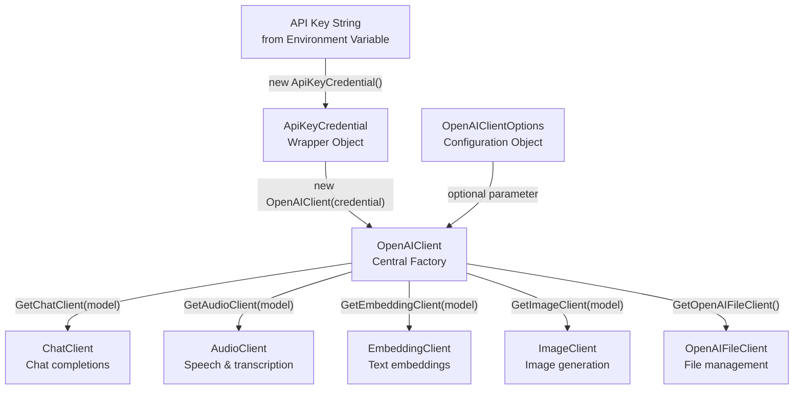
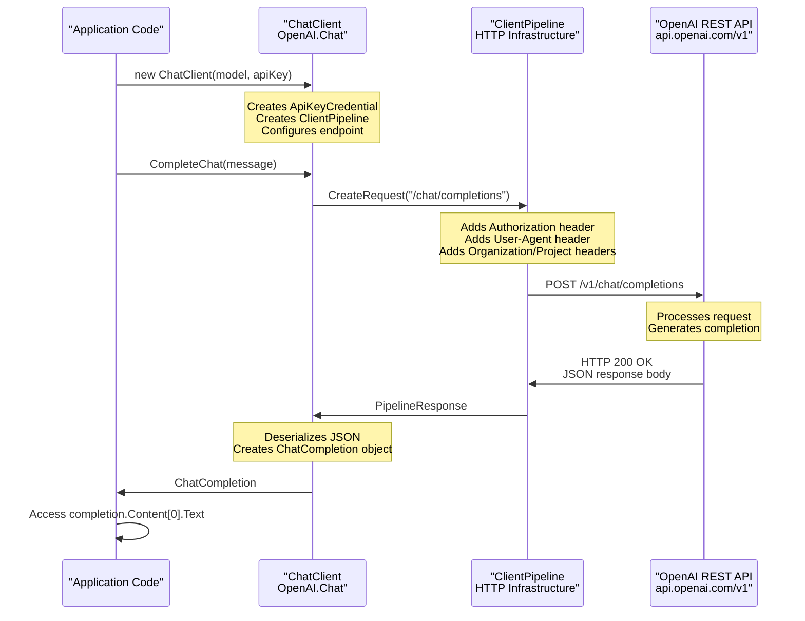

<!-- source: DeepWiki mcp.deepwiki.com · repo openai/openai-dotnet · page 2 Getting Started · fetched 2026-10-26 -->

# Getting Started

<details>
<summary>Relevant source files</summary>

The following files were used as context for generating this wiki page:

- [README.md](README.md)
- [examples/Assistants/Example01_RetrievalAugmentedGeneration.cs](examples/Assistants/Example01_RetrievalAugmentedGeneration.cs)
- [examples/Assistants/Example01_RetrievalAugmentedGenerationAsync.cs](examples/Assistants/Example01_RetrievalAugmentedGenerationAsync.cs)
- [examples/Assistants/Example05_AssistantsWithVision.cs](examples/Assistants/Example05_AssistantsWithVision.cs)
- [examples/Assistants/Example05_AssistantsWithVisionAsync.cs](examples/Assistants/Example05_AssistantsWithVisionAsync.cs)
- [examples/Chat/Example02_SimpleChatStreaming.cs](examples/Chat/Example02_SimpleChatStreaming.cs)
- [examples/Chat/Example02_SimpleChatStreamingAsync.cs](examples/Chat/Example02_SimpleChatStreamingAsync.cs)
- [examples/Chat/Example03_FunctionCalling.cs](examples/Chat/Example03_FunctionCalling.cs)
- [examples/Chat/Example06_StructuredOutputs.cs](examples/Chat/Example06_StructuredOutputs.cs)
- [examples/Chat/Example06_StructuredOutputsAsync.cs](examples/Chat/Example06_StructuredOutputsAsync.cs)
- [specification/base/typespec/common/models.tsp](specification/base/typespec/common/models.tsp)
- [specification/base/typespec/main.tsp](specification/base/typespec/main.tsp)
- [specification/base/typespec/videos/main.tsp](specification/base/typespec/videos/main.tsp)
- [specification/client/videos.client.tsp](specification/client/videos.client.tsp)
- [src/Custom/OpenAIClient.cs](src/Custom/OpenAIClient.cs)
- [src/Custom/OpenAIClientOptions.cs](src/Custom/OpenAIClientOptions.cs)
- [src/Generated/Models/Chat/ChatReasoningEffortLevel.cs](src/Generated/Models/Chat/ChatReasoningEffortLevel.cs)
- [src/Generated/Models/Responses/ResponseReasoningEffortLevel.cs](src/Generated/Models/Responses/ResponseReasoningEffortLevel.cs)
- [tests/Telemetry/ChatTelemetryTests.cs](tests/Telemetry/ChatTelemetryTests.cs)

</details>


This page provides a quick start guide for installing and using the OpenAI .NET SDK. It covers package installation, authentication methods, client initialization patterns, and basic usage examples to help you make your first API call.

For detailed information about specific API features, see the [Client Libraries](#4) section. For dependency injection patterns, see [Dependency Injection](#7.4). For architectural details about the SDK's design, see [Architecture and Design](#3).

---

## Purpose and Scope

The OpenAI .NET SDK is a client library that provides convenient access to the OpenAI REST API from .NET applications. It supports all .NET Standard 2.0 compatible frameworks, including .NET 8.0 and later. The SDK follows a factory pattern where a central `OpenAIClient` provisions specialized clients for different API features.

This guide covers:
- Installing the NuGet package
- Obtaining and configuring API credentials
- Creating client instances
- Making basic synchronous and asynchronous API calls
- Understanding the client hierarchy

---

## Installation

### Prerequisites

Before using the SDK, you need an OpenAI API key:

1. Create an account at https://platform.openai.com/signup (or log in if you already have one)
2. Navigate to https://platform.openai.com/account/api-keys
3. Select "Create new secret key" and optionally name the key
4. Save the API key securely - it will not be shown again

**Important**: Never commit API keys to source control. Store them in environment variables or secure configuration systems.

### Installing the NuGet Package

Add the OpenAI SDK to your .NET project using the .NET CLI:

```bash
dotnet add package OpenAI
```

For preview versions with experimental features:

```bash
dotnet add package OpenAI --prerelease
```

The SDK targets .NET Standard 2.0, making it compatible with:
- .NET 8.0 and 9.0
- .NET Core 2.0 and later
- .NET Framework 4.6.1 and later

**Sources**: [README.md:40-55]()

---

## Client Initialization Patterns

### Basic Initialization Flow

The SDK provides multiple ways to create clients depending on your authentication and configuration needs:



**Sources**: [src/Custom/OpenAIClient.cs:84-165](), [README.md:121-142]()

### Authentication Options

The SDK supports three authentication patterns:

#### 1. Direct API Key (Simplest)

For quick prototyping and simple applications:

```csharp
using OpenAI.Chat;

ChatClient client = new(
    model: "gpt-4o", 
    apiKey: Environment.GetEnvironmentVariable("OPENAI_API_KEY")
);
```

#### 2. ApiKeyCredential (Recommended)

For applications needing configuration options:

```csharp
using OpenAI;
using OpenAI.Chat;

ApiKeyCredential credential = new(Environment.GetEnvironmentVariable("OPENAI_API_KEY"));
OpenAIClientOptions options = new()
{
    Endpoint = new Uri("https://api.openai.com/v1"),
    OrganizationId = "org-123456",
    ProjectId = "proj-789012"
};

OpenAIClient openAIClient = new(credential, options);
ChatClient chatClient = openAIClient.GetChatClient("gpt-4o");
```

#### 3. Custom Authentication Policy (Advanced)

For custom authentication scenarios, including Azure OpenAI:

```csharp
using System.ClientModel.Primitives;

AuthenticationPolicy customAuth = /* custom implementation */;
OpenAIClient client = new(customAuth, new OpenAIClientOptions());
```

The `ApiKeyCredential` is created and managed internally by the `OpenAIClient` constructor at [src/Custom/OpenAIClient.cs:100-124](). Custom authentication policies are marked as experimental with the `OPENAI001` diagnostic.

**Sources**: [src/Custom/OpenAIClient.cs:96-149](), [README.md:60-90]()

---

## Client Hierarchy and Factory Pattern

### The OpenAIClient Factory

The `OpenAIClient` class serves as a central factory for creating specialized API clients. This pattern allows multiple clients to share configuration, authentication, and HTTP pipeline infrastructure:

```mermaid
graph TB
    subgraph "Shared Configuration"
        Pipeline["ClientPipeline<br/>HTTP request/response handling"]
        Options["OpenAIClientOptions<br/>Endpoint, Organization, Project"]
        Auth["ApiKeyCredential<br/>or AuthenticationPolicy"]
    end
    
    subgraph "OpenAIClient Factory"
        Factory["OpenAIClient<br/>src/Custom/OpenAIClient.cs"]
    end
    
    subgraph "Specialized Clients - Stable"
        Chat["ChatClient<br/>GetChatClient(model)"]
        Audio["AudioClient<br/>GetAudioClient(model)"]
        Embed["EmbeddingClient<br/>GetEmbeddingClient(model)"]
        Image["ImageClient<br/>GetImageClient(model)"]
        File["OpenAIFileClient<br/>GetOpenAIFileClient()"]
        Moderate["ModerationClient<br/>GetModerationClient(model)"]
        Model["OpenAIModelClient<br/>GetOpenAIModelClient()"]
    end
    
    subgraph "Specialized Clients - Experimental"
        Response["OpenAIResponseClient<br/>GetOpenAIResponseClient(model)<br/>[Experimental OPENAI001]"]
        Assistant["AssistantClient<br/>GetAssistantClient()<br/>[Experimental OPENAI001]"]
        Vector["VectorStoreClient<br/>GetVectorStoreClient()<br/>[Experimental OPENAI001]"]
        Batch["BatchClient<br/>GetBatchClient()<br/>[Experimental OPENAI001]"]
        FineTune["FineTuningClient<br/>GetFineTuningClient()<br/>[Experimental OPENAI001]"]
        Video["VideoClient<br/>GetVideoClient()<br/>[Experimental OPENAI001]"]
        Realtime["RealtimeClient<br/>GetRealtimeClient()<br/>[Experimental OPENAI002]"]
    end
    
    Auth --> Factory
    Pipeline --> Factory
    Options --> Factory
    
    Factory --> Chat
    Factory --> Audio
    Factory --> Embed
    Factory --> Image
    Factory --> File
    Factory --> Moderate
    Factory --> Model
    
    Factory --> Response
    Factory --> Assistant
    Factory --> Vector
    Factory --> Batch
    Factory --> FineTune
    Factory --> Video
    Factory --> Realtime
```



**Sources**: [src/Custom/OpenAIClient.cs:30-407](), [README.md:92-112]()

### Available Clients

The following table lists all specialized clients accessible through the `OpenAIClient` factory:

| Namespace | Client Class | Factory Method | Model Required | Status |
|-----------|--------------|----------------|----------------|--------|
| `OpenAI.Chat` | `ChatClient` | `GetChatClient(model)` | Yes | Stable |
| `OpenAI.Audio` | `AudioClient` | `GetAudioClient(model)` | Yes | Stable |
| `OpenAI.Embeddings` | `EmbeddingClient` | `GetEmbeddingClient(model)` | Yes | Stable |
| `OpenAI.Images` | `ImageClient` | `GetImageClient(model)` | Yes | Stable |
| `OpenAI.Files` | `OpenAIFileClient` | `GetOpenAIFileClient()` | No | Stable |
| `OpenAI.Moderations` | `ModerationClient` | `GetModerationClient(model)` | Yes | Stable |
| `OpenAI.Models` | `OpenAIModelClient` | `GetOpenAIModelClient()` | No | Stable |
| `OpenAI.Responses` | `OpenAIResponseClient` | `GetOpenAIResponseClient(model)` | Yes | Experimental |
| `OpenAI.Assistants` | `AssistantClient` | `GetAssistantClient()` | No | Experimental |
| `OpenAI.VectorStores` | `VectorStoreClient` | `GetVectorStoreClient()` | No | Experimental |
| `OpenAI.Batch` | `BatchClient` | `GetBatchClient()` | No | Experimental |
| `OpenAI.FineTuning` | `FineTuningClient` | `GetFineTuningClient()` | No | Experimental |
| `OpenAI.Videos` | `VideoClient` | `GetVideoClient()` | No | Experimental |
| `OpenAI.Realtime` | `RealtimeClient` | `GetRealtimeClient()` | No | Experimental |

Clients marked as "Experimental" require suppressing diagnostic warnings (`OPENAI001` or `OPENAI002`) before use. For details on API stability, see [API Compatibility](#8.4).

**Sources**: [src/Custom/OpenAIClient.cs:166-364](), [README.md:94-112]()

---

## Basic Usage Examples

### Synchronous Chat Completion

The simplest usage pattern creates a specialized client directly and makes a synchronous API call:

```csharp
using OpenAI.Chat;

ChatClient client = new(
    model: "gpt-4o", 
    apiKey: Environment.GetEnvironmentVariable("OPENAI_API_KEY")
);

ChatCompletion completion = client.CompleteChat("Say 'this is a test.'");

Console.WriteLine($"[ASSISTANT]: {completion.Content[0].Text}");
```

This example demonstrates:
- Direct `ChatClient` instantiation with model and API key
- Synchronous `CompleteChat` method call
- Accessing response content through the `Content` property

**Sources**: [README.md:60-68](), [examples/Chat/Example02_SimpleChatStreaming.cs:10-26]()

### Asynchronous Chat Completion

For production applications, use asynchronous methods to avoid blocking threads:

```csharp
using OpenAI.Chat;

ChatClient client = new(
    model: "gpt-4o", 
    apiKey: Environment.GetEnvironmentVariable("OPENAI_API_KEY")
);

ChatCompletion completion = await client.CompleteChatAsync("Say 'this is a test.'");

Console.WriteLine($"[ASSISTANT]: {completion.Content[0].Text}");
```

Every synchronous method in the SDK has an asynchronous counterpart with the `Async` suffix (e.g., `CompleteChat` → `CompleteChatAsync`).

**Sources**: [README.md:113-119](), [examples/Chat/Example02_SimpleChatStreamingAsync.cs:10-28]()

### Using the Factory Pattern

For applications using multiple API features, the factory pattern shares configuration and improves resource efficiency:

```csharp
using OpenAI;
using OpenAI.Chat;
using OpenAI.Audio;

OpenAIClient openAIClient = new(Environment.GetEnvironmentVariable("OPENAI_API_KEY"));

// Create multiple specialized clients from the same factory
ChatClient chatClient = openAIClient.GetChatClient("gpt-4o");
AudioClient ttsClient = openAIClient.GetAudioClient("tts-1");
AudioClient whisperClient = openAIClient.GetAudioClient("whisper-1");

// All clients share the same pipeline, authentication, and configuration
ChatCompletion chat = chatClient.CompleteChat("Hello!");
// ... use audio clients ...
```

The factory creates new instances of specialized clients rather than caching singletons. This allows targeting different models with multiple clients of the same type.

**Sources**: [src/Custom/OpenAIClient.cs:26-29](), [README.md:121-142]()

---

## Request and Response Flow

### Making API Calls

The following diagram illustrates the complete flow from client initialization to receiving responses:



**Sources**: [src/Custom/OpenAIClient.cs:372-406]()

### Streaming Responses

For long-running operations, streaming provides incremental results:

```csharp
using OpenAI.Chat;
using System.ClientModel;

ChatClient client = new(
    model: "gpt-4o", 
    apiKey: Environment.GetEnvironmentVariable("OPENAI_API_KEY")
);

CollectionResult<StreamingChatCompletionUpdate> updates = 
    client.CompleteChatStreaming("Say 'this is a test.'");

Console.Write($"[ASSISTANT]: ");
foreach (StreamingChatCompletionUpdate update in updates)
{
    if (update.ContentUpdate.Count > 0)
    {
        Console.Write(update.ContentUpdate[0].Text);
    }
}
```

Streaming methods return `CollectionResult<T>` (synchronous) or `AsyncCollectionResult<T>` (asynchronous) that can be enumerated to process incremental updates. For details on streaming patterns, see [Streaming Patterns](#5.1).

**Sources**: [README.md:184-220](), [examples/Chat/Example02_SimpleChatStreaming.cs:10-26]()

---

## Configuration Options

### OpenAIClientOptions

The `OpenAIClientOptions` class configures client behavior:

| Property | Type | Description | Default |
|----------|------|-------------|---------|
| `Endpoint` | `Uri` | Base URL for API requests | `https://api.openai.com/v1` |
| `OrganizationId` | `string` | OpenAI organization identifier | `null` |
| `ProjectId` | `string` | OpenAI project identifier | `null` |
| `UserAgentApplicationId` | `string` | Custom application identifier for telemetry | `null` |
| `RetryPolicy` | `ClientRetryPolicy` | Retry behavior for failed requests | Default policy |
| `NetworkTimeout` | `TimeSpan` | Timeout for network operations | Default timeout |

### Custom Endpoint Example

To connect to alternative endpoints (e.g., Azure OpenAI, self-hosted LLMs):

```csharp
using OpenAI;
using OpenAI.Chat;

ChatClient client = new(
    model: "MODEL_NAME",
    credential: new ApiKeyCredential(Environment.GetEnvironmentVariable("OPENAI_API_KEY")),
    options: new OpenAIClientOptions() 
    { 
        Endpoint = new Uri("https://custom-endpoint.example.com/v1")
    }
);
```

The endpoint URL is stored in the internal `_endpoint` field and used by the shared `ClientPipeline` for all API requests.

**Sources**: [README.md:72-90](), [src/Custom/OpenAIClient.cs:94-164]()

---

## Next Steps

After completing this guide, explore these topics:

- **[Chat Client](#4.2)** - Comprehensive chat completions, streaming, function calling, and structured outputs
- **[Audio Client](#4.5)** - Speech generation, transcription, and translation
- **[Images Client](#4.6)** - Image generation, editing, and variations
- **[Assistants Client](#4.4)** - Stateful conversations with tools and file search
- **[Dependency Injection](#7.4)** - Integration with ASP.NET Core
- **[Examples and Guides](#7)** - Practical code examples for common scenarios

For advanced topics like telemetry, protocol methods, and custom pipelines, see [Advanced Features](#5).

**Sources**: [README.md:1-1285](), [examples/OpenAI.Examples.csproj:1-27]()

---

