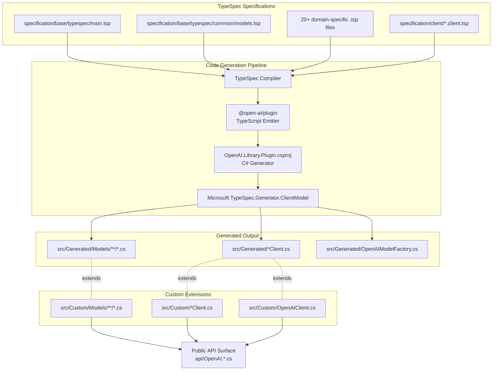
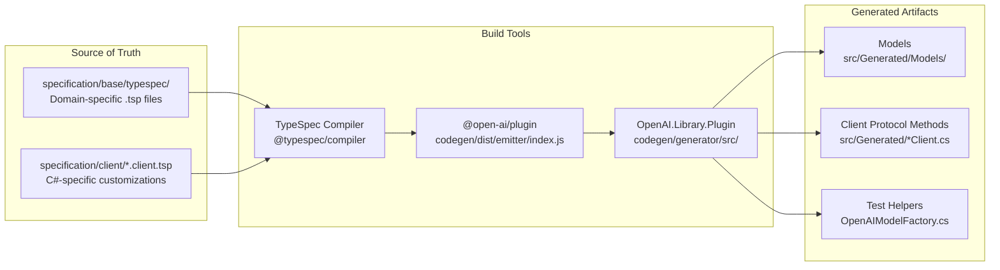
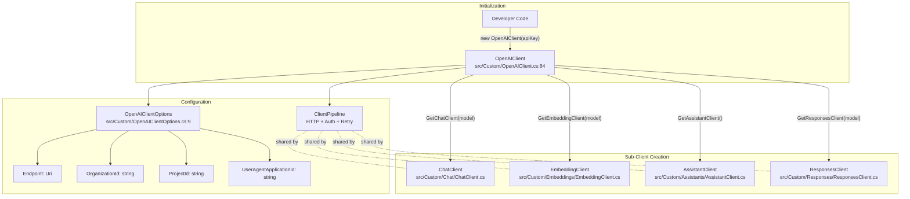
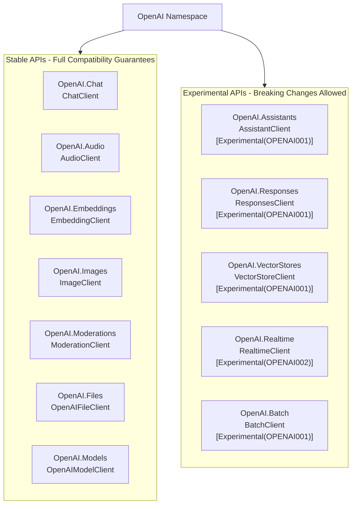
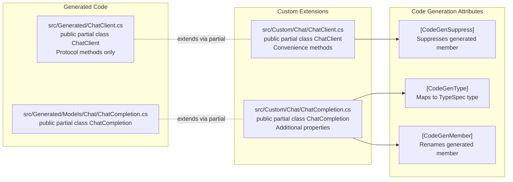
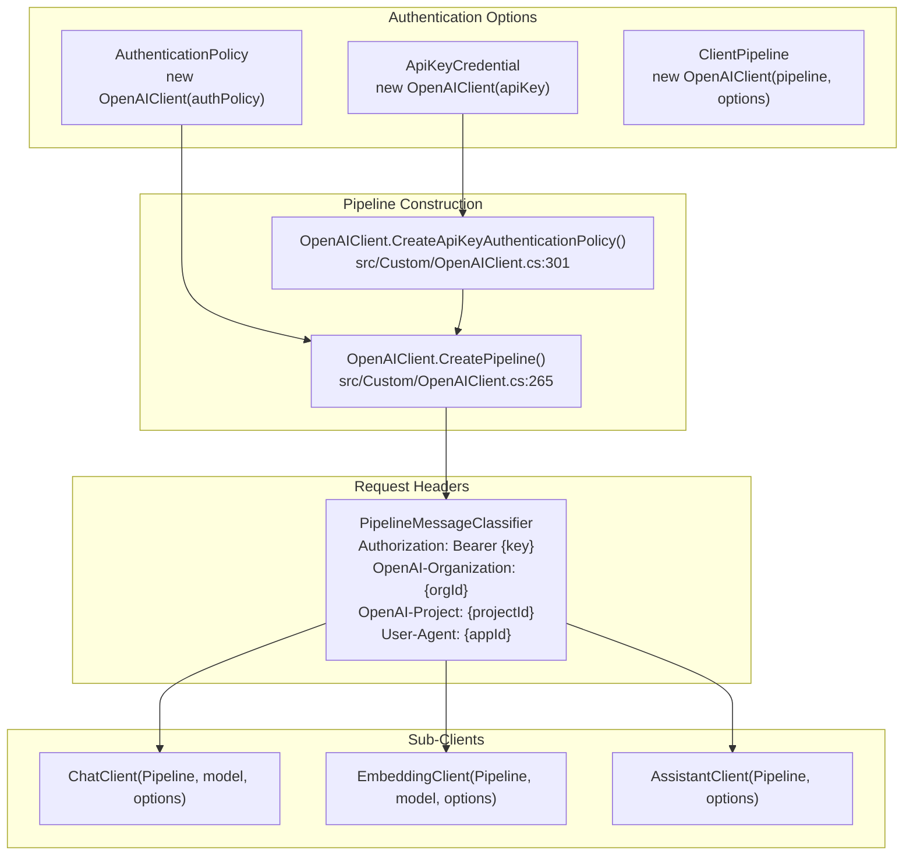
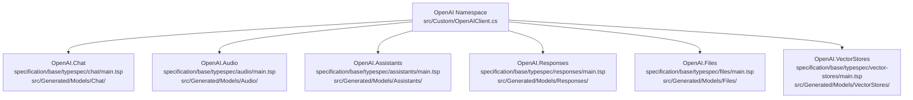
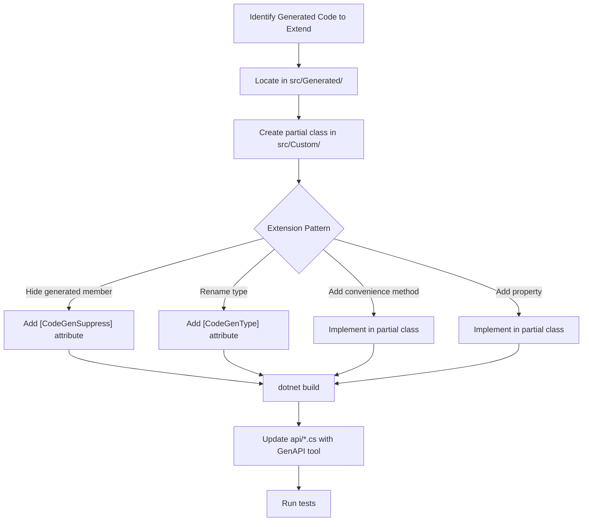
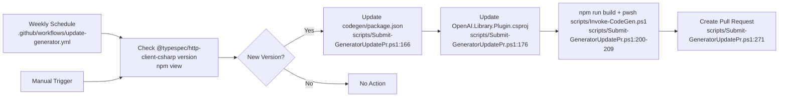

<!-- source: DeepWiki mcp.deepwiki.com · repo openai/openai-dotnet · page 3 Architecture and Design · fetched 2026-10-26 -->

# Architecture and Design

<details>
<summary>Relevant source files</summary>

The following files were used as context for generating this wiki page:

- [api/OpenAI.net8.0.cs](api/OpenAI.net8.0.cs)
- [api/OpenAI.netstandard2.0.cs](api/OpenAI.netstandard2.0.cs)
- [codegen/generator/src/OpenAI.Library.Plugin.csproj](codegen/generator/src/OpenAI.Library.Plugin.csproj)
- [codegen/package.json](codegen/package.json)
- [package-lock.json](package-lock.json)
- [package.json](package.json)
- [scripts/Submit-GeneratorUpdatePr.ps1](scripts/Submit-GeneratorUpdatePr.ps1)
- [specification/base/typespec/common/models.tsp](specification/base/typespec/common/models.tsp)
- [specification/base/typespec/main.tsp](specification/base/typespec/main.tsp)
- [specification/base/typespec/videos/main.tsp](specification/base/typespec/videos/main.tsp)
- [specification/client/videos.client.tsp](specification/client/videos.client.tsp)
- [src/Custom/Conversations/IncludedConversationItemProperty.cs](src/Custom/Conversations/IncludedConversationItemProperty.cs)
- [src/Custom/OpenAIClient.cs](src/Custom/OpenAIClient.cs)
- [src/Custom/OpenAIClientOptions.cs](src/Custom/OpenAIClientOptions.cs)
- [src/Custom/Videos/Internal/InternalOrderEnum.cs](src/Custom/Videos/Internal/InternalOrderEnum.cs)
- [src/Custom/Videos/Internal/InternalVideoContentVariant.cs](src/Custom/Videos/Internal/InternalVideoContentVariant.cs)
- [src/Generated/Models/Chat/ChatReasoningEffortLevel.cs](src/Generated/Models/Chat/ChatReasoningEffortLevel.cs)
- [src/Generated/Models/Conversations/IncludedConversationItemProperty.cs](src/Generated/Models/Conversations/IncludedConversationItemProperty.cs)
- [src/Generated/Models/OpenAIContext.cs](src/Generated/Models/OpenAIContext.cs)
- [src/Generated/Models/Responses/ResponseReasoningEffortLevel.cs](src/Generated/Models/Responses/ResponseReasoningEffortLevel.cs)
- [src/Generated/Models/Videos/InternalOrderEnum.cs](src/Generated/Models/Videos/InternalOrderEnum.cs)
- [src/Generated/Models/Videos/InternalVideoContentVariant.cs](src/Generated/Models/Videos/InternalVideoContentVariant.cs)
- [src/Generated/OpenAIModelFactory.cs](src/Generated/OpenAIModelFactory.cs)
- [tests/Responses/ResponsesTests.cs](tests/Responses/ResponsesTests.cs)
- [tspCodeModel.json](tspCodeModel.json)

</details>


## Purpose and Scope

This document describes the architectural design and key structural patterns of the OpenAI .NET SDK. It covers:
- The code generation system built on TypeSpec
- The client factory pattern and sub-client organization
- The distinction between generated and custom code
- The API stability model (stable vs. experimental)
- Configuration and pipeline architecture

For information about specific client capabilities, see [Client Libraries](#4). For code generation development workflows, see [Code Generation System](#8.1).

---

## High-Level Architecture

The OpenAI .NET SDK follows a layered architecture with four primary systems:

### System Overview



**Sources**: [specification/base/typespec/main.tsp:1-25](), [codegen/package.json:1-46](), [codegen/generator/src/OpenAI.Library.Plugin.csproj:1-20](), [src/Generated/OpenAIModelFactory.cs:1-27]()

---

## Code Generation System

The SDK uses a TypeSpec-based code generation system where API specifications are written in TypeSpec and compiled to C# code.

### TypeSpec-to-C# Pipeline



### Key Generation Artifacts

| Artifact Type | Location | Purpose |
|--------------|----------|---------|
| Model classes | `src/Generated/Models/**/*.cs` | DTOs representing API request/response schemas |
| Client protocol methods | `src/Generated/*Client.cs` | Low-level HTTP methods with `BinaryContent` parameters |
| Model factory | `src/Generated/OpenAIModelFactory.cs` | Test helper methods for creating model instances |
| OpenAIContext | `src/Generated/Models/OpenAIContext.cs` | Custom serialization context registration |

The generator produces **protocol methods only** by default. Convenience methods are added through custom code or TypeSpec client customizations.

**Sources**: [specification/base/typespec/main.tsp:1-25](), [codegen/package.json:14-35](), [src/Generated/OpenAIModelFactory.cs:1-50](), [src/Generated/Models/OpenAIContext.cs:1-26]()

---

## Client Factory Pattern

The SDK uses a factory pattern where `OpenAIClient` serves as the central entry point for creating specialized sub-clients.

### OpenAIClient Architecture



### Factory Method Pattern

Each `Get*Client()` method creates a new instance rather than caching:

```
// OpenAIClient does NOT cache sub-clients
public virtual ChatClient GetChatClient(string model)
    => new(Pipeline, model, _options);

public virtual AssistantClient GetAssistantClient()
    => new(Pipeline, _options);
```

This design allows users to create multiple clients targeting different models or configurations. Sub-clients share the parent's `ClientPipeline` and `OpenAIClientOptions`.

**Sources**: [src/Custom/OpenAIClient.cs:25-86](), [src/Custom/OpenAIClientOptions.cs:1-75](), [api/OpenAI.netstandard2.0.cs:2-30]()

---

## API Stability Model

The SDK distinguishes between **stable** and **experimental** APIs using the `[Experimental("OPENAI001")]` attribute.

### Stable vs. Experimental APIs



### Experimental API Markers

Experimental APIs are marked at multiple levels:

| Level | Example |
|-------|---------|
| Client class | `[Experimental("OPENAI001")] public class AssistantClient` |
| Individual methods | `[Experimental("OPENAI001")] public virtual AssistantClient GetAssistantClient()` |
| Model types | `[Experimental("OPENAI001")] public class Assistant` |
| Enums | `[Experimental("OPENAI001")] public readonly partial struct FileSearchRanker` |

Stable APIs have no experimental attribute and follow strict semantic versioning for breaking changes.

**Sources**: [api/OpenAI.net8.0.cs:6-43](), [api/OpenAI.netstandard2.0.cs:12-28]()

---

## Custom Code Extensions

The SDK uses partial classes and code generation attributes to extend generated code without modifying generator output.

### Extension Mechanisms



### Common Extension Patterns

**Suppressing Generated Constructors:**
```csharp
[CodeGenSuppress("OpenAIClient", typeof(Uri), typeof(ApiKeyCredential), typeof(OpenAIClientOptions))]
public partial class OpenAIClient
{
    // Custom constructor with different signature
    public OpenAIClient(string apiKey) : this(new ApiKeyCredential(apiKey), new OpenAIClientOptions()) { }
}
```

**Renaming Generated Types:**
```csharp
[CodeGenType("OrderEnum")]
internal readonly partial struct InternalOrderEnum { }
```

**Renaming Generated Members:**
```csharp
[CodeGenMember("MessageInputImageImageUrl")]
public static IncludedConversationItemProperty MessageInputImageUri { get; }
```

**Sources**: [src/Custom/OpenAIClient.cs:36-83](), [src/Custom/Conversations/IncludedConversationItemProperty.cs:1-27](), [src/Custom/Videos/Internal/InternalOrderEnum.cs:1-12]()

---

## Pipeline and Authentication

The SDK uses `System.ClientModel.Primitives.ClientPipeline` for HTTP communication with pluggable authentication.

### Authentication Flow



### Configuration Headers

The `OpenAIClientOptions` class controls request headers:

| Property | Header | Purpose |
|----------|--------|---------|
| `Endpoint` | *(used for URI construction)* | Service endpoint (default: `https://api.openai.com/v1`) |
| `OrganizationId` | `OpenAI-Organization` | Specifies which organization to bill |
| `ProjectId` | `OpenAI-Project` | Specifies which project to access |
| `UserAgentApplicationId` | `User-Agent` | Application identifier for telemetry |

All sub-clients inherit these headers via the shared `ClientPipeline`.

**Sources**: [src/Custom/OpenAIClient.cs:86-150](), [src/Custom/OpenAIClientOptions.cs:1-75]()

---

## Namespace Organization

The SDK organizes APIs into domain-specific namespaces, each corresponding to a TypeSpec domain file.

### Domain to Namespace Mapping



### Client-to-Model Alignment

Each client namespace contains:
- Client class (e.g., `ChatClient`)
- Request option classes (e.g., `ChatCompletionOptions`)
- Response model classes (e.g., `ChatCompletion`)
- Domain-specific enums and helper types (e.g., `ChatMessageRole`, `ChatFinishReason`)

**Sources**: [specification/base/typespec/main.tsp:1-25](), [src/Generated/Models/OpenAIContext.cs:1-200]()

---

## Customization Workflow

Developers extending the SDK follow this pattern:

### Extension Development Flow



### Example: Extending ChatClient

Generated code provides protocol method:
```csharp
// src/Generated/ChatClient.cs
public virtual ClientResult CompleteChat(BinaryContent content, RequestOptions options = null)
```

Custom code adds convenience method:
```csharp
// src/Custom/Chat/ChatClient.cs
public partial class ChatClient
{
    public virtual ClientResult<ChatCompletion> CompleteChat(
        IEnumerable<ChatMessage> messages,
        ChatCompletionOptions options = null,
        CancellationToken cancellationToken = default)
    {
        // Convenience implementation
    }
}
```

**Sources**: [src/Custom/OpenAIClient.cs:27-83](), [src/Custom/Conversations/IncludedConversationItemProperty.cs:8-26]()

---

## Build and Release Integration

The code generation system integrates with the build pipeline to ensure generated code stays synchronized with TypeSpec specifications.

### Generator Update Flow



The generator update script automatically:
1. Checks for new TypeSpec generator versions
2. Updates dependency versions in `package.json` and `.csproj` files
3. Regenerates all C# code from TypeSpec specifications
4. Creates a pull request with the changes

**Sources**: [scripts/Submit-GeneratorUpdatePr.ps1:1-325](), [codegen/package.json:18-25]()

---

## Key Design Principles

The SDK architecture follows these core principles:

| Principle | Implementation | Rationale |
|-----------|----------------|-----------|
| **Generated-First** | TypeSpec specifications are the source of truth | Ensures consistency with OpenAI API specs |
| **Partial Class Extensions** | Custom code extends generated code via partial classes | Preserves customizations across regenerations |
| **Factory Pattern** | `OpenAIClient` creates sub-clients, no caching | Allows flexible multi-client scenarios |
| **Shared Pipeline** | All sub-clients share parent's `ClientPipeline` | Consistent authentication and retry behavior |
| **Stable vs. Experimental** | `[Experimental]` attribute marks preview APIs | Allows innovation while protecting stable APIs |
| **Protocol + Convenience** | Generated protocol methods + custom convenience methods | Balances flexibility with usability |

**Sources**: [src/Custom/OpenAIClient.cs:25-165](), [src/Generated/OpenAIModelFactory.cs:1-50](), [api/OpenAI.net8.0.cs:1-56]()

---

