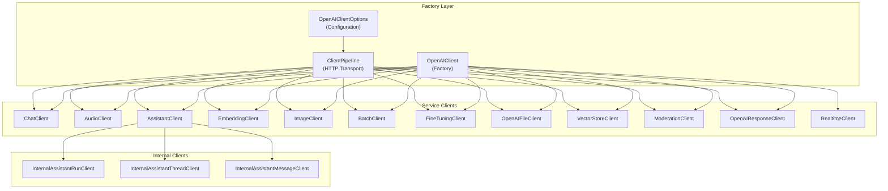
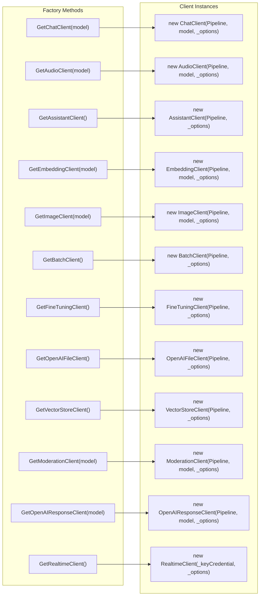

<!-- source: DeepWiki mcp.deepwiki.com · repo openai/openai-dotnet · page 4 Client Libraries · fetched 2026-10-26 -->

# Client Libraries

<details>
<summary>Relevant source files</summary>

The following files were used as context for generating this wiki page:

- [api/OpenAI.net8.0.cs](api/OpenAI.net8.0.cs)
- [api/OpenAI.netstandard2.0.cs](api/OpenAI.netstandard2.0.cs)
- [specification/base/typespec/common/models.tsp](specification/base/typespec/common/models.tsp)
- [specification/base/typespec/main.tsp](specification/base/typespec/main.tsp)
- [specification/base/typespec/videos/main.tsp](specification/base/typespec/videos/main.tsp)
- [specification/client/videos.client.tsp](specification/client/videos.client.tsp)
- [src/Custom/OpenAIClient.cs](src/Custom/OpenAIClient.cs)
- [src/Custom/OpenAIClientOptions.cs](src/Custom/OpenAIClientOptions.cs)
- [src/Generated/Models/Chat/ChatReasoningEffortLevel.cs](src/Generated/Models/Chat/ChatReasoningEffortLevel.cs)
- [src/Generated/Models/OpenAIContext.cs](src/Generated/Models/OpenAIContext.cs)
- [src/Generated/Models/Responses/ResponseReasoningEffortLevel.cs](src/Generated/Models/Responses/ResponseReasoningEffortLevel.cs)
- [src/Generated/OpenAIModelFactory.cs](src/Generated/OpenAIModelFactory.cs)
- [tests/Responses/ResponsesTests.cs](tests/Responses/ResponsesTests.cs)
- [tspCodeModel.json](tspCodeModel.json)

</details>


This page provides comprehensive documentation of all available API client libraries in the OpenAI .NET SDK. It covers the central factory pattern, individual client types, and their relationships within the overall SDK architecture.

For information about getting started with basic usage, see [Getting Started](#2). For detailed documentation of specific client implementations, see the individual client pages ([Chat](#4.2), [Assistants](#4.4), [Audio](#4.5), etc.).

## Overview

The OpenAI .NET SDK implements a factory-based client architecture where `OpenAIClient` serves as the central factory for creating specialized API clients. This design enables shared configuration management while providing focused, type-safe interfaces for each OpenAI API surface.

The client library system consists of three main components:

| Component | Purpose | Example |
|-----------|---------|---------|
| **Factory Client** | Central configuration and client creation | `OpenAIClient` |
| **Service Clients** | API-specific functionality | `ChatClient`, `AudioClient`, `AssistantClient` |
| **Internal Clients** | Low-level protocol operations | `InternalAssistantRunClient`, `InternalAssistantMessageClient` |

Sources: [src/Custom/OpenAIClient.cs:28-31](), [src/Custom/OpenAIClient.cs:77-379]()

## Client Factory Architecture



Sources: [src/Custom/OpenAIClient.cs:160-336]()

## Factory Methods and Client Creation

The `OpenAIClient` provides factory methods that create new instances of specialized clients while sharing the same authentication, configuration, and HTTP pipeline:



Sources: [src/Custom/OpenAIClient.cs:204](), [src/Custom/OpenAIClient.cs:181](), [src/Custom/OpenAIClient.cs:170](), [src/Custom/OpenAIClient.cs:215](), [src/Custom/OpenAIClient.cs:257](), [src/Custom/OpenAIClient.cs:193](), [src/Custom/OpenAIClient.cs:246](), [src/Custom/OpenAIClient.cs:234](), [src/Custom/OpenAIClient.cs:320](), [src/Custom/OpenAIClient.cs:279](), [src/Custom/OpenAIClient.cs:308](), [src/Custom/OpenAIClient.cs:296]()

## Available Client Libraries

### Model-Specific Clients

These clients require a model parameter and are designed for OpenAI APIs that operate on specific models:

| Client | Purpose | Factory Method | Model Required |
|--------|---------|----------------|----------------|
| `ChatClient` | Chat completions and conversations | `GetChatClient(model)` | Yes |
| `AudioClient` | Speech-to-text and text-to-speech | `GetAudioClient(model)` | Yes |
| `EmbeddingClient` | Text embeddings generation | `GetEmbeddingClient(model)` | Yes |
| `ImageClient` | Image generation and editing | `GetImageClient(model)` | Yes |
| `ModerationClient` | Content moderation | `GetModerationClient(model)` | Yes |
| `OpenAIResponseClient` | Advanced response generation | `GetOpenAIResponseClient(model)` | Yes |

### Service-Specific Clients

These clients operate on OpenAI services that don't require model specification:

| Client | Purpose | Factory Method | Experimental |
|--------|---------|----------------|--------------|
| `AssistantClient` | AI assistants with persistent threads | `GetAssistantClient()` | Yes |
| `BatchClient` | Asynchronous batch operations | `GetBatchClient()` | Yes |
| `FineTuningClient` | Model fine-tuning operations | `GetFineTuningClient()` | Yes |
| `OpenAIFileClient` | File upload and management | `GetOpenAIFileClient()` | No |
| `VectorStoreClient` | Vector storage for RAG | `GetVectorStoreClient()` | Yes |
| `RealtimeClient` | Real-time conversation sessions | `GetRealtimeClient()` | Yes |

Sources: [src/Custom/OpenAIClient.cs:169](), [src/Custom/OpenAIClient.cs:192](), [src/Custom/OpenAIClient.cs:245](), [src/Custom/OpenAIClient.cs:319](), [src/Custom/OpenAIClient.cs:295]()

### Internal Client Architecture

Some complex services use internal clients for low-level protocol operations:

| Internal Client | Purpose | Used By |
|-----------------|---------|---------|
| `InternalAssistantRunClient` | Run execution and management | `AssistantClient` |
| `InternalAssistantThreadClient` | Thread lifecycle operations | `AssistantClient` |
| `InternalAssistantMessageClient` | Message CRUD operations | `AssistantClient` |

Sources: [src/Custom/Assistants/Internal/InternalAssistantRunClient.cs:9](), [src/Custom/Assistants/Internal/InternalAssistantThreadClient.cs:8](), [src/Custom/Assistants/Internal/InternalAssistantMessageClient.cs:8]()

## Authentication and Configuration

All clients share the same authentication and configuration through the factory pattern:

### Constructor Patterns

Each client follows consistent constructor patterns for flexibility:

| Constructor Type | Parameters | Usage |
|------------------|------------|-------|
| **API Key String** | `string apiKey` | Simple authentication |
| **Credential** | `ApiKeyCredential credential` | Structured authentication |
| **Credential + Options** | `ApiKeyCredential credential, OpenAIClientOptions options` | Full configuration |
| **Authentication Policy** | `AuthenticationPolicy authenticationPolicy` | Advanced authentication |
| **Pipeline** | `ClientPipeline pipeline, OpenAIClientOptions options` | Advanced customization |

Sources: [src/Custom/FineTuning/FineTuningClient.cs:54-56](), [src/Custom/FineTuning/FineTuningClient.cs:64-66](), [src/Custom/FineTuning/FineTuningClient.cs:74-76](), [src/Custom/FineTuning/FineTuningClient.cs:82-84](), [src/Custom/FineTuning/FineTuningClient.cs:108-115]()

### Shared Configuration

The `OpenAIClientOptions` class provides shared configuration across all clients:

| Option | Purpose | Header |
|--------|---------|--------|
| `Endpoint` | Custom service endpoint | - |
| `OrganizationId` | OpenAI organization identifier | `OpenAI-Organization` |
| `ProjectId` | OpenAI project identifier | `OpenAI-Project` |
| `UserAgentApplicationId` | Custom application identifier | `User-Agent` |

Sources: [src/Custom/OpenAIClientOptions.cs:18-26](), [src/Custom/OpenAIClientOptions.cs:35-43](), [src/Custom/OpenAIClientOptions.cs:51-59](), [src/Custom/OpenAIClientOptions.cs:64-72]()

## Usage Patterns

### Factory Pattern Usage

The recommended approach is to create a single `OpenAIClient` instance and use it to create specialized clients as needed:

```csharp
var client = new OpenAIClient("your-api-key");
var chatClient = client.GetChatClient("gpt-4");
var audioClient = client.GetAudioClient("whisper-1");
```

### Direct Client Creation

For scenarios requiring only a specific client type, direct instantiation is supported:

```csharp
var chatClient = new ChatClient("gpt-4", "your-api-key");
```

Sources: [src/Custom/OpenAIClient.cs:92-96](), [src/Custom/OpenAIClient.cs:204](), [src/Custom/OpenAIClient.cs:181]()

### Pipeline Sharing

The factory pattern ensures efficient resource usage by sharing the HTTP pipeline across all clients created from the same `OpenAIClient` instance:

```csharp
var client = new OpenAIClient(apiKey, options);
// All these clients share the same pipeline and configuration
var chatClient = client.GetChatClient("gpt-4");
var embedClient = client.GetEmbeddingClient("text-embedding-3-small");
var imageClient = client.GetImageClient("dall-e-3");
```

Sources: [src/Custom/OpenAIClient.cs:140-143](), [src/Custom/OpenAIClient.cs:344-351]()

---

