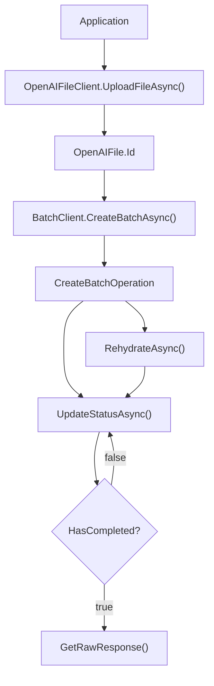
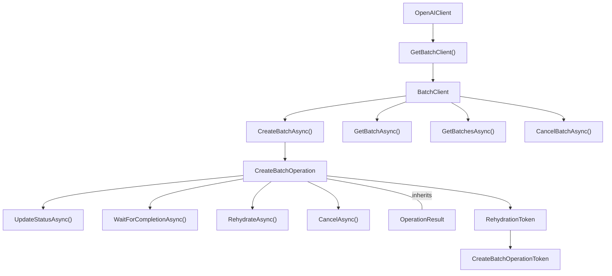
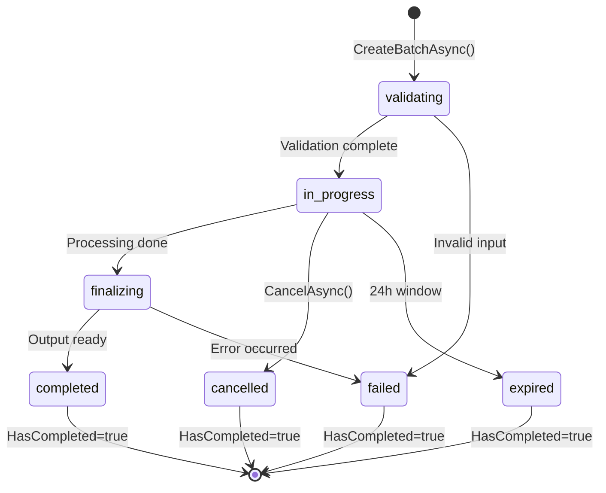
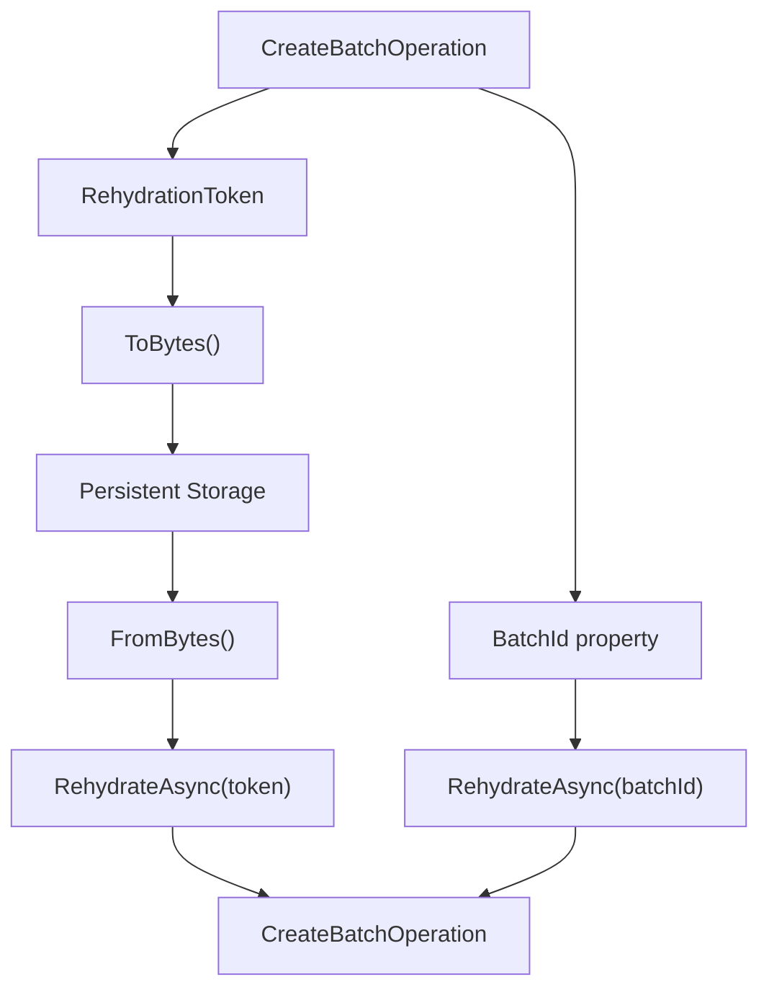
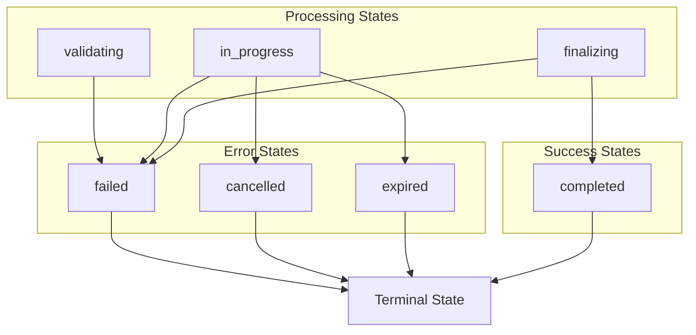

<!-- source: DeepWiki mcp.deepwiki.com · repo openai/openai-dotnet · page 4.10 Batch Processing · fetched 2026-10-26 -->

# Batch Processing

<details>
<summary>Relevant source files</summary>

The following files were used as context for generating this wiki page:

- [CHANGELOG.md](CHANGELOG.md)
- [api/OpenAI.net8.0.cs](api/OpenAI.net8.0.cs)
- [api/OpenAI.netstandard2.0.cs](api/OpenAI.netstandard2.0.cs)
- [scripts/Test-ApiCompatibility.ps1](scripts/Test-ApiCompatibility.ps1)
- [src/Generated/Models/OpenAIContext.cs](src/Generated/Models/OpenAIContext.cs)
- [src/Generated/OpenAIModelFactory.cs](src/Generated/OpenAIModelFactory.cs)
- [src/OpenAI.csproj](src/OpenAI.csproj)
- [tests/Responses/ResponsesTests.cs](tests/Responses/ResponsesTests.cs)
- [tests/SessionRecords/ResponsesTests/WebSearchCallStreaming.json](tests/SessionRecords/ResponsesTests/WebSearchCallStreaming.json)
- [tests/SessionRecords/ResponsesTests/WebSearchCallStreamingAsync.json](tests/SessionRecords/ResponsesTests/WebSearchCallStreamingAsync.json)
- [tspCodeModel.json](tspCodeModel.json)

</details>


The `BatchClient` provides asynchronous batch processing for large volumes of API requests. Batch operations submit multiple requests via a JSONL file and poll for completion in the background.

Related: [Files and Vector Stores](#4.8) for file management, [Chat Client](#4.2) for real-time requests.

## Overview

Batch processing executes multiple API requests asynchronously from an uploaded file. The workflow involves:
1. Upload JSONL file with requests using `OpenAIFileClient`
2. Create batch operation via `BatchClient.CreateBatchAsync()`
3. Monitor status via `CreateBatchOperation`
4. Retrieve results when complete

**Batch Processing Flow**



Sources: [tests/Batch/BatchTests.cs:113-169](), [src/Custom/Batch/CreateBatchOperation.Protocol.cs:18-44]()

## Core Components

**Class Hierarchy**



Sources: [src/Custom/Batch/CreateBatchOperation.Protocol.cs:18-235]()

### BatchClient

`BatchClient` is marked with `[Experimental("OPENAI001")]` and provides batch operation management.

| Method | Parameters | Return Type | Purpose |
|--------|-----------|-------------|---------|
| `CreateBatchAsync()` | `BinaryContent content, bool waitUntilCompleted` | `Task<CreateBatchOperation>` | Creates new batch operation |
| `GetBatchAsync()` | `string batchId, RequestOptions options` | `Task<ClientResult>` | Retrieves batch status by ID |
| `GetBatchesAsync()` | `string after, int? limit, RequestOptions options` | `AsyncCollectionResult` | Lists batches with pagination |
| `CancelBatchAsync()` | `string batchId, RequestOptions options` | `Task<ClientResult>` | Cancels in-progress batch |

The client also exposes protocol methods via `CreateGetBatchRequest()` and `CreateCancelBatchRequest()` for constructing `PipelineMessage` objects.

Sources: [src/Custom/Batch/CreateBatchOperation.Protocol.cs:196-234](), [tests/Batch/BatchTests.cs:23-33]()

### CreateBatchOperation

`CreateBatchOperation` extends `OperationResult` and implements long-running operation patterns with rehydration support.

| Member | Type | Description |
|--------|------|-------------|
| `BatchId` | `string` | Batch identifier for API calls |
| `HasCompleted` | `bool` | Computed from status: `completed`, `cancelled`, `expired`, or `failed` |
| `RehydrationToken` | `ContinuationToken?` | Serializable token containing `BatchId` |
| `UpdateStatusAsync()` | Method | Calls `GetBatchAsync()` and updates internal state |
| `WaitForCompletionAsync()` | Method | Polls until `HasCompleted` is true |

The operation maintains internal references to `BatchClient _parentClient`, `Uri _endpoint`, and `string _batchId` for protocol-level requests.

Sources: [src/Custom/Batch/CreateBatchOperation.Protocol.cs:18-44](), [src/Custom/Batch/CreateBatchOperation.Protocol.cs:134-176]()

## Batch Lifecycle

Batch status is determined by the `status` field in the response JSON. The `HasCompleted` property checks if status equals `InternalBatchStatus.Completed`, `Cancelled`, `Expired`, or `Failed`.

**Status Transitions**



The completion check in `GetHasCompleted()` compares the status string:
```csharp
return status == InternalBatchStatus.Completed ||
       status == InternalBatchStatus.Cancelled ||
       status == InternalBatchStatus.Expired ||
       status == InternalBatchStatus.Failed;
```

Sources: [src/Custom/Batch/CreateBatchOperation.Protocol.cs:178-184](), [tests/Batch/BatchTests.cs:113-169]()

## Creating Batches

### Client Instantiation

`BatchClient` is obtained from `OpenAIClient`:

```csharp
OpenAIClient client = new("your-api-key");
BatchClient batchClient = client.GetBatchClient();
```

Direct instantiation constructors accept `ApiKeyCredential` or `AuthenticationPolicy`.

Sources: [tests/Batch/BatchTests.cs:23]()

### File Upload and Batch Creation

Upload JSONL file with `OpenAIFileClient`, then create batch with `CreateBatchAsync()`:

```csharp
// Upload file
OpenAIFileClient fileClient = client.GetOpenAIFileClient();
using MemoryStream stream = new();
using StreamWriter writer = new(stream);
writer.WriteLine(@"{""custom_id"": ""request-1"", ""method"": ""POST"", ""url"": ""/v1/chat/completions"", ""body"": {...}}");
writer.Flush();
stream.Position = 0;

OpenAIFile inputFile = await fileClient.UploadFileAsync(
    stream, 
    "batch.jsonl", 
    FileUploadPurpose.Batch);

// Create batch
BinaryContent content = BinaryContent.Create(BinaryData.FromObjectAsJson(new
{
    input_file_id = inputFile.Id,
    endpoint = "/v1/chat/completions",
    completion_window = "24h",
    metadata = new { testMetadataKey = "test metadata value" }
}));

CreateBatchOperation operation = await batchClient.CreateBatchAsync(
    content, 
    waitUntilCompleted: false);
```

The `waitUntilCompleted` parameter controls whether `CreateBatchAsync()` blocks until completion. Set to `false` for async processing.

Sources: [tests/Batch/BatchTests.cs:113-138]()

### Request File Format

Each line in the JSONL file must be a complete JSON object:

```jsonl
{"custom_id": "request-1", "method": "POST", "url": "/v1/chat/completions", "body": {"model": "gpt-4o-mini", "messages": [{"role": "system", "content": "You are a helpful assistant."}, {"role": "user", "content": "What is 2+2?"}]}}
```

Required fields:
- `custom_id`: Unique identifier for the request
- `method`: HTTP method (typically `"POST"`)
- `url`: API endpoint path (e.g., `"/v1/chat/completions"`)
- `body`: Request payload matching the target API's schema

Sources: [tests/Batch/BatchTests.cs:117]()

## Monitoring and Rehydration

### Polling for Status

`CreateBatchOperation` provides two polling patterns:

```csharp
// Manual polling
ClientResult result = await operation.UpdateStatusAsync();
BinaryData responseContent = result.GetRawResponse().Content;
// Parse responseContent to check status

// Automatic polling until completion
await operation.WaitForCompletionAsync();
Assert.That(operation.HasCompleted, Is.True);
```

`UpdateStatusAsync()` calls `GetBatchAsync()` internally and updates `HasCompleted` based on the response status field.

Sources: [src/Custom/Batch/CreateBatchOperation.Protocol.cs:134-151](), [src/Custom/Batch/CreateBatchOperation.Protocol.cs:153-165]()

### Rehydration

Rehydration reconstructs `CreateBatchOperation` from serialized state, enabling continuation across process restarts.

**Rehydration Mechanisms**



Using `ContinuationToken`:
```csharp
BinaryData tokenBytes = operation.RehydrationToken.ToBytes();
// Store tokenBytes in database/file

// Later, in new process:
ContinuationToken token = ContinuationToken.FromBytes(tokenBytes);
CreateBatchOperation rehydrated = await CreateBatchOperation.RehydrateAsync(
    batchClient, 
    token);
```

Using `BatchId` directly:
```csharp
string batchId = operation.BatchId;
// Store batchId

// Later:
CreateBatchOperation rehydrated = await CreateBatchOperation.RehydrateAsync(
    batchClient, 
    batchId);
```

Both methods call `GetBatchAsync()` to retrieve current status and reconstruct the operation object. The `CreateBatchOperationToken` wraps the `BatchId` in a structured token format.

Sources: [src/Custom/Batch/CreateBatchOperation.Protocol.cs:56-131](), [tests/Batch/BatchTests.cs:174-252]()

## Error Handling and Cancellation

### Canceling Batch Operations

In-progress batches can be canceled to stop processing:

```csharp
ClientResult cancelResult = await batchOperation.CancelAsync();
```

Sources: [src/Custom/Batch/CreateBatchOperation.Protocol.cs:218-234]()

### Batch Listing and Management

Retrieve and manage multiple batches with pagination support:

```csharp
// List all batches
CollectionResult batches = batchClient.GetBatches(after: null, limit: 20);

// Iterate through pages
foreach (ClientResult pageResult in batches.GetRawPages())
{
    // Process batch data from pageResult
}
```

Sources: [tests/Batch/BatchTests.cs:28-56]()

**Error Status Handling**



Sources: [src/Custom/Batch/CreateBatchOperation.Protocol.cs:178-184]()

---

