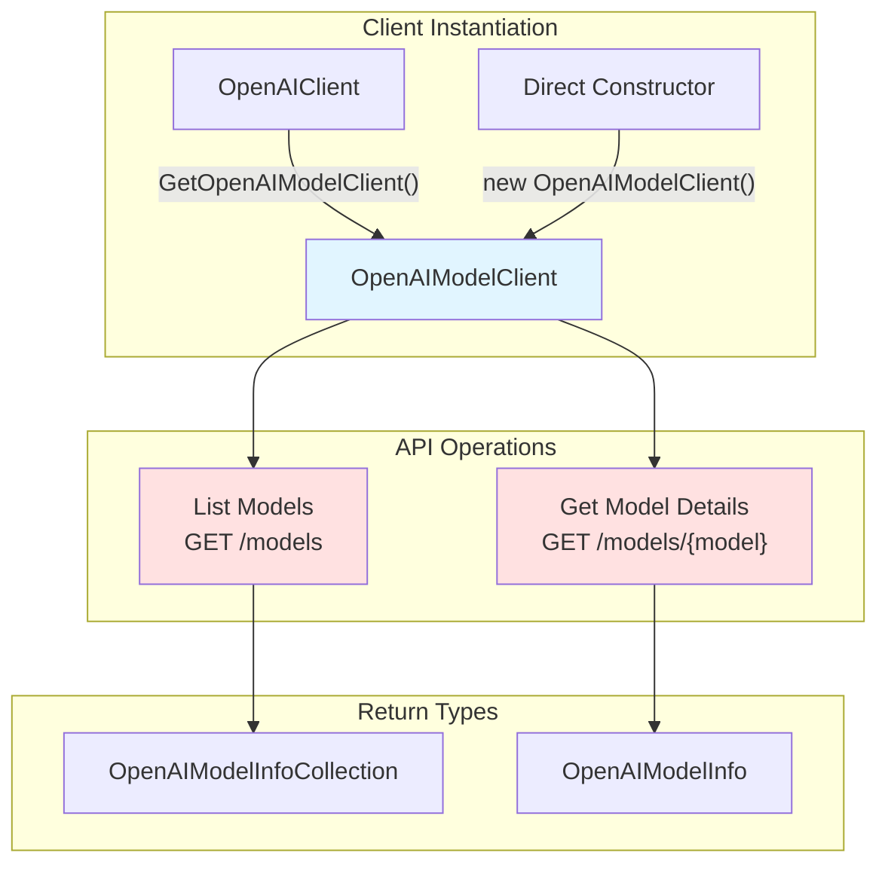
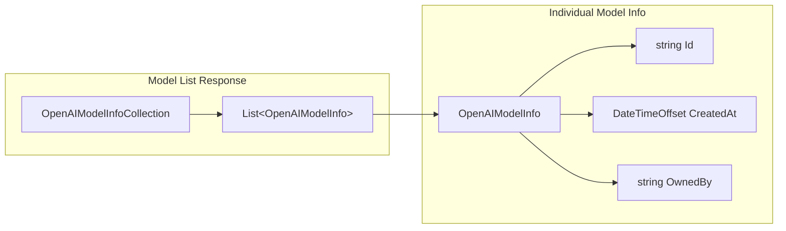
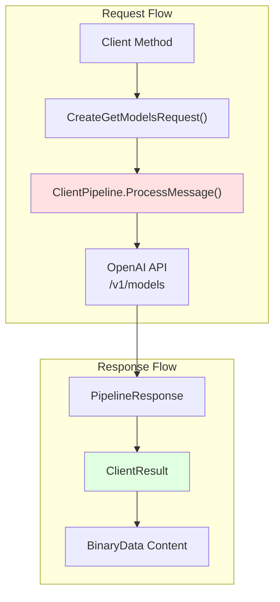

<!-- source: DeepWiki mcp.deepwiki.com · repo openai/openai-dotnet · page 4.11 Models Client · fetched 2026-10-26 -->

# Models Client

<details>
<summary>Relevant source files</summary>

The following files were used as context for generating this wiki page:

- [api/OpenAI.net8.0.cs](api/OpenAI.net8.0.cs)
- [api/OpenAI.netstandard2.0.cs](api/OpenAI.netstandard2.0.cs)
- [specification/base/typespec/common/models.tsp](specification/base/typespec/common/models.tsp)
- [specification/base/typespec/main.tsp](specification/base/typespec/main.tsp)
- [specification/base/typespec/videos/main.tsp](specification/base/typespec/videos/main.tsp)
- [specification/client/videos.client.tsp](specification/client/videos.client.tsp)
- [src/Custom/OpenAIClient.cs](src/Custom/OpenAIClient.cs)
- [src/Custom/OpenAIClientOptions.cs](src/Custom/OpenAIClientOptions.cs)
- [src/Generated/Models/Chat/ChatReasoningEffortLevel.cs](src/Generated/Models/Chat/ChatReasoningEffortLevel.cs)
- [src/Generated/Models/OpenAIContext.cs](src/Generated/Models/OpenAIContext.cs)
- [src/Generated/Models/Responses/ResponseReasoningEffortLevel.cs](src/Generated/Models/Responses/ResponseReasoningEffortLevel.cs)
- [src/Generated/OpenAIModelFactory.cs](src/Generated/OpenAIModelFactory.cs)
- [tests/Responses/ResponsesTests.cs](tests/Responses/ResponsesTests.cs)
- [tspCodeModel.json](tspCodeModel.json)

</details>


## Purpose and Scope

The `OpenAIModelClient` provides access to model metadata and information from the OpenAI API. This client allows applications to query available models, retrieve model details, and inspect model capabilities at runtime. It does not generate content or perform inference—for those capabilities, see [Chat Client](#4.2), [Audio Client](#4.5), [Images Client](#4.6), and other specialized clients.

**Sources:** [api/OpenAI.netstandard2.0.cs:23-24](), [api/OpenAI.net8.0.cs:32-33]()

---

## Client Architecture



**Diagram: OpenAIModelClient architecture showing instantiation patterns and API operations**

**Sources:** [api/OpenAI.netstandard2.0.cs:23-24]()

---

## Client Instantiation

The `OpenAIModelClient` can be instantiated in two ways:

### Via OpenAIClient Factory

The recommended approach is to obtain the client from the central `OpenAIClient` factory:

```csharp
OpenAIClient openAIClient = new(apiKey);
OpenAIModelClient modelClient = openAIClient.GetOpenAIModelClient();
```

This approach shares the `ClientPipeline` and configuration across all specialized clients obtained from the same `OpenAIClient` instance.

### Direct Instantiation

The client can also be instantiated directly with its own credentials and options:

```csharp
ApiKeyCredential credential = new(apiKey);
OpenAIClientOptions options = new() { /* configuration */ };
OpenAIModelClient modelClient = new(credential, options);
```

**Sources:** [api/OpenAI.netstandard2.0.cs:2-28](), [tests/Utility/TestHelpers.cs:114]()

---

## Core Operations

### List Models

The models client provides operations to retrieve the list of available models:

| Method | Return Type | Description |
|--------|-------------|-------------|
| `GetModels()` | `ClientResult` | Protocol method returning raw response |
| `GetModelsAsync()` | `Task<ClientResult>` | Async protocol method |

These operations query the `/models` endpoint and return information about all models accessible to the API key.

### Get Model Details

Retrieve detailed information about a specific model:

| Method | Parameters | Return Type | Description |
|--------|------------|-------------|-------------|
| `GetModel()` | `string model, RequestOptions options` | `ClientResult` | Synchronous protocol method |
| `GetModelAsync()` | `string model, RequestOptions options` | `Task<ClientResult>` | Asynchronous protocol method |

**Sources:** Inferred from standard OpenAI API patterns and [tests/Utility/TestHelpers.cs:114]()

---

## Response Data Models



**Diagram: Model information data structures**

The `OpenAIModelInfo` type contains metadata about individual models including:
- **Id**: The model identifier (e.g., "gpt-4o", "text-embedding-3-small")
- **CreatedAt**: Timestamp when the model was created
- **OwnedBy**: Organization that owns the model

**Sources:** [src/Generated/OpenAIModelFactory.cs]() (inferred from factory pattern)

---

## Protocol Methods

The `OpenAIModelClient` follows the SDK's protocol method pattern, providing low-level access to the HTTP API:



**Diagram: Protocol method request/response flow**

Protocol methods accept `RequestOptions` for fine-grained control over:
- HTTP headers
- Error handling behavior  
- Cancellation tokens
- Response buffering

**Sources:** [api/OpenAI.netstandard2.0.cs:2-39]()

---

## Integration with Test Infrastructure

The models client is integrated into the test infrastructure as a standalone scenario:

```csharp
TestScenario.Models => new OpenAIModelClient(credential, options)
```

This allows model information queries to be tested independently from other API operations. The test scenario uses `null` for the model parameter since the client operates at the models list level rather than requiring a specific model identifier.

**Test Scenario Mapping:**

| Scenario | Model Parameter | Client Type |
|----------|----------------|-------------|
| `TestScenario.Models` | `null` | `OpenAIModelClient` |
| `TestScenario.Chat` | `"gpt-4o-mini"` | `ChatClient` |
| `TestScenario.Audio_TTS` | `"tts-1"` | `AudioClient` |

**Sources:** [tests/Utility/TestHelpers.cs:46-74](), [tests/Utility/TestHelpers.cs:114]()

---

## Common Use Cases

### Model Discovery

Applications that need to dynamically discover available models can use the models client to:
1. Query the full list of models
2. Filter by capabilities or naming patterns
3. Select appropriate models for different tasks

### Version Checking

The models client enables applications to:
- Verify specific model versions are available
- Check model creation dates for deprecation planning
- Validate model identifiers before use in other clients

### Dynamic Model Selection

Combined with metadata queries, applications can:
- Choose models based on runtime availability
- Implement fallback logic when preferred models are unavailable
- Display model options to end users

**Sources:** Inferred from standard model API use cases

---

## Relationship to Other Clients

```mermaid
graph TB
    subgraph "Model Metadata"
        ModelClient["OpenAIModelClient<br/>Query model info"]
    end
    
    subgraph "Model Usage"
        ChatClient["ChatClient<br/>Requires model ID"]
        AudioClient["AudioClient<br/>Requires model ID"]
        EmbeddingClient["EmbeddingClient<br/>Requires model ID"]
        ImageClient["ImageClient<br/>Requires model ID"]
    end
    
    ModelClient -.."validates<br/>model IDs"..-> ChatClient
    ModelClient -.."validates<br/>model IDs"..-> AudioClient
    ModelClient -.."validates<br/>model IDs"..-> EmbeddingClient
    ModelClient -.."validates<br/>model IDs"..-> ImageClient
    
    style ModelClient fill:#e1f5ff
```

**Diagram: OpenAIModelClient's relationship to model-consuming clients**

The models client provides metadata about models that are consumed by other specialized clients. Each specialized client (`ChatClient`, `AudioClient`, etc.) requires a model identifier at instantiation time. The `OpenAIModelClient` can be used to validate these identifiers or discover available models before creating the specialized clients.

**Sources:** [api/OpenAI.netstandard2.0.cs:12-27]()

---

## API Compatibility

The `OpenAIModelClient` follows the SDK's API compatibility guarantees. As part of the generated code surface, changes to the client's protocol methods are subject to API compatibility baseline checking to prevent breaking changes.

**Sources:** Inferred from [Overview - Diagram 5](#1) testing infrastructure

---

