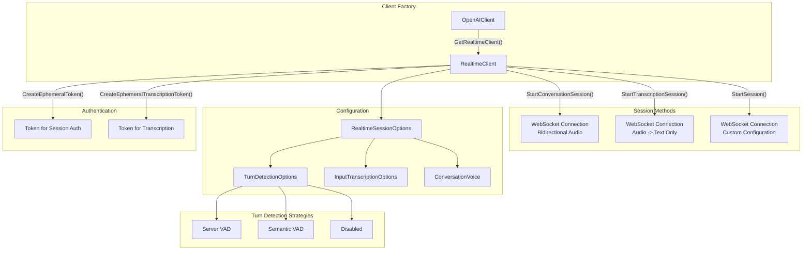
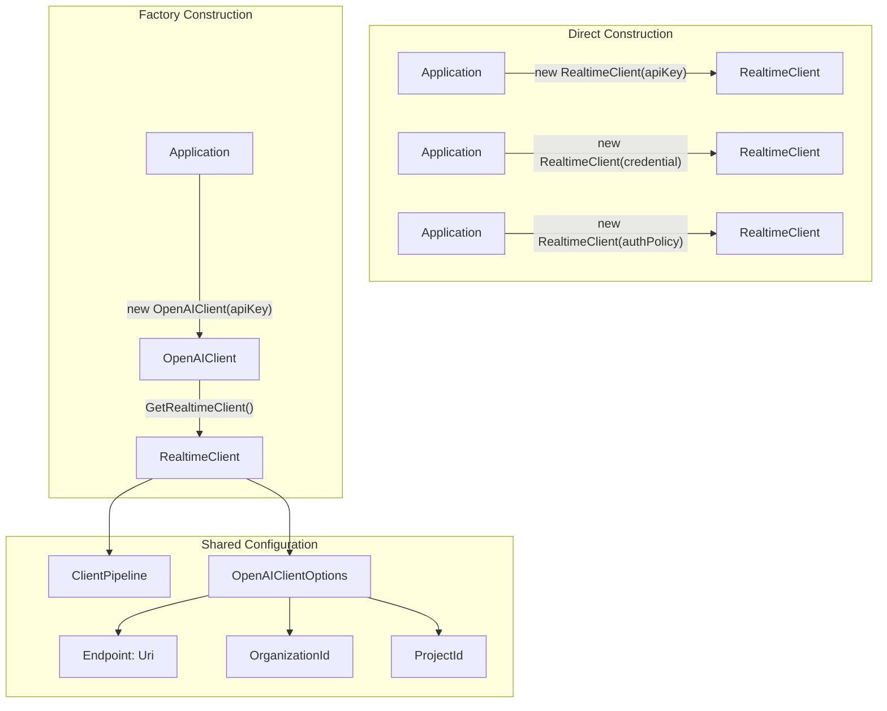
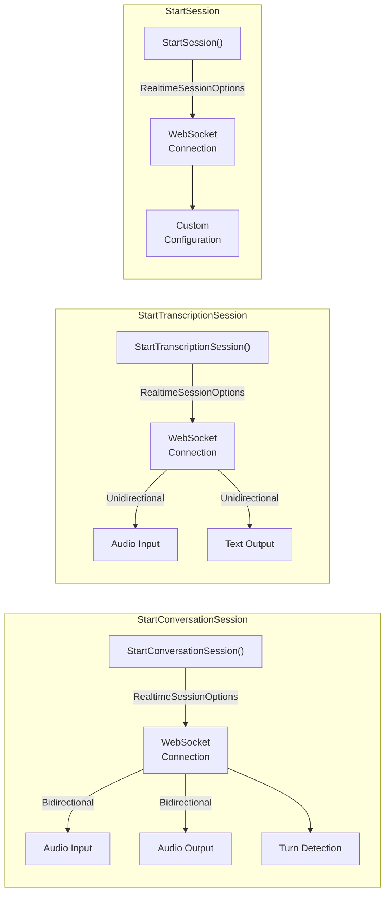
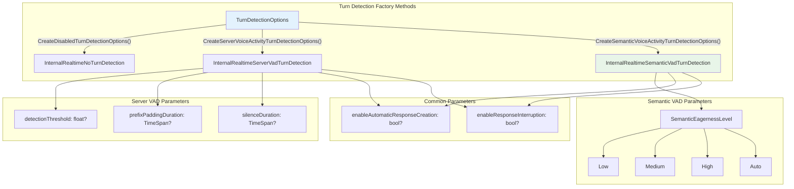
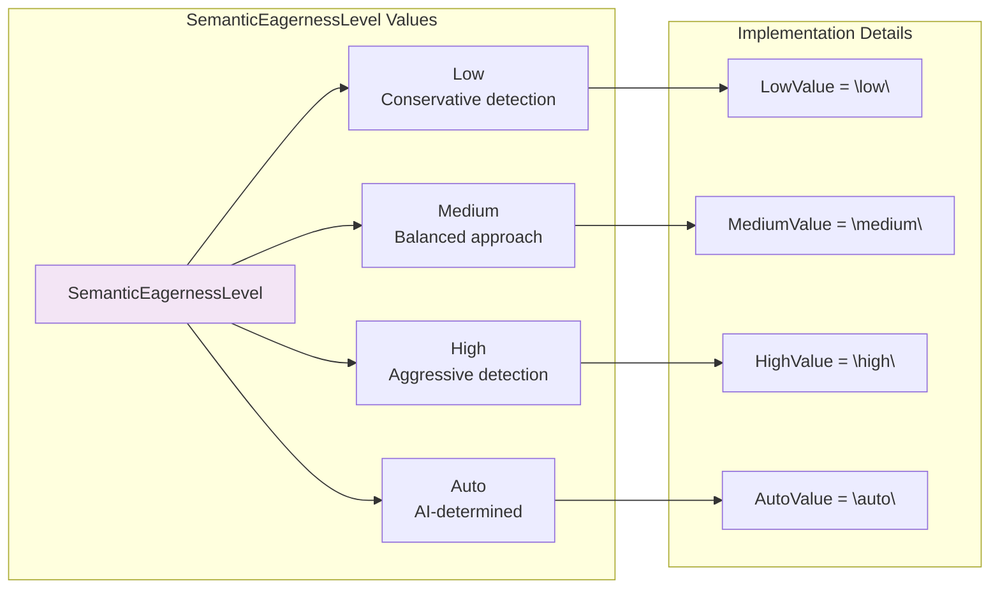
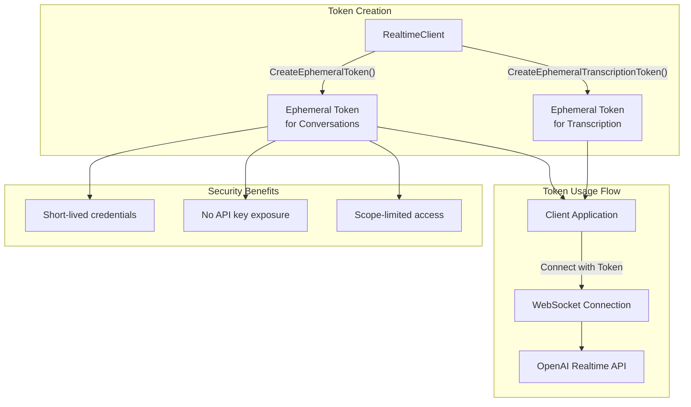
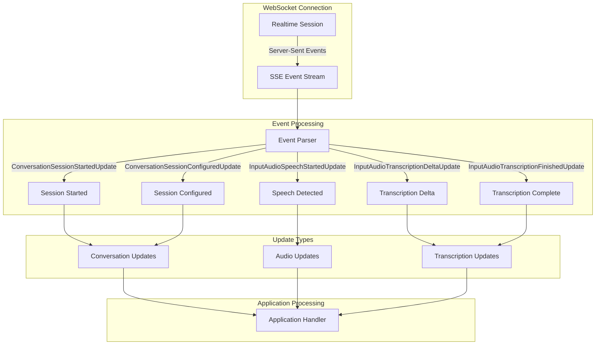

<!-- source: DeepWiki mcp.deepwiki.com · repo openai/openai-dotnet · page 4.12 Realtime Client · fetched 2026-10-26 -->

# Realtime Client

<details>
<summary>Relevant source files</summary>

The following files were used as context for generating this wiki page:

- [CHANGELOG.md](CHANGELOG.md)
- [api/OpenAI.net8.0.cs](api/OpenAI.net8.0.cs)
- [api/OpenAI.netstandard2.0.cs](api/OpenAI.netstandard2.0.cs)
- [scripts/Test-ApiCompatibility.ps1](scripts/Test-ApiCompatibility.ps1)
- [src/Generated/Models/OpenAIContext.cs](src/Generated/Models/OpenAIContext.cs)
- [src/Generated/OpenAIModelFactory.cs](src/Generated/OpenAIModelFactory.cs)
- [src/OpenAI.csproj](src/OpenAI.csproj)
- [tests/Responses/ResponsesTests.cs](tests/Responses/ResponsesTests.cs)
- [tests/SessionRecords/ResponsesTests/WebSearchCallStreaming.json](tests/SessionRecords/ResponsesTests/WebSearchCallStreaming.json)
- [tests/SessionRecords/ResponsesTests/WebSearchCallStreamingAsync.json](tests/SessionRecords/ResponsesTests/WebSearchCallStreamingAsync.json)
- [tspCodeModel.json](tspCodeModel.json)

</details>


This document covers the `RealtimeClient` in the OpenAI .NET SDK, which provides real-time bidirectional audio conversations using WebSocket connections and server-sent events. The client supports live audio streaming, turn detection, transcription, and interactive voice conversations.

For general chat completion functionality, see [Chat Client](#4.2). For assistant-based conversations, see [Assistants Client](#4.4). For non-realtime audio transcription and text-to-speech, see [Audio Client](#4.5).

## Overview

`RealtimeClient` is the primary interface for real-time audio conversations with OpenAI models. The client establishes persistent WebSocket connections for bidirectional streaming and processes server-sent events for real-time updates. This client is marked as experimental (`[Experimental("OPENAI002")]`) and its API may change in future releases.
</thinking>

The client provides three main operation modes:
- **Conversation Sessions**: Full bidirectional audio conversations with turn detection
- **Transcription Sessions**: Real-time audio transcription without response generation  
- **Generic Sessions**: Custom session configurations for specialized use cases



**RealtimeClient Architecture and Key Components**

Sources: [api/OpenAI.netstandard2.0.cs:27](), [api/OpenAI.net8.0.cs:38-39](), [CHANGELOG.md:185-192]()

## Client Construction

`RealtimeClient` can be constructed in several ways, supporting different authentication and configuration patterns.

### Construction Methods

| Constructor | Authentication | Use Case |
|-------------|----------------|----------|
| `RealtimeClient(string apiKey)` | API key string | Simple applications with hardcoded keys |
| `RealtimeClient(ApiKeyCredential credential)` | `ApiKeyCredential` object | Applications with credential management |
| `RealtimeClient(AuthenticationPolicy authenticationPolicy)` | Custom policy | Advanced auth scenarios (e.g., token rotation) |
| Via `OpenAIClient.GetRealtimeClient()` | Inherits from parent | Recommended for shared configuration |



**RealtimeClient Construction Patterns**

The `Endpoint` property on `RealtimeClient` allows inspection of the configured API endpoint. Custom `AuthenticationPolicy` implementations enable advanced scenarios like automatic token refresh.

Sources: [api/OpenAI.netstandard2.0.cs:27](), [api/OpenAI.net8.0.cs:38-39](), [CHANGELOG.md:185-188]()

## Session Management

`RealtimeClient` provides three session management methods, each optimized for different use cases.

### Session Methods



**Session Method Comparison**

| Method | Purpose | Audio Input | Audio Output | Turn Detection |
|--------|---------|-------------|--------------|----------------|
| `StartConversationSession` / `StartConversationSessionAsync` | Full bidirectional conversation | Yes | Yes | Yes |
| `StartTranscriptionSession` / `StartTranscriptionSessionAsync` | Real-time transcription only | Yes | No | No |
| `StartSession` / `StartSessionAsync` | Generic session with custom config | Configurable | Configurable | Configurable |

All session methods accept a `RealtimeSessionOptions` parameter and a `CancellationToken`. The methods return connection objects that handle the WebSocket lifecycle and server-sent event streaming.

Sources: [api/OpenAI.netstandard2.0.cs:27](), [CHANGELOG.md:188-191]()

## Session Configuration

`RealtimeSessionOptions` configures realtime session behavior. This class replaced the generic `RequestOptions` parameter in version 2.4.0 to provide strongly-typed configuration.

```mermaid
graph TB
    subgraph "RealtimeSessionOptions"
        RSO["RealtimeSessionOptions"] --> Model["Model: string"]
        RSO --> Voice["Voice: ConversationVoice"]
        RSO --> TDO["TurnDetection: TurnDetectionOptions"]
        RSO --> ITO["InputTranscription: InputTranscriptionOptions"]
        RSO --> Temperature["Temperature: float?"]
        RSO --> MaxTokens["MaxResponseOutputTokens: int?"]
    end
    
    subgraph "TurnDetectionOptions"
        TDO --> ServerVAD["CreateServerVoiceActivityTurnDetectionOptions()"]
        TDO --> SemanticVAD["CreateSemanticVoiceActivityTurnDetectionOptions()"]
        TDO --> Disabled["CreateDisabledTurnDetectionOptions()"]
    end
    
    subgraph "InputTranscriptionOptions"
        ITO --> TransModel["Model: InputTranscriptionModel"]
        ITO --> AudioFormat["AudioFormat: RealtimeAudioFormat"]
    end
    
    subgraph "ConversationVoice Values"
        Voice --> Alloy["Alloy"]
        Voice --> Ash["Ash"]
        Voice --> Ballad["Ballad"]
        Voice --> Coral["Coral"]
        Voice --> Echo["Echo"]
        Voice --> Fable["Fable"]
        Voice --> Sage["Sage"]
        Voice --> Shimmer["Shimmer"]
        Voice --> Verse["Verse"]
    end
```



**RealtimeSessionOptions Configuration Structure**

Sources: [CHANGELOG.md:188-191](), [src/Custom/Realtime/GeneratorStubs.cs:5-14]()

## Turn Detection System

Turn detection is a critical feature that determines when the conversation should transition between participants. The SDK provides three distinct turn detection strategies, each optimized for different use cases.

### Turn Detection Options

The `TurnDetectionOptions` class provides factory methods for creating different types of turn detection configurations:

| Method | Purpose | Key Parameters |
|--------|---------|----------------|
| `CreateDisabledTurnDetectionOptions()` | No automatic turn detection | None |
| `CreateServerVoiceActivityTurnDetectionOptions()` | Server-side voice activity detection | `detectionThreshold`, `prefixPaddingDuration`, `silenceDuration` |
| `CreateSemanticVoiceActivityTurnDetectionOptions()` | AI-powered semantic turn detection | `eagernessLevel` |



**Turn Detection Configuration Options**

### Semantic Eagerness Levels

The `SemanticEagernessLevel` enumeration controls how aggressively the semantic voice activity detection should trigger turn transitions:



**Semantic Eagerness Level Configuration**

Sources: [src/Custom/Realtime/TurnDetectionOptions.cs:38-49](), [src/Generated/Models/Realtime/SemanticEagernessLevel.cs:13-51](), [src/Generated/Models/Realtime/InternalRealtimeSemanticVadTurnDetection.cs:10-23]()

## Ephemeral Token Creation

`RealtimeClient` provides methods to create ephemeral authentication tokens for realtime sessions. These tokens enable secure, short-lived authentication without exposing long-term API keys to client applications.

### Token Creation Methods



**Ephemeral Token Architecture**

| Method | Synchronous | Asynchronous | Purpose |
|--------|-------------|--------------|---------|
| Token Creation | `CreateEphemeralToken` | `CreateEphemeralTokenAsync` | Create token for conversation sessions |
| Transcription Token | `CreateEphemeralTranscriptionToken` | `CreateEphemeralTranscriptionTokenAsync` | Create token for transcription-only sessions |

These methods are useful for client-side applications where you want to avoid embedding your API key directly. The server-side application can create ephemeral tokens and pass them to client applications, which then use the tokens to establish realtime connections.

A bug fix in version 2.4.0 resolved an issue with the HTTP pipeline that was preventing these methods from working correctly.

Sources: [api/OpenAI.netstandard2.0.cs:27](), [CHANGELOG.md:218-222]()

## Server-Sent Event Streaming

Realtime sessions use server-sent events (SSE) to deliver real-time updates from the OpenAI API. The SDK processes these events through specialized update classes.



**Server-Sent Event Flow in Realtime Sessions**

The SSE stream delivers various update types:
- Session lifecycle events (`ConversationSessionStartedUpdate`, `ConversationSessionConfiguredUpdate`)
- Audio input events (`InputAudioSpeechStartedUpdate`, `InputAudioSpeechFinishedUpdate`, `InputAudioCommittedUpdate`, `InputAudioClearedUpdate`)
- Transcription events (`InputAudioTranscriptionDeltaUpdate`, `InputAudioTranscriptionFinishedUpdate`, `InputAudioTranscriptionFailedUpdate`)
- Turn detection and conversation state events

Sources: [src/Generated/OpenAIModelFactory.cs:162-167](), [src/Generated/Models/OpenAIContext.cs:162-167]()

## Integration with OpenAI Client Factory

The `RealtimeClient` follows the standard OpenAI SDK factory pattern, allowing for consistent configuration and pipeline management across all client types.

```mermaid
graph TD
    subgraph "Client Creation Flow"
        App["Application Code"] --> |"new OpenAIClient(apiKey)"| Factory["OpenAIClient Factory"]
        Factory --> |"GetRealtimeClient()"| RC["RealtimeClient"]
    end
    
    subgraph "Shared Infrastructure"
        Factory --> Pipeline["ClientPipeline"]
        Factory --> Options["OpenAIClientOptions"]
        Factory --> Auth["ApiKeyCredential"]
    end
    
    subgraph "RealtimeClient Dependencies"
        RC --> Pipeline
        RC --> Options
        RC --> Auth
        RC --> Experimental["[Experimental(\"OPENAI002\")]"]
    end
    
    subgraph "Configuration Options"
        Options --> Endpoint["Endpoint: Uri"]
        Options --> OrgId["OrganizationId: string"]
        Options --> ProjectId["ProjectId: string"]
        Options --> UserAgent["UserAgentApplicationId: string"]
    end
    
    style RC fill:#ffcdd2
    style Experimental fill:#ffcdd2
    style Factory fill:#e3f2fd
```

**RealtimeClient Factory Integration**

The `RealtimeClient` is marked with `[Experimental("OPENAI002")]` in the .NET 8.0 target framework, indicating its experimental status and the potential for API changes.

Sources: [api/OpenAI.netstandard2.0.cs:21](), [api/OpenAI.net8.0.cs:26-27](), [api/OpenAI.netstandard2.0.cs:24-29]()

## Code Generation and Internal Architecture

The realtime conversation system relies heavily on code generation to maintain consistency between the OpenAI API specification and the .NET SDK implementation.

```mermaid
graph LR
    subgraph "Code Generation Stubs"
        GS["GeneratorStubs.cs"] --> |"[CodeGenType]"| Types["Generated Types"]
    end
    
    subgraph "Generated Realtime Types"
        Types --> RAF["RealtimeAudioFormat"]
        Types --> ITM["InputTranscriptionModel"]
        Types --> ITO["InputTranscriptionOptions"]
        Types --> CIS["ConversationItemStatus"]
        Types --> CMR["ConversationMessageRole"]
        Types --> CS["ConversationStatus"]
        Types --> CTU["ConversationTokenUsage"]
        Types --> CTK["ConversationToolKind"]
        Types --> CV["ConversationVoice"]
        Types --> SEL["SemanticEagernessLevel"]
    end
    
    subgraph "Internal Implementation"
        IGS["Internal/GeneratorStubs.cs"] --> |"[Experimental(\"OPENAI002\")]"| InternalTypes["Internal Generated Types"]
        InternalTypes --> IRSVAD["InternalRealtimeSemanticVadTurnDetection"]
        InternalTypes --> Events["RealtimeClientEvent Types"]
        InternalTypes --> Server["RealtimeServerEvent Types"]
    end
    
    style GS fill:#e3f2fd
    style IGS fill:#f3e5f5
    style IRSVAD fill:#e8f5e8
```

**Code Generation Architecture**

The code generation system ensures that the public API surface remains clean while providing comprehensive internal types for wire protocol handling. The `[CodeGenType]` attributes map public types to their internal wire protocol representations.

Sources: [src/Custom/Realtime/GeneratorStubs.cs:5-14](), [src/Custom/Realtime/Internal/GeneratorStubs.cs:1-96]()

---

