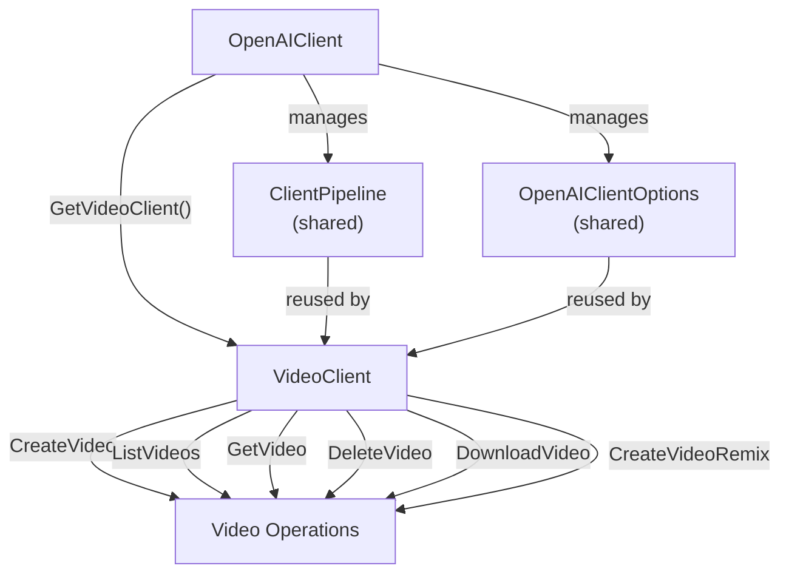
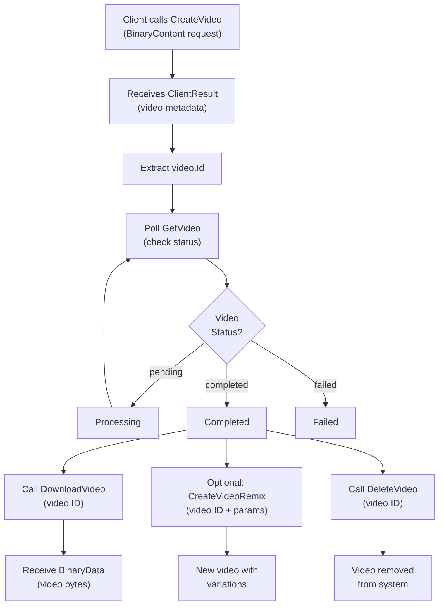
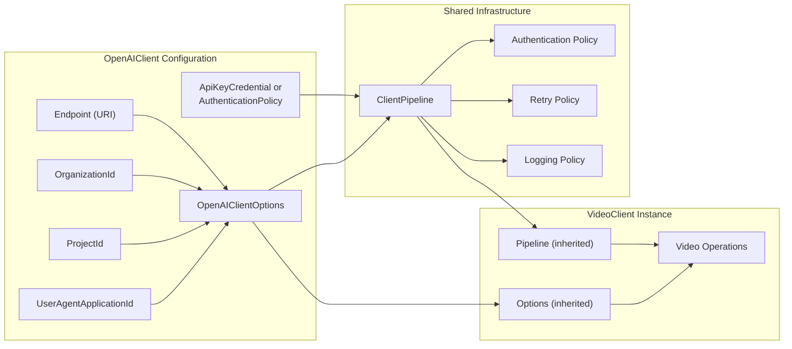
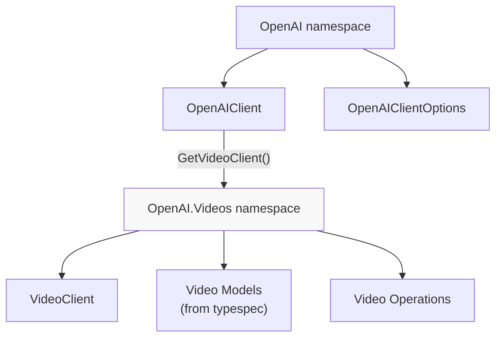
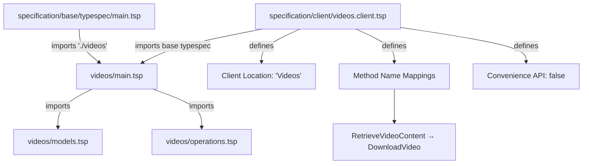

<!-- source: DeepWiki mcp.deepwiki.com · repo openai/openai-dotnet · page 4.13 Video Client · fetched 2026-10-26 -->

# Video Client

<details>
<summary>Relevant source files</summary>

The following files were used as context for generating this wiki page:

- [api/OpenAI.net8.0.cs](api/OpenAI.net8.0.cs)
- [api/OpenAI.netstandard2.0.cs](api/OpenAI.netstandard2.0.cs)
- [specification/base/typespec/common/models.tsp](specification/base/typespec/common/models.tsp)
- [specification/base/typespec/main.tsp](specification/base/typespec/main.tsp)
- [specification/base/typespec/videos/main.tsp](specification/base/typespec/videos/main.tsp)
- [specification/client/videos.client.tsp](specification/client/videos.client.tsp)
- [src/Custom/OpenAIClient.cs](src/Custom/OpenAIClient.cs)
- [src/Custom/OpenAIClientOptions.cs](src/Custom/OpenAIClientOptions.cs)
- [src/Generated/Models/Chat/ChatReasoningEffortLevel.cs](src/Generated/Models/Chat/ChatReasoningEffortLevel.cs)
- [src/Generated/Models/OpenAIContext.cs](src/Generated/Models/OpenAIContext.cs)
- [src/Generated/Models/Responses/ResponseReasoningEffortLevel.cs](src/Generated/Models/Responses/ResponseReasoningEffortLevel.cs)
- [src/Generated/OpenAIModelFactory.cs](src/Generated/OpenAIModelFactory.cs)
- [tests/Responses/ResponsesTests.cs](tests/Responses/ResponsesTests.cs)
- [tspCodeModel.json](tspCodeModel.json)

</details>


## Purpose and Scope

The `VideoClient` provides access to OpenAI's video generation and content management operations. This client is part of the experimental API surface and enables video creation, remixing, retrieval, and deletion operations. The Video Client is obtained from the central `OpenAIClient` factory and operates within the `OpenAI.Videos` namespace.

For information about other media generation capabilities, see:
- Image generation: [Images Client](#4.6)
- Audio generation: [Audio Client](#4.5)

**Sources:** [api/OpenAI.net8.0.cs:1-56](), [specification/client/videos.client.tsp:1-27]()

---

## Experimental Status

The `VideoClient` is marked as experimental with the `OPENAI001` diagnostic ID. This indicates that the API surface is subject to breaking changes in future releases, as the video generation capabilities evolve. Users should be prepared for potential modifications to method signatures, response models, and operational behavior.

```csharp
[Experimental("OPENAI001")]
public virtual VideoClient GetVideoClient();
```

**Sources:** [api/OpenAI.net8.0.cs:42-43]()

---

## Obtaining a VideoClient

The `VideoClient` is obtained through the `OpenAIClient` factory using the `GetVideoClient()` method. Unlike model-specific clients such as `ChatClient` or `AudioClient`, the `VideoClient` does not require a model parameter at instantiation, as video model selection is handled at the operation level.

### VideoClient Factory Pattern



**Example Usage:**

```csharp
OpenAIClient client = new OpenAIClient(apiKey);
VideoClient videoClient = client.GetVideoClient();

// The videoClient now shares the same authentication,
// endpoint configuration, and pipeline as the parent OpenAIClient
```

**Sources:** [src/Custom/OpenAIClient.cs:18-19,84-165](), [api/OpenAI.net8.0.cs:42-43]()

---

## Core Operations

The `VideoClient` supports six primary operations for managing video content. These operations follow the protocol method pattern, requiring direct construction of request objects and handling of response primitives.

### Operation Categories

| Operation | Purpose | Typespec Name | C# Method Name |
|-----------|---------|---------------|----------------|
| Create | Generate a new video | `createVideo` | `CreateVideo` (protocol) |
| List | Retrieve multiple videos | `ListVideos` | `ListVideos` (protocol) |
| Get | Retrieve a single video by ID | `GetVideo` | `GetVideo` (protocol) |
| Download | Get video content bytes | `RetrieveVideoContent` | `DownloadVideo` (protocol) |
| Delete | Remove a video | `DeleteVideo` | `DeleteVideo` (protocol) |
| Remix | Create variation of existing video | `CreateVideoRemix` | `CreateVideoRemix` (protocol) |

**Sources:** [specification/client/videos.client.tsp:10-26]()

---

## Protocol-Only Methods

The Video Client operations are intentionally generated as protocol methods only, without convenience method overloads. This design choice is indicated in the typespec specifications through the `@@convenientAPI` decorator set to `false`.

```typescript
// From videos.client.tsp
@@convenientAPI(ListVideos, false);
@@convenientAPI(createVideo, false);
@@convenientAPI(DeleteVideo, false);
@@convenientAPI(GetVideo, false);
@@convenientAPI(RetrieveVideoContent, false);
@@convenientAPI(CreateVideoRemix, false);
```

This means all operations require:
1. Constructing `BinaryContent` request bodies manually
2. Using `RequestOptions` for customization
3. Handling `ClientResult` responses directly
4. Deserializing response content using `ModelReaderWriter` or similar mechanisms

**Sources:** [specification/client/videos.client.tsp:18-23]()

---

## Video Lifecycle Workflow

The following diagram illustrates a typical workflow for creating, managing, and consuming video content through the Video Client.

### Video Content Management Flow



**Sources:** [specification/client/videos.client.tsp:10-15]()

---

## Client Configuration and Pipeline

The `VideoClient` inherits its configuration from the parent `OpenAIClient`, including authentication, endpoint settings, and HTTP pipeline configuration. The client is instantiated through the factory method pattern and does not maintain singleton instances.

### Configuration Inheritance



**Sources:** [src/Custom/OpenAIClient.cs:84-165](), [src/Custom/OpenAIClientOptions.cs:1-75]()

---

## Namespace and Type Organization

The Video Client resides in the `OpenAI.Videos` namespace, separate from the core `OpenAI` namespace. This organizational structure groups video-specific types, models, and operations together.



**Sources:** [src/Custom/OpenAIClient.cs:18-19](), [src/Generated/Models/OpenAIContext.cs:25]()

---

## TypeSpec Specification Structure

The Video Client's specification is organized across multiple TypeSpec files that define models and operations, which are then processed by the code generation system to produce the C# client implementation.

### Specification File Structure



**Sources:** [specification/base/typespec/main.tsp:23](), [specification/base/typespec/videos/main.tsp:1-3](), [specification/client/videos.client.tsp:1-27]()

---

## Generated Code Organization

The code generator processes the TypeSpec specifications and produces generated code in the `src/Generated/` directory. The Video Client's generated types are registered in the `OpenAIContext` class for serialization and deserialization support.

**Registration Pattern:**

The `OpenAIContext` class includes `[ModelReaderWriterBuildable]` attributes for all video-related types, enabling proper JSON serialization/deserialization through the `ModelReaderWriter` infrastructure.

**Sources:** [src/Generated/Models/OpenAIContext.cs:1-26](), [src/Generated/OpenAIModelFactory.cs:1-26]()

---

## Integration with OpenAIClient Factory

The `VideoClient` follows the same factory pattern used by other specialized clients. The `OpenAIClient` class suppresses the generated cached client fields and provides new instances on each call to `GetVideoClient()`.

```csharp
// From OpenAIClient.cs - suppressed patterns
[CodeGenSuppress("_cachedVideoClient")]
[CodeGenSuppress("GetVideoClient")]
```

This design allows:
- Multiple `VideoClient` instances if needed
- Independent lifecycle management
- Consistent configuration inheritance
- No shared state between client instances

**Sources:** [src/Custom/OpenAIClient.cs:56,79]()

---

## Summary

The `VideoClient` provides protocol-level access to OpenAI's video generation and management operations through an experimental API surface. Key characteristics include:

| Aspect | Details |
|--------|---------|
| **Namespace** | `OpenAI.Videos` |
| **Experimental** | Yes (`OPENAI001`) |
| **Factory Method** | `OpenAIClient.GetVideoClient()` |
| **Method Style** | Protocol methods only (no convenience overloads) |
| **Operations** | Create, List, Get, Download, Delete, Remix |
| **Configuration** | Inherited from parent `OpenAIClient` |
| **Instance Model** | Non-singleton (new instance per call) |

Users working with video content should be prepared for the protocol method pattern, requiring manual request construction and response handling, and should account for potential API changes due to the experimental status.

**Sources:** [api/OpenAI.net8.0.cs:1-56](), [specification/client/videos.client.tsp:1-27](), [src/Custom/OpenAIClient.cs:1-333]()

---

