<!-- source: DeepWiki mcp.deepwiki.com · repo openai/openai-dotnet · page 4.3 Responses API Client · fetched 2026-10-26 -->

# Responses API Client

<details>
<summary>Relevant source files</summary>

The following files were used as context for generating this wiki page:

- [CHANGELOG.md](CHANGELOG.md)
- [api/OpenAI.net8.0.cs](api/OpenAI.net8.0.cs)
- [api/OpenAI.netstandard2.0.cs](api/OpenAI.netstandard2.0.cs)
- [scripts/Test-ApiCompatibility.ps1](scripts/Test-ApiCompatibility.ps1)
- [specification/base/typespec/responses/operations.tsp](specification/base/typespec/responses/operations.tsp)
- [src/Custom/Responses/IncludedResponseProperty.cs](src/Custom/Responses/IncludedResponseProperty.cs)
- [src/Generated/Models/OpenAIContext.cs](src/Generated/Models/OpenAIContext.cs)
- [src/Generated/Models/Responses/IncludedResponseProperty.cs](src/Generated/Models/Responses/IncludedResponseProperty.cs)
- [src/Generated/OpenAIModelFactory.cs](src/Generated/OpenAIModelFactory.cs)
- [src/OpenAI.csproj](src/OpenAI.csproj)
- [tests/Responses/ResponsesTests.cs](tests/Responses/ResponsesTests.cs)
- [tests/SessionRecords/ResponsesTests/WebSearchCallStreaming.json](tests/SessionRecords/ResponsesTests/WebSearchCallStreaming.json)
- [tests/SessionRecords/ResponsesTests/WebSearchCallStreamingAsync.json](tests/SessionRecords/ResponsesTests/WebSearchCallStreamingAsync.json)
- [tspCodeModel.json](tspCodeModel.json)

</details>


The `ResponsesClient` provides access to OpenAI's Responses API, which enables complex multi-turn interactions with advanced tool execution, background processing, and reasoning capabilities. This client supports stateful conversations, parallel tool calls, and integration with external systems through the Model Context Protocol (MCP).

**Scope**: This page covers the `ResponsesClient` class and the Responses API domain models. For basic chat completions without persistent state, see [Chat Client](#4.2). For persistent assistant threads with file storage, see [Assistants Client](#4.4).

**Experimental Status**: The Responses API is marked with `[Experimental("OPENAI001")]` and may introduce breaking changes in future releases.

---

## Client Instantiation

### Factory Pattern

The `ResponsesClient` is obtained from the `OpenAIClient` factory by calling `GetResponsesClient(string model)`:

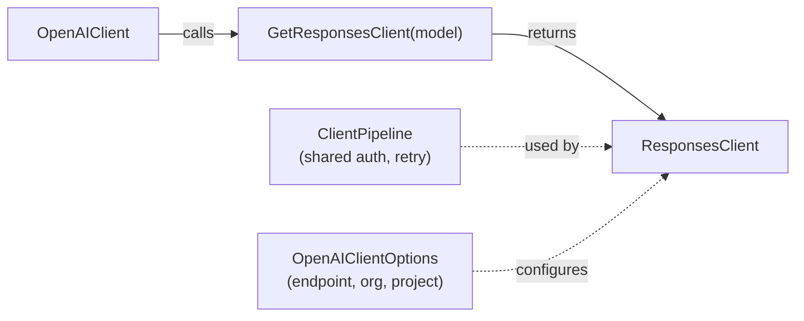

**Sources**: [api/OpenAI.netstandard2.0.cs:27](), [api/OpenAI.net8.0.cs:39]()

### Constructor Patterns

The client supports multiple authentication patterns:

| Constructor | Purpose |
|-------------|---------|
| `ResponsesClient(string apiKey)` | Direct API key authentication |
| `ResponsesClient(ApiKeyCredential credential)` | Credential-based authentication |
| `ResponsesClient(AuthenticationPolicy policy)` | Custom authentication policy |
| `ResponsesClient(ClientPipeline pipeline, OpenAIClientOptions options)` | Full control over HTTP pipeline |

**Sources**: [api/OpenAI.netstandard2.0.cs:1950-1957]()

### Model Property

The `ResponsesClient` exposes a `Model` property that returns the model identifier configured during instantiation:

```csharp
ResponsesClient client = openAIClient.GetResponsesClient("gpt-4o-mini");
string model = client.Model; // "gpt-4o-mini"
```

**Sources**: [api/OpenAI.netstandard2.0.cs:1949](), [CHANGELOG.md:136]()

---

## Core Operations

### Operation Method Map

```mermaid
graph TD
    ResponsesClient["ResponsesClient"]
    
    subgraph "Synchronous Methods"
        CreateResponse["CreateResponse<br/>(CreateResponseOptions)"]
        CreateResponseStreaming["CreateResponseStreaming<br/>(CreateResponseOptions)"]
        GetResponse["GetResponse<br/>(responseId)"]
        CancelResponse["CancelResponse<br/>(responseId)"]
        DeleteResponse["DeleteResponse<br/>(responseId)"]
        GetInputItems["GetResponseInputItems<br/>(responseId)"]
    end
    
    subgraph "Asynchronous Methods"
        CreateResponseAsync["CreateResponseAsync"]
        CreateResponseStreamingAsync["CreateResponseStreamingAsync"]
        GetResponseAsync["GetResponseAsync"]
        CancelResponseAsync["CancelResponseAsync"]
        DeleteResponseAsync["DeleteResponseAsync"]
        GetInputItemsAsync["GetResponseInputItemsAsync"]
    end
    
    ResponsesClient --> CreateResponse
    ResponsesClient --> CreateResponseAsync
    ResponsesClient --> CreateResponseStreaming
    ResponsesClient --> CreateResponseStreamingAsync
    ResponsesClient --> GetResponse
    ResponsesClient --> GetResponseAsync
    ResponsesClient --> CancelResponse
    ResponsesClient --> CancelResponseAsync
    ResponsesClient --> DeleteResponse
    ResponsesClient --> DeleteResponseAsync
    ResponsesClient --> GetInputItems
    ResponsesClient --> GetInputItemsAsync
```

**Sources**: [api/OpenAI.netstandard2.0.cs:1959-1997](), [specification/base/typespec/responses/operations.tsp:15-94]()

### CreateResponse Operations

Creates a new response with the specified configuration:

| Method | Return Type | Description |
|--------|-------------|-------------|
| `CreateResponse` | `ClientResult<ResponseResult>` | Synchronous non-streaming |
| `CreateResponseAsync` | `Task<ClientResult<ResponseResult>>` | Asynchronous non-streaming |
| `CreateResponseStreaming` | `AsyncCollectionResult<StreamingResponseUpdate>` | Synchronous streaming |
| `CreateResponseStreamingAsync` | `AsyncCollectionResult<StreamingResponseUpdate>` | Asynchronous streaming |

The streaming methods require `StreamingEnabled = true` in `CreateResponseOptions`.

**Sources**: [api/OpenAI.netstandard2.0.cs:1959-1966](), [CHANGELOG.md:26]()

### GetResponse Operations

Retrieves an existing response by ID, with optional streaming support:

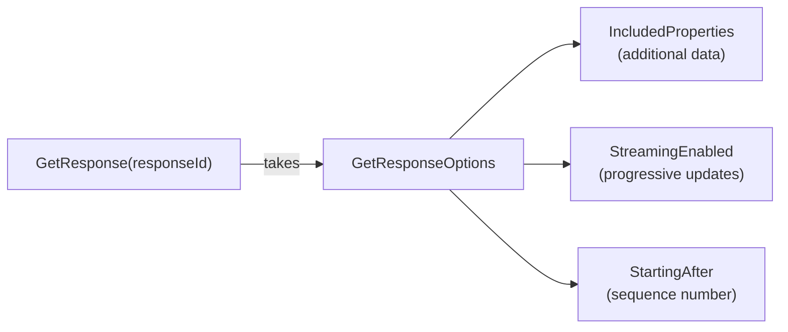

**Sources**: [api/OpenAI.netstandard2.0.cs:1969-1972](), [specification/base/typespec/responses/operations.tsp:34-52]()

### Lifecycle Management

| Method | Purpose | Return Type |
|--------|---------|-------------|
| `CancelResponse` | Stops an in-progress response | `ClientResult<ResponseResult>` |
| `DeleteResponse` | Permanently removes a response | `ClientResult<ResponseDeletionResult>` |

**Sources**: [api/OpenAI.netstandard2.0.cs:1973-1980](), [specification/base/typespec/responses/operations.tsp:54-76]()

---

## Request Configuration

### CreateResponseOptions Class Hierarchy

```mermaid
graph TD
    CreateResponseOptions["CreateResponseOptions"]
    
    subgraph "Input Configuration"
        InputItems["InputItems<br/>IList&lt;ResponseItem&gt;"]
        PreviousResponseId["PreviousResponseId<br/>(multi-turn)"]
        ConversationOptions["ConversationOptions<br/>(state management)"]
    end
    
    subgraph "Model Configuration"
        Instructions["Instructions<br/>(system behavior)"]
        Temperature["Temperature"]
        TopP["TopP"]
        MaxOutputTokens["MaxOutputTokens"]
    end
    
    subgraph "Tool Configuration"
        Tools["Tools<br/>IList&lt;ResponseTool&gt;"]
        ToolChoice["ToolChoice<br/>ResponseToolChoice"]
        ParallelToolCalls["ParallelToolCallsEnabled"]
        MaxToolCallCount["MaxToolCallCount"]
    end
    
    subgraph "Output Configuration"
        StreamingEnabled["StreamingEnabled"]
        IncludedProperties["IncludedProperties<br/>(extra data)"]
        TopLogProbabilityCount["TopLogProbabilityCount"]
        TextVerbosity["TextVerbosity"]
    end
    
    CreateResponseOptions --> InputItems
    CreateResponseOptions --> PreviousResponseId
    CreateResponseOptions --> ConversationOptions
    CreateResponseOptions --> Instructions
    CreateResponseOptions --> Temperature
    CreateResponseOptions --> TopP
    CreateResponseOptions --> MaxOutputTokens
    CreateResponseOptions --> Tools
    CreateResponseOptions --> ToolChoice
    CreateResponseOptions --> ParallelToolCalls
    CreateResponseOptions --> MaxToolCallCount
    CreateResponseOptions --> StreamingEnabled
    CreateResponseOptions --> IncludedProperties
    CreateResponseOptions --> TopLogProbabilityCount
    CreateResponseOptions --> TextVerbosity
```

**Sources**: [api/OpenAI.netstandard2.0.cs:1998-2070](), [CHANGELOG.md:11-16]()

### Key Properties

| Property | Type | Purpose |
|----------|------|---------|
| `InputItems` | `IList<ResponseItem>` | Input messages, tool outputs, etc. |
| `PreviousResponseId` | `string` | Links to previous response for multi-turn |
| `ConversationOptions` | `ConversationOptions` | Automatic state management |
| `Instructions` | `string` | System-level behavior instructions |
| `Tools` | `IList<ResponseTool>` | Available tools for execution |
| `ToolChoice` | `ResponseToolChoice` | Tool selection strategy |
| `StreamingEnabled` | `bool` | Enable progressive streaming |
| `BackgroundModeEnabled` | `bool` | Allow background processing |
| `MaxToolCallCount` | `int?` | Limit total built-in tool calls |
| `IncludedProperties` | `IList<IncludedResponseProperty>` | Additional output data |

**Sources**: [api/OpenAI.netstandard2.0.cs:1998-2070](), [CHANGELOG.md:11-16]()

### ConversationOptions

Introduced in version 2.8.0, `ConversationOptions` enables automatic state management across multi-turn interactions:

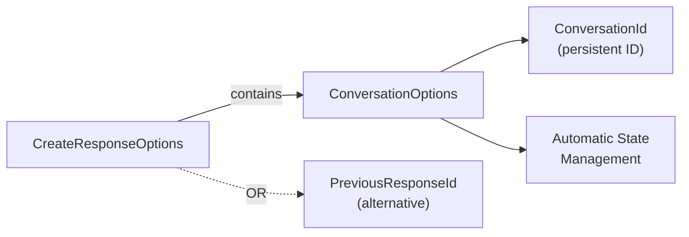

Using `ConversationOptions` eliminates the need to manually chain responses via `PreviousResponseId`.

**Sources**: [CHANGELOG.md:11](), [api/OpenAI.netstandard2.0.cs:2019]()

---

## Response Items

### Response Item Type Hierarchy

```mermaid
graph TD
    ResponseItem["ResponseItem<br/>(abstract base)"]
    
    subgraph "Input Items"
        UserMessage["MessageResponseItem<br/>(role: user)"]
        AssistantMessage["MessageResponseItem<br/>(role: assistant)"]
        SystemMessage["MessageResponseItem<br/>(role: system)"]
        DeveloperMessage["MessageResponseItem<br/>(role: developer)"]
        FunctionOutput["FunctionCallOutputResponseItem"]
        ComputerOutput["ComputerCallOutputResponseItem"]
    end
    
    subgraph "Output Items"
        ResponseMessage["MessageResponseItem<br/>(assistant output)"]
        FunctionCall["FunctionCallResponseItem"]
        FileSearchCall["FileSearchCallResponseItem"]
        WebSearchCall["WebSearchCallResponseItem"]
        ComputerCall["ComputerCallResponseItem"]
        CodeInterpreterCall["CodeInterpreterCallResponseItem"]
        ImageGenerationCall["ImageGenerationCallResponseItem"]
        Reasoning["ReasoningResponseItem"]
    end
    
    ResponseItem --> UserMessage
    ResponseItem --> AssistantMessage
    ResponseItem --> SystemMessage
    ResponseItem --> DeveloperMessage
    ResponseItem --> FunctionOutput
    ResponseItem --> ComputerOutput
    ResponseItem --> ResponseMessage
    ResponseItem --> FunctionCall
    ResponseItem --> FileSearchCall
    ResponseItem --> WebSearchCall
    ResponseItem --> ComputerCall
    ResponseItem --> CodeInterpreterCall
    ResponseItem --> ImageGenerationCall
    ResponseItem --> Reasoning
```

**Sources**: [api/OpenAI.netstandard2.0.cs:2071-2205]()

### Factory Methods

`ResponseItem` provides static factory methods for creating input items:

| Factory Method | Creates | Purpose |
|----------------|---------|---------|
| `CreateUserMessageItem` | `MessageResponseItem` | User input message |
| `CreateAssistantMessageItem` | `MessageResponseItem` | Assistant message |
| `CreateSystemMessageItem` | `MessageResponseItem` | System instructions |
| `CreateDeveloperMessageItem` | `MessageResponseItem` | Developer guidance |
| `CreateFunctionCallOutputItem` | `FunctionCallOutputResponseItem` | Function execution result |
| `CreateComputerCallOutputItem` | `ComputerCallOutputResponseItem` | Computer use result |

**Sources**: [api/OpenAI.netstandard2.0.cs:2071-2089]()

### MessageResponseItem Content

Message items contain `ResponseContentPart` objects:

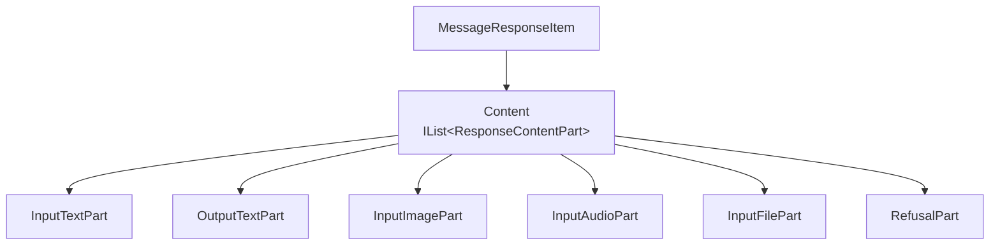

**Sources**: [api/OpenAI.netstandard2.0.cs:2154-2161]()

---

## Tool System

### Tool Type Architecture

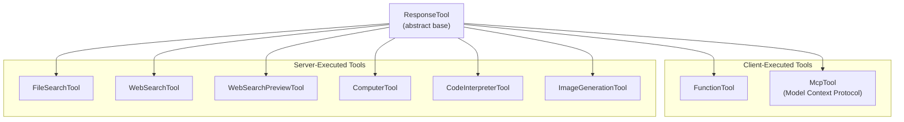

**Sources**: [api/OpenAI.netstandard2.0.cs:2206-2318]()

### FunctionTool Configuration

For custom function execution:

| Property | Type | Purpose |
|----------|------|---------|
| `FunctionName` | `string` | Unique function identifier |
| `Description` | `string` | Natural language description |
| `Parameters` | `BinaryData` | JSON schema for parameters |
| `StrictSchemaEnabled` | `bool?` | Enforce strict validation |

**Factory Method**: `ResponseTool.CreateFunctionTool(functionName, description, parameters, strictModeEnabled)`

**Sources**: [api/OpenAI.netstandard2.0.cs:2207-2211](), [tests/Responses/ResponsesTests.cs:366-381]()

### WebSearchTool Configuration

Enables internet search with location context:

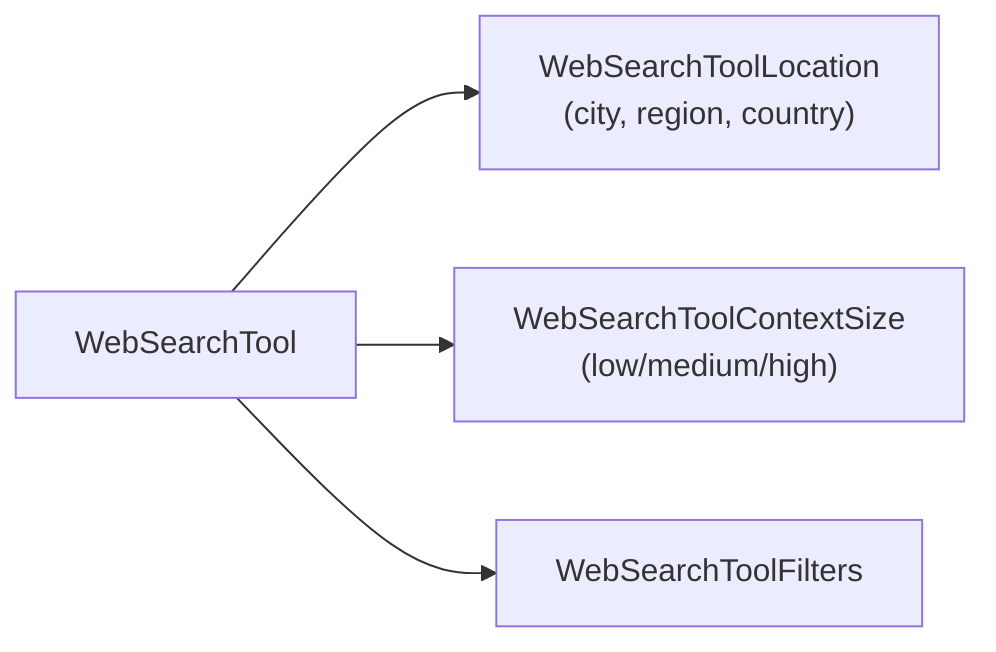

**Factory Method**: `ResponseTool.CreateWebSearchTool(userLocation, searchContextSize, filters)`

**Sources**: [api/OpenAI.netstandard2.0.cs:2234-2239](), [tests/Responses/ResponsesTests.cs:143-151]()

### McpTool Configuration

Integrates with Model Context Protocol servers:

| Property | Type | Purpose |
|----------|------|---------|
| `ServerLabel` | `string` | MCP server identifier |
| `ServerUri` | `Uri` | Server endpoint |
| `AllowedTools` | `IList<string>` | Tool whitelist |
| `ToolCallApprovalPolicy` | `McpToolCallApprovalPolicy` | Approval requirements |
| `AuthorizationToken` | `string` | Authentication token |
| `ConnectorId` | `string` | OpenAI connector ID |

**Sources**: [api/OpenAI.netstandard2.0.cs:2273-2301](), [CHANGELOG.md:138-141]()

### ComputerTool Configuration

Enables UI automation with screenshot feedback:

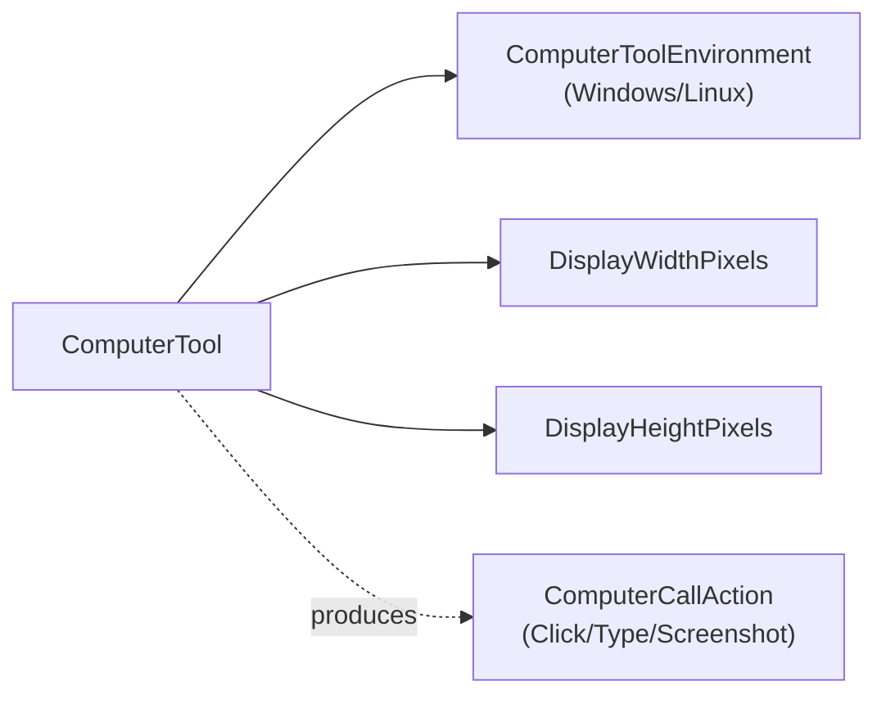

**Factory Method**: `ResponseTool.CreateComputerTool(environment, displayWidthPixels, displayHeightPixels)`

**Sources**: [api/OpenAI.netstandard2.0.cs:2212-2217](), [tests/Responses/ResponsesTests.cs:77-136]()

---

## Streaming

### Streaming Update Type System

```mermaid
graph TD
    StreamingResponseUpdate["StreamingResponseUpdate<br/>(base class)"]
    
    subgraph "Response Lifecycle"
        Created["ResponseCreatedUpdate"]
        InProgress["ResponseInProgressUpdate"]
        Completed["ResponseCompletedUpdate"]
        Failed["ResponseFailedUpdate"]
        Cancelled["ResponseCancelledUpdate"]
    end
    
    subgraph "Output Item Events"
        ItemAdded["OutputItemAddedUpdate"]
        ItemDone["OutputItemDoneUpdate"]
    end
    
    subgraph "Content Events"
        ContentPartAdded["ContentPartAddedUpdate"]
        OutputTextDelta["OutputTextDeltaUpdate"]
        OutputTextDone["OutputTextDoneUpdate"]
    end
    
    subgraph "Tool Execution Events"
        FunctionCallArgsUpdate["FunctionCallArgumentsDeltaUpdate"]
        FunctionCallArgsDone["FunctionCallArgumentsDoneUpdate"]
        WebSearchInProgress["WebSearchCallInProgressUpdate"]
        WebSearchSearching["WebSearchCallSearchingUpdate"]
        WebSearchCompleted["WebSearchCallCompletedUpdate"]
    end
    
    subgraph "Reasoning Events"
        ReasoningTextDelta["ReasoningSummaryTextDeltaUpdate"]
        ReasoningTextDone["ReasoningSummaryTextDoneUpdate"]
        ReasoningPartAdded["ReasoningSummaryPartAddedUpdate"]
        ReasoningPartDone["ReasoningSummaryPartDoneUpdate"]
    end
    
    StreamingResponseUpdate --> Created
    StreamingResponseUpdate --> InProgress
    StreamingResponseUpdate --> Completed
    StreamingResponseUpdate --> Failed
    StreamingResponseUpdate --> Cancelled
    StreamingResponseUpdate --> ItemAdded
    StreamingResponseUpdate --> ItemDone
    StreamingResponseUpdate --> ContentPartAdded
    StreamingResponseUpdate --> OutputTextDelta
    StreamingResponseUpdate --> OutputTextDone
    StreamingResponseUpdate --> FunctionCallArgsUpdate
    StreamingResponseUpdate --> FunctionCallArgsDone
    StreamingResponseUpdate --> WebSearchInProgress
    StreamingResponseUpdate --> WebSearchSearching
    StreamingResponseUpdate --> WebSearchCompleted
    StreamingResponseUpdate --> ReasoningTextDelta
    StreamingResponseUpdate --> ReasoningTextDone
    StreamingResponseUpdate --> ReasoningPartAdded
    StreamingResponseUpdate --> ReasoningPartDone
```

**Sources**: [api/OpenAI.netstandard2.0.cs:2329-2581]()

### Streaming Pattern

Basic streaming iteration:

```csharp
CreateResponseOptions options = new(inputItems)
{
    StreamingEnabled = true
};

await foreach (StreamingResponseUpdate update in client.CreateResponseStreamingAsync(options))
{
    if (update is StreamingResponseOutputTextDeltaUpdate textDelta)
    {
        Console.Write(textDelta.Delta);
    }
    else if (update is StreamingResponseCompletedUpdate completed)
    {
        ResponseResult finalResponse = completed.Response;
    }
}
```

**Sources**: [tests/Responses/ResponsesTests.cs:263-288]()

### Background Mode Streaming

When `BackgroundModeEnabled = true`, streaming updates include `SequenceNumber` for ordering:

| Property | Type | Purpose |
|----------|------|---------|
| `SequenceNumber` | `int` | Event ordering identifier |
| `ItemId` | `string` | Associated output item ID |
| `OutputIndex` | `int` | Position in output array |

**Sources**: [api/OpenAI.netstandard2.0.cs:2330](), [CHANGELOG.md:412]()

---

## Multi-turn Conversations

### Chaining Pattern with PreviousResponseId

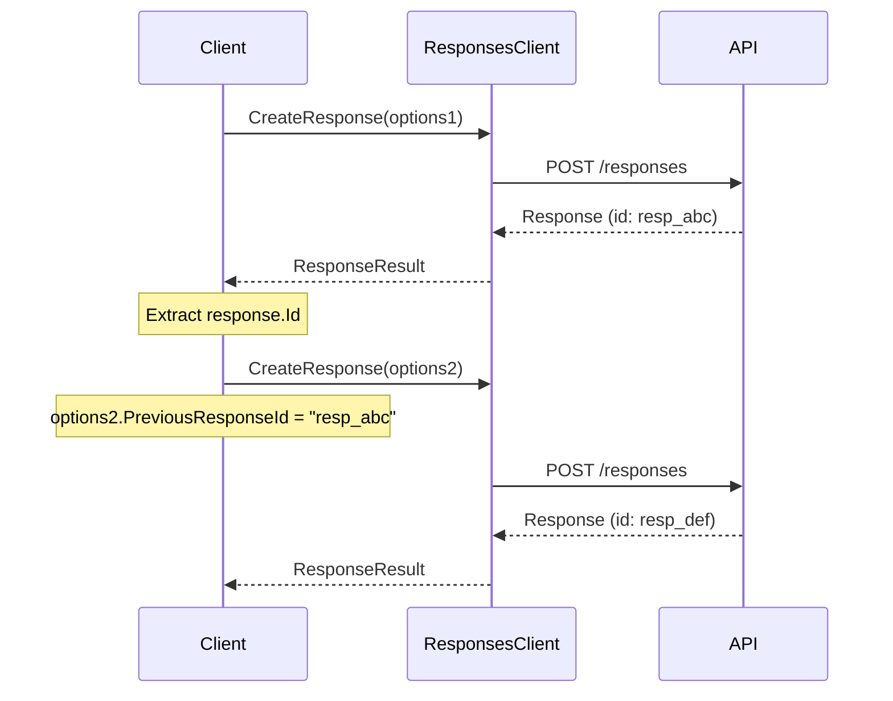

**Sources**: [tests/Responses/ResponsesTests.cs:106-109]()

### Automatic State Management with ConversationOptions

Using `ConversationOptions` eliminates manual response chaining:

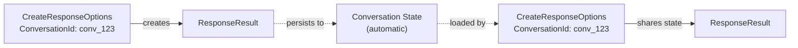

**Sources**: [CHANGELOG.md:11](), [api/OpenAI.netstandard2.0.cs:2019]()

---

## Background Processing

### Background Mode Architecture

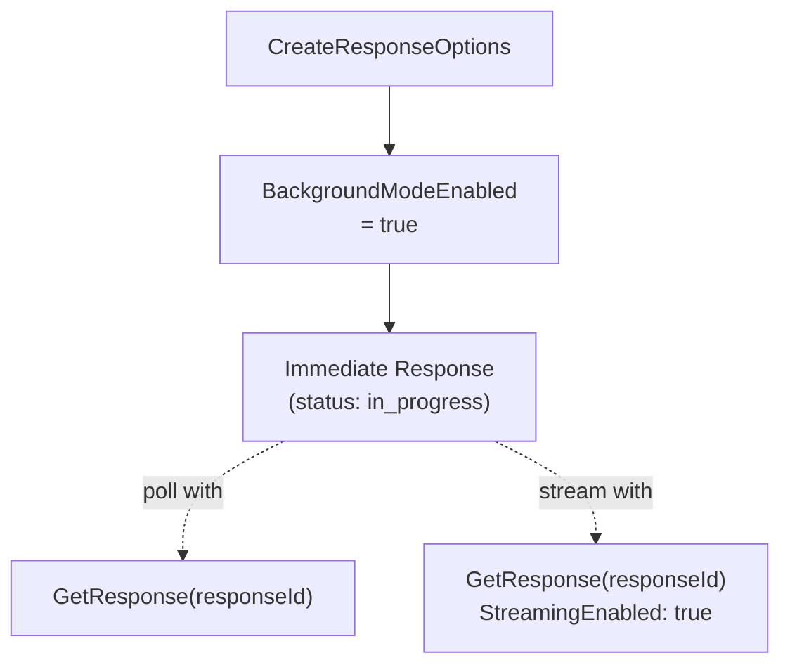

Background mode allows the API to return immediately while processing continues server-side.

**Sources**: [CHANGELOG.md:410](), [api/OpenAI.netstandard2.0.cs:2005]()

### Response Status Lifecycle

| Status | Description |
|--------|-------------|
| `InProgress` | Response is being generated |
| `Completed` | Successfully finished |
| `Failed` | Error occurred during processing |
| `Cancelled` | Cancelled via `CancelResponse` |
| `Expired` | Timed out or retention expired |

**Sources**: [api/OpenAI.netstandard2.0.cs:2600-2616]()

---

## ResponseResult Structure

### Response Result Property Map

```mermaid
graph TD
    ResponseResult["ResponseResult"]
    
    subgraph "Identity"
        Id["Id<br/>(resp_xxx)"]
        CreatedAt["CreatedAt<br/>(DateTimeOffset)"]
        Model["Model<br/>(string)"]
    end
    
    subgraph "Status"
        Status["Status<br/>(ResponseStatus)"]
        Error["Error<br/>(ResponseError)"]
        IncompleteDetails["IncompleteDetails"]
    end
    
    subgraph "Output"
        OutputItems["OutputItems<br/>IList&lt;ResponseItem&gt;"]
        Usage["Usage<br/>ResponseTokenUsage"]
    end
    
    subgraph "Configuration Echo"
        Instructions["Instructions"]
        Tools["Tools<br/>IList&lt;ResponseTool&gt;"]
        Temperature["Temperature"]
        TopP["TopP"]
    end
    
    subgraph "Multi-turn"
        PreviousResponseId["PreviousResponseId"]
        ConversationOptions["ConversationOptions"]
    end
    
    ResponseResult --> Id
    ResponseResult --> CreatedAt
    ResponseResult --> Model
    ResponseResult --> Status
    ResponseResult --> Error
    ResponseResult --> IncompleteDetails
    ResponseResult --> OutputItems
    ResponseResult --> Usage
    ResponseResult --> Instructions
    ResponseResult --> Tools
    ResponseResult --> Temperature
    ResponseResult --> TopP
    ResponseResult --> PreviousResponseId
    ResponseResult --> ConversationOptions
```

**Sources**: [api/OpenAI.netstandard2.0.cs:2618-2689]()

### ResponseTokenUsage

Token consumption details:

| Property | Type | Description |
|----------|------|-------------|
| `InputTokenCount` | `int` | Tokens in input |
| `OutputTokenCount` | `int` | Tokens in output |
| `TotalTokenCount` | `int` | Combined total |
| `InputTokenDetails` | `ResponseInputTokenUsageDetails` | Detailed input breakdown |
| `OutputTokenDetails` | `ResponseOutputTokenUsageDetails` | Detailed output breakdown |

**Sources**: [api/OpenAI.netstandard2.0.cs:2784-2790]()

---

## Advanced Features

### IncludedResponseProperty

Request additional data in responses:

| Property | Purpose |
|----------|---------|
| `FileSearchCallResults` | Include search result details |
| `ReasoningEncryptedContent` | Include encrypted reasoning data |
| `CodeInterpreterCallOutputs` | Include code execution outputs |
| `MessageInputImageUri` | Include image URLs |
| `ComputerCallOutputImageUri` | Include screenshot URLs |

**Sources**: [src/Generated/Models/Responses/IncludedResponseProperty.cs:15-33](), [src/Custom/Responses/IncludedResponseProperty.cs:1-13]()

### TopLogProbabilityCount

Request log probabilities for top tokens:

```csharp
CreateResponseOptions options = new(inputItems)
{
    TopLogProbabilityCount = 5 // Return top 5 token probabilities
};
```

**Sources**: [CHANGELOG.md:13](), [api/OpenAI.netstandard2.0.cs:2061]()

### SafetyIdentifier

Specify a stable user identifier for safety monitoring:

```csharp
CreateResponseOptions options = new(inputItems)
{
    SafetyIdentifier = "user_12345"
};
```

**Sources**: [CHANGELOG.md:10](), [api/OpenAI.netstandard2.0.cs:2048]()

### MaxToolCallCount

Limit total built-in tool calls (applies across all tools):

```csharp
CreateResponseOptions options = new(inputItems)
{
    MaxToolCallCount = 10, // Maximum 10 tool calls total
    Tools = { fileSearchTool, webSearchTool }
};
```

**Sources**: [CHANGELOG.md:12](), [api/OpenAI.netstandard2.0.cs:2043]()

---

## Common Usage Patterns

### Basic Response Creation

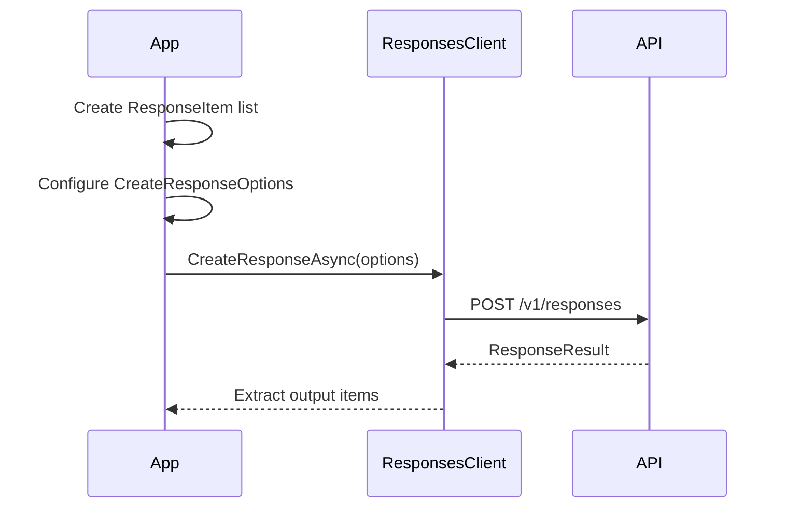

**Sources**: [tests/Responses/ResponsesTests.cs:353-395]()

### Web Search Pattern

Test demonstrates web search with location context:

```csharp
ResponseResult response = await client.CreateResponseAsync(
    new CreateResponseOptions([
        ResponseItem.CreateUserMessageItem("What's the weather like in San Francisco?")
    ])
    {
        Tools =
        {
            ResponseTool.CreateWebSearchTool(
                userLocation: WebSearchToolLocation.CreateApproximateLocation(city: "San Francisco"),
                searchContextSize: WebSearchToolContextSize.Low)
        },
        ToolChoice = ResponseToolChoice.CreateWebSearchChoice()
    });
```

**Sources**: [tests/Responses/ResponsesTests.cs:140-164]()

### Multi-turn with Tool Outputs

Pattern for handling tool calls and providing results:

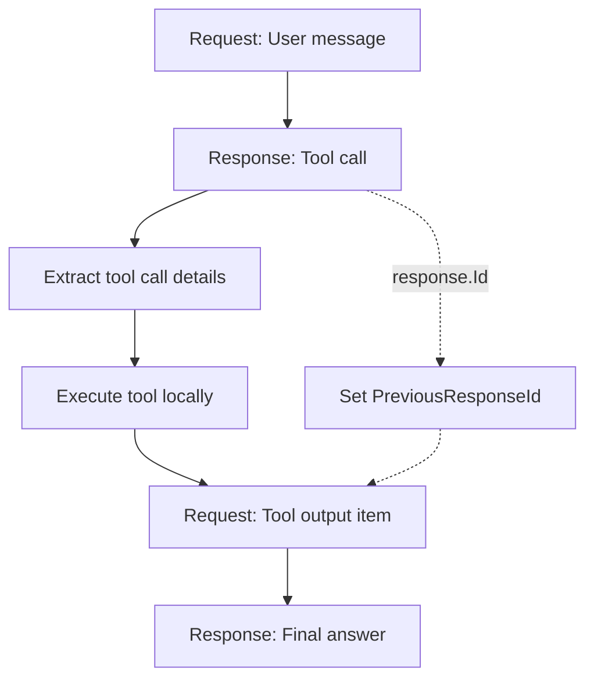

**Sources**: [tests/Responses/ResponsesTests.cs:400-526]()

### Streaming with Web Search

Web search streaming includes distinct lifecycle events:

| Event Type | Purpose |
|------------|---------|
| `WebSearchCallInProgressUpdate` | Search initiated |
| `WebSearchCallSearchingUpdate` | Search executing |
| `WebSearchCallCompletedUpdate` | Search finished |
| `OutputItemDoneUpdate` | Final search results |

**Sources**: [tests/Responses/ResponsesTests.cs:195-260](), [tests/SessionRecords/ResponsesTests/WebSearchCallStreaming.json:64-76]()

---

## Error Handling

### ResponseError Structure

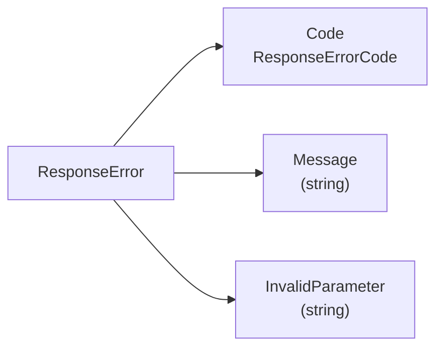

**Sources**: [api/OpenAI.netstandard2.0.cs:2698-2702]()

### ResponseErrorCode Values

| Code | Description |
|------|-------------|
| `InvalidRequest` | Malformed request |
| `RateLimitExceeded` | Too many requests |
| `ServerError` | Internal server error |
| `ContentFilterError` | Content policy violation |

**Sources**: [api/OpenAI.netstandard2.0.cs:2703-2719]()

---

## Protocol Methods

The client provides low-level protocol methods that accept and return `BinaryContent`:

| Method | Purpose |
|--------|---------|
| `CreateResponse(BinaryContent, RequestOptions)` | Raw request/response |
| `GetResponse(string, RequestOptions)` | Retrieve with custom options |
| `GetResponseStreaming(string, RequestOptions)` | Stream with custom options |
| `GetResponseInputItems(string, RequestOptions)` | List input items |

These methods provide full control over request/response payloads when needed.

**Sources**: [api/OpenAI.netstandard2.0.cs:1967-1997]()

---

## Experimental Status

The Responses API is marked `[Experimental("OPENAI001")]` in the .NET 8.0 target and excluded from API compatibility validation. Breaking changes are permitted between releases.

**Sources**: [scripts/Test-ApiCompatibility.ps1:173](), [api/OpenAI.net8.0.cs:38-39]()

---

