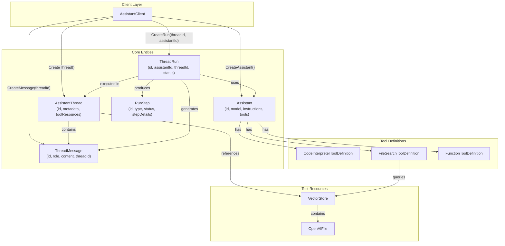
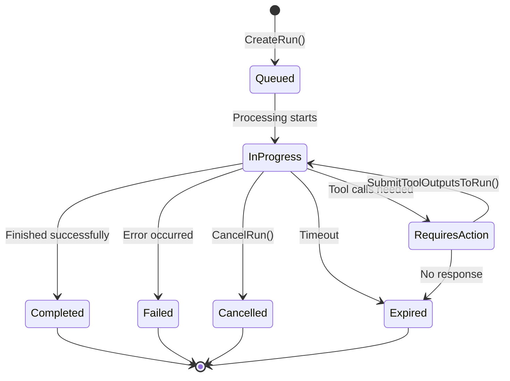
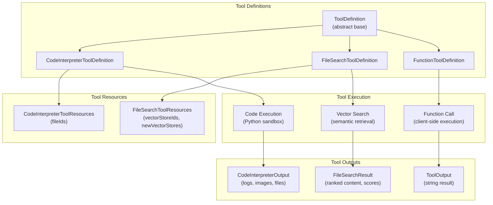

<!-- source: DeepWiki mcp.deepwiki.com · repo openai/openai-dotnet · page 4.4 Assistants Client · fetched 2026-10-26 -->

# Assistants Client

<details>
<summary>Relevant source files</summary>

The following files were used as context for generating this wiki page:

- [README.md](README.md)
- [api/OpenAI.net8.0.cs](api/OpenAI.net8.0.cs)
- [api/OpenAI.netstandard2.0.cs](api/OpenAI.netstandard2.0.cs)
- [examples/Assistants/Example01_RetrievalAugmentedGeneration.cs](examples/Assistants/Example01_RetrievalAugmentedGeneration.cs)
- [examples/Assistants/Example01_RetrievalAugmentedGenerationAsync.cs](examples/Assistants/Example01_RetrievalAugmentedGenerationAsync.cs)
- [examples/Assistants/Example05_AssistantsWithVision.cs](examples/Assistants/Example05_AssistantsWithVision.cs)
- [examples/Assistants/Example05_AssistantsWithVisionAsync.cs](examples/Assistants/Example05_AssistantsWithVisionAsync.cs)
- [examples/Chat/Example02_SimpleChatStreaming.cs](examples/Chat/Example02_SimpleChatStreaming.cs)
- [examples/Chat/Example02_SimpleChatStreamingAsync.cs](examples/Chat/Example02_SimpleChatStreamingAsync.cs)
- [examples/Chat/Example03_FunctionCalling.cs](examples/Chat/Example03_FunctionCalling.cs)
- [examples/Chat/Example06_StructuredOutputs.cs](examples/Chat/Example06_StructuredOutputs.cs)
- [examples/Chat/Example06_StructuredOutputsAsync.cs](examples/Chat/Example06_StructuredOutputsAsync.cs)
- [src/Generated/Models/OpenAIContext.cs](src/Generated/Models/OpenAIContext.cs)
- [src/Generated/OpenAIModelFactory.cs](src/Generated/OpenAIModelFactory.cs)
- [tests/Assistants/Assistants.VectorStoresTests.cs](tests/Assistants/Assistants.VectorStoresTests.cs)
- [tests/Assistants/AssistantsTests.cs](tests/Assistants/AssistantsTests.cs)
- [tests/Responses/ResponsesTests.cs](tests/Responses/ResponsesTests.cs)
- [tests/SessionRecords/ResponsesToolTests/ImageGenToolInputMaskWithFileId.json](tests/SessionRecords/ResponsesToolTests/ImageGenToolInputMaskWithFileId.json)
- [tests/SessionRecords/ResponsesToolTests/ImageGenToolInputMaskWithFileIdAsync.json](tests/SessionRecords/ResponsesToolTests/ImageGenToolInputMaskWithFileIdAsync.json)
- [tests/SessionRecords/ResponsesToolTests/ImageGenToolInputMaskWithImageUri.json](tests/SessionRecords/ResponsesToolTests/ImageGenToolInputMaskWithImageUri.json)
- [tests/SessionRecords/ResponsesToolTests/ImageGenToolInputMaskWithImageUriAsync.json](tests/SessionRecords/ResponsesToolTests/ImageGenToolInputMaskWithImageUriAsync.json)
- [tests/Telemetry/ChatTelemetryTests.cs](tests/Telemetry/ChatTelemetryTests.cs)
- [tspCodeModel.json](tspCodeModel.json)

</details>


The `AssistantClient` provides access to OpenAI's Assistants API, enabling creation of persistent AI assistants with stateful, multi-turn conversations. Unlike the stateless ChatClient (see [4.2](#4.2)), assistants maintain conversation history in threads and support advanced capabilities including retrieval-augmented generation (RAG) with vector stores, code execution, and multi-step reasoning.

**Experimental Status**: The Assistants API is marked as experimental (`[Experimental("OPENAI001")]`) and may introduce breaking changes between releases. For stable, stateless chat interactions, see [ChatClient](#4.2). For the newer Responses API with similar multi-turn capabilities, see [ResponsesClient](#4.3).

Sources: [api/OpenAI.net8.0.cs:15-16](), [api/OpenAI.net8.0.cs:78-186](), [README.md:98]()

## Client Instantiation

The `AssistantClient` can be instantiated directly or obtained from `OpenAIClient`:

**Direct instantiation:**
```csharp
AssistantClient client = new("your-api-key");
```

**Via OpenAIClient factory:**
```csharp
OpenAIClient openAIClient = new("your-api-key");
AssistantClient assistantClient = openAIClient.GetAssistantClient();
```

The client constructor accepts `ApiKeyCredential`, `AuthenticationPolicy`, or a raw string API key. It also supports `OpenAIClientOptions` for custom endpoints and configuration.

Sources: [api/OpenAI.net8.0.cs:81-86](), [examples/Assistants/Example01_RetrievalAugmentedGeneration.cs:20-22]()

## Core Entity Relationships



**Entity Lifecycle and Relationships**

Sources: [api/OpenAI.net8.0.cs:59-77](), [api/OpenAI.net8.0.cs:287-297](), [api/OpenAI.net8.0.cs:571-690]()

## Assistant Management

### Creating Assistants

Assistants are created with a model identifier and optional configuration:

```csharp
Assistant assistant = await client.CreateAssistantAsync(
    "gpt-4o",
    new AssistantCreationOptions()
    {
        Name = "Sales Data Assistant",
        Instructions = "You are a helpful assistant for analyzing sales data.",
        Tools =
        {
            new FileSearchToolDefinition(),
            new CodeInterpreterToolDefinition()
        },
        Metadata = { ["department"] = "sales" }
    });
```

**Key Properties:**
- `Model`: The model identifier (e.g., "gpt-4o", "gpt-4o-mini")
- `Instructions`: System-level instructions for the assistant's behavior
- `Name`: Optional display name
- `Description`: Optional description
- `Tools`: List of `ToolDefinition` instances (file search, code interpreter, functions)
- `ToolResources`: Resources like vector stores for file search
- `Temperature` / `NucleusSamplingFactor`: Sampling parameters
- `ResponseFormat`: Output format constraints (text, JSON, JSON schema)
- `Metadata`: Up to 16 key-value pairs for organization

Sources: [api/OpenAI.net8.0.cs:95-97](), [api/OpenAI.net8.0.cs:215-229](), [examples/Assistants/Example01_RetrievalAugmentedGeneration.cs:60-82]()

### Modifying Assistants

Existing assistants can be updated using `ModifyAssistantAsync()`:

```csharp
AssistantModificationOptions options = new()
{
    Name = "Updated Name",
    Instructions = "New instructions",
    Metadata = { ["updated"] = "true" }
};
Assistant updated = await client.ModifyAssistantAsync(assistantId, options);
```

**Note:** Only specified fields are modified; omitted fields retain their original values.

Sources: [api/OpenAI.net8.0.cs:166-169](), [api/OpenAI.net8.0.cs:241-256](), [tests/Assistants/AssistantsTests.cs:92-97]()

### Listing and Retrieving Assistants

```csharp
// Retrieve specific assistant
Assistant assistant = await client.GetAssistantAsync(assistantId);

// List all assistants with pagination
AsyncCollectionResult<Assistant> assistants = client.GetAssistantsAsync(
    new AssistantCollectionOptions()
    {
        Order = AssistantCollectionOrder.Descending,
        PageSizeLimit = 20
    });

await foreach (Assistant a in assistants)
{
    Console.WriteLine($"{a.Id}: {a.Name}");
}
```

Sources: [api/OpenAI.net8.0.cs:131-137](), [api/OpenAI.net8.0.cs:188-197](), [tests/Assistants/AssistantsTests.cs:125-134]()

### Deleting Assistants

```csharp
AssistantDeletionResult result = await client.DeleteAssistantAsync(assistantId);
Console.WriteLine($"Deleted: {result.Deleted}, ID: {result.AssistantId}");
```

Sources: [api/OpenAI.net8.0.cs:119-121](), [api/OpenAI.net8.0.cs:231-239]()

## Thread Management

### Creating Threads

Threads represent conversation sessions. They can be created empty or with initial messages:

```csharp
// Empty thread
AssistantThread thread = await client.CreateThreadAsync();

// Thread with initial messages
ThreadCreationOptions options = new()
{
    InitialMessages =
    {
        "Hello, I need help with sales data.",
        new ThreadInitializationMessage(
            MessageRole.User,
            [
                "Can you analyze this image?",
                MessageContent.FromImageUri(imageUri)
            ])
    },
    Metadata = { ["session"] = "abc123" }
};
AssistantThread thread = await client.CreateThreadAsync(options);
```

Sources: [api/OpenAI.net8.0.cs:108-117](), [tests/Assistants/AssistantsTests.cs:152-162](), [tests/Assistants/AssistantsTests.cs:224-259]()

### Thread Modification and Deletion

```csharp
// Modify metadata
ThreadModificationOptions options = new()
{
    Metadata = { ["status"] = "active" }
};
AssistantThread updated = await client.ModifyThreadAsync(threadId, options);

// Delete thread
ThreadDeletionResult result = await client.DeleteThreadAsync(threadId);
```

Sources: [api/OpenAI.net8.0.cs:176-179](), [api/OpenAI.net8.0.cs:127-129](), [tests/Assistants/AssistantsTests.cs:147-150]()

## Message Management

### Creating Messages

Messages are added to threads and represent user or assistant turns:

```csharp
// Simple text message
ThreadMessage message = await client.CreateMessageAsync(
    threadId,
    MessageRole.User,
    ["What were the sales figures for January?"]);

// Multi-content message with images
ThreadMessage message = await client.CreateMessageAsync(
    threadId,
    MessageRole.User,
    [
        "Compare these two charts:",
        MessageContent.FromImageFileId(fileId1),
        MessageContent.FromImageUri(imageUri)
    ],
    new MessageCreationOptions()
    {
        Attachments =
        {
            new MessageCreationAttachment(
                dataFileId,
                [new FileSearchToolDefinition()])
        }
    });
```

**MessageContent Types:**
- `MessageContent.FromText(string)`: Plain text
- `MessageContent.FromImageFileId(string, MessageImageDetail?)`: Image by file ID
- `MessageContent.FromImageUri(Uri, MessageImageDetail?)`: Image by URL

**MessageImageDetail Values:**
- `Auto`: Let the model choose detail level
- `Low`: Faster, cheaper processing
- `High`: More detailed analysis

Sources: [api/OpenAI.net8.0.cs:98-101](), [api/OpenAI.net8.0.cs:400-407](), [api/OpenAI.net8.0.cs:442-446](), [tests/Assistants/AssistantsTests.cs:181-186](), [tests/Assistants/AssistantsTests.cs:261-286]()

### Listing and Retrieving Messages

```csharp
// Get specific message
ThreadMessage message = await client.GetMessageAsync(threadId, messageId);

// List messages with ordering
MessageCollectionOptions options = new()
{
    Order = MessageCollectionOrder.Ascending,
    PageSizeLimit = 50
};

AsyncCollectionResult<ThreadMessage> messages = 
    client.GetMessagesAsync(threadId, options);

await foreach (ThreadMessage msg in messages)
{
    Console.WriteLine($"[{msg.Role}]: {msg.Content[0].Text}");
}
```

Sources: [api/OpenAI.net8.0.cs:139-145](), [api/OpenAI.net8.0.cs:373-382](), [tests/Assistants/AssistantsTests.cs:203-220]()

### Message Modification

Messages can be modified to update metadata:

```csharp
MessageModificationOptions options = new()
{
    Metadata = { ["reviewed"] = "true" }
};
ThreadMessage updated = await client.ModifyMessageAsync(
    threadId,
    messageId,
    options);
```

Sources: [api/OpenAI.net8.0.cs:170-173](), [tests/Assistants/AssistantsTests.cs:206-214]()

## Run Execution

### Run Lifecycle



**Run Status Flow**

Sources: [api/OpenAI.net8.0.cs:571-690]()

### Creating and Executing Runs

**Basic Run:**
```csharp
ThreadRun run = await client.CreateRunAsync(
    threadId,
    assistantId,
    new RunCreationOptions()
    {
        AdditionalInstructions = "Focus on Q1 data.",
        MaxCompletionTokens = 1000
    });

// Poll for completion
do
{
    await Task.Delay(TimeSpan.FromSeconds(1));
    run = await client.GetRunAsync(threadId, run.Id);
} while (!run.Status.IsTerminal);
```

**Thread and Run Creation (Combined):**
```csharp
ThreadRun run = await client.CreateThreadAndRunAsync(
    assistantId,
    new ThreadCreationOptions()
    {
        InitialMessages = { "Analyze the sales data." }
    },
    new RunCreationOptions()
    {
        AdditionalInstructions = "Use visualization where helpful."
    });
```

Sources: [api/OpenAI.net8.0.cs:102-105](), [api/OpenAI.net8.0.cs:111-113](), [tests/Assistants/AssistantsTests.cs:86-99](), [examples/Assistants/Example01_RetrievalAugmentedGeneration.cs:92-99]()

### Streaming Runs

Streaming provides real-time updates as the run executes:

```csharp
AsyncCollectionResult<StreamingUpdate> updates = 
    client.CreateRunStreamingAsync(threadId, assistantId);

await foreach (StreamingUpdate update in updates)
{
    if (update is RunUpdate runUpdate)
    {
        Console.WriteLine($"Run status: {runUpdate.Value.Status}");
    }
    else if (update is MessageContentUpdate contentUpdate)
    {
        Console.Write(contentUpdate.Text);
    }
    else if (update is RunStepUpdate stepUpdate)
    {
        Console.WriteLine($"Step: {stepUpdate.Value.Type}");
    }
}
```

**StreamingUpdate Types:**
- `RunUpdate`: Run status changes
- `MessageContentUpdate`: Incremental message content
- `RunStepUpdate`: Run step creation/updates
- `MessageUpdate`: Message metadata updates
- `ThreadUpdate`: Thread updates

Sources: [api/OpenAI.net8.0.cs:106-107](), [api/OpenAI.net8.0.cs:114-115](), [api/OpenAI.net8.0.cs:747-877](), [examples/Assistants/Example05_AssistantsWithVisionAsync.cs:52-70]()

### Handling Tool Calls

When a run requires action (function calling):

```csharp
if (run.Status == RunStatus.RequiresAction)
{
    List<ToolOutput> toolOutputs = new();
    
    foreach (RequiredAction action in run.RequiredActions)
    {
        if (action is SubmitToolOutputsAction toolAction)
        {
            foreach (ToolCall toolCall in toolAction.ToolCalls)
            {
                // Execute function
                string output = ExecuteFunction(
                    toolCall.FunctionName,
                    toolCall.FunctionArguments);
                
                toolOutputs.Add(new ToolOutput(toolCall.Id, output));
            }
        }
    }
    
    // Submit results
    run = await client.SubmitToolOutputsToRunAsync(
        threadId,
        run.Id,
        toolOutputs);
}
```

Streaming tool submission is also supported:

```csharp
AsyncCollectionResult<StreamingUpdate> updates = 
    client.SubmitToolOutputsToRunStreamingAsync(threadId, runId, toolOutputs);
```

Sources: [api/OpenAI.net8.0.cs:180-185](), [tests/Assistants/AssistantsTests.cs:354-419]()

### Run Steps

Run steps provide detailed information about execution stages:

```csharp
AsyncCollectionResult<RunStep> steps = 
    client.GetRunStepsAsync(threadId, runId);

await foreach (RunStep step in steps)
{
    Console.WriteLine($"Step {step.StepNumber}: {step.Type}");
    
    if (step.StepDetails is RunStepCodeInterpreterDetails codeDetails)
    {
        Console.WriteLine($"Code: {codeDetails.Input}");
        foreach (var output in codeDetails.Outputs)
        {
            if (output is RunStepCodeInterpreterLogOutput log)
            {
                Console.WriteLine($"Logs: {log.Logs}");
            }
        }
    }
}
```

**RunStep Types:**
- `MessageCreation`: Assistant generated a message
- `ToolCalls`: Tool execution (code interpreter, file search, function)

Sources: [api/OpenAI.net8.0.cs:154-161](), [api/OpenAI.net8.0.cs:691-746](), [tests/Assistants/AssistantsTests.cs:287-327]()

## Tool Integration

### Tool Definition Architecture



**Tool Integration Architecture**

Sources: [api/OpenAI.net8.0.cs:273-322](), [api/OpenAI.net8.0.cs:359-371]()

### Code Interpreter Tool

Enables Python code execution in a sandboxed environment:

```csharp
new AssistantCreationOptions()
{
    Tools =
    {
        new CodeInterpreterToolDefinition()
    },
    ToolResources = new()
    {
        CodeInterpreter = new()
        {
            FileIds = { dataFileId }
        }
    }
}
```

**Capabilities:**
- Execute Python code
- Access uploaded data files
- Generate visualizations (matplotlib)
- Perform calculations
- Output images and data files

**Code Interpreter Outputs:**
- `RunStepCodeInterpreterLogOutput`: Text logs
- `RunStepCodeInterpreterImageOutput`: Generated images (file ID)

Sources: [api/OpenAI.net8.0.cs:299-305](), [api/OpenAI.net8.0.cs:307-313](), [examples/Assistants/Example01_RetrievalAugmentedGeneration.cs:68-81]()

### File Search Tool

Performs semantic search over vector stores:

```csharp
new AssistantCreationOptions()
{
    Tools =
    {
        new FileSearchToolDefinition()
        {
            MaxResults = 20,
            RankingOptions = new FileSearchRankingOptions(0.7f)
            {
                Ranker = FileSearchRanker.Auto
            }
        }
    },
    ToolResources = new()
    {
        FileSearch = new()
        {
            VectorStoreIds = { existingVectorStoreId },
            NewVectorStores =
            {
                new VectorStoreCreationHelper([file1Id, file2Id])
                {
                    ChunkingStrategy = FileChunkingStrategy.CreateAutoStrategy(),
                    Metadata = { ["source"] = "sales-q1" }
                }
            }
        }
    }
}
```

**FileSearchRankingOptions:**
- `ScoreThreshold`: Minimum relevance score (0.0-1.0)
- `Ranker`: Ranking algorithm (`Auto`, `Default20240821`)

**FileSearchRanker Values:**
- `Auto`: Automatically select best ranker
- `Default20240821`: Specific ranker version

Sources: [api/OpenAI.net8.0.cs:341-349](), [api/OpenAI.net8.0.cs:315-320](), [api/OpenAI.net8.0.cs:331-339](), [api/OpenAI.net8.0.cs:351-358]()

### Function Tool

Defines custom functions for the assistant to call:

```csharp
new AssistantCreationOptions()
{
    Tools =
    {
        new FunctionToolDefinition("get_weather")
        {
            Description = "Get current weather for a location",
            Parameters = BinaryData.FromString("""
                {
                    "type": "object",
                    "properties": {
                        "location": {
                            "type": "string",
                            "description": "City name"
                        },
                        "unit": {
                            "type": "string",
                            "enum": ["celsius", "fahrenheit"]
                        }
                    },
                    "required": ["location"]
                }
                """),
            StrictParameterSchemaEnabled = true
        }
    }
}
```

**Function Tool Properties:**
- `FunctionName`: Function identifier
- `Description`: Purpose and usage
- `Parameters`: JSON Schema for arguments
- `StrictParameterSchemaEnabled`: Enforce strict schema validation

Sources: [api/OpenAI.net8.0.cs:360-371](), [tests/Assistants/AssistantsTests.cs:354-419]()

## Vector Stores and RAG

### Vector Store Creation

Vector stores enable file search by chunking and embedding documents:

```csharp
VectorStoreClient vectorStoreClient = openAIClient.GetVectorStoreClient();

VectorStoreCreationOptions options = new()
{
    Name = "Sales Data Q1 2024",
    FileIds = { file1Id, file2Id },
    ExpirationPolicy = new VectorStoreExpirationPolicy(
        VectorStoreExpirationAnchor.LastActiveAt,
        days: 7),
    ChunkingStrategy = FileChunkingStrategy.CreateStaticStrategy(
        maxChunkSizeTokens: 800,
        chunkOverlapTokens: 400),
    Metadata = { ["quarter"] = "Q1" }
};

VectorStore vectorStore = await vectorStoreClient.CreateVectorStoreAsync(options);
```

**Chunking Strategies:**
- `CreateAutoStrategy()`: Automatic chunking (default)
- `CreateStaticStrategy(maxTokens, overlap)`: Fixed-size chunks with overlap

Sources: [api/OpenAI.net8.0.cs:1248-1269](), [tests/Assistants/Assistants.VectorStoresTests.cs:51-74]()

### File Management in Vector Stores

```csharp
// Add file to vector store
VectorStoreFile vsFile = await vectorStoreClient.AddFileToVectorStoreAsync(
    vectorStoreId,
    fileId);

// Monitor processing
while (vsFile.Status == VectorStoreFileStatus.InProgress)
{
    await Task.Delay(1000);
    vsFile = await vectorStoreClient.GetFileFromVectorStoreAsync(
        vectorStoreId,
        fileId);
}

// List files in vector store
AsyncCollectionResult<VectorStoreFile> files = 
    vectorStoreClient.GetVectorStoreFilesAsync(vectorStoreId);

// Remove file
FileFromStoreRemovalResult removal = 
    await vectorStoreClient.RemoveFileFromVectorStoreAsync(
        vectorStoreId,
        fileId);
```

**VectorStoreFileStatus Values:**
- `InProgress`: Processing/embedding
- `Completed`: Ready for search
- `Failed`: Processing error

Sources: [api/OpenAI.net8.0.cs:1316-1341](), [tests/Assistants/Assistants.VectorStoresTests.cs:156-201]()

### File Batches

Efficiently add multiple files:

```csharp
VectorStoreFileBatch batch = await vectorStoreClient.CreateBatchAsync(
    vectorStoreId,
    [file1Id, file2Id, file3Id]);

// Poll for completion
while (batch.Status == VectorStoreFileBatchStatus.InProgress)
{
    await Task.Delay(1000);
    batch = await vectorStoreClient.GetBatchAsync(vectorStoreId, batch.Id);
}

Console.WriteLine($"Processed: {batch.FileCounts.Completed}/{batch.FileCounts.Total}");
```

Sources: [api/OpenAI.net8.0.cs:1342-1357](), [tests/Assistants/Assistants.VectorStoresTests.cs:356-379]()

## Pagination and Collection Results

All list operations return `CollectionResult<T>` or `AsyncCollectionResult<T>` with built-in pagination:

### Basic Pagination

```csharp
AssistantCollectionOptions options = new()
{
    PageSizeLimit = 20,
    Order = AssistantCollectionOrder.Descending,
    AfterId = "asst_abc123",  // Cursor for next page
    BeforeId = null           // Cursor for previous page
};

AsyncCollectionResult<Assistant> assistants = 
    client.GetAssistantsAsync(options);

// Enumerate all pages automatically
await foreach (Assistant assistant in assistants)
{
    Console.WriteLine(assistant.Name);
}
```

### Manual Page Navigation

```csharp
AsyncCollectionResult<Assistant> assistants = 
    client.GetAssistantsAsync(new AssistantCollectionOptions { PageSizeLimit = 10 });

IAsyncEnumerable<ClientResult> pages = assistants.GetRawPagesAsync();
IAsyncEnumerator<ClientResult> pageEnum = pages.GetAsyncEnumerator();

await pageEnum.MoveNextAsync();
ClientResult firstPage = pageEnum.Current;

// Get continuation token for next page
ContinuationToken token = assistants.GetContinuationToken(firstPage);
BinaryData tokenBytes = token.ToBytes();

// Rehydrate collection from token
ContinuationToken rehydrated = ContinuationToken.FromBytes(tokenBytes);
AsyncCollectionResult<Assistant> nextPage = client.GetAssistantsAsync(
    new AssistantCollectionOptions
    {
        AfterId = rehydrated.ToBytes().ToString(),
        PageSizeLimit = 10
    });
```

**Collection Options:**
- `PageSizeLimit`: Items per page (max varies by endpoint)
- `Order`: `Ascending` or `Descending` by creation time
- `AfterId`: Cursor for pagination (exclusive)
- `BeforeId`: Reverse pagination cursor (exclusive)

Sources: [api/OpenAI.net8.0.cs:188-197](), [tests/Assistants/Assistants.VectorStoresTests.cs:205-262]()

## Configuration Options

### AssistantCreationOptions

| Property | Type | Description |
|----------|------|-------------|
| `Name` | `string` | Display name (max 256 chars) |
| `Description` | `string` | Description (max 512 chars) |
| `Instructions` | `string` | System instructions |
| `Tools` | `IList<ToolDefinition>` | Tool definitions (max 128) |
| `ToolResources` | `ToolResources` | Vector stores and files |
| `Metadata` | `IDictionary<string, string>` | Custom key-value pairs (max 16) |
| `Temperature` | `float?` | Sampling temperature (0.0-2.0) |
| `NucleusSamplingFactor` | `float?` | Top-p sampling (0.0-1.0) |
| `ResponseFormat` | `AssistantResponseFormat` | Output format (text, JSON, JSON schema) |

Sources: [api/OpenAI.net8.0.cs:215-229]()

### RunCreationOptions

| Property | Type | Description |
|----------|------|-------------|
| `AdditionalInstructions` | `string` | Run-specific instructions |
| `AdditionalMessages` | `IList<ThreadInitializationMessage>` | Messages to add before run |
| `OverrideInstructions` | `string` | Replace assistant instructions |
| `OverrideTools` | `IList<ToolDefinition>` | Replace assistant tools |
| `Metadata` | `IDictionary<string, string>` | Custom metadata |
| `Temperature` | `float?` | Override sampling temperature |
| `NucleusSamplingFactor` | `float?` | Override top-p |
| `MaxCompletionTokens` | `int?` | Token limit |
| `MaxPromptTokens` | `int?` | Prompt token limit |
| `TruncationStrategy` | `RunTruncationStrategy` | How to handle context window |
| `ToolChoice` | `ToolConstraint` | Tool selection behavior |
| `ParallelToolCallsEnabled` | `bool?` | Allow parallel tool execution |
| `ResponseFormat` | `AssistantResponseFormat` | Override output format |

Sources: [api/OpenAI.net8.0.cs:878-929]()

### Response Format Options

```csharp
// Plain text (default)
AssistantResponseFormat.Text

// JSON object (unstructured)
AssistantResponseFormat.JsonObject

// JSON Schema (structured)
AssistantResponseFormat.CreateJsonSchemaFormat(
    name: "user_profile",
    jsonSchema: BinaryData.FromString("""
        {
            "type": "object",
            "properties": {
                "name": { "type": "string" },
                "age": { "type": "integer" }
            },
            "required": ["name", "age"],
            "additionalProperties": false
        }
        """),
    description: "User profile data",
    strictSchemaEnabled: true)
```

Sources: [api/OpenAI.net8.0.cs:258-285]()

## Error Handling and Status Management

### Run Status Terminal States

```csharp
if (run.Status.IsTerminal)
{
    switch (run.Status)
    {
        case RunStatus.Completed:
            // Success - retrieve messages
            break;
            
        case RunStatus.Failed:
            Console.WriteLine($"Error: {run.LastError?.Message}");
            break;
            
        case RunStatus.Cancelled:
            Console.WriteLine("Run was cancelled");
            break;
            
        case RunStatus.Expired:
            Console.WriteLine("Run expired - no action taken in time");
            break;
    }
}
```

**RunStatus Values:**
- `Queued`: Waiting to start
- `InProgress`: Currently executing
- `RequiresAction`: Needs tool outputs
- `Cancelling`: Cancellation in progress
- `Cancelled`: Successfully cancelled
- `Failed`: Error occurred
- `Completed`: Successfully finished
- `Expired`: Timed out

Sources: [api/OpenAI.net8.0.cs:571-690](), [tests/Assistants/AssistantsTests.cs:96-99]()

### Cancelling Runs

```csharp
ThreadRun cancelled = await client.CancelRunAsync(threadId, runId);
Console.WriteLine($"Status: {cancelled.Status}");  // Cancelling or Cancelled
```

Sources: [api/OpenAI.net8.0.cs:91-93]()

## Usage Tracking

Run completion provides token usage information:

```csharp
ThreadRun run = await client.GetRunAsync(threadId, runId);

if (run.Status == RunStatus.Completed && run.Usage != null)
{
    Console.WriteLine($"Prompt tokens: {run.Usage.InputTokenCount}");
    Console.WriteLine($"Completion tokens: {run.Usage.OutputTokenCount}");
    Console.WriteLine($"Total: {run.Usage.TotalTokenCount}");
}
```

Sources: [api/OpenAI.net8.0.cs:571-690](), [tests/Assistants/AssistantsTests.cs:335-352]()

## Protocol Methods

All convenience methods have protocol method equivalents accepting `BinaryContent` and `RequestOptions`:

```csharp
// Convenience method
Assistant assistant = await client.CreateAssistantAsync("gpt-4o");

// Protocol method
BinaryContent content = BinaryContent.Create(
    BinaryData.FromString("""
        {
            "model": "gpt-4o",
            "name": "My Assistant"
        }
        """));

ClientResult result = await client.CreateAssistantAsync(content);
Assistant assistant = ModelReaderWriter.Read<Assistant>(result.GetRawResponse().Content);
```

Protocol methods provide:
- Direct control over HTTP requests
- Custom error handling via `RequestOptions.ErrorOptions`
- Access to raw `ClientResult` with HTTP response details

Sources: [api/OpenAI.net8.0.cs:94-97]()

## Best Practices

1. **Resource Cleanup**: Delete assistants, threads, and files when no longer needed to avoid quota limits
2. **Polling Intervals**: Use exponential backoff or 1-second intervals when polling run status
3. **Token Limits**: Set `MaxCompletionTokens` to prevent excessive costs
4. **Metadata Usage**: Leverage metadata for organization, filtering, and tracking
5. **Thread Reuse**: Reuse threads for multi-turn conversations to maintain context
6. **Tool Selection**: Use `FileSearch` for RAG, `CodeInterpreter` for computation, avoid mixing unless necessary
7. **Streaming**: Use streaming for real-time UI updates and better user experience
8. **Error Recovery**: Handle `RequiresAction` status promptly to avoid run expiration (10 minutes)

Sources: [tests/Assistants/AssistantsTests.cs:42-83](), [examples/Assistants/Example01_RetrievalAugmentedGeneration.cs:92-116]()

---

