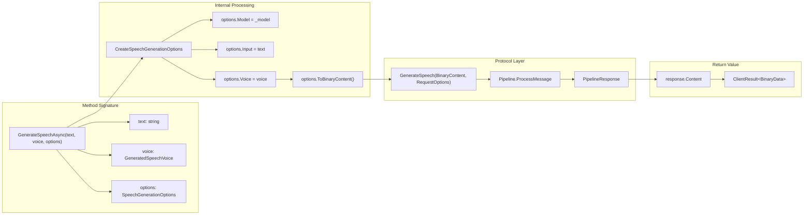
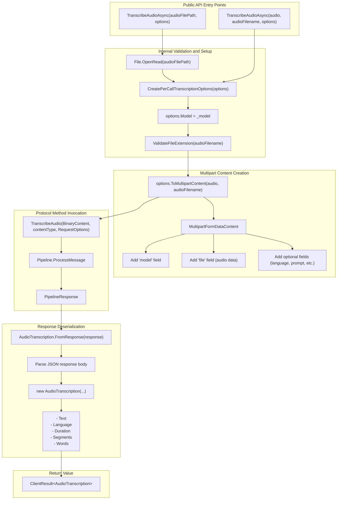
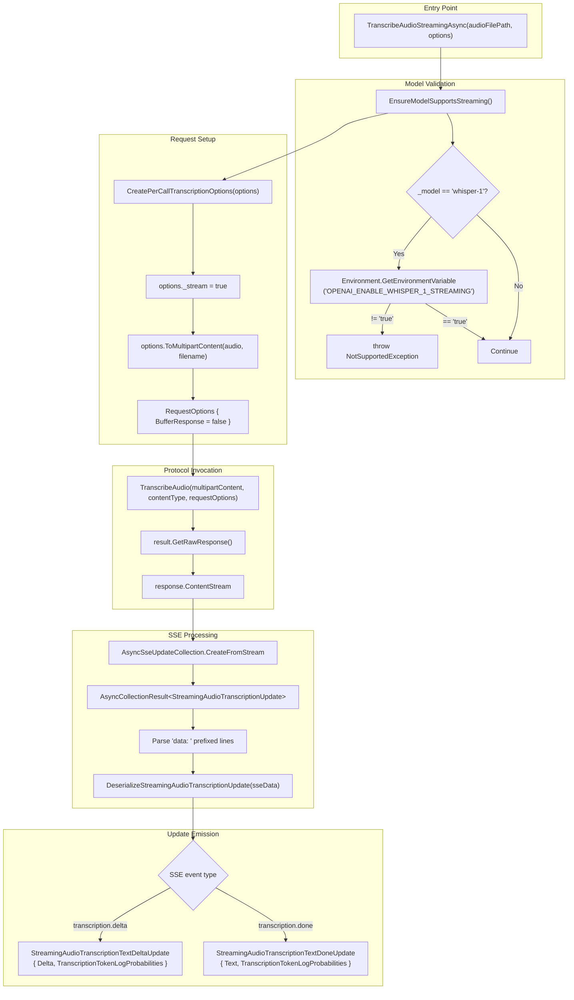

<!-- source: DeepWiki mcp.deepwiki.com · repo openai/openai-dotnet · page 4.5 Audio Client · fetched 2026-10-26 -->

# Audio Client

<details>
<summary>Relevant source files</summary>

The following files were used as context for generating this wiki page:

- [api/OpenAI.net8.0.cs](api/OpenAI.net8.0.cs)
- [api/OpenAI.netstandard2.0.cs](api/OpenAI.netstandard2.0.cs)
- [examples/Chat/Example08_ChatSerialization.cs](examples/Chat/Example08_ChatSerialization.cs)
- [src/Custom/Assistants/AssistantClient.cs](src/Custom/Assistants/AssistantClient.cs)
- [src/Custom/Audio/AudioClient.cs](src/Custom/Audio/AudioClient.cs)
- [src/Custom/Embeddings/EmbeddingClient.cs](src/Custom/Embeddings/EmbeddingClient.cs)
- [src/Custom/Images/ImageClient.cs](src/Custom/Images/ImageClient.cs)
- [src/Custom/Moderations/ModerationClient.cs](src/Custom/Moderations/ModerationClient.cs)
- [src/Custom/VectorStores/VectorStoreClient.cs](src/Custom/VectorStores/VectorStoreClient.cs)
- [src/Generated/Models/OpenAIContext.cs](src/Generated/Models/OpenAIContext.cs)
- [src/Generated/ModerationClient.cs](src/Generated/ModerationClient.cs)
- [src/Generated/OpenAIModelFactory.cs](src/Generated/OpenAIModelFactory.cs)
- [tests/Responses/ResponsesTests.cs](tests/Responses/ResponsesTests.cs)
- [tspCodeModel.json](tspCodeModel.json)

</details>


The `AudioClient` provides audio processing operations including text-to-speech generation (`GenerateSpeech`), audio transcription (`TranscribeAudio`), and audio translation (`TranslateAudio`). The client is model-specific and supports `tts-1`/`tts-1-hd` for speech generation and `whisper-1`/`gpt-4o-mini` for transcription operations. Streaming transcription is available through `TranscribeAudioStreaming` on compatible models.

For multimodal chat with audio input/output, see [Chat Client](#4.2). For WebSocket-based real-time audio conversations, see [Realtime Client](#4.12).

Sources: [src/Custom/Audio/AudioClient.cs:1-124](), [api/OpenAI.netstandard2.0.cs:1-50]()

---

## Client Architecture

**AudioClient Class Hierarchy and Method Groups**

```mermaid
graph TB
    subgraph "Instantiation"
        OpenAIClient["OpenAIClient"]
        FactoryMethod["GetAudioClient(model)"]
        DirectConstructor["new AudioClient(model, apiKey)"]
        
        OpenAIClient -->|"[OpenAIClient.cs:13]"| FactoryMethod
        FactoryMethod --> AudioClientInstance
        DirectConstructor --> AudioClientInstance
    end
    
    subgraph "AudioClient Instance"
        AudioClientInstance["AudioClient"]
        ModelField["_model: string"]
        PipelineField["Pipeline: ClientPipeline"]
        EndpointField["_endpoint: Uri"]
        
        AudioClientInstance --> ModelField
        AudioClientInstance --> PipelineField
        AudioClientInstance --> EndpointField
    end
    
    subgraph "Speech Generation Methods"
        GenerateSpeech["GenerateSpeech(string, GeneratedSpeechVoice)"]
        GenerateSpeechAsync["GenerateSpeechAsync(string, GeneratedSpeechVoice)"]
        SpeechOptions["SpeechGenerationOptions"]
        SpeechOutput["ClientResult&lt;BinaryData&gt;"]
        
        AudioClientInstance --> GenerateSpeech
        AudioClientInstance --> GenerateSpeechAsync
        GenerateSpeech --> SpeechOptions
        GenerateSpeechAsync --> SpeechOptions
        SpeechOptions --> SpeechOutput
    end
    
    subgraph "Transcription Methods"
        TranscribeAudio["TranscribeAudio(string/Stream)"]
        TranscribeAudioAsync["TranscribeAudioAsync(string/Stream)"]
        TranscribeStreaming["TranscribeAudioStreaming(string/Stream)"]
        TranscriptionOptions["AudioTranscriptionOptions"]
        TranscriptionOutput["ClientResult&lt;AudioTranscription&gt;"]
        StreamingOutput["AsyncCollectionResult&lt;StreamingAudioTranscriptionUpdate&gt;"]
        
        AudioClientInstance --> TranscribeAudio
        AudioClientInstance --> TranscribeAudioAsync
        AudioClientInstance --> TranscribeStreaming
        TranscribeAudio --> TranscriptionOptions
        TranscribeAudioAsync --> TranscriptionOptions
        TranscribeStreaming --> TranscriptionOptions
        TranscriptionOptions --> TranscriptionOutput
        TranscriptionOptions --> StreamingOutput
    end
    
    subgraph "Translation Methods"
        TranslateAudio["TranslateAudio(string/Stream)"]
        TranslateAudioAsync["TranslateAudioAsync(string/Stream)"]
        TranslationOptions["AudioTranslationOptions"]
        TranslationOutput["ClientResult&lt;AudioTranslation&gt;"]
        
        AudioClientInstance --> TranslateAudio
        AudioClientInstance --> TranslateAudioAsync
        TranslateAudio --> TranslationOptions
        TranslateAudioAsync --> TranslationOptions
        TranslationOptions --> TranslationOutput
    end
```



Sources: [src/Custom/Audio/AudioClient.cs:1-438](), [api/OpenAI.netstandard2.0.cs:13]()

---

## Client Initialization

The `AudioClient` can be instantiated directly or obtained through the `OpenAIClient` factory. Multiple `AudioClient` instances targeting different models can coexist for different use cases (e.g., one for TTS, another for transcription).

### Direct Instantiation

```csharp
// Simple constructor with API key
AudioClient ttsClient = new("tts-1", apiKey);

// With credential and options
AudioClient whisperClient = new(
    "whisper-1",
    new ApiKeyCredential(apiKey),
    new OpenAIClientOptions()
    {
        Endpoint = new Uri("https://api.openai.com/v1")
    });
```

### Factory Pattern

```csharp
OpenAIClient openAIClient = new(apiKey);
AudioClient ttsClient = openAIClient.GetAudioClient("tts-1");
AudioClient whisperClient = openAIClient.GetAudioClient("whisper-1");
```

### Constructor Overloads

| Constructor | Purpose |
|-------------|---------|
| `AudioClient(string model, string apiKey)` | Simple initialization with model and API key |
| `AudioClient(string model, ApiKeyCredential credential)` | With credential object |
| `AudioClient(string model, ApiKeyCredential credential, OpenAIClientOptions options)` | Full configuration with options |
| `AudioClient(string model, AuthenticationPolicy authenticationPolicy, OpenAIClientOptions options)` | Custom authentication policy (Experimental) |
| `protected internal AudioClient(ClientPipeline pipeline, string model, OpenAIClientOptions options)` | Internal constructor for factory pattern |

Sources: [src/Custom/Audio/AudioClient.cs:24-111](), [README.md:133-142]()

---

## Speech Generation (Text-to-Speech)

Speech generation converts text into spoken audio using models like `tts-1` (standard quality) or `tts-1-hd` (high definition).

**Speech Generation Request Flow**



Sources: [src/Custom/Audio/AudioClient.cs:125-172]()

### Basic Usage

```csharp
AudioClient client = new("tts-1", apiKey);

BinaryData audioData = await client.GenerateSpeechAsync(
    "Hello, this is a test of text-to-speech.",
    GeneratedSpeechVoice.Alloy);

// Save to file
await File.WriteAllBytesAsync("output.mp3", audioData.ToArray());
```

### Advanced Options

```csharp
SpeechGenerationOptions options = new()
{
    ResponseFormat = GeneratedSpeechFormat.Opus,
    Speed = 1.25f  // 0.25 to 4.0
};

BinaryData audioData = await client.GenerateSpeechAsync(
    text: "Custom audio generation",
    voice: GeneratedSpeechVoice.Nova,
    options: options);
```

### Available Output Formats

| Format | Description | Use Case |
|--------|-------------|----------|
| `GeneratedSpeechFormat.Mp3` | MP3 format (default) | General purpose, widely compatible |
| `GeneratedSpeechFormat.Opus` | Opus format | Low latency, internet streaming |
| `GeneratedSpeechFormat.Aac` | AAC format | Digital audio compression |
| `GeneratedSpeechFormat.Flac` | FLAC format | Lossless compression |
| `GeneratedSpeechFormat.Wav` | WAV format | Uncompressed, high quality |
| `GeneratedSpeechFormat.Pcm` | PCM format | Raw audio data |

Sources: [src/Custom/Audio/AudioClient.cs:125-172](), [README.md:673-708]()

---

## Audio Transcription (Speech-to-Text)

Audio transcription converts spoken audio into text. The client supports both file paths and streams as input, with multiple response formats and optional timestamp granularities.

**Transcription Request Processing**



Sources: [src/Custom/Audio/AudioClient.cs:175-258](), [src/Custom/Audio/AudioClient.cs:410-419]()

### Basic Transcription

```csharp
AudioClient client = new("whisper-1", apiKey);

// From file path
AudioTranscription transcription = await client.TranscribeAudioAsync(
    "path/to/audio.mp3");

Console.WriteLine(transcription.Text);
```

### Transcription with Timestamps

```csharp
AudioTranscriptionOptions options = new()
{
    ResponseFormat = AudioTranscriptionFormat.Verbose,
    TimestampGranularities = AudioTimestampGranularities.Word | AudioTimestampGranularities.Segment
};

AudioTranscription transcription = await client.TranscribeAudioAsync(
    audioFilePath,
    options);

// Word-level timestamps
foreach (TranscribedWord word in transcription.Words)
{
    Console.WriteLine($"{word.Word}: {word.StartTime} - {word.EndTime}");
}

// Segment-level timestamps and metadata
foreach (TranscribedSegment segment in transcription.Segments)
{
    Console.WriteLine($"Segment {segment.Id}: {segment.Text}");
    Console.WriteLine($"  Time: {segment.StartTime} - {segment.EndTime}");
    Console.WriteLine($"  Avg Log Prob: {segment.AverageLogProbability}");
    Console.WriteLine($"  Compression Ratio: {segment.CompressionRatio}");
}
```

### Transcription with Log Probabilities

```csharp
AudioTranscriptionOptions options = new()
{
    Includes = AudioTranscriptionIncludes.Logprobs
};

AudioTranscription transcription = await client.TranscribeAudioAsync(
    audioFilePath,
    options);

foreach (var tokenLogProb in transcription.TranscriptionTokenLogProbabilities)
{
    Console.WriteLine($"Token: {tokenLogProb.Token}");
    Console.WriteLine($"Log Probability: {tokenLogProb.LogProbability}");
    Console.WriteLine($"UTF-8 Bytes: {string.Join(", ", tokenLogProb.Utf8Bytes.ToArray())}");
}
```

### Response Formats

| Format | Value | Description | Includes Metadata |
|--------|-------|-------------|-------------------|
| Text | `AudioTranscriptionFormat.Text` | Plain text only | No |
| Simple JSON | `AudioTranscriptionFormat.Simple` | JSON with text field | No |
| Verbose JSON | `AudioTranscriptionFormat.Verbose` | Full metadata | Yes (duration, language, segments) |
| SRT | `AudioTranscriptionFormat.Srt` | SubRip subtitle format | Segment timestamps |
| VTT | `AudioTranscriptionFormat.Vtt` | WebVTT subtitle format | Segment timestamps |

### Input Methods

| Method | Signature | Use Case |
|--------|-----------|----------|
| File Path | `TranscribeAudio(string audioFilePath, AudioTranscriptionOptions options)` | Simple file-based transcription |
| Stream | `TranscribeAudio(Stream audio, string audioFilename, AudioTranscriptionOptions options)` | In-memory audio data or streaming |

Sources: [src/Custom/Audio/AudioClient.cs:175-258](), [tests/Audio/TranscriptionTests.cs:29-186](), [README.md:673-708]()

---

## Audio Translation

Audio translation converts spoken audio in any supported language into English text. The API is similar to transcription but always outputs English regardless of input language.

**Translation Request Flow**

```mermaid
graph LR
    subgraph "Method Call"
        TranslateMethod["TranslateAudioAsync(audio, audioFilename, options)"]
    end
    
    subgraph "Setup"
        CreateOptions["CreatePerCallTranslationOptions(options)"]
        SetModel["options.Model = _model"]
        ToMultipart["options.ToMultipartContent(audio, audioFilename)"]
    end
    
    subgraph "Protocol Layer"
        TranslateProtocol["TranslateAudio(BinaryContent, contentType, RequestOptions)"]
        Pipeline["Pipeline.ProcessMessage"]
        Response["PipelineResponse"]
    end
    
    subgraph "Deserialization"
        FromResponse["AudioTranslation.FromResponse(response)"]
        ParseJson["JsonDocument.Parse(response.Content)"]
        BuildResult["new AudioTranslation { Text, Language, Duration, Segments }"]
    end
    
    TranslateMethod --> CreateOptions
    CreateOptions --> SetModel
    SetModel --> ToMultipart
    ToMultipart --> TranslateProtocol
    TranslateProtocol --> Pipeline
    Pipeline --> Response
    Response --> FromResponse
    FromResponse --> ParseJson
    ParseJson --> BuildResult
```



Sources: [src/Custom/Audio/AudioClient.cs:357-408](), [src/Custom/Audio/AudioClient.cs:428-437]()

### Basic Translation

```csharp
AudioClient client = new("whisper-1", apiKey);

// Translate French audio to English
AudioTranslation translation = await client.TranslateAudioAsync(
    "path/to/french_audio.wav");

Console.WriteLine(translation.Text);  // English output
```

### Translation with Verbose Format

```csharp
AudioTranslationOptions options = new()
{
    ResponseFormat = AudioTranslationFormat.Verbose
};

AudioTranslation translation = await client.TranslateAudioAsync(
    audioFilePath,
    options);

Console.WriteLine($"Language detected: {translation.Language}");  // "english"
Console.WriteLine($"Duration: {translation.Duration}");

foreach (TranscribedSegment segment in translation.Segments)
{
    Console.WriteLine($"{segment.StartTime} - {segment.EndTime}: {segment.Text}");
}
```

Sources: [src/Custom/Audio/AudioClient.cs:357-408](), [tests/Audio/TranslationTests.cs:26-110]()

---

## Streaming Transcription (Experimental)

Streaming transcription provides real-time audio-to-text conversion as the audio is being processed. This feature is marked as `[Experimental("OPENAI001")]` and requires models that support streaming (e.g., `gpt-4o-mini`, not `whisper-1`).

**Streaming Transcription Flow**



Sources: [src/Custom/Audio/AudioClient.cs:259-354](), [src/Custom/Audio/AudioClient.cs:440-460]()

### Basic Streaming

```csharp
// Only supported on certain models
AudioClient client = new("gpt-4o-mini", apiKey);

StringBuilder fullTranscription = new();

await foreach (StreamingAudioTranscriptionUpdate update in 
    client.TranscribeAudioStreamingAsync(audioFilePath))
{
    if (update is StreamingAudioTranscriptionTextDeltaUpdate deltaUpdate)
    {
        Console.Write(deltaUpdate.Delta);
        fullTranscription.Append(deltaUpdate.Delta);
    }
    else if (update is StreamingAudioTranscriptionTextDoneUpdate doneUpdate)
    {
        Console.WriteLine();
        Console.WriteLine($"Complete: {doneUpdate.Text}");
        
        // Verify accumulated deltas match final text
        Debug.Assert(fullTranscription.ToString() == doneUpdate.Text);
    }
}
```

### Streaming with Log Probabilities

```csharp
AudioTranscriptionOptions options = new()
{
    Includes = AudioTranscriptionIncludes.Logprobs
};

List<AudioTokenLogProbabilityDetails> allLogProbs = new();

await foreach (var update in client.TranscribeAudioStreamingAsync(
    audioFilePath, 
    options))
{
    if (update is StreamingAudioTranscriptionTextDeltaUpdate deltaUpdate)
    {
        Console.Write(deltaUpdate.Delta);
        allLogProbs.AddRange(deltaUpdate.TranscriptionTokenLogProbabilities);
    }
    else if (update is StreamingAudioTranscriptionTextDoneUpdate doneUpdate)
    {
        // Final log probabilities match accumulated delta log probs
        Console.WriteLine($"Total tokens: {doneUpdate.TranscriptionTokenLogProbabilities.Count}");
    }
}
```

### Model Compatibility

The `AudioClient._model` field determines which operations are supported. The `EnsureModelSupportsStreaming()` method validates model compatibility for streaming operations:

| Model | Speech Generation | Transcription | Translation | Streaming Transcription |
|-------|------------------|---------------|-------------|------------------------|
| `tts-1` | ✅ | ❌ | ❌ | ❌ |
| `tts-1-hd` | ✅ | ❌ | ❌ | ❌ |
| `whisper-1` | ❌ | ✅ | ✅ | ⚠️ Requires env var |
| `gpt-4o-mini` | ❌ | ✅ | ✅ | ✅ |
| `gpt-4o-audio-preview` | ❌ | ✅ | ✅ | ✅ |

The streaming validation logic in `EnsureModelSupportsStreaming()` checks:
1. If `_model` is `"whisper-1"`, read environment variable `OPENAI_ENABLE_WHISPER_1_STREAMING`
2. If not set to `"true"`, throw `NotSupportedException` with message about model compatibility
3. All other models pass validation

Sources: [src/Custom/Audio/AudioClient.cs:440-460](), [tests/Audio/TranscriptionTests.cs:240-265]()

---

## Audio Format Support

### Audio Input Formats

Audio input is validated by the `audioFilename` parameter extension. Supported extensions are checked in `ValidateFileExtension()`:

| Extension | Format | Media Type |
|-----------|--------|------------|
| `.mp3` | MPEG Audio Layer III | audio/mpeg |
| `.mp4`, `.m4a` | MPEG-4 Audio | audio/mp4 |
| `.mpeg`, `.mpga` | MPEG Audio | audio/mpeg |
| `.wav` | Waveform Audio | audio/wav |
| `.webm` | WebM Audio | audio/webm |

When using the stream overload, the `audioFilename` parameter must have a valid extension:

```csharp
using FileStream audioStream = File.OpenRead("recording.mp3");

// audioFilename determines format validation
AudioTranscription transcription = await client.TranscribeAudioAsync(
    audio: audioStream,
    audioFilename: "recording.mp3",  // Extension used for validation
    options: options);
```

Sources: [src/Custom/Audio/AudioClient.cs:178-223]()

---

## Integration Patterns

### Singleton Registration (Dependency Injection)

The `AudioClient` is thread-safe and should be registered as a singleton in ASP.NET Core applications:

```csharp
// Program.cs
builder.Services.AddSingleton<AudioClient>(serviceProvider =>
{
    var apiKey = Environment.GetEnvironmentVariable("OPENAI_API_KEY");
    return new AudioClient("whisper-1", apiKey);
});

// Controller
public class TranscriptionController : ControllerBase
{
    private readonly AudioClient _audioClient;
    
    public TranscriptionController(AudioClient audioClient)
    {
        _audioClient = audioClient;
    }
    
    [HttpPost("transcribe")]
    public async Task<IActionResult> Transcribe(IFormFile audioFile)
    {
        using var stream = audioFile.OpenReadStream();
        var transcription = await _audioClient.TranscribeAudioAsync(
            stream,
            audioFile.FileName);
        
        return Ok(new { text = transcription.Text });
    }
}
```

### Multiple Model Support

Create separate clients for different audio operations:

```csharp
OpenAIClient openAIClient = new(apiKey);

// Text-to-speech with standard quality
AudioClient ttsClient = openAIClient.GetAudioClient("tts-1");

// Text-to-speech with HD quality
AudioClient ttsHdClient = openAIClient.GetAudioClient("tts-1-hd");

// Speech-to-text
AudioClient whisperClient = openAIClient.GetAudioClient("whisper-1");

// Streaming transcription
AudioClient streamingClient = openAIClient.GetAudioClient("gpt-4o-mini");
```

### Error Handling

```csharp
try
{
    AudioTranscription transcription = await client.TranscribeAudioAsync(
        audioFilePath,
        new AudioTranscriptionOptions()
        {
            Language = "invalid-language-code"
        });
}
catch (ClientResultException ex)
{
    // Handle API errors
    Console.WriteLine($"API Error: {ex.Message}");
    Console.WriteLine($"Status: {ex.Status}");
}
catch (NotSupportedException ex)
{
    // Handle unsupported model/feature combinations
    Console.WriteLine($"Not Supported: {ex.Message}");
}
```

Sources: [src/Custom/Audio/AudioClient.cs:1-438](), [README.md:144-182](), [tests/Audio/TranscriptionTests.cs:240-265]()

---

## Configuration Options Reference

### SpeechGenerationOptions Properties

| Property | Type | Default | Description |
|----------|------|---------|-------------|
| `ResponseFormat` | `GeneratedSpeechFormat?` | `Mp3` | Output audio format |
| `Speed` | `float?` | `1.0` | Playback speed (0.25 - 4.0) |

### AudioTranscriptionOptions Properties

| Property | Type | Default | Description |
|----------|------|---------|-------------|
| `ResponseFormat` | `AudioTranscriptionFormat?` | `Verbose` | Output format (Text, Simple, Verbose, Srt, Vtt) |
| `Language` | `string` | Auto-detect | ISO-639-1 language code |
| `Prompt` | `string` | `null` | Optional context to guide transcription |
| `Temperature` | `float?` | `0` | Sampling temperature (0.0 - 1.0) |
| `TimestampGranularities` | `AudioTimestampGranularities?` | `Default` | Request word and/or segment timestamps |
| `Includes` | `AudioTranscriptionIncludes?` | `null` | Request additional data (e.g., log probabilities) |

### AudioTranslationOptions Properties

| Property | Type | Default | Description |
|----------|------|---------|-------------|
| `ResponseFormat` | `AudioTranslationFormat?` | `Verbose` | Output format |
| `Prompt` | `string` | `null` | Optional context for translation |
| `Temperature` | `float?` | `0` | Sampling temperature (0.0 - 1.0) |

Sources: [src/Custom/Audio/AudioClient.cs:125-408](), [tests/Audio/TranscriptionTests.cs:54-123]()

---

