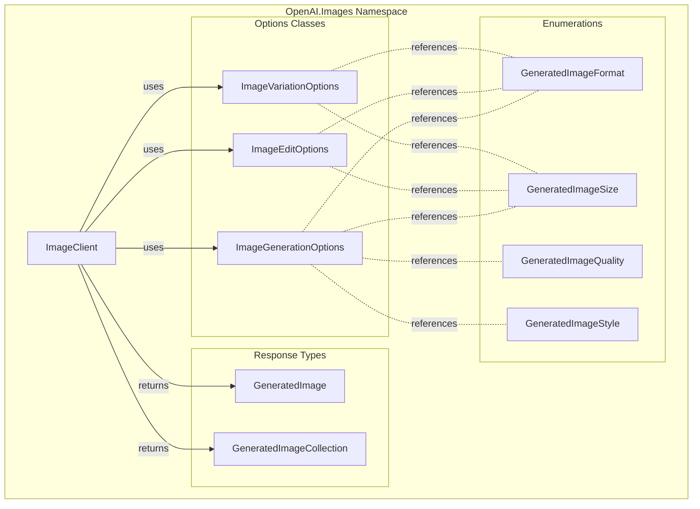
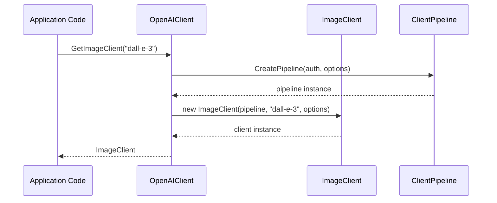
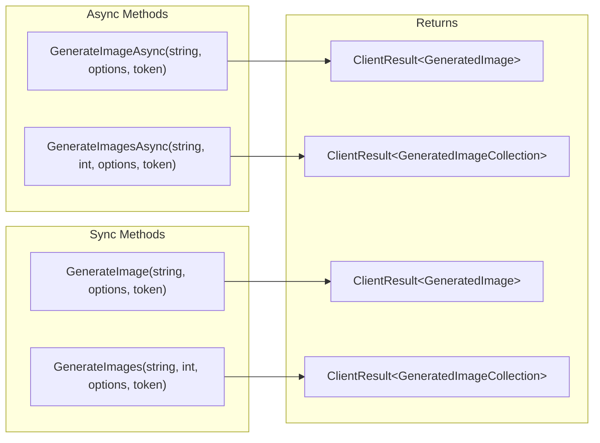
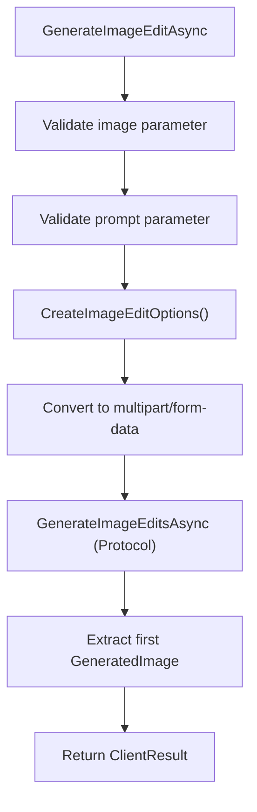
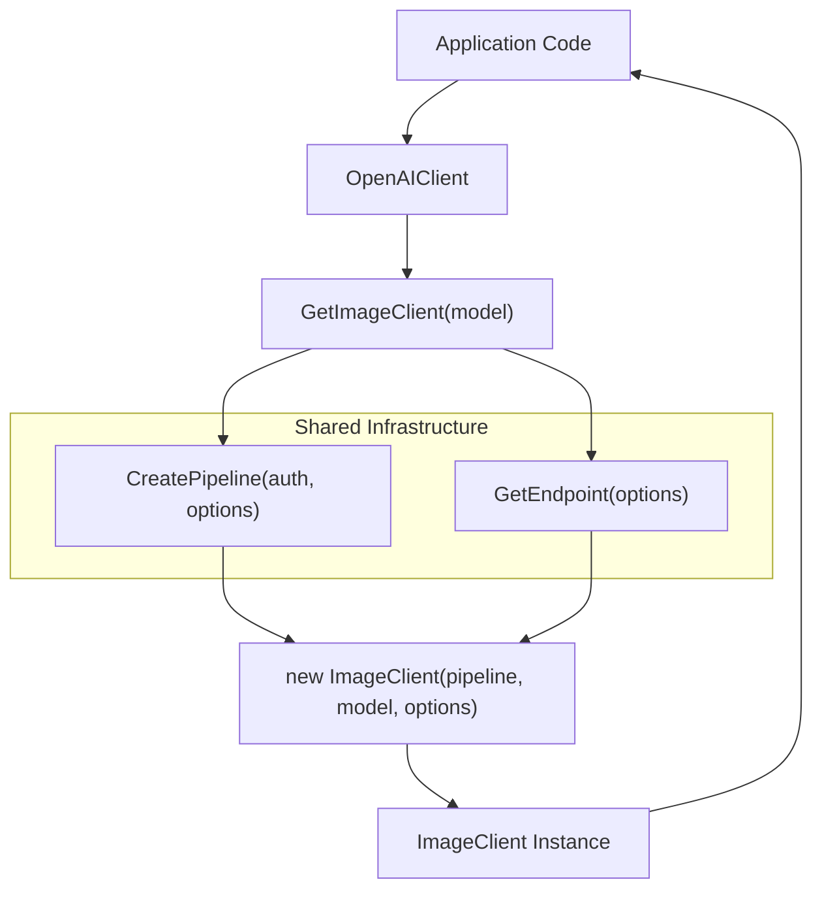
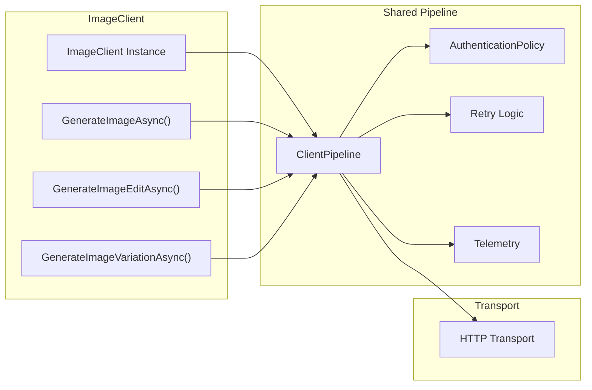

<!-- source: DeepWiki mcp.deepwiki.com · repo openai/openai-dotnet · page 4.6 Images Client · fetched 2026-10-26 -->

# Images Client

<details>
<summary>Relevant source files</summary>

The following files were used as context for generating this wiki page:

- [api/OpenAI.net8.0.cs](api/OpenAI.net8.0.cs)
- [api/OpenAI.netstandard2.0.cs](api/OpenAI.netstandard2.0.cs)
- [examples/Chat/Example08_ChatSerialization.cs](examples/Chat/Example08_ChatSerialization.cs)
- [src/Custom/Assistants/AssistantClient.cs](src/Custom/Assistants/AssistantClient.cs)
- [src/Custom/Audio/AudioClient.cs](src/Custom/Audio/AudioClient.cs)
- [src/Custom/Embeddings/EmbeddingClient.cs](src/Custom/Embeddings/EmbeddingClient.cs)
- [src/Custom/Images/ImageClient.cs](src/Custom/Images/ImageClient.cs)
- [src/Custom/Moderations/ModerationClient.cs](src/Custom/Moderations/ModerationClient.cs)
- [src/Custom/VectorStores/VectorStoreClient.cs](src/Custom/VectorStores/VectorStoreClient.cs)
- [src/Generated/Models/OpenAIContext.cs](src/Generated/Models/OpenAIContext.cs)
- [src/Generated/ModerationClient.cs](src/Generated/ModerationClient.cs)
- [src/Generated/OpenAIModelFactory.cs](src/Generated/OpenAIModelFactory.cs)
- [tests/Responses/ResponsesTests.cs](tests/Responses/ResponsesTests.cs)
- [tspCodeModel.json](tspCodeModel.json)

</details>


## Purpose and Scope

This document describes the `ImageClient` class in the `OpenAI.Images` namespace, which provides access to OpenAI's DALL-E image generation, editing, and variation capabilities. The `ImageClient` enables applications to generate images from text prompts, edit existing images with masks, and create variations of existing images.

For information about other API clients, see:
- Chat operations: [Chat Client](#4.2)
- Audio operations: [Audio Client](#4.5)
- Central factory pattern: [OpenAIClient](#4.1)

**Sources:** [src/Custom/Images/ImageClient.cs:1-30](), [api/OpenAI.netstandard2.0.cs:1-50]()

---

## Architecture Overview

The `ImageClient` follows the SDK's standard client architecture pattern with model-based initialization, shared pipeline infrastructure, and separate methods for each image operation type.

### ImageClient Class Structure



**Sources:** [src/Custom/Images/ImageClient.cs:1-126](), [api/OpenAI.netstandard2.0.cs:1-50]()

---

## Client Initialization

`ImageClient` instances are created through the `OpenAIClient` factory or via direct instantiation with a model identifier.

### Factory Pattern via OpenAIClient



### Constructor Variants

The `ImageClient` provides multiple constructors:

| Constructor | Parameters | Use Case |
|------------|-----------|----------|
| `ImageClient(string, string)` | model, apiKey | Simple API key authentication |
| `ImageClient(string, ApiKeyCredential)` | model, credential | Credential-based authentication |
| `ImageClient(string, ApiKeyCredential, OpenAIClientOptions)` | model, credential, options | Full configuration control |
| `ImageClient(string, AuthenticationPolicy)` | model, authenticationPolicy | Custom authentication |
| `ImageClient(string, AuthenticationPolicy, OpenAIClientOptions)` | model, authenticationPolicy, options | Custom auth with configuration |

**Sources:** [src/Custom/Images/ImageClient.cs:26-91](), [api/OpenAI.netstandard2.0.cs:1-50]()

### Properties

| Property | Type | Description |
|---------|------|-------------|
| `Model` | `string` | Model identifier used for requests |
| `Endpoint` | `Uri` | Service endpoint URI |
| `Pipeline` | `ClientPipeline` | Shared HTTP pipeline |

**Sources:** [src/Custom/Images/ImageClient.cs:115-125]()

---

## Image Generation

Image generation creates new images from text prompts using DALL-E models.

### Method Signatures



### Single Image Generation

The `GenerateImage` and `GenerateImageAsync` methods generate a single image:

**Method signature:** [src/Custom/Images/ImageClient.cs:135-145]()
- Parameter `prompt`: Text description of desired image
- Parameter `options`: Optional `ImageGenerationOptions` for configuration
- Parameter `cancellationToken`: Cancellation support
- Returns: `ClientResult<GeneratedImage>` containing single image result

**Sources:** [src/Custom/Images/ImageClient.cs:128-163]()

### Multiple Image Generation

The `GenerateImages` and `GenerateImagesAsync` methods generate multiple images:

**Method signature:** [src/Custom/Images/ImageClient.cs:172-190]()
- Parameter `prompt`: Text description of desired images
- Parameter `imageCount`: Number of images to generate
- Parameter `options`: Optional `ImageGenerationOptions` for configuration
- Parameter `cancellationToken`: Cancellation support
- Returns: `ClientResult<GeneratedImageCollection>` containing all generated images

**Sources:** [src/Custom/Images/ImageClient.cs:165-190]()

### Internal Implementation Flow

```mermaid
sequenceDiagram
    participant App as Application
    participant IC as ImageClient
    participant Helper as CreateImageGenerationOptions
    participant Protocol as GenerateImages (Protocol)
    participant API as OpenAI API
    
    App->>IC: GenerateImageAsync(prompt, options)
    IC->>Helper: CreateImageGenerationOptions(prompt, null, ref options)
    Helper->>Helper: Set model, prompt, imageCount
    IC->>Protocol: GenerateImagesAsync(content, requestOptions)
    Protocol->>API: POST /v1/images/generations
    API-->>Protocol: Response
    Protocol-->>IC: ClientResult
    IC->>IC: Cast to GeneratedImageCollection
    IC->>IC: Extract first image
    IC-->>App: ClientResult&lt;GeneratedImage&gt;
```

**Sources:** [src/Custom/Images/ImageClient.cs:135-163](), [src/Custom/Images/ImageClient.Helpers.cs:1-30]()

---

## Image Editing

Image editing modifies existing images based on a prompt and optional mask to specify the editing region.

### Method Signatures

The `GenerateImageEdit` and `GenerateImageEditAsync` methods support image editing:

**Method signature:** [src/Custom/Images/ImageClient.cs:206-224]()
- Parameter `image`: Image to edit (Stream or file path)
- Parameter `prompt`: Text description of desired edits
- Parameter `imageFileName`: Original filename for multipart upload
- Parameter `options`: Optional `ImageEditOptions` for configuration
- Parameter `cancellationToken`: Cancellation support
- Returns: `ClientResult<GeneratedImage>` containing edited image result

### With Mask Support

When a mask is provided, only the masked regions are edited:

**Method signature:** [src/Custom/Images/ImageClient.cs:297-317]()
- Parameter `image`: Image to edit
- Parameter `mask`: Mask image specifying edit regions (transparent areas)
- Parameter `prompt`: Text description of desired edits
- Additional parameters for file names and options

### Internal Processing



**Sources:** [src/Custom/Images/ImageClient.cs:192-386]()

---

## Image Variations

Image variations create similar images based on an existing image without requiring a text prompt.

### Method Signatures

The `GenerateImageVariation` and `GenerateImageVariationAsync` methods generate variations:

**Method signature:** [src/Custom/Images/ImageClient.cs:410-426]()
- Parameter `image`: Source image (Stream or file path)
- Parameter `imageFileName`: Original filename for multipart upload
- Parameter `options`: Optional `ImageVariationOptions` for configuration
- Parameter `cancellationToken`: Cancellation support
- Returns: `ClientResult<GeneratedImage>` containing single variation

### Multiple Variations

Generate multiple variations with `GenerateImageVariations` and `GenerateImageVariationsAsync`:

**Method signature:** [src/Custom/Images/ImageClient.cs:497-515]()
- Parameter `image`: Source image
- Parameter `imageCount`: Number of variations to generate
- Parameter `imageFileName`: Original filename
- Parameter `options`: Optional `ImageVariationOptions`
- Parameter `cancellationToken`: Cancellation support
- Returns: `ClientResult<GeneratedImageCollection>` containing all variations

**Sources:** [src/Custom/Images/ImageClient.cs:388-592]()

---

## Response Types

### GeneratedImage

Represents a single generated, edited, or variant image result.

| Property | Type | Description |
|---------|------|-------------|
| `ImageUri` | `Uri` | URL to the generated image (when format is URL) |
| `ImageBytes` | `BinaryData` | Base64-encoded image data (when format is Base64) |
| `RevisedPrompt` | `string` | The prompt used after revision by the model |

**Sources:** [api/OpenAI.netstandard2.0.cs:1-100]()

### GeneratedImageCollection

Represents a collection of generated images from a single request. Inherits from `IEnumerable<GeneratedImage>`.

| Property | Type | Description |
|---------|------|-------------|
| `CreatedAt` | `DateTimeOffset` | Timestamp of generation |
| `Count` | `int` | Number of images in collection |

**Sources:** [api/OpenAI.netstandard2.0.cs:1-100]()

---

## Configuration Options

### ImageGenerationOptions

Configuration for image generation requests:

| Property | Type | Description |
|---------|------|-------------|
| `Size` | `GeneratedImageSize?` | Image dimensions (256x256, 512x512, 1024x1024, 1792x1024, 1024x1792) |
| `Quality` | `GeneratedImageQuality?` | Quality level (Standard, HD) |
| `Style` | `GeneratedImageStyle?` | Style preference (Vivid, Natural) |
| `ResponseFormat` | `GeneratedImageFormat?` | Output format (Url, Base64) |
| `User` | `string` | End-user identifier for abuse monitoring |

**Sources:** [api/OpenAI.netstandard2.0.cs:1-200]()

### ImageEditOptions

Configuration for image editing requests:

| Property | Type | Description |
|---------|------|-------------|
| `Size` | `GeneratedImageSize?` | Output image dimensions |
| `ResponseFormat` | `GeneratedImageFormat?` | Output format (Url, Base64) |
| `User` | `string` | End-user identifier |

**Sources:** [api/OpenAI.netstandard2.0.cs:1-200]()

### ImageVariationOptions

Configuration for image variation requests:

| Property | Type | Description |
|---------|------|-------------|
| `Size` | `GeneratedImageSize?` | Output image dimensions |
| `ResponseFormat` | `GeneratedImageFormat?` | Output format (Url, Base64) |
| `User` | `string` | End-user identifier |

**Sources:** [api/OpenAI.netstandard2.0.cs:1-200]()

---

## Integration with OpenAIClient

The `ImageClient` integrates with the central `OpenAIClient` factory pattern for unified client creation and configuration management.

### Factory Method Flow



### OpenAIClient Factory Method

The `GetImageClient` method in `OpenAIClient`:

**Location:** [api/OpenAI.netstandard2.0.cs:22]()
```
public virtual ImageClient GetImageClient(string model)
```

This method:
1. Creates or reuses the shared `ClientPipeline` with authentication
2. Retrieves the configured endpoint URI
3. Instantiates `ImageClient` with the pipeline, model, and options
4. Returns the configured client instance

**Sources:** [api/OpenAI.netstandard2.0.cs:1-50](), [src/Custom/Images/ImageClient.cs:104-113]()

### Shared Pipeline Benefits



The shared pipeline provides:
- Centralized authentication via `ApiKeyCredential` or `AuthenticationPolicy`
- Consistent retry logic for transient failures
- Unified telemetry and logging
- Connection pooling and efficient HTTP transport

**Sources:** [src/Custom/Images/ImageClient.cs:88-113](), [src/Custom/OpenAIClient.cs:1-100]()

---

