<!-- source: DeepWiki mcp.deepwiki.com · repo openai/openai-dotnet · page 4.7 Embeddings Client · fetched 2026-10-26 -->

# Embeddings Client

Relevant source files

The following files were used as context for generating this wiki page:

- [api/OpenAI.net8.0.cs](api/OpenAI.net8.0.cs)
- [api/OpenAI.netstandard2.0.cs](api/OpenAI.netstandard2.0.cs)
- [examples/Chat/Example08_ChatSerialization.cs](examples/Chat/Example08_ChatSerialization.cs)
- [src/Custom/Assistants/AssistantClient.cs](src/Custom/Assistants/AssistantClient.cs)
- [src/Custom/Audio/AudioClient.cs](src/Custom/Audio/AudioClient.cs)
- [src/Custom/Embeddings/EmbeddingClient.cs](src/Custom/Embeddings/EmbeddingClient.cs)
- [src/Custom/Images/ImageClient.cs](src/Custom/Images/ImageClient.cs)
- [src/Custom/Moderations/ModerationClient.cs](src/Custom/Moderations/ModerationClient.cs)
- [src/Custom/VectorStores/VectorStoreClient.cs](src/Custom/VectorStores/VectorStoreClient.cs)
- [src/Generated/Models/OpenAIContext.cs](src/Generated/Models/OpenAIContext.cs)
- [src/Generated/ModerationClient.cs](src/Generated/ModerationClient.cs)
- [src/Generated/OpenAIModelFactory.cs](src/Generated/OpenAIModelFactory.cs)
- [tests/Responses/ResponsesTests.cs](tests/Responses/ResponsesTests.cs)
- [tspCodeModel.json](tspCodeModel.json)

## Purpose and Scope

The `EmbeddingClient` provides functionality for generating vector embeddings from text inputs (as strings or pre-tokenized integer arrays) using OpenAI's embedding models. Embeddings are numerical representations of text that capture semantic meaning, enabling semantic search, clustering, and similarity comparison operations.

This page covers the `EmbeddingClient` class, its instantiation patterns, core operations, input formats, and return types. For information about using embeddings in retrieval-augmented generation (RAG) systems, see [Assistants Client](#4.4) and [Files and Vector Stores](#4.8).

**Sources:** [src/Custom/Embeddings/EmbeddingClient.cs:1-304]()

---

## Client Instantiation

### Factory Method via OpenAIClient

The `EmbeddingClient` can be instantiated through the `OpenAIClient` factory or directly constructed.

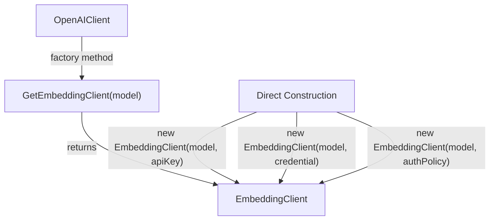

**Sources:** [api/OpenAI.netstandard2.0.cs:17](), [src/Custom/Embeddings/EmbeddingClient.cs:23-92]()

### Constructor Patterns

| Constructor | Parameters | Use Case |
|-------------|-----------|----------|
| `EmbeddingClient(string model, string apiKey)` | Model name, API key string | Simple scenarios with API key authentication |
| `EmbeddingClient(string model, ApiKeyCredential credential)` | Model name, credential object | Standard authentication pattern |
| `EmbeddingClient(string model, ApiKeyCredential credential, OpenAIClientOptions options)` | Model name, credential, client options | Custom endpoint or configuration |
| `EmbeddingClient(string model, AuthenticationPolicy authenticationPolicy)` | Model name, custom auth policy | Advanced authentication scenarios |
| `EmbeddingClient(ClientPipeline pipeline, string model, OpenAIClientOptions options)` | Pipeline, model, options | Internal use, custom pipeline injection |

**Sources:** [src/Custom/Embeddings/EmbeddingClient.cs:28-114]()

### Key Properties

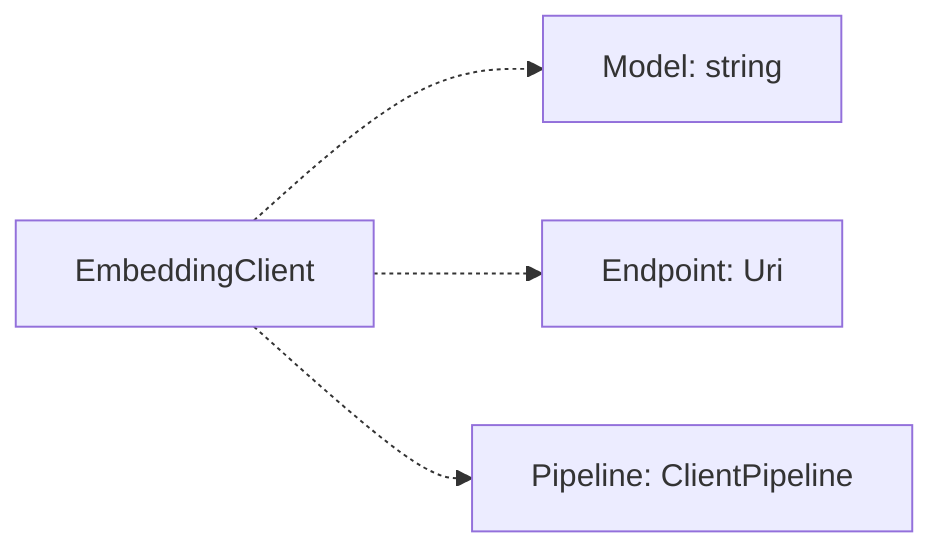

- **Model**: The name of the embedding model used for requests (e.g., `"text-embedding-3-small"`, `"text-embedding-3-large"`)
- **Endpoint**: The service endpoint URI (from `OpenAIClientOptions`)
- **Pipeline**: The HTTP communication pipeline for request/response handling

**Sources:** [src/Custom/Embeddings/EmbeddingClient.cs:116-126]()

---

## Core Operations

### Single Embedding Generation

The `GenerateEmbedding` method generates a single embedding from a string input.

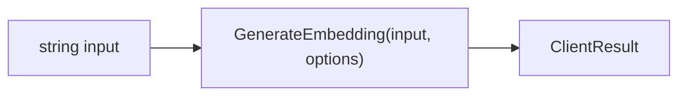

**Method Signatures:**
- `Task<ClientResult<OpenAIEmbedding>> GenerateEmbeddingAsync(string input, EmbeddingGenerationOptions options, CancellationToken cancellationToken)`
- `ClientResult<OpenAIEmbedding> GenerateEmbedding(string input, EmbeddingGenerationOptions options, CancellationToken cancellationToken)`

**Sources:** [src/Custom/Embeddings/EmbeddingClient.cs:128-164]()

### Multiple Embeddings Generation

The `GenerateEmbeddings` method generates embeddings for multiple text inputs in a single request.

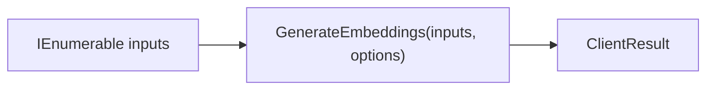

**Method Signatures:**
- `Task<ClientResult<OpenAIEmbeddingCollection>> GenerateEmbeddingsAsync(IEnumerable<string> inputs, EmbeddingGenerationOptions options, CancellationToken cancellationToken)`
- `ClientResult<OpenAIEmbeddingCollection> GenerateEmbeddings(IEnumerable<string> inputs, EmbeddingGenerationOptions options, CancellationToken cancellationToken)`

**Sources:** [src/Custom/Embeddings/EmbeddingClient.cs:166-208]()

---

## Input Formats

### Text Input (Strings)

The most common input format is text strings. The client automatically serializes them to the required JSON format.

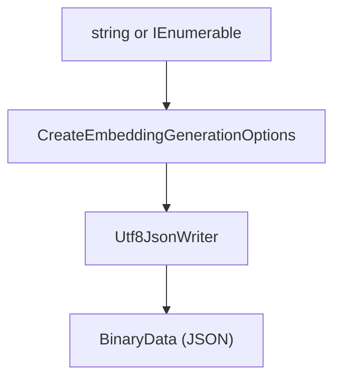

**Internal Processing:**
- Single string: Serialized as JSON string value
- Multiple strings: Serialized as JSON array of strings
- Encoding format set to `Base64` for efficient transmission

**Sources:** [src/Custom/Embeddings/EmbeddingClient.cs:248-279]()

### Tokenized Input (Integer Arrays)

For advanced scenarios, pre-tokenized input can be provided as `ReadOnlyMemory<int>` collections.

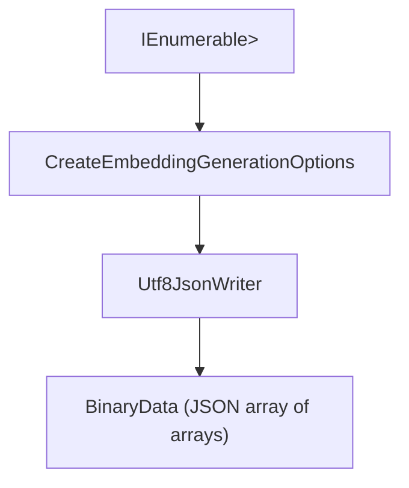

**Method Signatures:**
- `Task<ClientResult<OpenAIEmbeddingCollection>> GenerateEmbeddingsAsync(IEnumerable<ReadOnlyMemory<int>> inputs, EmbeddingGenerationOptions options, CancellationToken cancellationToken)`
- `ClientResult<OpenAIEmbeddingCollection> GenerateEmbeddings(IEnumerable<ReadOnlyMemory<int>> inputs, EmbeddingGenerationOptions options, CancellationToken cancellationToken)`

**Sources:** [src/Custom/Embeddings/EmbeddingClient.cs:210-246](), [src/Custom/Embeddings/EmbeddingClient.cs:281-304]()

---

## Return Types and Data Models

### OpenAIEmbedding

Represents a single embedding result.

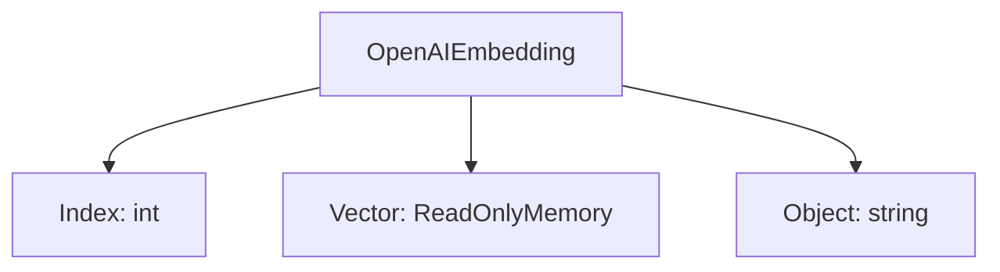

| Property | Type | Description |
|----------|------|-------------|
| `Index` | `int` | The index of the embedding in the request |
| `Vector` | `ReadOnlyMemory<float>` | The embedding vector as a read-only memory buffer of float values |
| `Object` | `string` | The object type (always `"embedding"`) |

**Sources:** [src/Generated/OpenAIModelFactory.cs:475-479]()

### OpenAIEmbeddingCollection

Represents a collection of embedding results from a batch request.

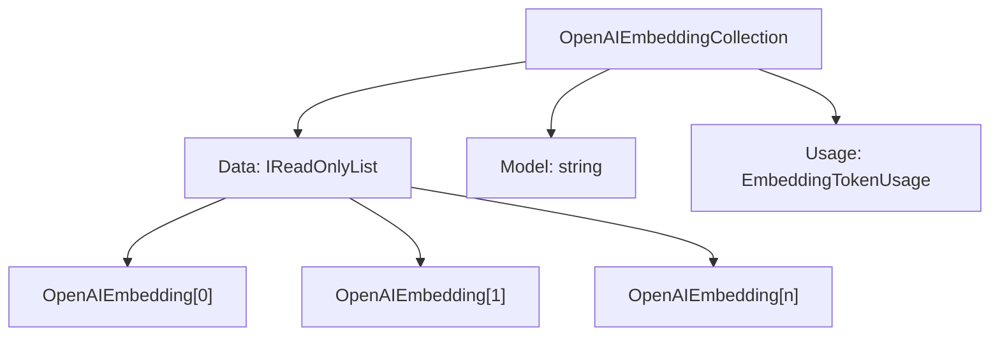

| Property | Type | Description |
|----------|------|-------------|
| `Data` | `IReadOnlyList<OpenAIEmbedding>` | The list of generated embeddings |
| `Model` | `string` | The model used for generation |
| `Object` | `string` | The object type (always `"list"`) |
| `Usage` | `EmbeddingTokenUsage` | Token usage information |

**Sources:** [src/Generated/OpenAIModelFactory.cs:481-486]()

### EmbeddingTokenUsage

Provides token consumption information for the embedding request.

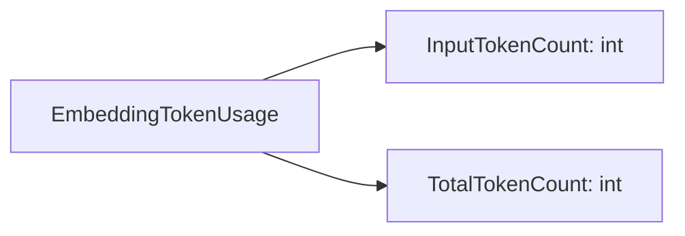

| Property | Type | Description |
|----------|------|-------------|
| `InputTokenCount` | `int` | Number of tokens in the input |
| `TotalTokenCount` | `int` | Total tokens consumed (input only for embeddings) |

**Sources:** [src/Generated/OpenAIModelFactory.cs:493-496]()

---

## Request/Response Flow

### End-to-End Embedding Generation Flow

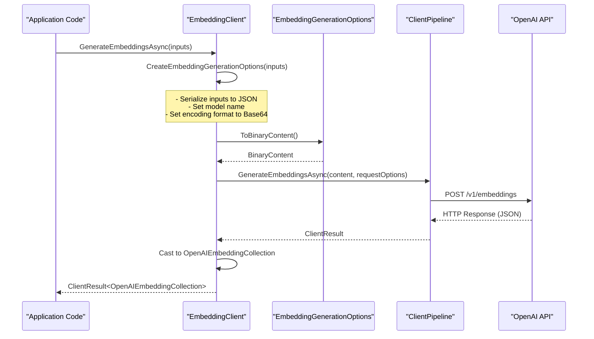

**Sources:** [src/Custom/Embeddings/EmbeddingClient.cs:178-188]()

### Internal Options Configuration

The client configures `EmbeddingGenerationOptions` with the following internal processing:

1. **Input Serialization**: Converts string or token inputs to JSON `BinaryData`
2. **Model Assignment**: Sets the `Model` property to the client's model name
3. **Encoding Format**: Sets `EncodingFormat` to `Base64` for efficient transmission

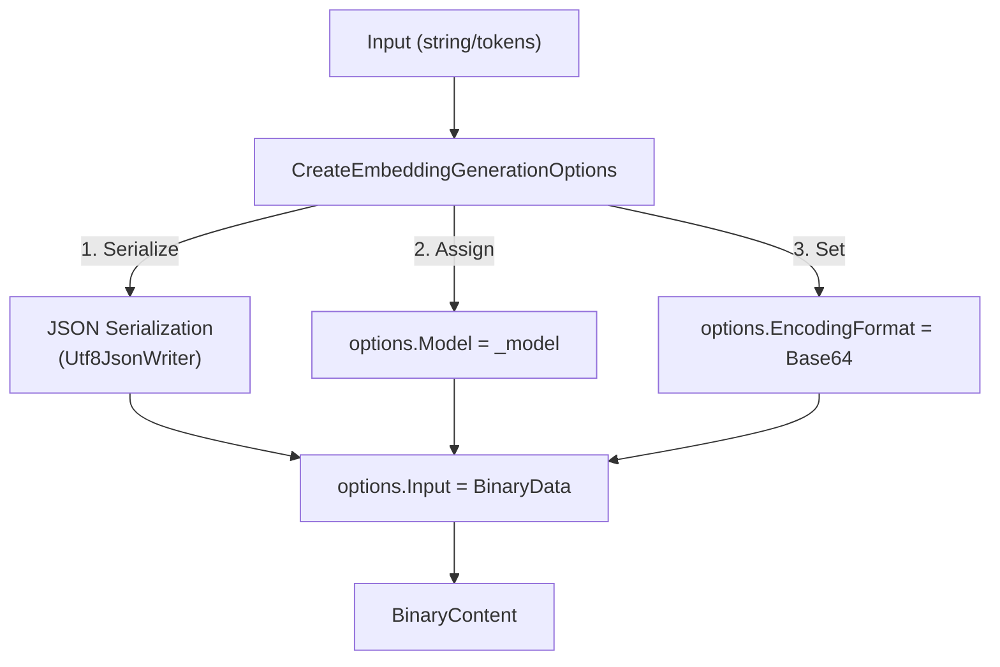

**Sources:** [src/Custom/Embeddings/EmbeddingClient.cs:248-259](), [src/Custom/Embeddings/EmbeddingClient.cs:261-279](), [src/Custom/Embeddings/EmbeddingClient.cs:281-304]()

---

## Code Entity Mapping

### Class Hierarchy and Relationships

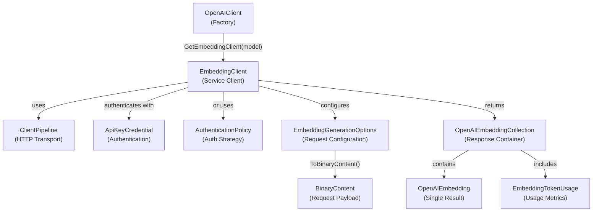

**Sources:** [src/Custom/Embeddings/EmbeddingClient.cs:1-304](), [api/OpenAI.netstandard2.0.cs:17]()

### Key Method Signatures

| Method | File Location | Return Type |
|--------|---------------|-------------|
| `GenerateEmbeddingAsync(string input, ...)` | [src/Custom/Embeddings/EmbeddingClient.cs:135-145]() | `Task<ClientResult<OpenAIEmbedding>>` |
| `GenerateEmbedding(string input, ...)` | [src/Custom/Embeddings/EmbeddingClient.cs:154-164]() | `ClientResult<OpenAIEmbedding>` |
| `GenerateEmbeddingsAsync(IEnumerable<string> inputs, ...)` | [src/Custom/Embeddings/EmbeddingClient.cs:173-189]() | `Task<ClientResult<OpenAIEmbeddingCollection>>` |
| `GenerateEmbeddings(IEnumerable<string> inputs, ...)` | [src/Custom/Embeddings/EmbeddingClient.cs:198-208]() | `ClientResult<OpenAIEmbeddingCollection>` |
| `GenerateEmbeddingsAsync(IEnumerable<ReadOnlyMemory<int>> inputs, ...)` | [src/Custom/Embeddings/EmbeddingClient.cs:217-227]() | `Task<ClientResult<OpenAIEmbeddingCollection>>` |
| `GenerateEmbeddings(IEnumerable<ReadOnlyMemory<int>> inputs, ...)` | [src/Custom/Embeddings/EmbeddingClient.cs:236-246]() | `ClientResult<OpenAIEmbeddingCollection>` |

**Sources:** [src/Custom/Embeddings/EmbeddingClient.cs:128-246]()

---

## Architecture Integration

### Position in SDK Architecture

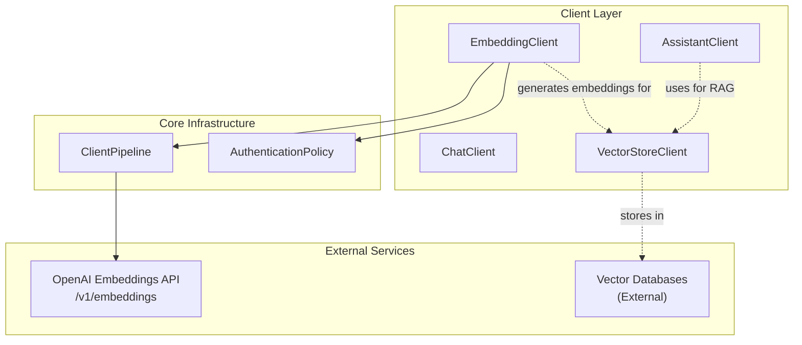

**Sources:** [src/Custom/Embeddings/EmbeddingClient.cs:1-304]()

### Common Usage Pattern

The `EmbeddingClient` is typically used in conjunction with vector storage for semantic search and RAG applications:

1. **Generate Embeddings**: Use `EmbeddingClient` to create vector representations of text
2. **Store Vectors**: Store embeddings in vector stores (via `VectorStoreClient`)
3. **Semantic Search**: Use stored embeddings for similarity-based retrieval
4. **RAG Integration**: Provide retrieved context to `AssistantClient` or `ChatClient`

**Sources:** [src/Custom/Embeddings/EmbeddingClient.cs:1-304](), [src/Custom/VectorStores/VectorStoreClient.cs:1-557]()

---

