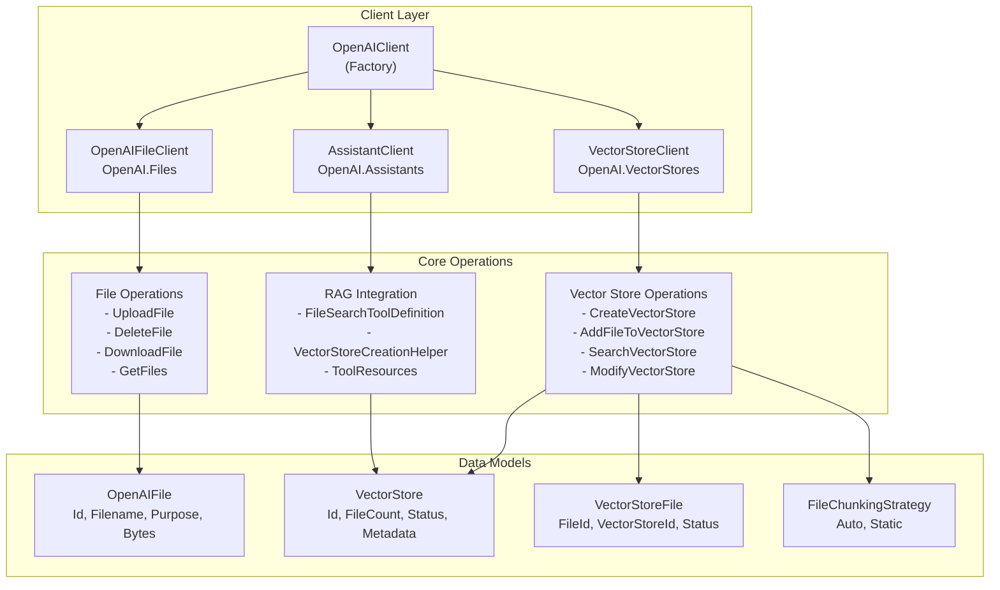
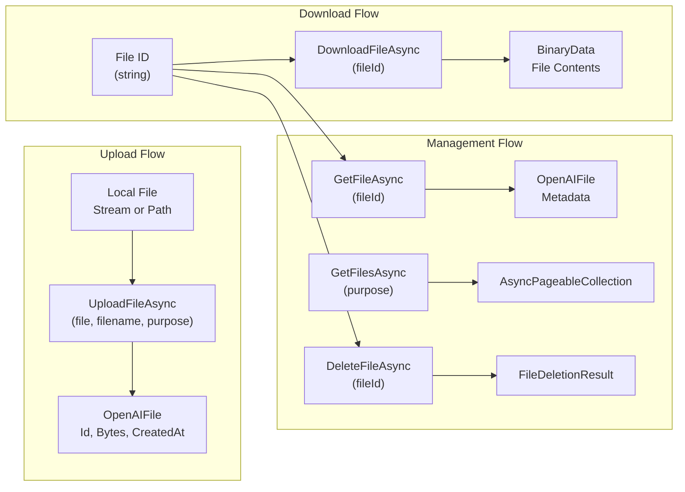
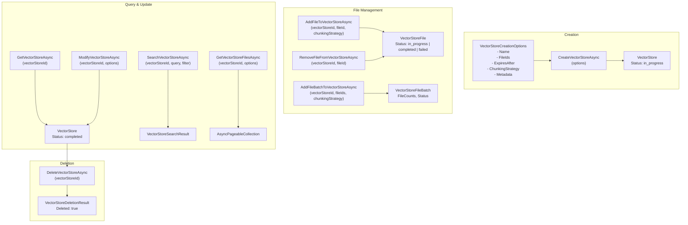
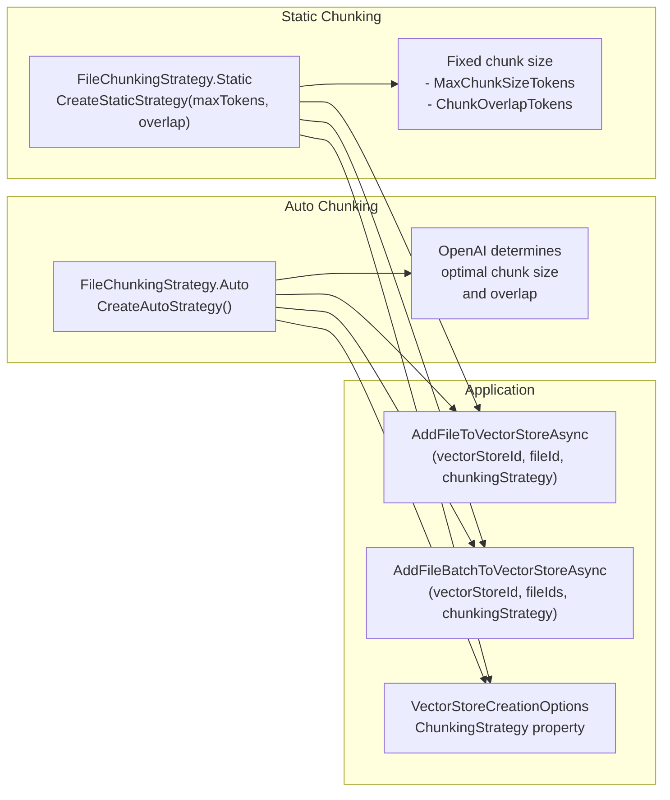
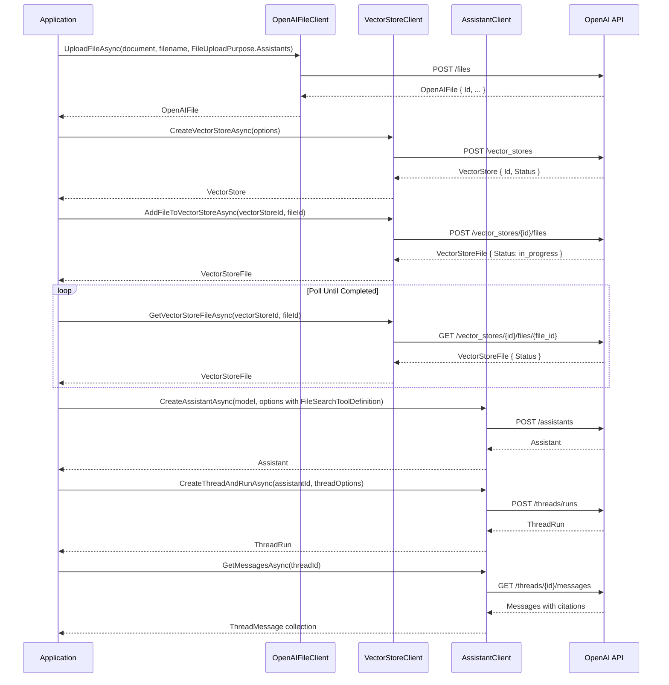
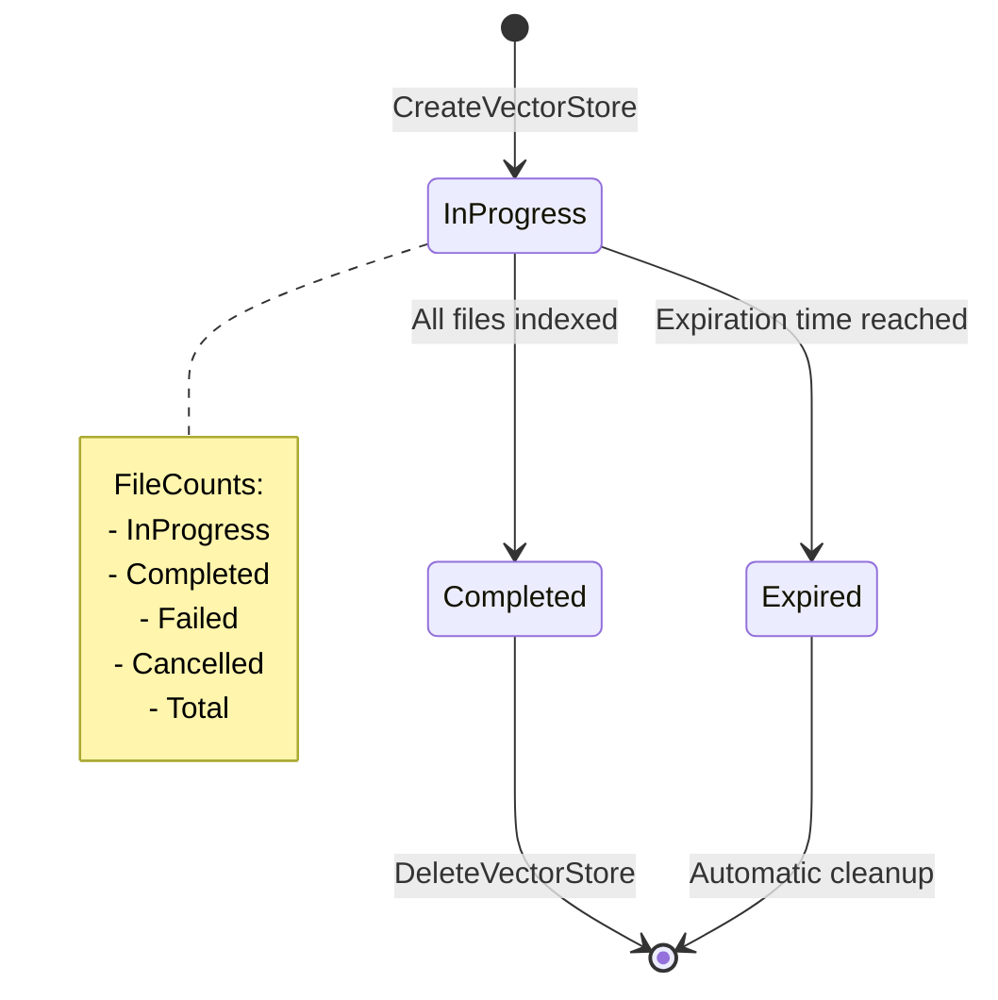

<!-- source: DeepWiki mcp.deepwiki.com · repo openai/openai-dotnet · page 4.8 Files and Vector Stores · fetched 2026-10-26 -->

# Files and Vector Stores

<details>
<summary>Relevant source files</summary>

The following files were used as context for generating this wiki page:

- [api/OpenAI.net8.0.cs](api/OpenAI.net8.0.cs)
- [api/OpenAI.netstandard2.0.cs](api/OpenAI.netstandard2.0.cs)
- [examples/Chat/Example08_ChatSerialization.cs](examples/Chat/Example08_ChatSerialization.cs)
- [src/Custom/Assistants/AssistantClient.cs](src/Custom/Assistants/AssistantClient.cs)
- [src/Custom/Audio/AudioClient.cs](src/Custom/Audio/AudioClient.cs)
- [src/Custom/Embeddings/EmbeddingClient.cs](src/Custom/Embeddings/EmbeddingClient.cs)
- [src/Custom/Images/ImageClient.cs](src/Custom/Images/ImageClient.cs)
- [src/Custom/Moderations/ModerationClient.cs](src/Custom/Moderations/ModerationClient.cs)
- [src/Custom/VectorStores/VectorStoreClient.cs](src/Custom/VectorStores/VectorStoreClient.cs)
- [src/Generated/Models/OpenAIContext.cs](src/Generated/Models/OpenAIContext.cs)
- [src/Generated/ModerationClient.cs](src/Generated/ModerationClient.cs)
- [src/Generated/OpenAIModelFactory.cs](src/Generated/OpenAIModelFactory.cs)
- [tests/Assistants/Assistants.VectorStoresTests.cs](tests/Assistants/Assistants.VectorStoresTests.cs)
- [tests/Assistants/AssistantsTests.cs](tests/Assistants/AssistantsTests.cs)
- [tests/Responses/ResponsesTests.cs](tests/Responses/ResponsesTests.cs)
- [tests/SessionRecords/ResponsesToolTests/ImageGenToolInputMaskWithFileId.json](tests/SessionRecords/ResponsesToolTests/ImageGenToolInputMaskWithFileId.json)
- [tests/SessionRecords/ResponsesToolTests/ImageGenToolInputMaskWithFileIdAsync.json](tests/SessionRecords/ResponsesToolTests/ImageGenToolInputMaskWithFileIdAsync.json)
- [tests/SessionRecords/ResponsesToolTests/ImageGenToolInputMaskWithImageUri.json](tests/SessionRecords/ResponsesToolTests/ImageGenToolInputMaskWithImageUri.json)
- [tests/SessionRecords/ResponsesToolTests/ImageGenToolInputMaskWithImageUriAsync.json](tests/SessionRecords/ResponsesToolTests/ImageGenToolInputMaskWithImageUriAsync.json)
- [tspCodeModel.json](tspCodeModel.json)

</details>


## Purpose and Scope

This document describes the file management and vector storage capabilities provided by the OpenAI .NET SDK through the `OpenAIFileClient` and `VectorStoreClient` classes. These clients enable uploading files to OpenAI, organizing them into vector stores for semantic search, and integrating them with other OpenAI features such as Assistants for Retrieval Augmented Generation (RAG).

For information about using files and vector stores with the Assistants API, see [Assistants Client](#4.4). For information about file search as a tool, see [File Search Tool](#6.2).

## Architecture Overview

The file and vector store system consists of two primary client classes that work together to enable document-based AI workflows:



**Sources:** [api/OpenAI.netstandard2.0.cs:105-111](), [src/Custom/VectorStores/VectorStoreClient.cs:1-100]()

## OpenAIFileClient

The `OpenAIFileClient` provides file management operations for uploading, downloading, and managing files in the OpenAI service. Files can serve multiple purposes including assistant retrieval, vision tasks, fine-tuning, and batch processing.

### Client Instantiation

The client can be instantiated directly or obtained from `OpenAIClient`:

| Constructor Pattern | Description |
|---|---|
| `new OpenAIFileClient(apiKey)` | Simple API key authentication |
| `new OpenAIFileClient(credential)` | Using `ApiKeyCredential` |
| `new OpenAIFileClient(credential, options)` | With custom endpoint or configuration |
| `openAIClient.GetOpenAIFileClient()` | Factory method from parent client |

**Sources:** [api/OpenAI.netstandard2.0.cs:1563-1591]()

### File Upload Purposes

Files must be uploaded with a specific purpose that determines how they can be used:

| Purpose | Value | Use Case |
|---|---|---|
| `FileUploadPurpose.Assistants` | `"assistants"` | File search and code interpreter in assistants |
| `FileUploadPurpose.Vision` | `"vision"` | Image inputs for vision-capable models |
| `FileUploadPurpose.Batch` | `"batch"` | Batch API request files |
| `FileUploadPurpose.FineTune` | `"fine-tune"` | Fine-tuning training data |

**Sources:** [api/OpenAI.netstandard2.0.cs:1657-1663]()

### Core File Operations



**Sources:** [api/OpenAI.netstandard2.0.cs:1593-1640]()

### OpenAIFile Model

The `OpenAIFile` class represents a file stored in the OpenAI service:

| Property | Type | Description |
|---|---|---|
| `Id` | `string` | Unique file identifier |
| `Bytes` | `long` | File size in bytes |
| `CreatedAt` | `DateTimeOffset` | Upload timestamp |
| `Filename` | `string` | Original filename |
| `Purpose` | `FileUploadPurpose` | Intended use of the file |

**Sources:** [api/OpenAI.netstandard2.0.cs:1642-1655]()

## VectorStoreClient

The `VectorStoreClient` manages vector stores, which are collections of files that have been indexed for semantic search. Vector stores enable retrieval augmented generation (RAG) by allowing assistants to search through document content.

### Client Instantiation

Similar to `OpenAIFileClient`, the vector store client supports multiple instantiation patterns:

| Constructor Pattern | Description |
|---|---|
| `new VectorStoreClient(apiKey)` | Simple API key authentication |
| `new VectorStoreClient(credential)` | Using `ApiKeyCredential` |
| `new VectorStoreClient(credential, options)` | With custom configuration |
| `openAIClient.GetVectorStoreClient()` | Factory method from parent client |

**Sources:** [src/Custom/VectorStores/VectorStoreClient.cs:36-83](), [api/OpenAI.netstandard2.0.cs:27]()

### Vector Store Lifecycle



**Sources:** [src/Custom/VectorStores/VectorStoreClient.cs:108-644]()

### VectorStore Model

The `VectorStore` class represents an indexed collection of files:

| Property | Type | Description |
|---|---|---|
| `Id` | `string` | Unique vector store identifier |
| `Name` | `string` | Display name for the vector store |
| `Status` | `VectorStoreStatus` | Processing status: `InProgress`, `Completed`, `Expired` |
| `FileCounts` | `VectorStoreFileCounts` | Count of files by status |
| `CreatedAt` | `DateTimeOffset` | Creation timestamp |
| `ExpiresAt` | `DateTimeOffset?` | Optional expiration time |
| `LastActiveAt` | `DateTimeOffset?` | Last usage timestamp |
| `Metadata` | `IReadOnlyDictionary<string, string>` | Custom key-value pairs |

**Sources:** [api/OpenAI.netstandard2.0.cs:2671-2686]()

### File Chunking Strategies

When adding files to a vector store, you can specify how the content should be chunked for indexing:



**Sources:** [api/OpenAI.netstandard2.0.cs:2626-2655]()

### VectorStoreFile Status Tracking

Files added to a vector store progress through several states:

| Status | Description |
|---|---|
| `InProgress` | File is being chunked and indexed |
| `Completed` | File is ready for search |
| `Cancelled` | Processing was cancelled |
| `Failed` | Indexing failed (see `LastError`) |

**Sources:** [api/OpenAI.netstandard2.0.cs:2755-2781]()

### Vector Store Search (Experimental)

The `SearchVectorStore` method enables direct semantic search over vector store content:

```csharp
// Method signature
public virtual Task<ClientResult<VectorStoreSearchResult>> SearchVectorStoreAsync(
    string vectorStoreId,
    string query,
    VectorStoreSearchOptions options = null,
    CancellationToken cancellationToken = default)
```

| Parameter | Type | Description |
|---|---|---|
| `vectorStoreId` | `string` | The vector store to search |
| `query` | `string` | Natural language search query |
| `options.Filter` | `BinaryData` | JSON filter to restrict search scope |
| `options.IncludeFileChunks` | `bool?` | Whether to return matching chunks |
| `options.MaxResults` | `int?` | Maximum number of results |
| `options.RankingOptions` | `VectorStoreSearchRankingOptions` | Ranking configuration |

**Sources:** [src/Custom/VectorStores/VectorStoreClient.cs:593-644](), [api/OpenAI.netstandard2.0.cs:2524-2533]()

## Integration with Assistants API

Files and vector stores are primarily used with the Assistants API to enable retrieval augmented generation. The integration occurs through tool definitions and resource specifications.

### RAG Workflow with Assistants



**Sources:** [examples/Assistants/Example01_RetrievalAugmentedGeneration.cs:1-152]()

### VectorStoreCreationHelper

The `VectorStoreCreationHelper` provides a convenient way to create and populate vector stores inline during assistant creation:

```csharp
AssistantCreationOptions assistantOptions = new()
{
    Name = "Document Assistant",
    Tools = { new FileSearchToolDefinition() },
    ToolResources = new()
    {
        FileSearch = new()
        {
            NewVectorStores =
            {
                new VectorStoreCreationHelper([fileId1, fileId2], chunkingStrategy, metadata)
            }
        }
    }
};
```

| Property | Type | Description |
|---|---|---|
| `FileIds` | `IList<string>` | Files to include in the vector store |
| `ChunkingStrategy` | `FileChunkingStrategy` | How to chunk the files |
| `Metadata` | `IDictionary<string, string>` | Custom metadata |

**Sources:** [api/OpenAI.netstandard2.0.cs:1049-1054](), [examples/Assistants/Example01_RetrievalAugmentedGeneration.cs:74-82]()

### FileSearchToolDefinition

Assistants use `FileSearchToolDefinition` to enable semantic search over vector stores:

```csharp
FileSearchToolDefinition tool = new()
{
    MaxResults = 20,
    RankingOptions = new FileSearchRankingOptions(scoreThreshold: 0.5f)
    {
        Ranker = FileSearchRanker.Auto
    }
};
```

| Property | Type | Description |
|---|---|---|
| `MaxResults` | `int?` | Maximum search results to retrieve (default: based on model) |
| `RankingOptions` | `FileSearchRankingOptions` | Score threshold and ranker selection |

**Sources:** [api/OpenAI.netstandard2.0.cs:1055-1073]()

### FileSearchToolResources

The `FileSearchToolResources` class specifies which vector stores an assistant can search:

```csharp
ToolResources toolResources = new()
{
    FileSearch = new()
    {
        VectorStoreIds = { existingVectorStoreId },
        NewVectorStores = { new VectorStoreCreationHelper([fileId]) }
    }
};
```

| Property | Type | Description |
|---|---|---|
| `VectorStoreIds` | `IList<string>` | Existing vector stores to use |
| `NewVectorStores` | `IList<VectorStoreCreationHelper>` | New vector stores to create |

**Sources:** [api/OpenAI.netstandard2.0.cs:1074-1084]()

## Pagination Support

Both `OpenAIFileClient` and `VectorStoreClient` provide paginated list operations using the `AsyncPageableCollection<T>` pattern:

### File Pagination

```csharp
AsyncPageableCollection<OpenAIFile> files = fileClient.GetFilesAsync(
    purpose: FileUploadPurpose.Assistants,
    new FileCollectionOptions
    {
        PageSizeLimit = 100,
        AfterId = "file_abc123",  // Cursor for pagination
        Order = FileCollectionOrder.Descending
    });

await foreach (OpenAIFile file in files)
{
    Console.WriteLine($"{file.Filename}: {file.Id}");
}
```

**Sources:** [api/OpenAI.netstandard2.0.cs:1614-1622]()

### Vector Store Pagination

```csharp
AsyncPageableCollection<VectorStore> stores = vectorClient.GetVectorStoresAsync(
    new VectorStoreCollectionOptions
    {
        PageSizeLimit = 20,
        AfterId = "vs_abc123",
        BeforeId = "vs_xyz789",
        Order = VectorStoreCollectionOrder.Ascending
    });

await foreach (VectorStore store in stores)
{
    Console.WriteLine($"{store.Name}: {store.FileCounts.Completed} files");
}
```

**Sources:** [src/Custom/VectorStores/VectorStoreClient.cs:213-260]()

### VectorStoreFile Pagination

```csharp
AsyncPageableCollection<VectorStoreFile> files = vectorClient.GetVectorStoreFilesAsync(
    vectorStoreId,
    new VectorStoreFileCollectionOptions
    {
        Filter = VectorStoreFileStatusFilter.Completed,
        PageSizeLimit = 50,
        Order = VectorStoreFileCollectionOrder.Descending
    });

await foreach (VectorStoreFile file in files)
{
    Console.WriteLine($"File {file.Id}: {file.Status}");
}
```

**Sources:** [src/Custom/VectorStores/VectorStoreClient.cs:316-365]()

## Common Patterns and Best Practices

### Pattern: Assistant RAG with Temporary Resources

```csharp
OpenAIClient client = new(apiKey);
OpenAIFileClient fileClient = client.GetOpenAIFileClient();
VectorStoreClient vectorClient = client.GetVectorStoreClient();
AssistantClient assistantClient = client.GetAssistantClient();

// Upload document
OpenAIFile file = await fileClient.UploadFileAsync(
    documentStream,
    "data.json",
    FileUploadPurpose.Assistants);

// Create vector store with file
VectorStore vectorStore = await vectorClient.CreateVectorStoreAsync(
    new VectorStoreCreationOptions
    {
        Name = "Product Data",
        FileIds = { file.Id },
        ChunkingStrategy = FileChunkingStrategy.CreateAutoStrategy()
    });

// Create assistant with file search
Assistant assistant = await assistantClient.CreateAssistantAsync(
    "gpt-4o",
    new AssistantCreationOptions
    {
        Tools = { new FileSearchToolDefinition() },
        ToolResources = new()
        {
            FileSearch = new() { VectorStoreIds = { vectorStore.Id } }
        }
    });

// Use assistant...
ThreadRun run = await assistantClient.CreateThreadAndRunAsync(
    assistant.Id,
    new ThreadCreationOptions
    {
        InitialMessages = { "What products sold best in Q1?" }
    });

// Clean up
await assistantClient.DeleteAssistantAsync(assistant.Id);
await vectorClient.DeleteVectorStoreAsync(vectorStore.Id);
await fileClient.DeleteFileAsync(file.Id);
```

**Sources:** [examples/Assistants/Example01_RetrievalAugmentedGenerationAsync.cs:1-152]()

### Pattern: Inline Vector Store Creation

```csharp
// Create assistant with inline vector store creation
Assistant assistant = await assistantClient.CreateAssistantAsync(
    "gpt-4o",
    new AssistantCreationOptions
    {
        Name = "Sales Analysis Assistant",
        Instructions = "Help analyze sales data from uploaded documents.",
        Tools = { new FileSearchToolDefinition() },
        ToolResources = new()
        {
            FileSearch = new()
            {
                NewVectorStores =
                {
                    new VectorStoreCreationHelper(
                        fileIds: [fileId1, fileId2, fileId3],
                        chunkingStrategy: FileChunkingStrategy.CreateStaticStrategy(
                            maxChunkSizeTokens: 800,
                            chunkOverlapTokens: 400),
                        metadata: new Dictionary<string, string>
                        {
                            ["purpose"] = "sales_analysis",
                            ["year"] = "2024"
                        })
                }
            }
        }
    });
```

**Sources:** [examples/Assistants/Example01_RetrievalAugmentedGeneration.cs:60-83]()

### Pattern: Batch File Processing

```csharp
// Upload multiple files
string[] filePaths = Directory.GetFiles("./documents", "*.pdf");
List<string> fileIds = new();

foreach (string path in filePaths)
{
    OpenAIFile file = await fileClient.UploadFileAsync(
        path,
        FileUploadPurpose.Assistants);
    fileIds.Add(file.Id);
}

// Add all files to vector store in a batch
VectorStoreFileBatch batch = await vectorClient.AddFileBatchToVectorStoreAsync(
    vectorStoreId,
    fileIds,
    FileChunkingStrategy.CreateAutoStrategy());

// Poll batch status
while (batch.Status == VectorStoreFileBatchStatus.InProgress)
{
    await Task.Delay(TimeSpan.FromSeconds(2));
    batch = await vectorClient.GetVectorStoreFileBatchAsync(
        vectorStoreId,
        batch.Id);
}

Console.WriteLine($"Completed: {batch.FileCounts.Completed}");
Console.WriteLine($"Failed: {batch.FileCounts.Failed}");
```

**Sources:** [src/Custom/VectorStores/VectorStoreClient.cs:425-475]()

### Pattern: Vision Files with Assistants

```csharp
OpenAIFileClient fileClient = client.GetOpenAIFileClient();
AssistantClient assistantClient = client.GetAssistantClient();

// Upload image for vision
OpenAIFile imageFile = await fileClient.UploadFileAsync(
    imagePath,
    FileUploadPurpose.Vision);

// Create thread with image message
AssistantThread thread = await assistantClient.CreateThreadAsync(
    new ThreadCreationOptions
    {
        InitialMessages =
        {
            new ThreadInitializationMessage(
                MessageRole.User,
                [
                    "Please analyze this image:",
                    MessageContent.FromImageFileId(imageFile.Id)
                ])
        }
    });

// Vision-capable assistant processes the image
ThreadRun run = await assistantClient.CreateRunAsync(
    thread.Id,
    visionAssistantId);
```

**Sources:** [examples/Assistants/Example05_AssistantsWithVisionAsync.cs:1-78]()

## Error Handling and Status Monitoring

### VectorStore Processing Status



**Sources:** [api/OpenAI.netstandard2.0.cs:2688-2709]()

### File Processing Errors

When files fail to process, the `VectorStoreFile` includes error details:

```csharp
VectorStoreFile file = await vectorClient.GetVectorStoreFileAsync(
    vectorStoreId,
    fileId);

if (file.Status == VectorStoreFileStatus.Failed)
{
    VectorStoreFileError error = file.LastError;
    Console.WriteLine($"Error Code: {error.Code}");
    Console.WriteLine($"Message: {error.Message}");
}
```

| Error Code | Description |
|---|---|
| `ServerError` | Temporary OpenAI service issue |
| `UnsupportedFile` | File type not supported for indexing |
| `InvalidFile` | File content is malformed or corrupt |

**Sources:** [api/OpenAI.netstandard2.0.cs:2783-2795]()

## Thread Safety and Resource Management

Both `OpenAIFileClient` and `VectorStoreClient` are thread-safe and can be registered as singletons:

```csharp
// ASP.NET Core dependency injection
builder.Services.AddSingleton<OpenAIFileClient>(sp =>
    new OpenAIFileClient(
        Environment.GetEnvironmentVariable("OPENAI_API_KEY")));

builder.Services.AddSingleton<VectorStoreClient>(sp =>
    new VectorStoreClient(
        Environment.GetEnvironmentVariable("OPENAI_API_KEY")));
```

Files and vector stores are persistent resources that exist in the OpenAI service until explicitly deleted. Always clean up temporary resources to avoid unnecessary storage costs.

**Sources:** [src/Custom/VectorStores/VectorStoreClient.cs:34-100]()

---

