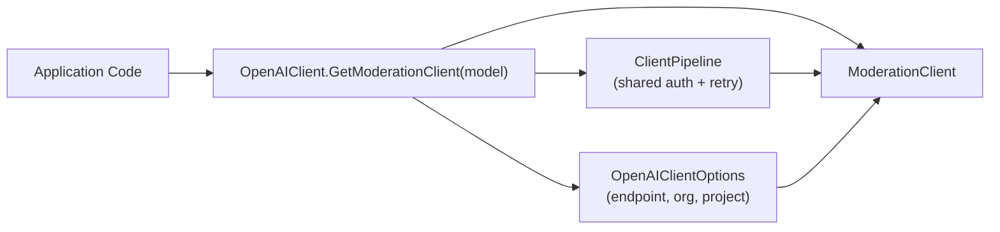
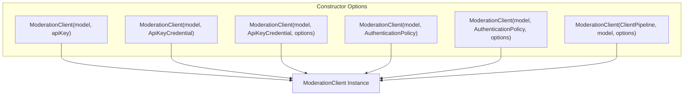
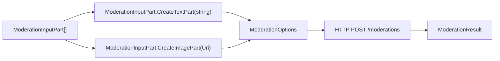
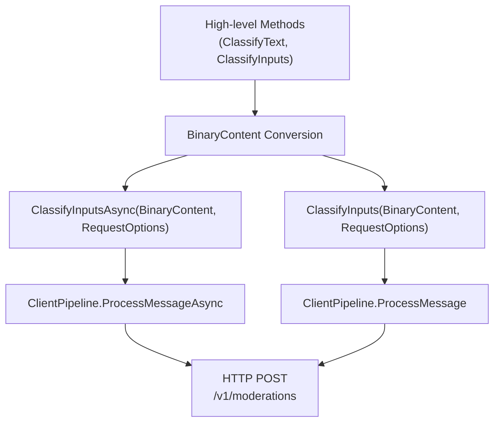
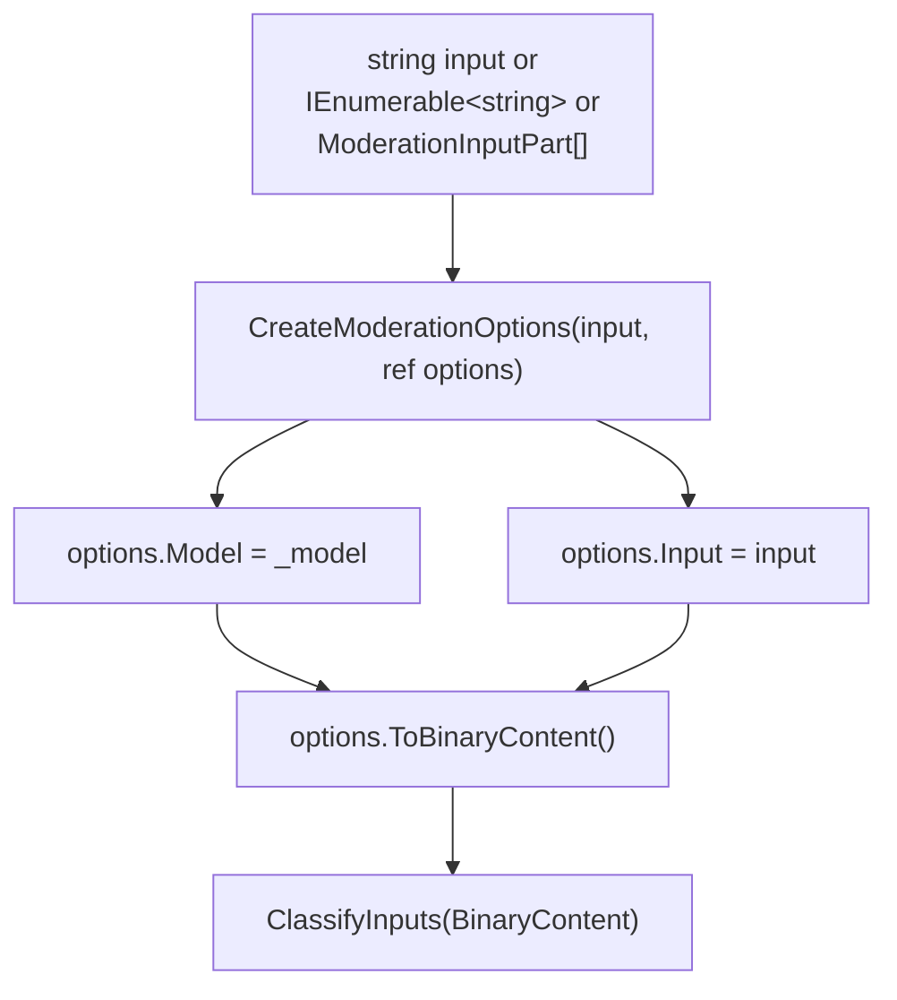
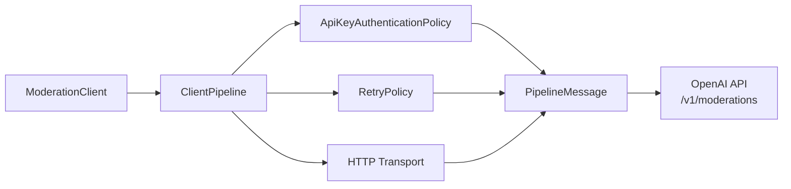

<!-- source: DeepWiki mcp.deepwiki.com · repo openai/openai-dotnet · page 4.9 Moderation Client · fetched 2026-10-26 -->

# Moderation Client

<details>
<summary>Relevant source files</summary>

The following files were used as context for generating this wiki page:

- [api/OpenAI.net8.0.cs](api/OpenAI.net8.0.cs)
- [api/OpenAI.netstandard2.0.cs](api/OpenAI.netstandard2.0.cs)
- [examples/Chat/Example08_ChatSerialization.cs](examples/Chat/Example08_ChatSerialization.cs)
- [src/Custom/Assistants/AssistantClient.cs](src/Custom/Assistants/AssistantClient.cs)
- [src/Custom/Audio/AudioClient.cs](src/Custom/Audio/AudioClient.cs)
- [src/Custom/Embeddings/EmbeddingClient.cs](src/Custom/Embeddings/EmbeddingClient.cs)
- [src/Custom/Images/ImageClient.cs](src/Custom/Images/ImageClient.cs)
- [src/Custom/Moderations/ModerationClient.cs](src/Custom/Moderations/ModerationClient.cs)
- [src/Custom/VectorStores/VectorStoreClient.cs](src/Custom/VectorStores/VectorStoreClient.cs)
- [src/Generated/Models/OpenAIContext.cs](src/Generated/Models/OpenAIContext.cs)
- [src/Generated/ModerationClient.cs](src/Generated/ModerationClient.cs)
- [src/Generated/OpenAIModelFactory.cs](src/Generated/OpenAIModelFactory.cs)
- [tests/Responses/ResponsesTests.cs](tests/Responses/ResponsesTests.cs)
- [tspCodeModel.json](tspCodeModel.json)

</details>


The `ModerationClient` provides functionality for classifying text and image content to detect potentially harmful material across multiple safety categories. This client is part of the stable API surface and uses OpenAI's moderation models to evaluate inputs for violations of content policies.

For general information about obtaining clients from the factory, see [OpenAIClient](#4.1). For working with text generation, see [Chat Client](#4.2). For other content moderation approaches within assistant or response workflows, see [Assistants Client](#4.4) and [Responses API Client](#4.3).

## Client Instantiation

### Factory Method

The recommended approach is to obtain a `ModerationClient` from the `OpenAIClient` factory:



**Factory Method Invocation**

Sources: [api/OpenAI.netstandard2.0.cs:23](), [api/OpenAI.net8.0.cs:33]()

The `OpenAIClient.GetModerationClient(string model)` method creates a `ModerationClient` instance that shares authentication and pipeline configuration with the parent client.

### Direct Instantiation

`ModerationClient` can also be instantiated directly with various authentication options:



**Constructor Implementations**

Sources: [src/Custom/Moderations/ModerationClient.cs:29-115]()

All constructors require a `model` parameter specifying which moderation model to use. The client stores this model name internally and includes it in all classification requests.

## Authentication Patterns

The client follows the standard SDK authentication pattern:

| Constructor Parameter | Purpose | Lines |
|----------------------|---------|-------|
| `string apiKey` | Convenience constructor wrapping API key in credential | [src/Custom/Moderations/ModerationClient.cs:34]() |
| `ApiKeyCredential credential` | Standard credential-based authentication | [src/Custom/Moderations/ModerationClient.cs:47]() |
| `AuthenticationPolicy authenticationPolicy` | Custom authentication policy (experimental) | [src/Custom/Moderations/ModerationClient.cs:72-84]() |
| `ClientPipeline pipeline` | Pre-configured pipeline for advanced scenarios | [src/Custom/Moderations/ModerationClient.cs:106]() |

Sources: [src/Custom/Moderations/ModerationClient.cs:29-115]()

## Classification Methods

### Text Classification Architecture

```mermaid
graph TB
    subgraph "Single Input"
        ClassifyText["ClassifyText(string)"] --> CreateOptions1["CreateModerationOptions"]
        CreateOptions1 --> ToBinary1["ToBinaryContent()"]
        ToBinary1 --> Protocol1["ClassifyText(BinaryContent)"]
        Protocol1 --> Result1["ClientResult&lt;ModerationResult&gt;"]
    end
    
    subgraph "Multiple Inputs"
        ClassifyTexts["ClassifyText(IEnumerable&lt;string&gt;)"] --> CreateOptions2["CreateModerationOptions"]
        CreateOptions2 --> ToBinary2["ToBinaryContent()"]
        ToBinary2 --> Protocol2["ClassifyText(BinaryContent)"]
        Protocol2 --> Result2["ClientResult&lt;ModerationResultCollection&gt;"]
    end
    
    subgraph "Multimodal"
        ClassifyInputs["ClassifyInputs(IEnumerable&lt;ModerationInputPart&gt;)"] --> CreateOptions3["CreateModerationOptions"]
        CreateOptions3 --> ToBinary3["ToBinaryContent()"]
        ToBinary3 --> Protocol3["ClassifyInputs(BinaryContent)"]
        Protocol3 --> Result3["ClientResult&lt;ModerationResult&gt;"]
    end
```



**Method Implementations**

Sources: [src/Custom/Moderations/ModerationClient.cs:129-257]()

### Single Text Classification

The `ClassifyText` method evaluates a single string input:

```csharp
public virtual async Task<ClientResult<ModerationResult>> ClassifyTextAsync(
    string input, 
    CancellationToken cancellationToken = default)
```

```csharp
public virtual ClientResult<ModerationResult> ClassifyText(
    string input, 
    CancellationToken cancellationToken = default)
```

**Implementation Details:**
1. Validates input is not null or empty
2. Creates `ModerationOptions` with the model name
3. Converts to `BinaryContent`
4. Calls protocol method `ClassifyText(BinaryContent, RequestOptions)`
5. Extracts first result from collection and returns it

Sources: [src/Custom/Moderations/ModerationClient.cs:129-161]()

### Batch Text Classification

The batch overload processes multiple strings:

```csharp
public virtual async Task<ClientResult<ModerationResultCollection>> ClassifyTextAsync(
    IEnumerable<string> inputs, 
    CancellationToken cancellationToken = default)
```

```csharp
public virtual ClientResult<ModerationResultCollection> ClassifyText(
    IEnumerable<string> inputs, 
    CancellationToken cancellationToken = default)
```

Returns a `ModerationResultCollection` containing results for each input in the same order.

Sources: [src/Custom/Moderations/ModerationClient.cs:163-195]()

### Multimodal Classification

The `ClassifyInputs` method supports both text and image content:

```csharp
[Experimental("OPENAI001")]
public virtual async Task<ClientResult<ModerationResult>> ClassifyInputsAsync(
    IEnumerable<ModerationInputPart> inputParts, 
    CancellationToken cancellationToken = default)
```

**Multimodal Input Flow:**



Sources: [src/Custom/Moderations/ModerationClient.cs:197-211]()

The method is marked `[Experimental("OPENAI001")]` indicating it's part of the experimental API surface subject to potential breaking changes.

### Batch Multimodal Classification

For multiple multimodal inputs:

```csharp
[Experimental("OPENAI001")]
public virtual async Task<ClientResult<ModerationResultCollection>> ClassifyInputsAsync(
    IEnumerable<IEnumerable<ModerationInputPart>> inputPartsByInput, 
    CancellationToken cancellationToken = default)
```

Each element in `inputPartsByInput` represents one complete input (which may contain multiple parts like text + image).

Sources: [src/Custom/Moderations/ModerationClient.cs:213-257]()

## Protocol Methods

The generated protocol methods provide low-level access:



**Protocol Method Signatures:**

Sources: [src/Generated/ModerationClient.cs:25-40]()

These methods:
- Accept pre-serialized `BinaryContent`
- Return untyped `ClientResult` instead of strongly-typed results
- Provide full control over request options
- Are marked `[Experimental("OPENAI001")]`

## Client Properties

The client exposes two informational properties:

```csharp
[Experimental("OPENAI001")]
public string Model { get; }

[Experimental("OPENAI001")]
public Uri Endpoint { get; }
```

**Property Storage:**

Sources: [src/Custom/Moderations/ModerationClient.cs:120-127]()

- `Model`: Returns the model name provided during construction (stored in `_model` field)
- `Endpoint`: Returns the endpoint URI resolved from `OpenAIClientOptions` (stored in `_endpoint` field)

## Internal Architecture

### Option Building Pattern



**Option Creation Methods:**

Sources: [src/Custom/Moderations/ModerationClient.cs:259-282]()

The `CreateModerationOptions` helper methods (lines 259-282) populate a `ModerationOptions` instance with:
- The model name from the client's `_model` field
- The input content in the appropriate format

### Pipeline Integration



Sources: [src/Custom/Moderations/ModerationClient.cs:91-92](), [src/Generated/ModerationClient.cs:14-42]()

The `ClientPipeline` is either:
- Shared from the parent `OpenAIClient` (factory pattern)
- Created via `OpenAIClient.CreatePipeline()` (direct instantiation)

## Result Types

### ModerationResult

Represents the classification result for a single input. Contains:
- Category flags indicating detected violations
- Category scores (confidence levels)
- Overall flagged status

### ModerationResultCollection

Represents results for multiple inputs:
- Implements `IEnumerable<ModerationResult>`
- Results correspond to inputs by index
- Includes overall metadata about the request

The convenience methods `ClassifyText(string)` automatically extract the first result from the collection, while batch methods return the full collection.

Sources: [src/Custom/Moderations/ModerationClient.cs:143-144, 177]()

## Code Generation

The client follows the SDK's code generation pattern:

| Aspect | Implementation |
|--------|----------------|
| Base class | Generated in `src/Generated/ModerationClient.cs` |
| Custom extensions | Defined in `src/Custom/Moderations/ModerationClient.cs` |
| Type name | `[CodeGenType("Moderations")]` remaps to `ModerationClient` |
| Suppressions | `[CodeGenSuppress]` hides generated constructors and methods |
| Public API surface | Exported in `api/OpenAI.netstandard2.0.cs` and `api/OpenAI.net8.0.cs` |

Sources: [src/Custom/Moderations/ModerationClient.cs:15-23](), [src/Generated/ModerationClient.cs:1-42]()

The custom partial class adds:
- Strongly-typed convenience methods
- Multiple constructor overloads
- Helper methods for option building
- Documentation and parameter validation

---

