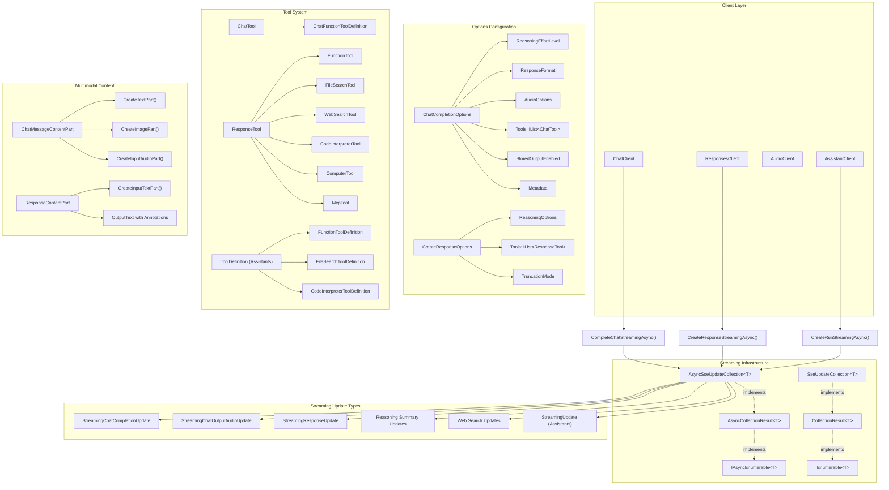
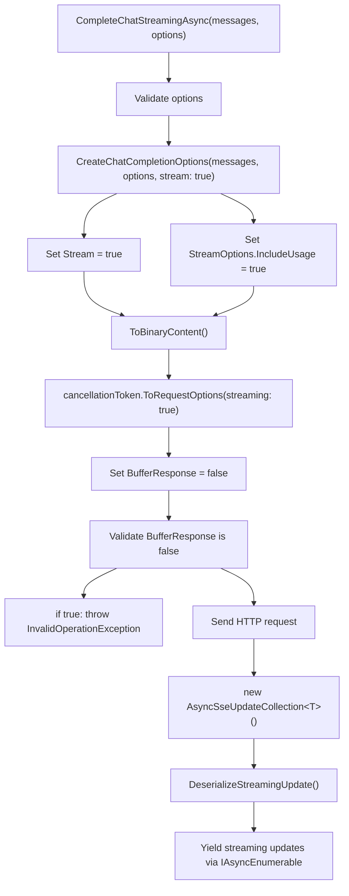
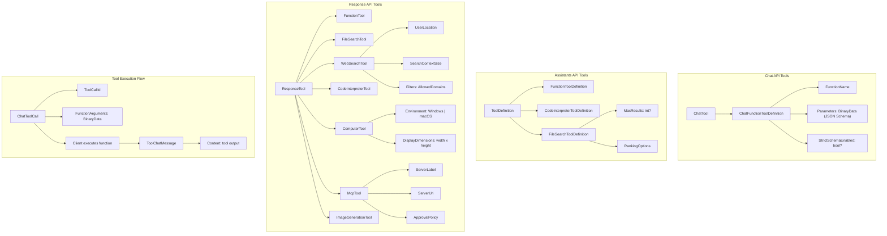
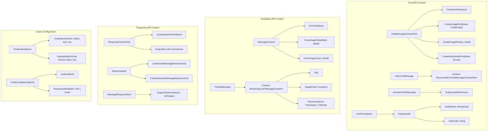
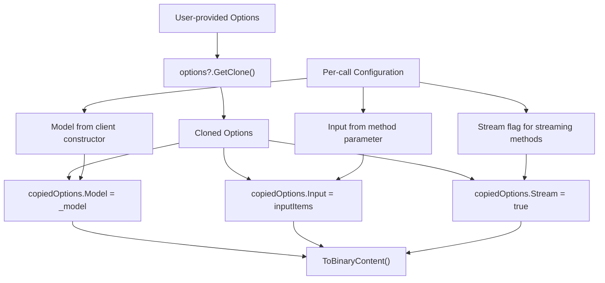
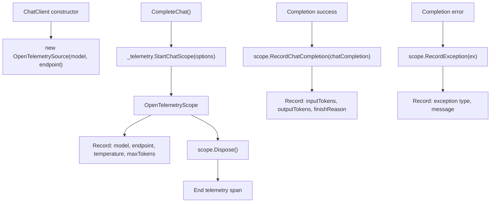
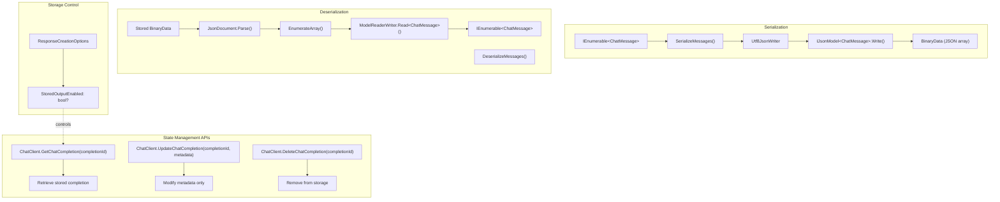

<!-- source: DeepWiki mcp.deepwiki.com · repo openai/openai-dotnet · page 5 Advanced Features · fetched 2026-10-26 -->

# Advanced Features

<details>
<summary>Relevant source files</summary>

The following files were used as context for generating this wiki page:

- [api/OpenAI.net8.0.cs](api/OpenAI.net8.0.cs)
- [api/OpenAI.netstandard2.0.cs](api/OpenAI.netstandard2.0.cs)
- [src/Custom/Chat/ChatClient.cs](src/Custom/Chat/ChatClient.cs)
- [src/Custom/Chat/ChatCompletionOptions.cs](src/Custom/Chat/ChatCompletionOptions.cs)
- [src/Generated/Models/OpenAIContext.cs](src/Generated/Models/OpenAIContext.cs)
- [src/Generated/OpenAIModelFactory.cs](src/Generated/OpenAIModelFactory.cs)
- [tests/Chat/ChatTests.cs](tests/Chat/ChatTests.cs)
- [tests/Responses/ResponsesTests.cs](tests/Responses/ResponsesTests.cs)
- [tests/SessionRecords/ChatTests/ChatServiceTierWorks.json](tests/SessionRecords/ChatTests/ChatServiceTierWorks.json)
- [tests/SessionRecords/ChatTests/ChatServiceTierWorksAsync.json](tests/SessionRecords/ChatTests/ChatServiceTierWorksAsync.json)
- [tests/SessionRecords/ChatTests/StructuredRefusalWorks.json](tests/SessionRecords/ChatTests/StructuredRefusalWorks.json)
- [tests/SessionRecords/ChatTests/StructuredRefusalWorksAsync.json](tests/SessionRecords/ChatTests/StructuredRefusalWorksAsync.json)
- [tests/SessionRecords/ChatTests/ValidateConcurrency.json](tests/SessionRecords/ChatTests/ValidateConcurrency.json)
- [tests/SessionRecords/ChatTests/ValidateConcurrencyAsync.json](tests/SessionRecords/ChatTests/ValidateConcurrencyAsync.json)
- [tests/SessionRecords/ChatTests/WebSearchWorks.json](tests/SessionRecords/ChatTests/WebSearchWorks.json)
- [tests/SessionRecords/ChatTests/WebSearchWorksAsync.json](tests/SessionRecords/ChatTests/WebSearchWorksAsync.json)
- [tspCodeModel.json](tspCodeModel.json)

</details>


This page provides an overview of advanced SDK capabilities that extend beyond basic API request-response patterns. These features enable sophisticated integration scenarios including real-time streaming, multimodal content processing, structured output validation, efficient pagination, and persistent state management.

For specific implementation details, see the following child pages:
- [Streaming Patterns](#5.1) - SSE-based streaming response handling
- [Multimodal Content](#5.2) - Images, audio, and files in messages
- [Structured Outputs and JSON Schema](#5.3) - Response format validation
- [Pagination and Collection Results](#5.4) - Cursor-based navigation patterns
- [State Management and Persistence](#5.5) - Storage, retrieval, and metadata

## Feature Categories

The SDK's advanced features can be grouped into seven major categories:

| Category | Primary Classes | Key Capabilities |
|----------|----------------|------------------|
| **Streaming** | `AsyncCollectionResult<T>`, `CollectionResult<T>`, streaming update types | Real-time SSE-based response streaming with token-by-token delivery and usage tracking |
| **Multimodal** | `ChatMessageContentPart`, `MessageContent`, `ResponseContentPart` | Support for text, images, audio, and file inputs/outputs across APIs |
| **Structured Outputs** | `ChatResponseFormat`, `AssistantResponseFormat` | JSON Schema enforcement with strict mode and refusal handling |
| **Tool Integration** | `ChatTool`, `ResponseTool`, `ToolDefinition` | Function calling, web search, file search, code interpreter, computer use, MCP |
| **Reasoning** | `ChatReasoningEffortLevel`, `ResponseReasoningOptions` | Extended reasoning capabilities with configurable effort and reasoning summaries |
| **Pagination** | `*CollectionOptions`, cursor properties | Cursor-based navigation with `AfterId`, `BeforeId`, `Order`, `PageSizeLimit` |
| **Persistence** | `StoredOutputEnabled`, metadata properties | Storage, retrieval, and metadata management for completions and responses |

Sources: [src/Custom/Chat/ChatClient.cs:220-280](), [src/Custom/Chat/ChatCompletionOptions.cs:1-220](), [tests/Responses/ResponsesTests.cs:1-465](), [tests/Chat/ChatTests.cs:1-900]()

## Advanced Feature Architecture

**Diagram: Advanced Feature System Overview**



Sources: [src/Custom/Chat/ChatClient.cs:230-280](), [src/Custom/Chat/ChatCompletionOptions.cs:1-220](), [tests/Responses/ResponsesTests.cs:140-260](), [tests/Chat/ChatTests.cs:142-280]()

## Streaming Response Pattern

The SDK implements a unified streaming pattern across all clients using Server-Sent Events (SSE). Methods returning `AsyncCollectionResult<T>` or `CollectionResult<T>` enable token-by-token processing of model outputs with real-time delivery.

### Streaming Method Signatures

| Client | Method | Return Type | Update Types |
|--------|--------|-------------|--------------|
| `ChatClient` | `CompleteChatStreamingAsync()` | `AsyncCollectionResult<StreamingChatCompletionUpdate>` | `ContentUpdate`, `OutputAudioUpdate`, `FunctionCallUpdate`, `ToolCallUpdate`, `Usage` |
| `ResponsesClient` | `CreateResponseStreamingAsync()` | `AsyncCollectionResult<StreamingResponseUpdate>` | `OutputTextDeltaUpdate`, `ReasoningSummaryUpdate`, `WebSearchCallUpdate`, `OutputItemDoneUpdate` |
| `AudioClient` | `TranscribeAudioStreamingAsync()` | `AsyncCollectionResult<StreamingAudioTranscriptionUpdate>` | Transcription segments with timestamps |
| `AssistantClient` | `CreateRunStreamingAsync()` | `AsyncCollectionResult<StreamingUpdate>` | `MessageContentUpdate`, `RunStepUpdate`, `ToolCallUpdate` |

**Diagram: Streaming Request Flow**



Sources: [src/Custom/Chat/ChatClient.cs:231-252](), [tests/Chat/ChatTests.cs:69-99](), [tests/Responses/ResponsesTests.cs:195-260]()

The SDK enforces that streaming methods must have `BufferResponse` set to `false` in `RequestOptions`. This validation occurs at [src/Custom/Chat/ChatClient.cs:240-243]() to prevent buffering responses that must be streamed.

### Streaming Usage Tracking

For chat completions, streaming includes final token usage by setting `StreamOptions.IncludeUsage = true` internally at [src/Custom/Chat/ChatClient.cs:27](). The final streaming update contains the complete `ChatTokenUsage` with input, output, and reasoning token counts.

Sources: [src/Custom/Chat/ChatClient.cs:27](), [tests/Chat/ChatTests.cs:88-98]()

## Reasoning Capabilities

Reasoning models like `o1`, `o3-mini`, and `gpt-5-mini` provide extended reasoning with configurable effort levels and optional reasoning summaries.

**Diagram: Reasoning Model Integration**

```mermaid
graph TB
    subgraph "Chat API Reasoning"
        ChatCompletionOptions["ChatCompletionOptions"]
        ChatCompletionOptions --> ReasoningEffortLevel["ReasoningEffortLevel: Low | Medium | High"]
        
        ChatCompletion["ChatCompletion"]
        ChatCompletion --> Usage["Usage.OutputTokenDetails"]
        Usage --> ReasoningTokenCount["ReasoningTokenCount"]
    end
    
    subgraph "Response API Reasoning"
        CreateResponseOptions["CreateResponseOptions"]
        CreateResponseOptions --> ReasoningOptions["ReasoningOptions"]
        
        ReasoningOptions --> EffortLevel["ReasoningEffortLevel"]
        ReasoningOptions --> SummaryVerbosity["ReasoningSummaryVerbosity: Auto | Detailed"]
        
        ResponseResult["ResponseResult"]
        ResponseResult --> OutputItems["OutputItems"]
        OutputItems --> ReasoningResponseItem["ReasoningResponseItem"]
        
        ReasoningResponseItem --> SummaryParts["SummaryParts: IReadOnlyList"]
        ReasoningResponseItem --> GetSummaryText["GetSummaryText()"]
    end
    
    subgraph "Streaming Reasoning"
        CreateResponseStreamingAsync["CreateResponseStreamingAsync()"]
        
        CreateResponseStreamingAsync --> ReasoningSummaryPartAddedUpdate["StreamingResponseReasoningSummaryPartAddedUpdate"]
        CreateResponseStreamingAsync --> ReasoningSummaryTextDeltaUpdate["StreamingResponseReasoningSummaryTextDeltaUpdate"]
        CreateResponseStreamingAsync --> ReasoningSummaryTextDoneUpdate["StreamingResponseReasoningSummaryTextDoneUpdate"]
        CreateResponseStreamingAsync --> ReasoningSummaryPartDoneUpdate["StreamingResponseReasoningSummaryPartDoneUpdate"]
    end
```



Sources: [src/Custom/Chat/ChatCompletionOptions.cs:156-161](), [tests/Responses/ResponsesTests.cs:290-348](), [tests/Responses/ResponsesTests.cs:400-437]()

### Reasoning Effort Levels

Reasoning effort can be constrained to balance latency, token usage, and response quality:

| Level | Use Case | Token Impact |
|-------|----------|--------------|
| `Low` | Faster responses for simpler problems | Minimal reasoning tokens |
| `Medium` | Balanced reasoning for moderate complexity | Moderate reasoning tokens |
| `High` | Deep reasoning for complex problems | Maximum reasoning tokens |

Set via `ChatCompletionOptions.ReasoningEffortLevel` at [src/Custom/Chat/ChatCompletionOptions.cs:161]() or `ResponseReasoningOptions.ReasoningEffortLevel` at [tests/Responses/ResponsesTests.cs:409]().

### Reasoning Summaries

The Response API supports streaming reasoning summaries that explain the model's thought process. Enable with `ReasoningSummaryVerbosity.Auto` or `ReasoningSummaryVerbosity.Detailed`:

```csharp
// Example from tests/Responses/ResponsesTests.cs:290-348
ReasoningOptions = new()
{
    ReasoningSummaryVerbosity = ResponseReasoningSummaryVerbosity.Auto,
    ReasoningEffortLevel = ResponseReasoningEffortLevel.High,
}
```

Streaming reasoning summaries emit four update types:
- `StreamingResponseReasoningSummaryPartAddedUpdate` - New reasoning part started
- `StreamingResponseReasoningSummaryTextDeltaUpdate` - Incremental text delta
- `StreamingResponseReasoningSummaryTextDoneUpdate` - Complete text for part
- `StreamingResponseReasoningSummaryPartDoneUpdate` - Reasoning part finished

Sources: [tests/Responses/ResponsesTests.cs:290-348](), [tests/Responses/ResponsesTests.cs:400-437]()

## Tool Integration

The SDK provides three distinct tool systems with different capabilities:

**Diagram: Tool System Hierarchy**



Sources: [tests/Responses/ResponsesTests.cs:139-164](), [tests/Responses/ResponsesTests.cs:76-137](), [tests/Chat/ChatTests.cs:350-580]()

### Web Search Tool

The `WebSearchTool` enables internet search with location context, filters, and automatic citation generation:

```csharp
// Example from tests/Responses/ResponsesTests.cs:195-209
ResponseTool.CreateWebSearchTool(
    userLocation: WebSearchToolLocation.CreateApproximateLocation(city: "San Francisco"),
    searchContextSize: WebSearchToolContextSize.Low)
```

Web search results include:
- `WebSearchCallResponseItem` with search metadata
- `OutputTextAnnotations` with URL citations referencing sources
- Streaming updates: `WebSearchCallInProgressUpdate`, `WebSearchCallSearchingUpdate`, `WebSearchCallCompletedUpdate`

Sources: [tests/Responses/ResponsesTests.cs:139-164](), [tests/Responses/ResponsesTests.cs:195-260]()

### Computer Use Tool

The `ComputerTool` enables UI automation by allowing the model to request screenshots and perform mouse/keyboard actions:

```csharp
// Example from tests/Responses/ResponsesTests.cs:76-137
ResponseTool computerTool = ResponseTool.CreateComputerTool(
    ComputerToolEnvironment.Windows, 
    displayWidth: 1024, 
    displayHeight: 768);
```

Computer tool workflow:
1. Model requests screenshot via `ComputerCallResponseItem` with `ScreenshotAction`
2. Client provides screenshot via `ResponseItem.CreateComputerCallOutputItem(callId, ComputerCallOutput.CreateScreenshotOutput(bytes, mediaType))`
3. Model analyzes and requests actions (click, type, scroll)
4. Multi-turn interaction continues with `PreviousResponseId`

Sources: [tests/Responses/ResponsesTests.cs:76-137]()

### Model Context Protocol (MCP)

The `McpTool` integrates with remote MCP servers for external tool execution:

```csharp
ResponseTool.CreateMcpTool(
    serverLabel: "weather-server",
    serverUri: new Uri("https://mcp.example.com"),
    approvalPolicy: CustomMcpToolCallApprovalPolicy.RequireApproval)
```

MCP configuration includes:
- `ServerLabel` - Identifier for the MCP server
- `ServerUri` - Connection endpoint
- `AllowedTools` - Optional tool name whitelist
- `ApprovalPolicy` - Controls whether client approval is required
- `AuthorizationToken` - Optional authentication

Sources: [api/OpenAI.netstandard2.0.cs](), Diagram 7 from high-level architecture

## Multimodal Content

The SDK supports text, images, audio, and files across Chat, Assistants, and Response APIs with different content part models.

**Diagram: Multimodal Content Types**



Sources: [tests/Chat/ChatTests.cs:122-140](), [tests/Chat/ChatTests.cs:142-190](), [tests/Chat/ChatTests.cs:192-280]()

### Audio Input and Output

Audio can be included in chat messages and generated in responses with models like `gpt-4o-audio-preview`:

**Audio Input:**
- `ChatMessageContentPart.CreateInputAudioPart(audioBytes, ChatInputAudioFormat.Mp3)` at [tests/Chat/ChatTests.cs:198-206]()
- Supported formats: `Mp3`, `Wav`
- Token usage tracked in `ChatTokenUsage.InputTokenDetails.AudioTokenCount`

**Audio Output:**
- Configure via `ChatCompletionOptions.AudioOptions` with voice and format at [tests/Chat/ChatTests.cs:149]()
- Enable audio modality: `ResponseModalities = ChatResponseModalities.Text | ChatResponseModalities.Audio`
- Streaming audio with `StreamingChatOutputAudioUpdate` providing `AudioBytesUpdate` and `TranscriptUpdate`
- Final audio accessed via `ChatCompletion.OutputAudio` with `AudioBytes` and `Transcript`

Sources: [tests/Chat/ChatTests.cs:142-190](), [tests/Chat/ChatTests.cs:192-280]()

### Annotations and Citations

Output text can include annotations for citations and file references:

| API | Annotation Type | Purpose |
|-----|-----------------|---------|
| Chat | `ChatMessageAnnotation` (URL citations from web search) | Reference web sources |
| Assistants | `FileCitationMessageAnnotation` | Reference vector store documents |
| Assistants | `FilePathMessageAnnotation` | Reference uploaded files |
| Responses | `OutputTextAnnotations` with `UrlCitation` | Reference web search results |

Web search annotations at [tests/Responses/ResponsesTests.cs:162]() include `Title`, `Url`, `StartIndex`, and `EndIndex` for inline citation placement.

Sources: [tests/Responses/ResponsesTests.cs:139-164](), [api/OpenAI.netstandard2.0.cs]()

## Options Cloning and Per-Call Configuration

Many clients implement a pattern where user-provided options are cloned and augmented with per-call parameters:



Sources: [src/Custom/Responses/OpenAIResponseClient.cs:321-336](), [src/Custom/Responses/ResponseCreationOptions.cs:84-93]()

This pattern is implemented in:
- `OpenAIResponseClient.CreatePerCallOptions()` at [src/Custom/Responses/OpenAIResponseClient.cs:321-336]()
- `ResponseCreationOptions.GetClone()` at [src/Custom/Responses/ResponseCreationOptions.cs:84-93]()
- `ChatClient.CreateChatCompletionOptions()` at [src/Custom/Chat/ChatClient.cs:383-397]()

The clone operation preserves the `JsonPatch` state at [src/Custom/Responses/ResponseCreationOptions.cs:87]() to maintain incremental modification tracking.

## Structured Outputs and Refusal Handling

The SDK enforces JSON Schema validation with strict mode and handles model refusals for policy-violating requests.

**Diagram: Structured Output Validation**

```mermaid
graph TB
    subgraph "Response Format Configuration"
        ChatResponseFormat["ChatResponseFormat"]
        ChatResponseFormat --> CreateJsonSchemaFormat["CreateJsonSchemaFormat(name, schema, strict)"]
        ChatResponseFormat --> CreateJsonObjectFormat["CreateJsonObjectFormat()"]
        ChatResponseFormat --> CreateTextFormat["CreateTextFormat()"]
        
        AssistantResponseFormat["AssistantResponseFormat"]
        AssistantResponseFormat --> CreateJsonSchemaFormat2["CreateJsonSchemaFormat(name, schema, description, strict)"]
    end
    
    subgraph "Schema Definition"
        BinaryData["BinaryData.FromString(jsonSchema)"]
        BinaryData --> JsonSchema["JSON Schema"]
        JsonSchema --> Properties["properties"]
        JsonSchema --> Required["required"]
        JsonSchema --> AdditionalProperties["additionalProperties: false"]
        
        StrictMode["strictSchemaEnabled: true"]
        StrictMode --> GuaranteedConformance["100% schema conformance"]
    end
    
    subgraph "Refusal Handling"
        ChatCompletion["ChatCompletion"]
        ChatCompletion --> Refusal["Refusal: string?"]
        ChatCompletion --> Content["Content: empty or null"]
        
        AssistantChatMessage["AssistantChatMessage"]
        AssistantChatMessage --> RefusalProperty["Refusal: string?"]
        
        StructuredRequest["Request with strict schema"]
        StructuredRequest --> PolicyViolation["Policy violation detected"]
        PolicyViolation --> RefusalResponse["Refusal: 'I'm very sorry, but I can't assist with that request.'"]
        RefusalResponse --> NullContent["Content: null"]
    end
    
    subgraph "Multi-Turn Conversation"
        FirstMessage["UserChatMessage(policy-violating request)"]
        FirstMessage --> FirstResponse["AssistantChatMessage with Refusal"]
        FirstResponse --> SecondMessage["UserChatMessage('Why can't you help me?')"]
        SecondMessage --> SecondResponse["AssistantChatMessage with explanation"]
    end
```



Sources: [tests/Chat/ChatTests.cs:453-520](), [tests/SessionRecords/ChatTests/StructuredRefusalWorks.json]()

### Strict Schema Mode

When `strictSchemaEnabled: true`, the model guarantees 100% conformance to the provided JSON Schema:

```csharp
// Example from tests/Chat/ChatTests.cs:469-512
ChatResponseFormat responseFormat = ChatResponseFormat.CreateJsonSchemaFormat(
    name: "food_recipe",
    jsonSchema: BinaryData.FromString("""
        {
          "type": "object",
          "properties": {
            "name": { "type": "string" },
            "ingredients": { "type": "array", "items": { "type": "string" } },
            "steps": { "type": "array", "items": { "type": "string" } }
          },
          "required": ["name", "ingredients", "steps"],
          "additionalProperties": false
        }
        """),
    strictSchemaEnabled: true);
```

With strict mode, the model will **never** produce output that violates the schema. For policy-violating requests, the model returns a refusal instead.

### Refusal Response Structure

When a request violates content policy and structured output is required, the response includes:
- `ChatCompletion.Refusal` contains the refusal message (e.g., "I'm very sorry, but I can't assist with that request.")
- `ChatCompletion.Content` is `null` or empty
- `FinishReason` is `Stop`

The refusal can be included in conversation history using `AssistantChatMessage` with the `Refusal` property set, enabling multi-turn clarification at [tests/SessionRecords/ChatTests/StructuredRefusalWorks.json:122-211]().

Sources: [tests/Chat/ChatTests.cs:453-520](), [tests/SessionRecords/ChatTests/StructuredRefusalWorks.json]()

## Service Tier Selection

For load balancing and latency optimization, the SDK supports explicit service tier selection:

```csharp
// Example from tests/Chat/ChatTests.cs:576-580
ChatCompletionOptions options = new()
{
    ServiceTier = ChatServiceTier.Default // or ChatServiceTier.Auto
};
```

Available service tiers:
- `ChatServiceTier.Auto` - System automatically selects optimal tier
- `ChatServiceTier.Default` - Standard processing tier

The selected tier is echoed in `ChatCompletion.ServiceTier` to confirm actual routing at [tests/SessionRecords/ChatTests/ChatServiceTierWorks.json:71]().

Sources: [tests/Chat/ChatTests.cs:565-606](), [tests/SessionRecords/ChatTests/ChatServiceTierWorks.json]()

## Telemetry Integration

The `ChatClient` implements OpenTelemetry instrumentation for distributed tracing and metrics collection:

**Diagram: OpenTelemetry Integration**



Sources: [src/Custom/Chat/ChatClient.cs:95](), [src/Custom/Chat/ChatClient.cs:156](), [src/Custom/Chat/ChatClient.cs:164](), [src/Custom/Chat/ChatClient.cs:169]()

Telemetry initialization occurs at [src/Custom/Chat/ChatClient.cs:95]() during client construction. Each chat completion creates a telemetry scope at [src/Custom/Chat/ChatClient.cs:156](), recording the completion at [src/Custom/Chat/ChatClient.cs:164]() or exceptions at [src/Custom/Chat/ChatClient.cs:169]().

Sources: [src/Custom/Chat/ChatClient.cs:95](), [src/Custom/Chat/ChatClient.cs:156-170]()

## Serialization and Persistence

The SDK supports serialization of messages and completions for storage and later retrieval:



Sources: [examples/Chat/Example08_ChatSerialization.cs:15-43](), [src/Custom/Chat/ChatClient.cs:313-381](), [src/Custom/Responses/ResponseCreationOptions.cs:65-66]()

Serialization examples are provided at [examples/Chat/Example08_ChatSerialization.cs:15-43](), implementing `ModelReaderWriter` for JSON conversion. State management methods are defined at [src/Custom/Chat/ChatClient.cs:313-381]().

## Request Options and Cancellation

Advanced scenarios require precise control over HTTP request execution:

| Property | Type | Purpose |
|----------|------|---------|
| `BufferResponse` | `bool?` | Controls whether response is buffered before returning (must be `false` for streaming) |
| `CancellationToken` | `CancellationToken` | Enables cooperative cancellation of long-running operations |
| `ErrorOptions` | `ClientErrorBehaviors` | Controls exception throwing behavior |

The SDK provides extension method `cancellationToken.ToRequestOptions(streaming: bool)` to create appropriately configured `RequestOptions` instances. This is used at:
- [src/Custom/Chat/ChatClient.cs:141]() for non-streaming
- [src/Custom/Chat/ChatClient.cs:232]() for streaming
- [src/Custom/Responses/OpenAIResponseClient.cs:143]() for non-streaming
- [src/Custom/Responses/OpenAIResponseClient.cs:195]() for streaming

## Child Page Overview

The following child pages provide detailed coverage of each advanced feature:

### [Streaming Patterns](#5.1)
Covers `AsyncCollectionResult<T>`, `CollectionResult<T>`, SSE deserialization, and streaming-specific update types like `StreamingChatCompletionUpdate`, `StreamingResponseUpdate`, and `StreamingRunUpdate`.

### [Multimodal Content](#5.2)
Details `ChatMessageContent`, `MessageContent`, content part types (`TextContent`, `ImageContent`, `AudioContent`), and multimodal support across Chat and Assistants APIs.

### [Structured Outputs and JSON Schema](#5.3)
Explains `ResponseFormat`, strict mode enforcement, JSON Schema validation, and guaranteed schema conformance for chat completions.

### [Pagination and Collection Results](#5.4)
Documents `*CollectionOptions` types, cursor-based navigation with `AfterId`/`BeforeId`, `PageSizeLimit`, and the `PaginationVisitor` code generation system.

### [State Management and Persistence](#5.5)
Covers completion storage APIs (`GetChatCompletion`, `UpdateChatCompletion`, `DeleteChatCompletion`), metadata management, `StoredOutputEnabled`, and serialization patterns with `ModelReaderWriter`.

Sources: [src/Custom/Chat/ChatClient.cs:1-398](), [src/Custom/Responses/OpenAIResponseClient.cs:1-337](), [src/Custom/Embeddings/EmbeddingClient.cs:1-308](), [src/Custom/Audio/AudioClient.cs:1-411](), [src/Custom/Responses/ResponseCreationOptions.cs:1-93]()

---

