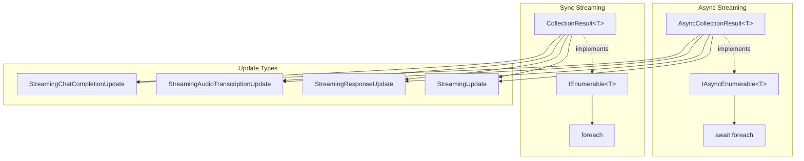
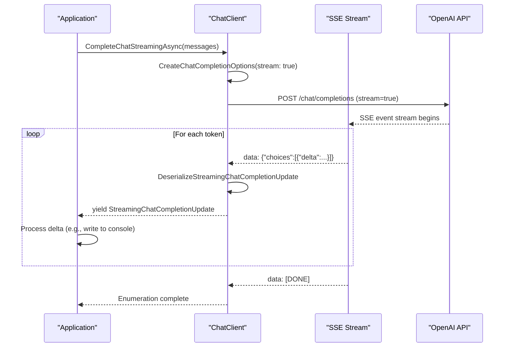
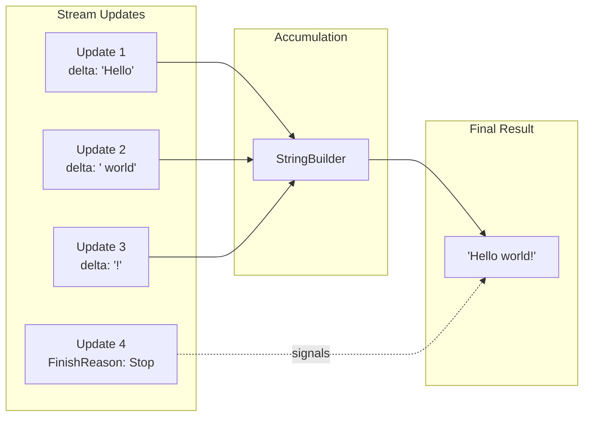
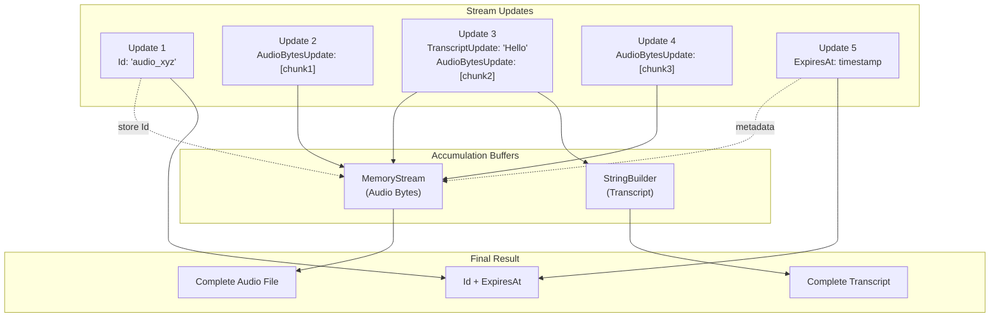
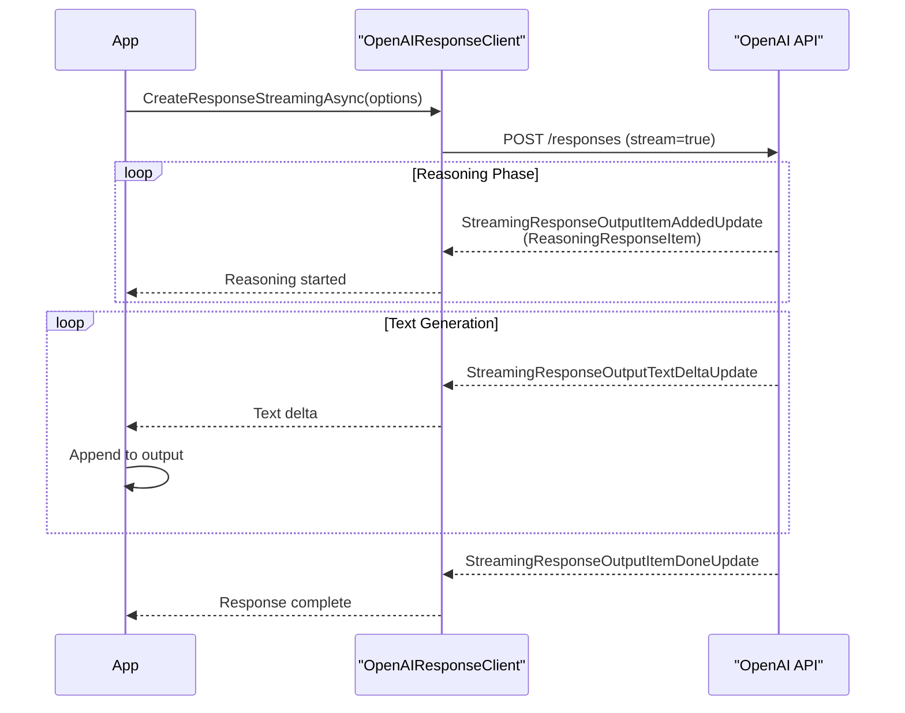
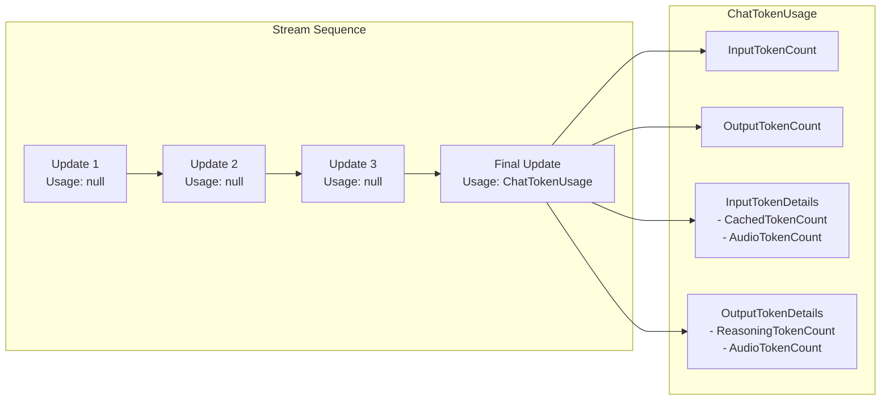
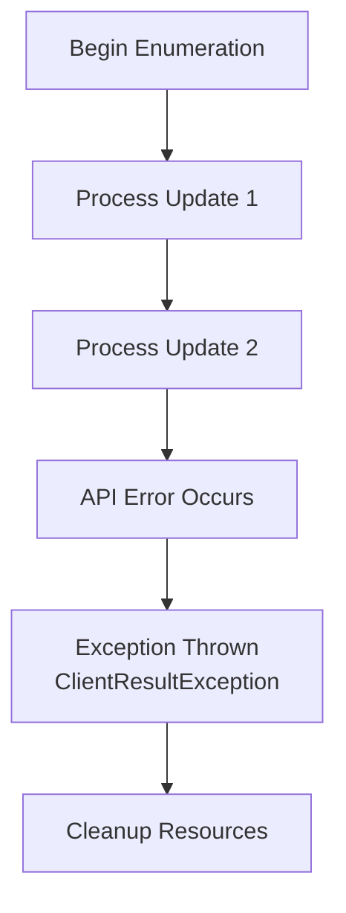

<!-- source: DeepWiki mcp.deepwiki.com · repo openai/openai-dotnet · page 5.1 Streaming Patterns · fetched 2026-10-26 -->

# Streaming Patterns

Relevant source files

The following files were used as context for generating this wiki page:

- [CHANGELOG.md](CHANGELOG.md)
- [api/OpenAI.net8.0.cs](api/OpenAI.net8.0.cs)
- [api/OpenAI.netstandard2.0.cs](api/OpenAI.netstandard2.0.cs)
- [scripts/Test-ApiCompatibility.ps1](scripts/Test-ApiCompatibility.ps1)
- [src/Custom/Chat/ChatClient.cs](src/Custom/Chat/ChatClient.cs)
- [src/Custom/Chat/ChatCompletionOptions.cs](src/Custom/Chat/ChatCompletionOptions.cs)
- [src/Generated/Models/OpenAIContext.cs](src/Generated/Models/OpenAIContext.cs)
- [src/Generated/OpenAIModelFactory.cs](src/Generated/OpenAIModelFactory.cs)
- [src/OpenAI.csproj](src/OpenAI.csproj)
- [tests/Chat/ChatTests.cs](tests/Chat/ChatTests.cs)
- [tests/Responses/ResponsesTests.cs](tests/Responses/ResponsesTests.cs)
- [tests/SessionRecords/ChatTests/ChatServiceTierWorks.json](tests/SessionRecords/ChatTests/ChatServiceTierWorks.json)
- [tests/SessionRecords/ChatTests/ChatServiceTierWorksAsync.json](tests/SessionRecords/ChatTests/ChatServiceTierWorksAsync.json)
- [tests/SessionRecords/ChatTests/StructuredRefusalWorks.json](tests/SessionRecords/ChatTests/StructuredRefusalWorks.json)
- [tests/SessionRecords/ChatTests/StructuredRefusalWorksAsync.json](tests/SessionRecords/ChatTests/StructuredRefusalWorksAsync.json)
- [tests/SessionRecords/ChatTests/ValidateConcurrency.json](tests/SessionRecords/ChatTests/ValidateConcurrency.json)
- [tests/SessionRecords/ChatTests/ValidateConcurrencyAsync.json](tests/SessionRecords/ChatTests/ValidateConcurrencyAsync.json)
- [tests/SessionRecords/ChatTests/WebSearchWorks.json](tests/SessionRecords/ChatTests/WebSearchWorks.json)
- [tests/SessionRecords/ChatTests/WebSearchWorksAsync.json](tests/SessionRecords/ChatTests/WebSearchWorksAsync.json)
- [tests/SessionRecords/ResponsesTests/WebSearchCallStreaming.json](tests/SessionRecords/ResponsesTests/WebSearchCallStreaming.json)
- [tests/SessionRecords/ResponsesTests/WebSearchCallStreamingAsync.json](tests/SessionRecords/ResponsesTests/WebSearchCallStreamingAsync.json)
- [tspCodeModel.json](tspCodeModel.json)

This document describes the streaming patterns used throughout the OpenAI .NET SDK for receiving incremental results from API operations. Streaming enables applications to process partial responses as they arrive, rather than waiting for complete responses.

For information about pagination patterns for list operations, see [Pagination and Collection Results](#5.4). For state management and continuation patterns, see [State Management and Persistence](#5.5).

## Overview

The SDK implements streaming using **Server-Sent Events (SSE)** as the underlying protocol. Streaming is available for several operations:

| Client | Streaming Method | Update Type |
|--------|-----------------|-------------|
| `ChatClient` | `CompleteChatStreamingAsync` / `CompleteChatStreaming` | `StreamingChatCompletionUpdate` |
| `AudioClient` | `TranscribeAudioStreamingAsync` / `TranscribeAudioStreaming` | `StreamingAudioTranscriptionUpdate` |
| `OpenAIResponseClient` | `CreateResponseStreamingAsync` / `GetResponseStreamingAsync` | `StreamingResponseUpdate` |
| `AssistantClient` | `CreateRunStreamingAsync` | `StreamingUpdate` |

All streaming operations follow a consistent pattern: they return a collection result that can be enumerated to process incremental updates.

**Sources:** [src/Custom/Chat/ChatClient.cs:218-307](), [src/Custom/Audio/AudioClient.cs:176-326](), [README.md:184-220]()

## Core Streaming Types

### Collection Result Types

The SDK provides two primary collection types for streaming results:

**`AsyncCollectionResult<T>`**: Implements `IAsyncEnumerable<T>`, allowing enumeration with `await foreach`. Used for asynchronous streaming operations.

**`CollectionResult<T>`**: Implements `IEnumerable<T>`, allowing enumeration with `foreach`. Used for synchronous streaming operations.

Both types encapsulate the underlying SSE stream and handle deserialization of individual events into strongly-typed update objects.

**Sources:** [src/Custom/Chat/ChatClient.cs:222-233](), [src/Custom/Chat/ChatClient.cs:267-279]()

## Chat Streaming Pattern

### Basic Usage

The `ChatClient` provides streaming through two method pairs:

The streaming methods automatically configure the request with `stream: true` and include `stream_options` to receive usage information:

- [src/Custom/Chat/ChatClient.cs:245]() sets `stream: true`
- [src/Custom/Chat/ChatClient.cs:26]() defines `s_includeUsageStreamOptions` with `includeUsage: true`

**Sources:** [src/Custom/Chat/ChatClient.cs:230-252](), [README.md:184-220](), [examples/Chat/Example02_SimpleChatStreaming.cs:1-27]()

### StreamingChatCompletionUpdate Structure

Each `StreamingChatCompletionUpdate` provides incremental information:

| Property | Type | Description |
|----------|------|-------------|
| `ContentUpdate` | `IReadOnlyList<ChatMessageContentPart>` | Text deltas for the response content |
| `ToolCallUpdates` | `IReadOnlyList<StreamingChatToolCallUpdate>` | Tool call updates if function calling is active |
| `FinishReason` | `ChatFinishReason?` | Present in final update; indicates why generation stopped |
| `Usage` | `ChatTokenUsage?` | Present in final update; provides token usage statistics |
| `OutputAudioUpdate` | `StreamingChatOutputAudioUpdate?` | Audio output deltas (for audio-enabled models) |

**Sources:** [tests/Chat/ChatTests.cs:69-99](), [README.md:487-493]()

### Delta Accumulation Pattern

For text content, applications typically accumulate deltas:

Example pattern:

1. Initialize an accumulator (e.g., `StringBuilder`)
2. For each `StreamingChatCompletionUpdate`, append `ContentUpdate[0].Text`
3. When `FinishReason` is present, streaming is complete

**Sources:** [examples/Chat/Example02_SimpleChatStreaming.cs:15-24](), [tests/Chat/ChatTests.cs:69-99]()

## Audio Streaming Patterns

### Audio Transcription Streaming

The `AudioClient` supports streaming for transcription operations:

- `TranscribeAudioStreamingAsync` returns `AsyncCollectionResult<StreamingAudioTranscriptionUpdate>`
- `TranscribeAudioStreaming` returns `CollectionResult<StreamingAudioTranscriptionUpdate>`

The service must be the `whisper-1` model or newer. Note that `whisper-1` does not support streaming and the client will throw an exception if attempted (checked at [src/Custom/Audio/AudioClient.cs:206-220]()).

**Sources:** [src/Custom/Audio/AudioClient.cs:176-326](), [CHANGELOG.md:247-255]()

### Audio Output Streaming (Chat)

For audio-enabled chat models (e.g., `gpt-4o-audio-preview`), streaming audio output is more complex because audio data arrives incrementally:

Key properties of `StreamingChatOutputAudioUpdate`:

| Property | Occurrence | Purpose |
|----------|-----------|---------|
| `Id` | Early updates, may repeat | Audio correlation ID for referencing in subsequent messages |
| `AudioBytesUpdate` | Multiple updates | Incremental audio bytes to append |
| `TranscriptUpdate` | Multiple updates | Incremental transcript text to append |
| `ExpiresAt` | Final update | Timestamp when the audio ID becomes invalid |

**Sources:** [tests/Chat/ChatTests.cs:142-190](), [README.md:487-493](), [tests/Chat/ChatTests.cs:240-279]()

## Response API Streaming

The `OpenAIResponseClient` supports streaming for complex multi-step reasoning:

The `StreamingResponseUpdate` hierarchy includes specialized update types:

- `StreamingResponseOutputItemAddedUpdate` - New output item begins (e.g., reasoning, message, tool call)
- `StreamingResponseOutputTextDeltaUpdate` - Text content delta
- `StreamingResponseFunctionCallArgumentsDeltaUpdate` - Function arguments delta
- `StreamingResponseOutputItemDoneUpdate` - Output item complete

**Sources:** [README.md:494-537](), [CHANGELOG.md:98-141]()

## Usage Tracking in Streams

### Chat Streaming Usage

Token usage information is provided in the **final** streaming update when `StreamOptions` includes usage (automatically set by the SDK):

The usage information is available via the `Usage` property which is `null` for all updates except the final one. Test validation at [tests/Chat/ChatTests.cs:87-98]() confirms this behavior.

**Sources:** [tests/Chat/ChatTests.cs:69-99](), [tests/Chat/ChatTests.cs:276-279](), [CHANGELOG.md:483-489]()

## Error Handling in Streams

### Exception Propagation

Exceptions during streaming enumeration are thrown when the error occurs in the stream:

Applications should wrap streaming enumeration in try-catch blocks to handle errors such as:

- **Authentication failures** (`ClientResultException` with `Status == 401`)
- **Network errors** (socket exceptions during enumeration)
- **API errors** (rate limits, model errors, etc.)

**Sources:** [tests/Chat/ChatSmokeTests.cs:104-124](), [tests/Chat/ChatTests.cs:283-301]()

### Stream Cancellation

Streaming operations respect `CancellationToken` parameters:

1. Pass `CancellationToken` to the streaming method
2. The token is included in the `RequestOptions` ([src/Custom/Chat/ChatClient.cs:232]())
3. Cancellation stops enumeration and disposes resources

**Sources:** [src/Custom/Chat/ChatClient.cs:230-233](), [src/Custom/Audio/AudioClient.cs:176-326]()

## Internal Stream Implementation

### SSE Infrastructure

The SDK uses two internal classes to implement SSE streaming:

**`AsyncSseUpdateCollection<T>`**: Handles asynchronous SSE streams
- Created at [src/Custom/Chat/ChatClient.cs:248-251]()
- Receives a factory function to create the HTTP request
- Receives a deserialization function to convert SSE events to typed updates
- Implements `IAsyncEnumerable<T>` for `await foreach` support

**`SseUpdateCollection<T>`**: Handles synchronous SSE streams
- Created at [src/Custom/Chat/ChatClient.cs:275-278]()
- Similar structure to async version but for synchronous enumeration

Both classes handle:
- Parsing SSE event format (`data:` lines)
- Detecting stream completion (`[DONE]` marker)
- Deserializing JSON payloads into update objects
- Resource disposal

**Sources:** [src/Custom/Chat/ChatClient.cs:248-251](), [src/Custom/Chat/ChatClient.cs:275-278]()

## Best Practices

### Buffered vs Unbuffered Responses

When calling streaming methods, the SDK automatically sets `BufferResponse = false` in the `RequestOptions`:

- Non-streaming methods require `BufferResponse = true` (asserted at [src/Custom/Chat/ChatClient.cs:148-151]())
- Streaming methods require `BufferResponse = false` (asserted at [src/Custom/Chat/ChatClient.cs:239-242]())

This ensures responses are processed incrementally rather than buffered in memory.

### Accumulation Strategies

Different content types require different accumulation strategies:

| Content Type | Accumulator | Example |
|--------------|-------------|---------|
| Text | `StringBuilder` | Chat text deltas |
| Audio bytes | `MemoryStream` | Audio output streaming |
| Transcript | `StringBuilder` | Audio transcription |
| Tool calls | `List<ChatToolCall>` | Function calling results |

### Timing Considerations

Streaming provides lower **time-to-first-token** compared to non-streaming:

- First update typically arrives within milliseconds
- Non-streaming waits for complete generation (can be seconds)
- Test at [tests/Chat/ChatTests.cs:76-94]() validates timing with `Stopwatch`

Applications requiring responsive UX should prefer streaming.

**Sources:** [tests/Chat/ChatTests.cs:76-94](), [examples/Chat/Example02_SimpleChatStreaming.cs:1-27]()

---

